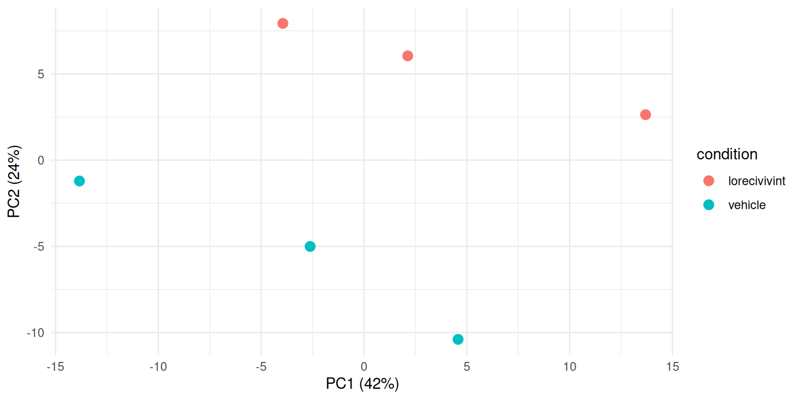
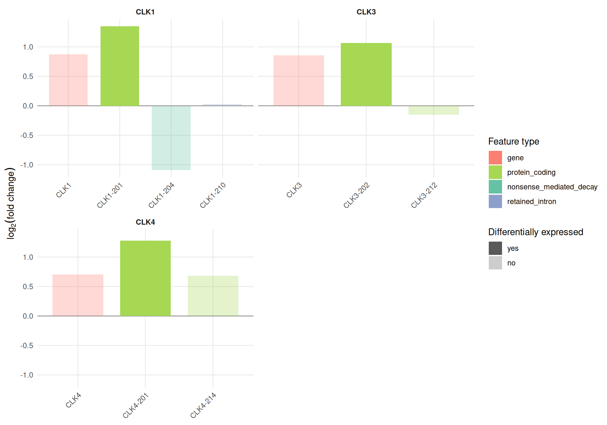
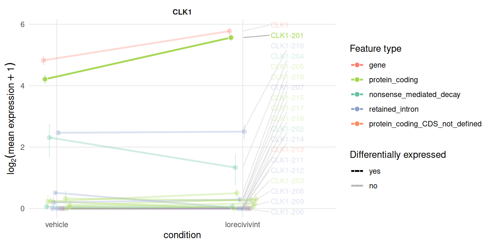
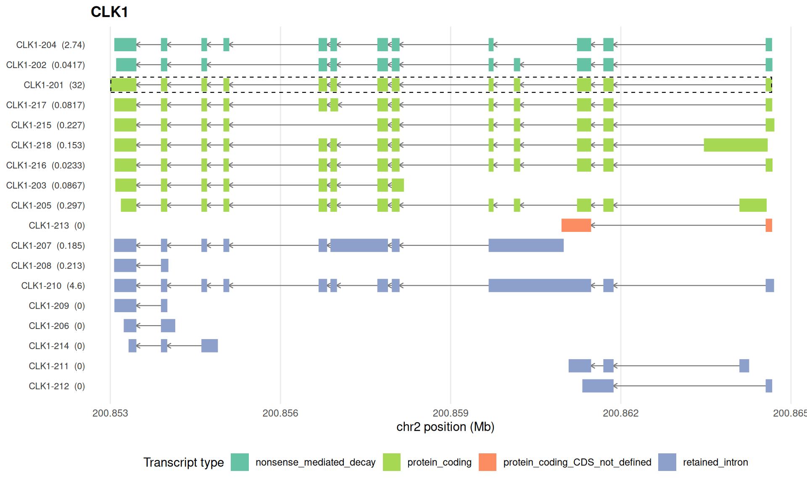
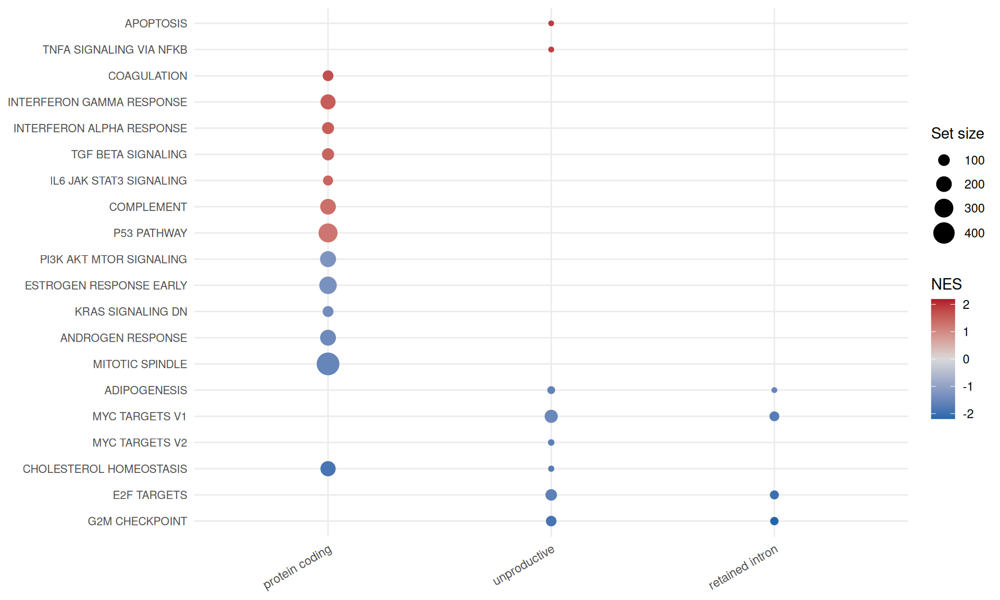

# Case study: a splicing kinase inhibitor in nanopore long reads

This article applies `isoformic` to Oxford Nanopore long-read cDNA
sequencing of 22Rv1 prostate cancer cells treated with lorecivivint, an
inhibitor of the CDC-like kinases (CLKs) that phosphorylate splicing
factors, against vehicle-treated cells \[Van Goubergen et al.
([2024](#ref-vangoubergen2024)); GEO
[GSE259334](https://www.ncbi.nlm.nih.gov/geo/query/acc.cgi?acc=GSE259334)\].
Long reads often span a transcript from end to end, so they assign reads
to isoforms with less ambiguity than short reads. The analysis is the
same as for short reads; only the quantification step changes.

## The data

The 6 samples (3 vehicle, 3 lorecivivint) were quantified with Oarfish
([Jousheghani et al. 2025](#ref-oarfish)) against the GENCODE v49
transcripts ([Frankish et al. 2018](#ref-gencode)) in its nanopore cDNA
mode, with 30 bootstrap replicates per sample; each sample has 6.3 to
7.0 million reads assigned to transcripts. Transcripts were tested with
`swish` ([Zhu et al. 2019](#ref-swish)) on the bootstrap replicates and
genes with `DESeq2` on the summed counts. The scripts that download the
reads from SRA and run every step are in `data-raw/case_studies/` of the
package repository.

The result is an `IsoformicExperiment` saved with
[`write_isoformic()`](https://luciorq.github.io/isoformic/reference/isoformic-io.md).
It keeps the complete differential expression tables (every tested
transcript and gene) but the expression assays and exon structures only
of a panel of 48 genes, so that it fits in the repository; it is not
installed with the package.
[`read_oarfish()`](https://luciorq.github.io/isoformic/reference/read_oarfish.md)
creates the same object from the Oarfish output directly, as shown in
the [preprocessing
article](https://luciorq.github.io/isoformic/articles/isoformic-preprocess.md).

``` r

library(isoformic)
library(dplyr)
library(ggplot2)

data_dir <- "data/prostate_ont"
iso <- read_isoformic(data_dir)
iso
#> <IsoformicExperiment> prostate_ont
#>   annotation : gencode_v49_chr_patch_hapl_scaff_annotation_gff3_case_study_subset (14,050 genes, 280,285 transcripts, 8,729 exons)
#>   samples    : 6 [condition, replicate, run]
#>   transcripts: 1,383 assayed from 48 genes
#>   assays     : abundance, counts
#>   gene assays: derived from transcript assays on demand
#>   DE results : det (27,934 transcripts), deg (14,050 genes)
#>   on disk    : /home/runner/work/isoformic/isoformic/vignettes/articles/data/prostate_ont
col_data(iso)
#> # A tibble: 6 × 4
#>   sample_id      condition    replicate run        
#>   <chr>          <chr>            <int> <chr>      
#> 1 vehicle_1      vehicle              1 SRR28114375
#> 2 vehicle_2      vehicle              2 SRR28114374
#> 3 vehicle_3      vehicle              3 SRR28114373
#> 4 lorecivivint_4 lorecivivint         4 SRR28114372
#> 5 lorecivivint_5 lorecivivint         5 SRR28114371
#> 6 lorecivivint_6 lorecivivint         6 SRR28114370
iso@metadata[c("quantification", "transcript_de", "gene_de")]
#> $quantification
#> [1] "Oarfish 0.11.0 (--seq-tech ont-cdna) against GENCODE v49 transcripts, 30 bootstrap replicates"
#> 
#> $transcript_de
#> [1] "swish (fishpond), 30 inferential replicates"
#> 
#> $gene_de
#> [1] "DESeq2, apeglm-shrunken log2 fold changes"
```

## Checking the samples first

The first principal component of the gene-level counts does not separate
the treatments, but the second one does. With three samples per group
there is no sign of a batch to adjust for.

``` r

pca <- read_parquet(fs::path(data_dir, "sample_pca.parquet")) |>
  left_join(col_data(iso), by = "sample_id")
ggplot(pca, aes(PC1, PC2, color = condition)) +
  geom_point(size = 3) +
  labs(
    x = sprintf("PC1 (%.0f%%)", 100 * pca$var_PC1[1]),
    y = sprintf("PC2 (%.0f%%)", 100 * pca$var_PC2[1])
  ) +
  theme_minimal()
```



## Differential expression at two levels

``` r

deg <- de_gene(iso)
det <- de_tx(iso)
c(
  genes_tested = nrow(deg),
  genes_fdr_5 = sum(deg$qvalue < 0.05, na.rm = TRUE),
  transcripts_tested = nrow(det),
  transcripts_fdr_5 = sum(det$qvalue < 0.05, na.rm = TRUE)
)
#>       genes_tested        genes_fdr_5 transcripts_tested  transcripts_fdr_5 
#>              14050                140              27934                287
```

At a false discovery rate of 5%, `DESeq2` finds 140 genes and `swish`
287 transcripts. `swish` computes its p-values from permutations of the
samples, and three against three samples allow only a few distinct
permutations: all 287 significant transcripts share the smallest
q-value, so they are ranked by fold change below.

``` r

range(det$qvalue[det$qvalue < 0.05], na.rm = TRUE)
#> [1] 3.484321e-05 3.484321e-05
```

Most significant transcripts are protein coding, followed by lncRNAs:

``` r

det |>
  filter(qvalue < 0.05) |>
  left_join(tx_annot(iso), by = "transcript_id") |>
  count(transcript_type, sort = TRUE)
#> # A tibble: 6 × 2
#>   transcript_type                    n
#>   <chr>                          <int>
#> 1 protein_coding                   251
#> 2 lncRNA                            21
#> 3 nonsense_mediated_decay            7
#> 4 retained_intron                    5
#> 5 protein_coding_CDS_not_defined     2
#> 6 artifact                           1
```

[`isoform_switches()`](https://luciorq.github.io/isoformic/reference/diversity.md)
relates the two levels with the default cutoffs of the experiment (an
absolute log2 fold change of at least 1 and a false discovery rate below
5%). Two thirds of the genes with a significant transcript have no
significant change of their total expression (`det_not_deg`).

``` r

switches <- isoform_switches(iso)
table(switches$switch_type)
#> 
#>  consistent det_not_deg 
#>          22          42
switches |>
  filter(switch_type == "det_not_deg") |>
  select(gene_name, n_tx_tested, n_det_up, n_det_down, det_sig_types, gene_log2FC) |>
  head(10)
#> # A tibble: 10 × 6
#>    gene_name n_tx_tested n_det_up n_det_down det_sig_types           gene_log2FC
#>    <chr>           <int>    <int>      <int> <chr>                         <dbl>
#>  1 SNHG29             21        4          0 lncRNA                     0.0448  
#>  2 RPL28               9        2          0 protein_coding;retaine…    0.00862 
#>  3 SELENBP1            9        2          0 protein_coding             0.537   
#>  4 CXorf38             2        1          0 protein_coding             0.0713  
#>  5 RPL37A              5        1          0 protein_coding            -0.000110
#>  6 PART1               3        1          0 lncRNA                     0.136   
#>  7 ADRA2A              1        0          1 protein_coding            -0.0313  
#>  8 C5                  5        0          1 protein_coding            -0.864   
#>  9 GSTA4               4        1          0 protein_coding             0.339   
#> 10 LGR5                1        0          1 protein_coding            -0.0492
```

## The CLK genes regulate themselves

The CLK genes are among them: lorecivivint raises one protein coding
isoform each of *CLK1*, *CLK3* and *CLK4*.

``` r

plot_log2fc(iso, feature = c("CLK1", "CLK3", "CLK4"), ncol = 2)
```



The gene-level results show why the classification needs care. *CLK1*
and *CLK3* are significant in `DESeq2`, but their shrunken fold changes
(1.8-fold) are below the cutoff of 2-fold, so
[`isoform_switches()`](https://luciorq.github.io/isoformic/reference/diversity.md)
does not count them as changed genes:

``` r

deg |>
  left_join(annot_data_genes(iso)[c("gene_id", "gene_name")], by = "gene_id") |>
  filter(gene_name %in% c("CLK1", "CLK3", "CLK4")) |>
  select(gene_name, log2FC, qvalue, deg_sig)
#> # A tibble: 3 × 4
#>   gene_name log2FC      qvalue deg_sig
#>   <chr>      <dbl>       <dbl> <chr>  
#> 1 CLK1       0.873 0.000000274 no     
#> 2 CLK3       0.858 0.0000568   no     
#> 3 CLK4       0.707 0.0598      no
```

The isoforms of *CLK1* explain most of its gene-level change. `CLK1-201`
encodes the full-length kinase; `CLK1-204` is the same transcript
without exon 4, which shifts the reading frame and makes it a target of
nonsense-mediated decay; `CLK1-210` keeps the introns on both sides of
exon 4. CLK1 activity favours the skipping of its own exon 4, and CLK
inhibitors shift the balance towards the full-length isoform ([Uzor et
al. 2018](#ref-uzor2018)). The long reads show that shift: the
full-length isoform rises from about 17 to 46 transcripts per million
while the skipped one falls from about 4 to 1.5 (not significant on its
own, with q = 0.25).

``` r

plot_tx_expr(iso, gene_name = "CLK1", group = "condition")
```



``` r

plot_genomic_context(iso, gene_name = "CLK1")
```



## The genes of the original study

Van Goubergen et al. ([2024](#ref-vangoubergen2024)) report that CLK
inhibition lowers the expression of the androgen receptor splice variant
ARV7 through the CLK2/SRSF9 axis. In these three against three nanopore
samples, no transcript of *AR*, *CLK2* or *SRSF9* reaches a false
discovery rate of 5%; *SRSF3* has one protein coding isoform with a
small but significant decrease.

``` r

det |>
  left_join(tx_annot(iso), by = "transcript_id") |>
  filter(gene_name %in% c("AR", "CLK2", "SRSF9", "SRSF3")) |>
  summarise(
    n_tested = n(),
    best_qvalue = min(qvalue),
    log2FC_of_best = log2FC[which.min(qvalue)],
    .by = gene_name
  )
#> # A tibble: 4 × 4
#>   gene_name n_tested best_qvalue log2FC_of_best
#>   <chr>        <int>       <dbl>          <dbl>
#> 1 CLK2             3   0.363              1.24 
#> 2 SRSF9            3   0.642             -0.841
#> 3 SRSF3            7   0.0000348         -0.266
#> 4 AR               4   0.266             -0.390
```

## Enrichment by transcript type

The package directory holds the hallmark gene sets of MSigDB ([Liberzon
et al. 2015](#ref-msigdb)).
[`run_enrichment()`](https://luciorq.github.io/isoformic/reference/enrichment.md)
ranks the transcripts by fold change and runs the enrichment separately
for each group of transcript types.

``` r

genesets <- read_gmt(fs::path(data_dir, "genesets.gmt"))
set.seed(42)
enrichment <- run_enrichment(iso, genesets, pval_cutoff = 0.05)
table(enrichment$experiment)
#> 
#>  protein_coding retained_intron    unproductive 
#>              13               4               9
```

``` r

plot_enrichment(enrichment, n = 20)
```



The androgen response, cholesterol homeostasis and mitotic spindle genes
go down in the protein coding isoforms of the treated cells, in line
with the anti-proliferative effect of lorecivivint reported by Van
Goubergen et al. ([2024](#ref-vangoubergen2024)). The proliferation sets
(G2M checkpoint, E2F and MYC targets) go down in the retained intron and
other unproductive isoforms, but not in the protein coding ones: a part
of the response to the drug that only the transcript-level analysis
shows.

## Citing isoformic

If you use `isoformic` in publications, please cite Mamede et al.
([2025](#ref-isoformic)); `citation("isoformic")` prints the reference.

## Session information

``` r

sessionInfo()
#> R version 4.6.2 (2026-10-29)
#> Platform: x86_64-pc-linux-gnu
#> Running under: Ubuntu 26.04.1 LTS
#> 
#> Matrix products: default
#> BLAS:   /usr/lib/x86_64-linux-gnu/openblas-pthread/libblas.so.3 
#> LAPACK: /usr/lib/x86_64-linux-gnu/openblas-pthread/libopenblasp-r0.3.32.so;  LAPACK version 3.12.0
#> 
#> locale:
#>  [1] LC_CTYPE=C.UTF-8       LC_NUMERIC=C           LC_TIME=C.UTF-8       
#>  [4] LC_COLLATE=C.UTF-8     LC_MONETARY=C.UTF-8    LC_MESSAGES=C.UTF-8   
#>  [7] LC_PAPER=C.UTF-8       LC_NAME=C              LC_ADDRESS=C          
#> [10] LC_TELEPHONE=C         LC_MEASUREMENT=C.UTF-8 LC_IDENTIFICATION=C   
#> 
#> time zone: UTC
#> tzcode source: system (glibc)
#> 
#> attached base packages:
#> [1] stats     graphics  grDevices utils     datasets  methods   base     
#> 
#> other attached packages:
#> [1] ggplot2_4.0.3   dplyr_1.2.1     isoformic_0.1.3
#> 
#> loaded via a namespace (and not attached):
#>  [1] Matrix_1.7-6        gtable_0.3.6        jsonlite_2.0.0     
#>  [4] compiler_4.6.2      Rcpp_1.1.2          tidyselect_1.2.1   
#>  [7] parallel_4.6.2      scales_1.4.0        BiocParallel_1.46.0
#> [10] yaml_2.3.12         fastmap_1.2.0       lattice_0.23-1     
#> [13] R6_2.6.1            labeling_0.4.3      generics_0.1.4     
#> [16] knitr_1.52          ggrepel_0.9.8       tibble_3.3.1       
#> [19] DBI_1.3.0           pillar_1.11.1       RColorBrewer_1.1-3 
#> [22] rlang_1.3.0         fastmatch_1.1-8     utf8_1.2.6         
#> [25] xfun_0.62           fs_2.1.0            S7_0.2.2           
#> [28] otel_0.3.0          cli_3.6.6           withr_3.0.3        
#> [31] magrittr_2.0.5      digest_0.6.39       grid_4.6.2         
#> [34] fgsea_1.38.0        cowplot_1.2.0       lifecycle_1.0.5    
#> [37] vctrs_0.7.3         data.table_1.18.6.1 evaluate_1.0.5     
#> [40] glue_1.8.1          farver_2.1.2        duckdb_2.0.0       
#> [43] codetools_0.2-20    rmarkdown_2.32      tools_4.6.2        
#> [46] pkgconfig_2.0.3     htmltools_0.5.9
```

## References

Frankish, A, GENCODE-consoritum, and P Flicek. 2018. “GENCODE reference
annotation for the human and mouse genomes.” *Nucleic Acids Research*,
ahead of print. <https://doi.org/10.1093/nar/gky955>.

Jousheghani, Zahra Zare, Noor Pratap Singh, and Rob Patro. 2025.
“Oarfish: Enhanced Probabilistic Modeling Leads to Improved Accuracy in
Long Read Transcriptome Quantification.” *Bioinformatics* 41
(Supplement_1): i304–13.
<https://doi.org/10.1093/bioinformatics/btaf240>.

Liberzon, Arthur, Chet Birger, Helga Thorvaldsdóttir, Mahmoud Ghandi,
Jill P. Mesirov, and Pablo Tamayo. 2015. “The Molecular Signatures
Database (MSigDB) Hallmark Gene Set Collection.” *Cell Systems* 1 (6):
417–25. <https://doi.org/10.1016/j.cels.2015.12.004>.

Mamede, Izabela, Lucio R. Queiroz, Carlos Mata-Machado, et al. 2025.
“Isoformic: A Workflow for Transcript-Level RNA-seq Interpretation.”
*NAR Genomics and Bioinformatics* 7 (4): lqaf176.
<https://doi.org/10.1093/nargab/lqaf176>.

Uzor, Simon, Panagiota Zorzou, Elizabeth Bowler, Sean Porazinski, Ian
Wilson, and Michael Ladomery. 2018. “Autoregulation of the Human Splice
Factor Kinase CLK1 Through Exon Skipping and Intron Retention.” *Gene*
670: 46–54. <https://doi.org/10.1016/j.gene.2018.05.095>.

Van Goubergen, Jasper, Miroslav Peřina, Florian Handle, et al. 2024.
“Targeting the CLK2/SRSF9 Splicing Axis in Prostate Cancer Leads to
Decreased ARV7 Expression.” *Molecular Oncology* 19 (2): 496–518.
<https://doi.org/10.1002/1878-0261.13728>.

Zhu, A, A Srivastava, JG Ibrahim, R Patro, and MI Love. 2019.
“Nonparametric expression analysis using inferential replicate counts.”
*Nucleic Acids Research* 47: e105. <https://doi.org/10.1093/nar/gkz622>.
