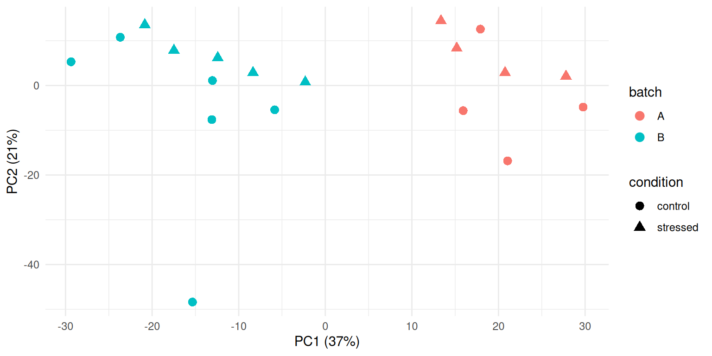
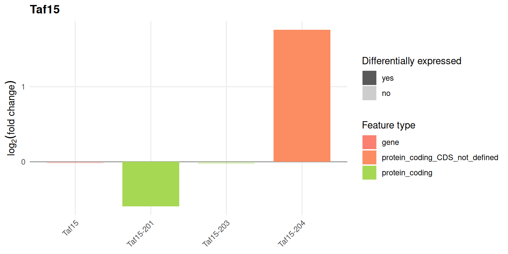
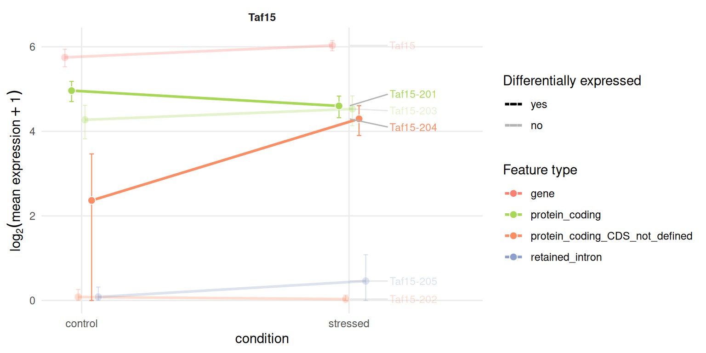
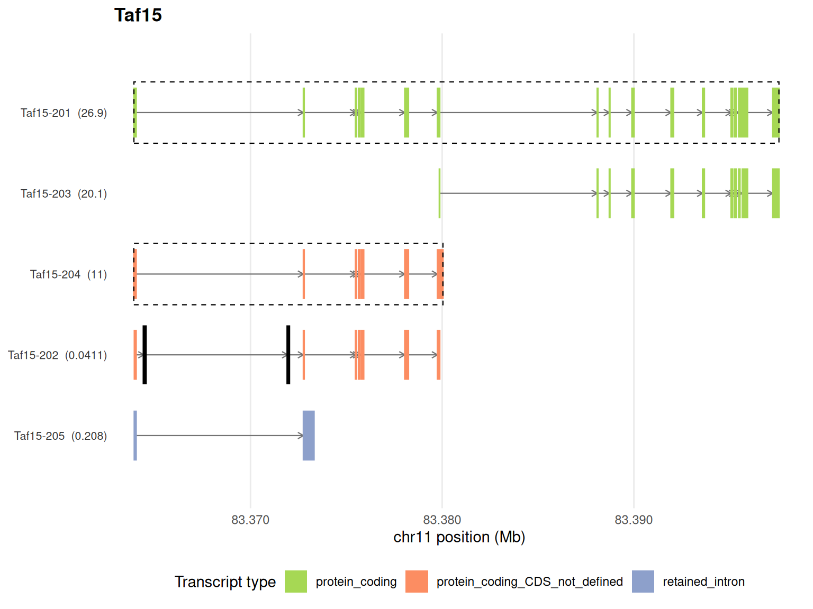
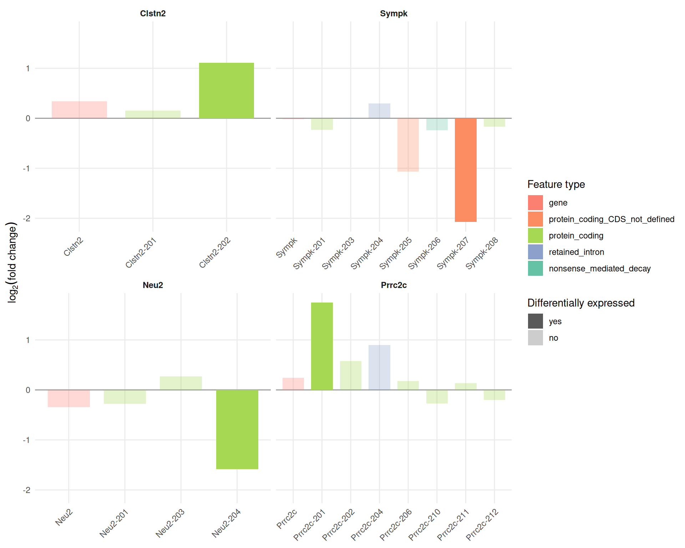
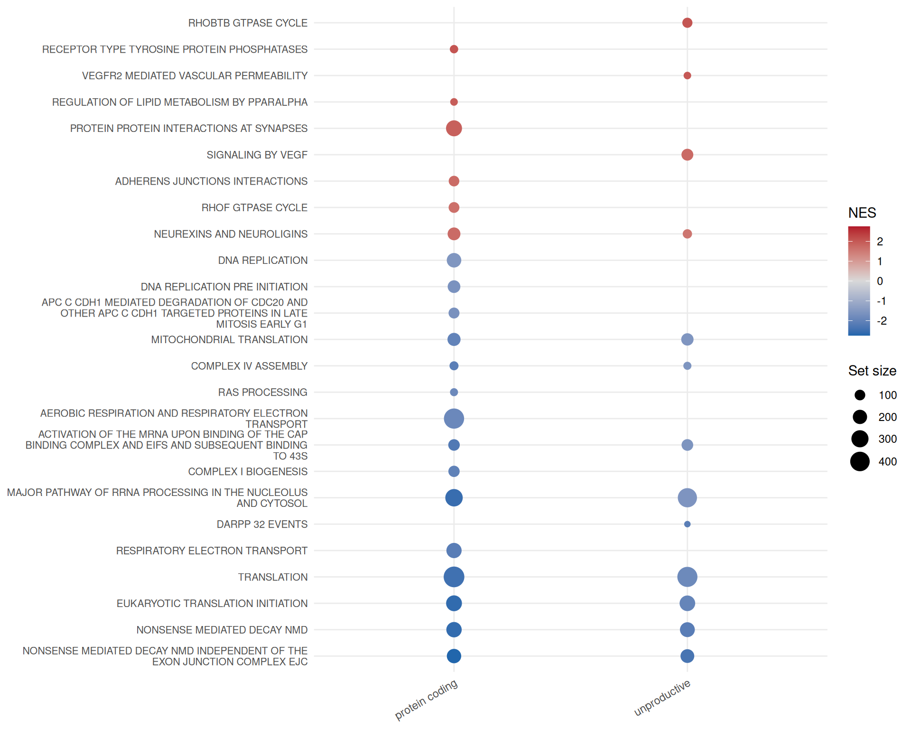

# Case study: chronic stress in the mouse brain

This article applies `isoformic` to a complete public dataset: bulk
RNA-seq of the anterodorsal bed nucleus of the stria terminalis (adBNST)
of male mice after six weeks of chronic variable mild stress, against
unstressed controls \[Degroat et al. ([2024](#ref-degroat2024));
BioProject
[PRJNA984605](https://www.ncbi.nlm.nih.gov/bioproject/PRJNA984605)\]. It
shows a common outcome of transcript-level analysis: stress leaves the
expression of genes almost unchanged, but changes which of their
isoforms are expressed.

## The data

The 19 male samples (10 control, 9 stressed) were quantified with Salmon
([Patro et al. 2017](#ref-salmon)) against the GENCODE vM38 transcripts
([Frankish et al. 2018](#ref-gencode)), with the GRCm39 genome as decoy
and 30 Gibbs draws per sample. Transcripts were tested with `swish`
([Zhu et al. 2019](#ref-swish)) on the inferential replicates and genes
with `DESeq2` on the summed counts. The scripts that download the reads
from SRA and run every step are in `data-raw/case_studies/` of the
package repository.

The result is an `IsoformicExperiment` saved with
[`write_isoformic()`](https://luciorq.github.io/isoformic/reference/isoformic-io.md).
It keeps the complete differential expression tables (every tested
transcript and gene) but the expression assays and exon structures only
of a panel of 47 genes, so that it fits in the repository; it is not
installed with the package.

``` r

library(isoformic)
library(dplyr)
library(ggplot2)

data_dir <- "data/mouse_bnst"
iso <- read_isoformic(data_dir)
iso
#> <IsoformicExperiment> mouse_bnst
#>   annotation : gencode_vm38_chr_patch_hapl_scaff_annotation_gff3_case_study_subset (20,720 genes, 135,433 transcripts, 4,443 exons)
#>   samples    : 19 [condition, batch, replicate, run]
#>   transcripts: 538 assayed from 47 genes
#>   assays     : abundance, counts
#>   gene assays: derived from transcript assays on demand
#>   DE results : det (58,661 transcripts), deg (20,720 genes)
#>   on disk    : /home/runner/work/isoformic/isoformic/vignettes/articles/data/mouse_bnst
col_data(iso)
#> # A tibble: 19 × 5
#>    sample_id  condition batch replicate run        
#>    <chr>      <chr>     <chr>     <int> <chr>      
#>  1 control_1  control   B             1 SRR24948951
#>  2 control_2  control   B             2 SRR24948952
#>  3 control_3  control   B             3 SRR24948953
#>  4 control_4  control   B             4 SRR24948954
#>  5 control_5  control   B             5 SRR24948955
#>  6 control_6  control   B             6 SRR24948940
#>  7 control_7  control   A             7 SRR24948935
#>  8 control_8  control   A             8 SRR24948931
#>  9 control_9  control   A             9 SRR24948925
#> 10 control_10 control   A            10 SRR24948928
#> 11 stressed_1 stressed  B             1 SRR24948948
#> 12 stressed_2 stressed  B             2 SRR24948949
#> 13 stressed_3 stressed  B             3 SRR24948950
#> 14 stressed_4 stressed  B             4 SRR24948943
#> 15 stressed_5 stressed  B             5 SRR24948942
#> 16 stressed_6 stressed  A             6 SRR24948930
#> 17 stressed_7 stressed  A             7 SRR24948929
#> 18 stressed_8 stressed  A             8 SRR24948932
#> 19 stressed_9 stressed  A             9 SRR24948927
```

## Checking the samples first

A principal component analysis of the gene-level counts shows that the
first component does not separate the conditions but two groups of
samples, one per range of SRA run accessions. The groups are not
annotated in GEO but are most likely two processing batches; they are
balanced between conditions (4 + 4 and 6 + 5 samples), so the tests can
adjust for them: `swish` stratifies its permutations by batch and
`DESeq2` uses the design `~ batch + condition`. Without the adjustment,
no transcript and no gene reaches a false discovery rate of 10%.

``` r

pca <- read_parquet(fs::path(data_dir, "sample_pca.parquet")) |>
  left_join(col_data(iso), by = "sample_id")
ggplot(pca, aes(PC1, PC2, color = batch, shape = condition)) +
  geom_point(size = 3) +
  labs(
    x = sprintf("PC1 (%.0f%%)", 100 * pca$var_PC1[1]),
    y = sprintf("PC2 (%.0f%%)", 100 * pca$var_PC2[1])
  ) +
  theme_minimal()
```



The sample far below the others on the second component (`control_3`)
has the smallest library (18.6 million read pairs) and the lowest
mapping rate (71%); it is kept in the analysis, but it is the first
sample to look at when a result depends on a single animal.

## Genes barely change, isoforms do

``` r

iso@metadata[c("transcript_de", "gene_de")]
#> $transcript_de
#> [1] "swish (fishpond), 30 inferential replicates, stratified by batch"
#> 
#> $gene_de
#> [1] "DESeq2, apeglm-shrunken log2 fold changes, design ~ batch + condition"
deg <- de_gene(iso)
det <- de_tx(iso)
c(
  genes_tested = nrow(deg),
  genes_fdr_5 = sum(deg$qvalue < 0.05, na.rm = TRUE),
  transcripts_tested = nrow(det),
  transcripts_fdr_5 = sum(det$qvalue < 0.05, na.rm = TRUE)
)
#>       genes_tested        genes_fdr_5 transcripts_tested  transcripts_fdr_5 
#>              20720                  4              58661                137
```

At a false discovery rate of 5%, `DESeq2` finds 4 genes and `swish` 137
transcripts. Many of the transcript changes are moderate, so this
article lowers the fold-change cutoff of the significance calls from the
default of 1 to 0.5 (a 1.4-fold change):

``` r

de_cutoffs(iso) <- list(log2fc = 0.5, pvalue = 0.05, use_fdr = TRUE)
```

The significant transcripts are not only protein coding isoforms: about
a third are retained intron, nonsense-mediated decay, other non-coding
isoforms of protein coding genes or lncRNAs.

``` r

det |>
  filter(qvalue < 0.05) |>
  left_join(tx_annot(iso), by = "transcript_id") |>
  count(transcript_type, sort = TRUE)
#> # A tibble: 6 × 2
#>   transcript_type                    n
#>   <chr>                          <int>
#> 1 protein_coding                    89
#> 2 retained_intron                   24
#> 3 protein_coding_CDS_not_defined    11
#> 4 nonsense_mediated_decay            7
#> 5 lncRNA                             4
#> 6 TEC                                2
```

[`isoform_switches()`](https://luciorq.github.io/isoformic/reference/diversity.md)
relates the two levels. Almost every gene with significant isoforms has
no significant change of its total expression (`det_not_deg`): a
gene-level analysis would miss all of them.

``` r

switches <- isoform_switches(iso)
table(switches$switch_type)
#> 
#>         consistent        det_not_deg opposite_direction 
#>                  1                 88                  1
switches |>
  select(gene_name, n_det_up, n_det_down, det_sig_types, gene_log2FC, switch_type) |>
  head(10)
#> # A tibble: 10 × 6
#>    gene_name n_det_up n_det_down det_sig_types           gene_log2FC switch_type
#>    <chr>        <int>      <int> <chr>                         <dbl> <chr>      
#>  1 Taf15            1          1 protein_coding;protein…    -0.0193  opposite_d…
#>  2 Atrx             2          0 retained_intron             0.0334  det_not_deg
#>  3 Rbm39            2          0 retained_intron             0.0315  det_not_deg
#>  4 Tspoap1          0          1 protein_coding              0.00976 det_not_deg
#>  5 Sympk            0          1 protein_coding_CDS_not…    -0.0210  det_not_deg
#>  6 Atp5f1b          0          1 protein_coding_CDS_not…    -0.0379  det_not_deg
#>  7 Ptk2b            0          1 protein_coding             -0.0238  det_not_deg
#>  8 Atp2a2           1          0 protein_coding              0.0266  det_not_deg
#>  9 Prrc2c           1          0 protein_coding              0.240   det_not_deg
#> 10 Sez6             0          1 nonsense_mediated_decay     0.00178 det_not_deg
```

## An isoform switch in *Taf15*

*Taf15* encodes an RNA-binding protein of the FET family. Its total
expression does not change, but its protein coding isoform `Taf15-201`
goes down while `Taf15-204`, a transcript without a coding sequence,
goes up: a switch from a productive to an unproductive isoform.

``` r

plot_log2fc(iso, feature = "Taf15")
```



The expression profile shows the same switch in transcripts per million:

``` r

plot_tx_expr(iso, gene_name = "Taf15", group = "condition")
```



and the genomic context shows the structures of the isoforms, with the
differentially expressed ones outlined:

``` r

plot_genomic_context(iso, gene_name = "Taf15")
```



## More genes with isoform-level changes

The other panel genes show the same pattern: one or two significant
isoforms in genes whose total does not move.

``` r

plot_log2fc(iso, feature = c("Clstn2", "Sympk", "Neu2", "Prrc2c"), ncol = 2)
```



The genes chosen for the first analysis of this dataset by the
`isoformic` authors (*Trip12*, *Meg3* and *Map4*) and classic stress
response genes such as *Fkbp5* and *Sgk1* do not reach a false discovery
rate of 5% once the batches are taken into account:

``` r

det |>
  left_join(tx_annot(iso), by = "transcript_id") |>
  filter(gene_name %in% c("Trip12", "Meg3", "Map4", "Fkbp5", "Sgk1")) |>
  summarise(best_qvalue = min(qvalue), .by = gene_name)
#> # A tibble: 5 × 2
#>   gene_name best_qvalue
#>   <chr>           <dbl>
#> 1 Meg3           0.0932
#> 2 Trip12         0.0516
#> 3 Sgk1           0.321 
#> 4 Map4           0.111 
#> 5 Fkbp5          0.313
```

## Enrichment by transcript type

The package directory holds the mouse Reactome pathways of MSigDB
([Liberzon et al. 2015](#ref-msigdb)) restricted to those with 15 to 500
tested genes.
[`run_enrichment()`](https://luciorq.github.io/isoformic/reference/enrichment.md)
ranks the transcripts by fold change and runs the enrichment separately
for the protein coding isoforms and for the unproductive ones.

``` r

genesets <- read_gmt(fs::path(data_dir, "genesets.gmt"))
set.seed(42)
enrichment <- run_enrichment(iso, genesets, pval_cutoff = 0.05)
table(enrichment$experiment)
#> 
#>        nonsense_mediated_decay                 protein_coding 
#>                             27                            132 
#> protein_coding_CDS_not_defined                retained_intron 
#>                             34                             77 
#>                   unproductive 
#>                            109
```

``` r

plot_enrichment(
  enrichment,
  n = 25,
  experiments = c("protein_coding", "unproductive"),
  nes_cutoff = 1.5
)
```



Translation, ribosome biogenesis and respiration pathways go down in the
protein coding isoforms of the stressed animals, while synaptic pathways
(protein interactions at synapses, neurexins and neuroligins,
transmission across chemical synapses) go up. The translation pathways
go down in the unproductive isoforms of the same genes as well. The
ribosomal protein genes also dominate the *nonsense-mediated decay*
pathways of Reactome, which is why those appear as well; that pathway
name describes the genes, not the transcript type.

## Citing isoformic

If you use `isoformic` in publications, please cite Mamede et al.
([2025](#ref-isoformic)); `citation("isoformic")` prints the reference.

## Session information

``` r

sessionInfo()
#> R version 4.6.2 (2026-10-29)
#> Platform: x86_64-pc-linux-gnu
#> Running under: Ubuntu 26.04.1 LTS
#> 
#> Matrix products: default
#> BLAS:   /usr/lib/x86_64-linux-gnu/openblas-pthread/libblas.so.3 
#> LAPACK: /usr/lib/x86_64-linux-gnu/openblas-pthread/libopenblasp-r0.3.32.so;  LAPACK version 3.12.0
#> 
#> locale:
#>  [1] LC_CTYPE=C.UTF-8       LC_NUMERIC=C           LC_TIME=C.UTF-8       
#>  [4] LC_COLLATE=C.UTF-8     LC_MONETARY=C.UTF-8    LC_MESSAGES=C.UTF-8   
#>  [7] LC_PAPER=C.UTF-8       LC_NAME=C              LC_ADDRESS=C          
#> [10] LC_TELEPHONE=C         LC_MEASUREMENT=C.UTF-8 LC_IDENTIFICATION=C   
#> 
#> time zone: UTC
#> tzcode source: system (glibc)
#> 
#> attached base packages:
#> [1] stats     graphics  grDevices utils     datasets  methods   base     
#> 
#> other attached packages:
#> [1] ggplot2_4.0.3   dplyr_1.2.1     isoformic_0.1.3
#> 
#> loaded via a namespace (and not attached):
#>  [1] Matrix_1.7-6        gtable_0.3.6        jsonlite_2.0.0     
#>  [4] compiler_4.6.2      Rcpp_1.1.2          tidyselect_1.2.1   
#>  [7] parallel_4.6.2      scales_1.4.0        BiocParallel_1.46.0
#> [10] yaml_2.3.12         fastmap_1.2.0       lattice_0.23-1     
#> [13] R6_2.6.1            labeling_0.4.3      generics_0.1.4     
#> [16] knitr_1.52          ggrepel_0.9.8       tibble_3.3.1       
#> [19] DBI_1.3.0           pillar_1.11.1       RColorBrewer_1.1-3 
#> [22] rlang_1.3.0         fastmatch_1.1-8     utf8_1.2.6         
#> [25] xfun_0.62           fs_2.1.0            S7_0.2.2           
#> [28] otel_0.3.0          cli_3.6.6           withr_3.0.3        
#> [31] magrittr_2.0.5      digest_0.6.39       grid_4.6.2         
#> [34] fgsea_1.38.0        cowplot_1.2.0       lifecycle_1.0.5    
#> [37] vctrs_0.7.3         data.table_1.18.6.1 evaluate_1.0.5     
#> [40] glue_1.8.1          farver_2.1.2        duckdb_2.0.0       
#> [43] codetools_0.2-20    rmarkdown_2.32      tools_4.6.2        
#> [46] pkgconfig_2.0.3     htmltools_0.5.9
```

## References

Degroat, Thomas J., Kimberly Wiersielis, Katherine Denney, et al. 2024.
“Chronic Stress and Its Effects on Behavior, RNA Expression of the Bed
Nucleus of the Stria Terminalis, and the M-current of NPY Neurons.”
*Psychoneuroendocrinology* 161: 106920.
<https://doi.org/10.1016/j.psyneuen.2023.106920>.

Frankish, A, GENCODE-consoritum, and P Flicek. 2018. “GENCODE reference
annotation for the human and mouse genomes.” *Nucleic Acids Research*,
ahead of print. <https://doi.org/10.1093/nar/gky955>.

Liberzon, Arthur, Chet Birger, Helga Thorvaldsdóttir, Mahmoud Ghandi,
Jill P. Mesirov, and Pablo Tamayo. 2015. “The Molecular Signatures
Database (MSigDB) Hallmark Gene Set Collection.” *Cell Systems* 1 (6):
417–25. <https://doi.org/10.1016/j.cels.2015.12.004>.

Mamede, Izabela, Lucio R. Queiroz, Carlos Mata-Machado, et al. 2025.
“Isoformic: A Workflow for Transcript-Level RNA-seq Interpretation.”
*NAR Genomics and Bioinformatics* 7 (4): lqaf176.
<https://doi.org/10.1093/nargab/lqaf176>.

Patro, R, G Duggal, MI Love, RA Irizarry, and C Kingsford. 2017. “Salmon
Provides Fast and Bias-Aware Quantification of Transcript Expression.”
*Nature Methods* 14: 417–19. <https://doi.org/10.1038/nmeth.4197>.

Zhu, A, A Srivastava, JG Ibrahim, R Patro, and MI Love. 2019.
“Nonparametric expression analysis using inferential replicate counts.”
*Nucleic Acids Research* 47: e105. <https://doi.org/10.1093/nar/gkz622>.
