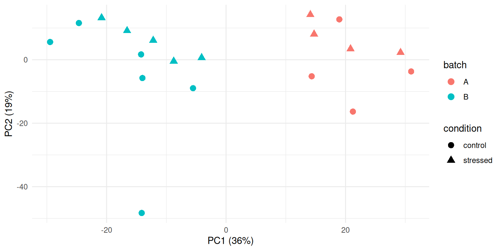
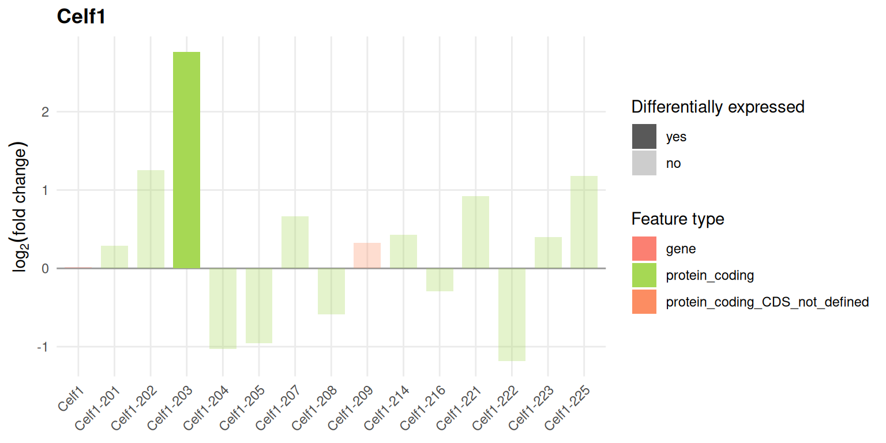
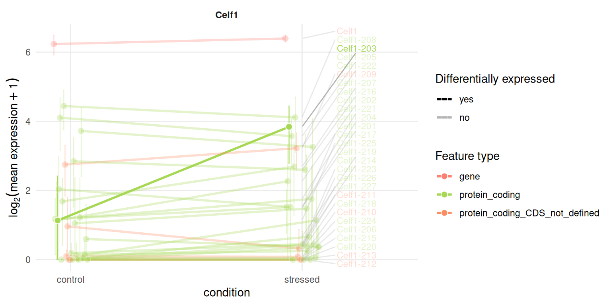
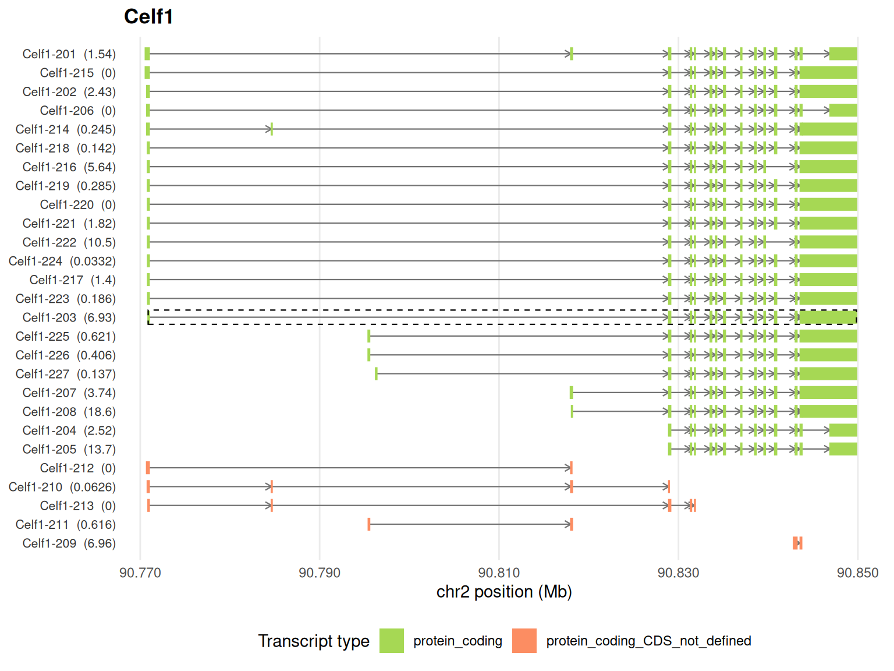
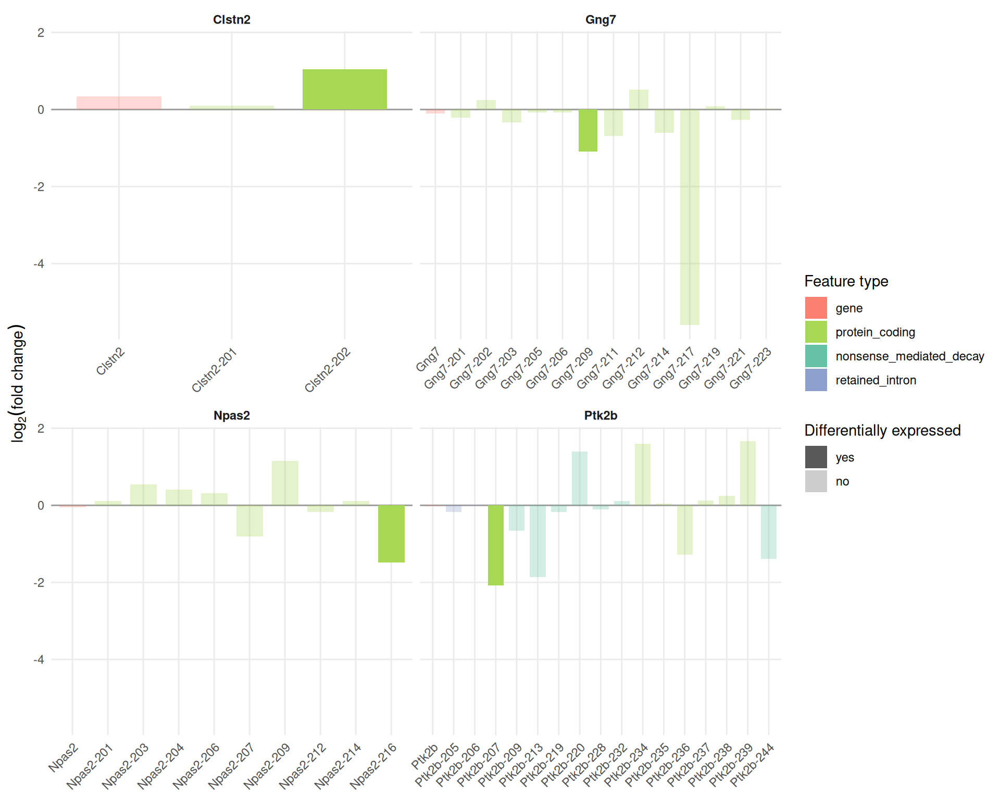
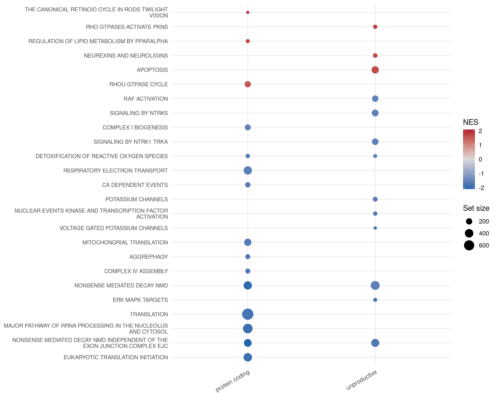

# Case study: chronic stress in the mouse brain

This article applies `isoformic` to a complete public dataset. It
contains bulk RNA-seq of the anterodorsal bed nucleus of the stria
terminalis (adBNST) of male mice. The mice had six weeks of chronic
variable mild stress and are compared with unstressed controls \[Degroat
et al. ([2024](#ref-degroat2024)); BioProject
[PRJNA984605](https://www.ncbi.nlm.nih.gov/bioproject/PRJNA984605)\]. It
shows a common outcome of transcript-level analysis. Stress leaves the
expression of genes almost unchanged, but changes which of their
isoforms are expressed.

## The data

The 19 male samples (10 control, 9 stressed) were quantified with Salmon
([Patro et al. 2017](#ref-salmon)) against the GENCODE vM39 transcripts
([Frankish et al. 2018](#ref-gencode)). The GRCm39 genome served as
decoy, and each sample has 30 Gibbs draws. Transcripts were tested with
`swish` ([Zhu et al. 2019](#ref-swish)) on the inferential replicates.
Genes were tested with `DESeq2` on the summed counts. The scripts that
download the reads from SRA and run every step are in
`data-raw/case_studies/` of the package repository.

The result is an `IsoformicExperiment` saved with
[`write_isoformic()`](https://luciorq.github.io/isoformic/reference/isoformic-io.md).
It keeps the complete differential expression tables (every tested
transcript and gene). The expression assays and exon structures cover
only a panel of 47 genes, so that the object fits in the repository. It
is not installed with the package.

``` r

library(isoformic)
library(dplyr)
library(ggplot2)

data_dir <- "data/mouse_bnst"
iso <- read_isoformic(data_dir)
iso
#> <IsoformicExperiment> mouse_bnst
#>   annotation : gencode_vm39_chr_patch_hapl_scaff_annotation_gff3_case_study_subset (20,736 genes, 330,137 transcripts, 17,003 exons)
#>   samples    : 19 [condition, batch, replicate, run]
#>   transcripts: 1,346 assayed from 47 genes
#>   assays     : abundance, counts
#>   gene assays: derived from transcript assays on demand
#>   DE results : det (103,288 transcripts), deg (20,736 genes)
#>   on disk    : data/mouse_bnst
col_data(iso)
#> # A tibble: 19 × 5
#>    sample_id  condition batch replicate run        
#>    <chr>      <chr>     <chr>     <int> <chr>      
#>  1 control_1  control   B             1 SRR24948951
#>  2 control_2  control   B             2 SRR24948952
#>  3 control_3  control   B             3 SRR24948953
#>  4 control_4  control   B             4 SRR24948954
#>  5 control_5  control   B             5 SRR24948955
#>  6 control_6  control   B             6 SRR24948940
#>  7 control_7  control   A             7 SRR24948935
#>  8 control_8  control   A             8 SRR24948931
#>  9 control_9  control   A             9 SRR24948925
#> 10 control_10 control   A            10 SRR24948928
#> 11 stressed_1 stressed  B             1 SRR24948948
#> 12 stressed_2 stressed  B             2 SRR24948949
#> 13 stressed_3 stressed  B             3 SRR24948950
#> 14 stressed_4 stressed  B             4 SRR24948943
#> 15 stressed_5 stressed  B             5 SRR24948942
#> 16 stressed_6 stressed  A             6 SRR24948930
#> 17 stressed_7 stressed  A             7 SRR24948929
#> 18 stressed_8 stressed  A             8 SRR24948932
#> 19 stressed_9 stressed  A             9 SRR24948927
```

## Checking the samples first

A principal component analysis of the gene-level counts shows that the
first component does not separate the conditions. It separates two
groups of samples, one per range of SRA run accessions. The groups are
not annotated in GEO but are most likely two processing batches. They
are balanced between conditions (4 + 4 and 6 + 5 samples), so the tests
can adjust for them. `swish` stratifies its permutations by batch and
`DESeq2` uses the design `~ batch + condition`. Without the adjustment,
no transcript and no gene reaches a false discovery rate of 5%, and only
4 transcripts and no gene reach 10%.

``` r

pca <- read_parquet(fs::path(data_dir, "sample_pca.parquet")) |>
  left_join(col_data(iso), by = "sample_id")
ggplot(pca, aes(PC1, PC2, color = batch, shape = condition)) +
  geom_point(size = 3) +
  labs(
    x = sprintf("PC1 (%.0f%%)", 100 * pca$var_PC1[1]),
    y = sprintf("PC2 (%.0f%%)", 100 * pca$var_PC2[1])
  ) +
  theme_minimal()
```



The sample far below the others on the second component (`control_3`)
has the smallest library (18.6 million read pairs) and the lowest
mapping rate (72%). It is kept in the analysis. It is the first sample
to check when a result depends on a single animal.

## Genes barely change, isoforms do

``` r

iso@metadata[c("transcript_de", "gene_de")]
#> $transcript_de
#> [1] "swish (fishpond), 30 inferential replicates, stratified by batch"
#> 
#> $gene_de
#> [1] "DESeq2, apeglm-shrunken log2 fold changes, design ~ batch + condition"
deg <- de_gene(iso)
det <- de_tx(iso)
c(
  genes_tested = nrow(deg),
  genes_fdr_5 = sum(deg$qvalue < 0.05, na.rm = TRUE),
  transcripts_tested = nrow(det),
  transcripts_fdr_5 = sum(det$qvalue < 0.05, na.rm = TRUE)
)
#>       genes_tested        genes_fdr_5 transcripts_tested  transcripts_fdr_5 
#>              20736                  4             103288                126
```

At a false discovery rate of 5%, `DESeq2` finds 4 genes and `swish` 126
transcripts. Many of the transcript changes are moderate: 74 of the 126
transcripts change less than 2-fold. This article therefore lowers the
fold-change cutoff of the significance calls from the default of 1 to
0.5 (a 1.4-fold change):

``` r

de_cutoffs(iso) <- list(log2fc = 0.5, pvalue = 0.05, use_fdr = TRUE)
```

The significant transcripts are not only protein coding isoforms. More
than half of them (69 of 126) are nonsense-mediated decay, retained
intron or other non-coding isoforms of protein coding genes, lncRNAs or
a TEC transcript.

``` r

det |>
  filter(qvalue < 0.05) |>
  left_join(tx_annot(iso), by = "transcript_id") |>
  count(transcript_type, sort = TRUE)
#> # A tibble: 6 × 2
#>   transcript_type                    n
#>   <chr>                          <int>
#> 1 protein_coding                    57
#> 2 nonsense_mediated_decay           28
#> 3 retained_intron                   24
#> 4 protein_coding_CDS_not_defined    12
#> 5 lncRNA                             4
#> 6 TEC                                1
```

[`isoform_switches()`](https://luciorq.github.io/isoformic/reference/diversity.md)
relates the two levels. With these cutoffs, 107 genes have one
significant isoform each, and none of them has a significant change of
its total expression (`det_not_deg`). A gene-level analysis would miss
all of them.

``` r

switches <- isoform_switches(iso)
table(switches$switch_type)
#> 
#> det_not_deg 
#>         107
switches |>
  select(gene_name, n_det_up, n_det_down, det_sig_types, gene_log2FC, switch_type) |>
  head(10)
#> # A tibble: 10 × 6
#>    gene_name n_det_up n_det_down det_sig_types           gene_log2FC switch_type
#>    <chr>        <int>      <int> <chr>                         <dbl> <chr>      
#>  1 Gng7             0          1 protein_coding             -0.107   det_not_deg
#>  2 Psap             0          1 protein_coding             -0.00322 det_not_deg
#>  3 Hsp90ab1         0          1 nonsense_mediated_decay    -0.0143  det_not_deg
#>  4 Slc6a6           0          1 nonsense_mediated_decay     0.0966  det_not_deg
#>  5 Sdha             0          1 nonsense_mediated_decay     0.0233  det_not_deg
#>  6 Celf1            1          0 protein_coding              0.0135  det_not_deg
#>  7 Kif1b            1          0 retained_intron             0.126   det_not_deg
#>  8 Glyr1            1          0 nonsense_mediated_decay     0.00392 det_not_deg
#>  9 Eno2             0          1 retained_intron            -0.0311  det_not_deg
#> 10 Epn1             0          1 protein_coding             -0.0245  det_not_deg
```

## A change of isoforms in *Celf1*

*Celf1* encodes an RNA-binding protein of the CELF family that regulates
alternative splicing. Its total expression does not change. Its protein
coding isoform `Celf1-203` goes up (log2 fold change 2.8), from 1.2 to
13 transcripts per million on average. `Celf1-203` encodes the same
protein as `Celf1-205`, one of the two most expressed isoforms in the
controls, but starts at a first exon far upstream and has a longer last
exon. `Celf1-205` goes down from 16 to 11 transcripts per million, which
is not significant on its own (q = 0.15).

``` r

plot_log2fc(iso, feature = "Celf1")
```



The expression profile shows the change in transcripts per million:

``` r

plot_tx_expr(iso, gene_name = "Celf1", group = "condition")
```



and the genomic context shows the structures of the isoforms, with the
differentially expressed ones outlined:

``` r

plot_genomic_context(iso, gene_name = "Celf1")
```



## More genes with isoform-level changes

Most other panel genes (34 of the other 46) show the same pattern: a
single significant isoform in a gene whose total expression does not
change significantly.

``` r

plot_log2fc(iso, feature = c("Clstn2", "Gng7", "Npas2", "Ptk2b"), ncol = 2)
```



Some genes do not reach a false discovery rate of 5% once the batches
are taken into account. These include the genes of the first `isoformic`
analysis of this dataset (*Trip12*, *Meg3* and *Map4*). They also
include classic stress response genes such as *Fkbp5* and *Sgk1*:

``` r

det |>
  left_join(tx_annot(iso), by = "transcript_id") |>
  filter(gene_name %in% c("Trip12", "Meg3", "Map4", "Fkbp5", "Sgk1")) |>
  summarise(best_qvalue = min(qvalue), .by = gene_name)
#> # A tibble: 5 × 2
#>   gene_name best_qvalue
#>   <chr>           <dbl>
#> 1 Map4           0.162 
#> 2 Meg3           0.0976
#> 3 Fkbp5          0.660 
#> 4 Trip12         0.247 
#> 5 Sgk1           0.286
```

## Enrichment by transcript type

The package directory holds the mouse Reactome pathways of MSigDB
([Liberzon et al. 2015](#ref-msigdb)) restricted to those with 15 to 500
tested genes.
[`run_enrichment()`](https://luciorq.github.io/isoformic/reference/enrichment.md)
ranks the transcripts by fold change and runs the enrichment separately
for the protein coding isoforms and for the unproductive ones.

``` r

genesets <- read_gmt(fs::path(data_dir, "genesets.gmt"))
set.seed(42)
enrichment <- run_enrichment(iso, genesets, pval_cutoff = 0.05)
table(enrichment$experiment)
#> 
#>        nonsense_mediated_decay                 protein_coding 
#>                             52                            119 
#> protein_coding_CDS_not_defined                retained_intron 
#>                             20                             58 
#>                   unproductive 
#>                             68
```

``` r

plot_enrichment(
  enrichment,
  n = 25,
  experiments = c("protein_coding", "unproductive"),
  nes_cutoff = 1.5
)
```



Translation and mitochondrial pathways go down in the protein coding
isoforms of the stressed animals (translation and eukaryotic translation
initiation, rRNA processing, mitochondrial translation, aerobic
respiration and respiratory electron transport, and complex IV assembly;
false discovery rate below 5%). Complex I biogenesis, in the figure,
goes down too, but not at a 5% false discovery rate. Few pathways go up
in the protein coding isoforms, and none of them is synaptic. The
ribosomal protein genes dominate the *nonsense-mediated decay* pathways
of Reactome (75 of the 92 leading-edge genes in the protein coding
isoforms), which is why those pathways are the most significant ones.
That pathway name describes the genes, not the transcript type. In the
unproductive isoforms the nonsense-mediated decay pathways and
mitochondrial translation go down as well, while apoptosis and
programmed cell death go up.

## Citing isoformic

If you use `isoformic` in publications, please cite Mamede et al.
([2025](#ref-isoformic)). `citation("isoformic")` prints the reference.

## Session information

``` r

sessionInfo()
#> R version 4.6.2 (2026-10-29)
#> Platform: x86_64-pc-linux-gnu
#> Running under: Ubuntu 26.04.1 LTS
#> 
#> Matrix products: default
#> BLAS:   /usr/lib/x86_64-linux-gnu/openblas-pthread/libblas.so.3 
#> LAPACK: /usr/lib/x86_64-linux-gnu/openblas-pthread/libopenblasp-r0.3.32.so;  LAPACK version 3.12.0
#> 
#> locale:
#>  [1] LC_CTYPE=C.UTF-8       LC_NUMERIC=C           LC_TIME=C.UTF-8       
#>  [4] LC_COLLATE=C.UTF-8     LC_MONETARY=C.UTF-8    LC_MESSAGES=C.UTF-8   
#>  [7] LC_PAPER=C.UTF-8       LC_NAME=C              LC_ADDRESS=C          
#> [10] LC_TELEPHONE=C         LC_MEASUREMENT=C.UTF-8 LC_IDENTIFICATION=C   
#> 
#> time zone: UTC
#> tzcode source: system (glibc)
#> 
#> attached base packages:
#> [1] stats     graphics  grDevices utils     datasets  methods   base     
#> 
#> other attached packages:
#> [1] ggplot2_4.0.4   dplyr_1.2.1     isoformic_0.1.3
#> 
#> loaded via a namespace (and not attached):
#>  [1] Matrix_1.7-6        gtable_0.3.6        jsonlite_2.0.0     
#>  [4] compiler_4.6.2      Rcpp_1.1.2          tidyselect_1.2.1   
#>  [7] parallel_4.6.2      scales_1.4.0        BiocParallel_1.46.0
#> [10] yaml_2.3.12         fastmap_1.2.0       lattice_0.23-1     
#> [13] R6_2.6.1            labeling_0.4.3      generics_0.1.4     
#> [16] knitr_1.52          ggrepel_0.9.8       tibble_3.3.1       
#> [19] DBI_1.3.0           pillar_1.11.1       RColorBrewer_1.1-3 
#> [22] rlang_1.3.0         fastmatch_1.1-8     utf8_1.2.6         
#> [25] xfun_0.62           fs_2.1.0            S7_1.0.0           
#> [28] otel_0.3.0          cli_3.6.6           withr_3.0.3        
#> [31] magrittr_2.0.5      digest_0.6.39       grid_4.6.2         
#> [34] fgsea_1.38.0        cowplot_1.2.0       lifecycle_1.0.5    
#> [37] vctrs_0.7.3         data.table_1.18.6.1 evaluate_1.0.5     
#> [40] glue_1.8.1          farver_2.1.2        duckdb_2.0.0       
#> [43] codetools_0.2-20    rmarkdown_2.32      tools_4.6.2        
#> [46] pkgconfig_2.0.3     htmltools_0.5.9
```

## References

Degroat, Thomas J., Kimberly Wiersielis, Katherine Denney, et al. 2024.
“Chronic Stress and Its Effects on Behavior, RNA Expression of the Bed
Nucleus of the Stria Terminalis, and the M-current of NPY Neurons.”
*Psychoneuroendocrinology* 161: 106920.
<https://doi.org/10.1016/j.psyneuen.2023.106920>.

Frankish, A, GENCODE-consoritum, and P Flicek. 2018. “GENCODE reference
annotation for the human and mouse genomes.” *Nucleic Acids Research*,
ahead of print. <https://doi.org/10.1093/nar/gky955>.

Liberzon, Arthur, Chet Birger, Helga Thorvaldsdóttir, Mahmoud Ghandi,
Jill P. Mesirov, and Pablo Tamayo. 2015. “The Molecular Signatures
Database (MSigDB) Hallmark Gene Set Collection.” *Cell Systems* 1 (6):
417–25. <https://doi.org/10.1016/j.cels.2015.12.004>.

Mamede, Izabela, Lucio R. Queiroz, Carlos Mata-Machado, et al. 2025.
“Isoformic: A Workflow for Transcript-Level RNA-seq Interpretation.”
*NAR Genomics and Bioinformatics* 7 (4): lqaf176.
<https://doi.org/10.1093/nargab/lqaf176>.

Patro, R, G Duggal, MI Love, RA Irizarry, and C Kingsford. 2017. “Salmon
Provides Fast and Bias-Aware Quantification of Transcript Expression.”
*Nature Methods* 14: 417–19. <https://doi.org/10.1038/nmeth.4197>.

Zhu, A, A Srivastava, JG Ibrahim, R Patro, and MI Love. 2019.
“Nonparametric expression analysis using inferential replicate counts.”
*Nucleic Acids Research* 47: e105. <https://doi.org/10.1093/nar/gkz622>.
