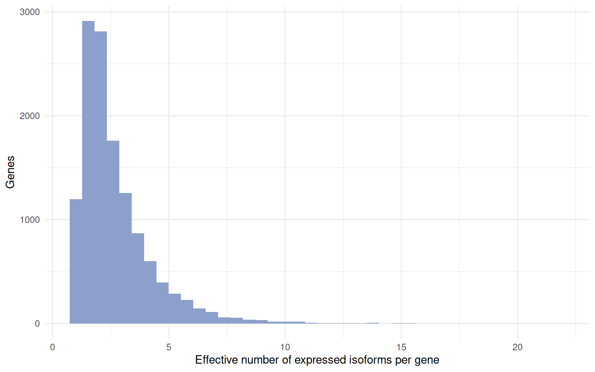
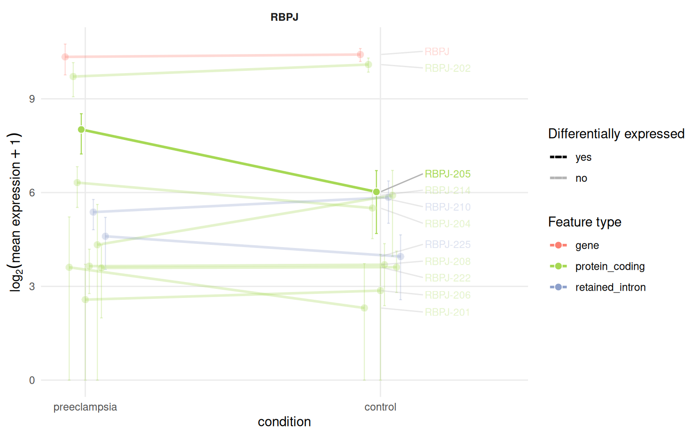

# Transcriptomic diversity

A gene-level analysis sums the isoforms of a gene and asks whether the
sum changes. This article asks how the expression of a gene is
distributed across its isoforms, whether the dominant isoform is the
canonical one, whether it differs between conditions and where the
transcript-level and gene-level calls disagree.

It starts from the object built in the
[introduction](https://luciorq.github.io/isoformic/articles/isoformic-introduction.md):

``` r

library(isoformic)
library(dplyr)
library(ggplot2)

extdata <- fs::path_package("isoformic", "extdata")
annot_dir <- prepare_isoformic_annotation(download_reference(version = "33", file_type = "gff"))
iso <- IsoformicExperiment(
  experiment_name = "preeclampsia_placenta",
  annot_path = annot_dir,
  assays = list(abundance = read_parquet(fs::path(extdata, "pe_abundance.parquet"))),
  col_data = read_parquet(fs::path(extdata, "pe_col_data.parquet"))
)
de_tx(iso) <- read_parquet(fs::path(extdata, "pe_det.parquet"))
de_gene(iso) <- read_parquet(fs::path(extdata, "pe_deg.parquet"))
```

## Isoform usage per gene

[`tx_diversity()`](https://luciorq.github.io/isoformic/reference/diversity.md)
summarises how each gene uses its isoforms: how many are annotated,
assayed and expressed, how many transcript types they span, which
isoform dominates and the *effective number of isoforms* (1 when a
single isoform carries all the expression, equal to the number of
isoforms when they are expressed evenly).

``` r

diversity <- tx_diversity(iso, min_expr = 1, min_samples = 3)
head(diversity)
#> # A tibble: 6 × 14
#>   gene_id         gene_name gene_type n_tx_annotated n_tx_assayed n_tx_expressed
#>   <chr>           <chr>     <chr>              <int>        <int>          <int>
#> 1 ENSG0000017296… MIR4435-… lncRNA               108           29             29
#> 2 ENSG0000019791… SPG7      protein_…             96           45             45
#> 3 ENSG0000010126… CSNK2A1   protein_…             48           34             34
#> 4 ENSG0000024208… MUC20-OT1 lncRNA               142           53             53
#> 5 ENSG0000024853… AC022784… lncRNA                70           26             26
#> 6 ENSG0000017981… PCBP1-AS1 lncRNA               239           32             32
#> # ℹ 8 more variables: n_tx_types <int>, tx_types <chr>, mean_gene_expr <dbl>,
#> #   dominant_transcript_id <chr>, dominant_transcript_name <chr>,
#> #   dominant_transcript_type <chr>, dominant_fraction <dbl>,
#> #   effective_isoforms <dbl>

diversity |>
  filter(n_tx_expressed >= 2) |>
  ggplot(aes(effective_isoforms)) +
  geom_histogram(bins = 40, fill = "#8da0cb") +
  labs(x = "Effective number of expressed isoforms per gene", y = "Genes") +
  theme_minimal()
```



## Dominant isoforms

[`dominant_isoform()`](https://luciorq.github.io/isoformic/reference/diversity.md)
finds the dominant isoform of each gene per condition and flags genes
whose dominant isoform differs between conditions. Transcripts carry
their annotation `tags` (`MANE_Select`, `Ensembl_canonical`, `basic`, …)
and an `is_canonical` flag, so the table also tells whether the dominant
isoform of a gene is its canonical transcript.

``` r

dominant <- dominant_isoform(iso, group = "condition")
dominant |>
  filter(dominant_switch, gene_expr > 10) |>
  head(10)
#> # A tibble: 10 × 11
#>    gene_id            gene_name gene_type      condition  dominant_transcript_id
#>    <chr>              <chr>     <chr>          <chr>      <chr>                 
#>  1 ENSG00000000938.13 FGR       protein_coding preeclamp… ENST00000374005.8     
#>  2 ENSG00000000938.13 FGR       protein_coding control    ENST00000374004.5     
#>  3 ENSG00000001084.13 GCLC      protein_coding preeclamp… ENST00000650454.1     
#>  4 ENSG00000001084.13 GCLC      protein_coding control    ENST00000509541.5     
#>  5 ENSG00000003436.16 TFPI      protein_coding preeclamp… ENST00000392365.5     
#>  6 ENSG00000003436.16 TFPI      protein_coding control    ENST00000233156.9     
#>  7 ENSG00000004846.16 ABCB5     protein_coding preeclamp… ENST00000404938.6     
#>  8 ENSG00000004846.16 ABCB5     protein_coding control    ENST00000443026.6     
#>  9 ENSG00000005187.12 ACSM3     protein_coding preeclamp… ENST00000289416.10    
#> 10 ENSG00000005187.12 ACSM3     protein_coding control    ENST00000614721.1     
#> # ℹ 6 more variables: dominant_transcript_name <chr>,
#> #   dominant_transcript_type <chr>, dominant_is_canonical <lgl>,
#> #   dominant_fraction <dbl>, gene_expr <dbl>, dominant_switch <lgl>

dominant_isoform(iso, gene_name = c("RBPJ", "EGFR", "FLT1"))[, c("gene_name", "dominant_transcript_name", "dominant_is_canonical", "dominant_fraction")]
#> # A tibble: 3 × 4
#>   gene_name dominant_transcript_name dominant_is_canonical dominant_fraction
#>   <chr>     <chr>                    <lgl>                             <dbl>
#> 1 FLT1      FLT1-204                 FALSE                             0.580
#> 2 EGFR      EGFR-201                 TRUE                              0.963
#> 3 RBPJ      RBPJ-202                 FALSE                             0.753
```

`min_expr` sets the expression floor below which a sample does not vote
for a dominant isoform.

## Isoform switches

[`isoform_switches()`](https://luciorq.github.io/isoformic/reference/diversity.md)
relates the transcript-level and gene-level calls: genes with
significant isoforms moving in opposite directions, or with significant
isoforms but no gene-level change, are the ones a gene-level analysis
would miss.

``` r

switches <- isoform_switches(iso)
table(switches$switch_type)
#> 
#>         consistent        det_not_deg opposite_direction 
#>                596               1804                241
head(switches)
#> # A tibble: 6 × 12
#>   gene_id          gene_name gene_type n_tx_tested n_det_sig n_det_up n_det_down
#>   <chr>            <chr>     <chr>           <int>     <int>    <int>      <int>
#> 1 ENSG00000198668… CALM1     protein_…          16         9        8          1
#> 2 ENSG00000213923… CSNK1E    protein_…          13         9        8          1
#> 3 ENSG00000196730… DAPK1     protein_…          16         8        7          1
#> 4 ENSG00000104763… ASAH1     protein_…          31         7        1          6
#> 5 ENSG00000100650… SRSF5     protein_…          17         7        5          2
#> 6 ENSG00000197102… DYNC1H1   protein_…          30         7        6          1
#> # ℹ 5 more variables: det_sig_types <chr>, max_abs_log2FC <dbl>,
#> #   gene_log2FC <dbl>, deg_sig <chr>, switch_type <chr>
```

The expression profile plot makes a switch visible as crossing lines
(see the [plots
article](https://luciorq.github.io/isoformic/articles/isoformic-plots.md)):

``` r

plot_tx_expr(iso, gene_name = "RBPJ", group = "condition")
```



## Exon-level diversity

The exon level adds structural diversity: how many distinct exons a gene
has and how many are shared by all of its isoforms.

``` r

exon_diversity(iso, gene_name = c("RBPJ", "EGFR", "FLT1"))
#> # A tibble: 3 × 9
#>   gene_id   gene_name gene_type  n_tx mean_exons_per_tx max_exons_per_tx n_exons
#>   <chr>     <chr>     <chr>     <int>             <dbl>            <int>   <int>
#> 1 ENSG0000… RBPJ      protein_…    31              6.52               12      65
#> 2 ENSG0000… EGFR      protein_…    11             14.4                28      46
#> 3 ENSG0000… FLT1      protein_…     9             14                  30      44
#> # ℹ 2 more variables: n_constitutive <int>, n_alternative <int>
```

What those structural differences do to the protein is the subject of
the [productivity
article](https://luciorq.github.io/isoformic/articles/isoformic-productivity.md).

## Session information

``` r

sessionInfo()
#> R version 4.6.2 (2026-10-29)
#> Platform: x86_64-pc-linux-gnu
#> Running under: Ubuntu 26.04.1 LTS
#> 
#> Matrix products: default
#> BLAS:   /usr/lib/x86_64-linux-gnu/openblas-pthread/libblas.so.3 
#> LAPACK: /usr/lib/x86_64-linux-gnu/openblas-pthread/libopenblasp-r0.3.32.so;  LAPACK version 3.12.0
#> 
#> locale:
#>  [1] LC_CTYPE=C.UTF-8       LC_NUMERIC=C           LC_TIME=C.UTF-8       
#>  [4] LC_COLLATE=C.UTF-8     LC_MONETARY=C.UTF-8    LC_MESSAGES=C.UTF-8   
#>  [7] LC_PAPER=C.UTF-8       LC_NAME=C              LC_ADDRESS=C          
#> [10] LC_TELEPHONE=C         LC_MEASUREMENT=C.UTF-8 LC_IDENTIFICATION=C   
#> 
#> time zone: UTC
#> tzcode source: system (glibc)
#> 
#> attached base packages:
#> [1] stats     graphics  grDevices utils     datasets  methods   base     
#> 
#> other attached packages:
#> [1] ggplot2_4.0.3   dplyr_1.2.1     isoformic_0.1.3
#> 
#> loaded via a namespace (and not attached):
#>  [1] gtable_0.3.6       jsonlite_2.0.0     compiler_4.6.2     Rcpp_1.1.2        
#>  [5] tidyselect_1.2.1   scales_1.4.0       yaml_2.3.12        fastmap_1.2.0     
#>  [9] R6_2.6.1           labeling_0.4.3     generics_0.1.4     curl_8.1.0        
#> [13] knitr_1.52         ggrepel_0.9.8      tibble_3.3.1       DBI_1.3.0         
#> [17] pillar_1.11.1      RColorBrewer_1.1-3 rlang_1.3.0        utf8_1.2.6        
#> [21] xfun_0.62          fs_2.1.0           S7_0.2.2           otel_0.3.0        
#> [25] cli_3.6.6          withr_3.0.3        magrittr_2.0.5     digest_0.6.39     
#> [29] grid_4.6.2         lifecycle_1.0.5    vctrs_0.7.3        evaluate_1.0.5    
#> [33] glue_1.8.1         farver_2.1.2       duckdb_2.0.0       rmarkdown_2.32    
#> [37] tools_4.6.2        pkgconfig_2.0.3    htmltools_0.5.9
```
