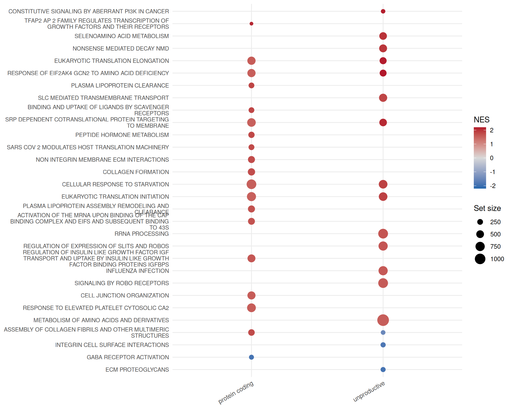
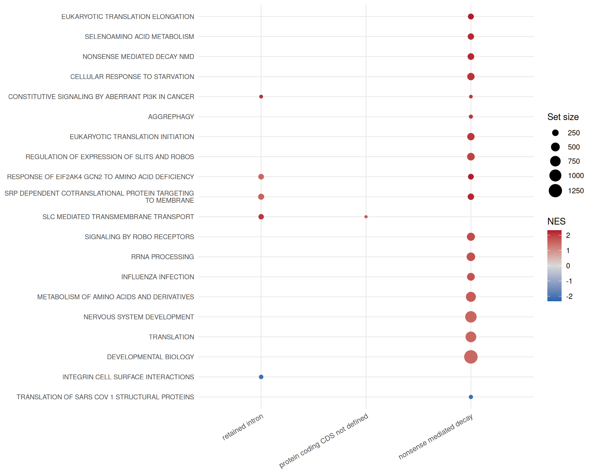

# Functional enrichment by transcript type

A transcript-level table has many more significant features than a
gene-level one, and most functional annotations are defined on genes.
This article runs gene set enrichment on the transcript-level results,
separately for protein coding transcripts and for the unproductive
transcript types, so that a pathway enriched only in unproductive
isoforms stands out.

It starts from the object built in the
[introduction](https://luciorq.github.io/isoformic/articles/isoformic-introduction.md):

``` r

library(isoformic)
library(dplyr)

data_dir <- "data/preeclampsia"
annot_dir <- prepare_isoformic_annotation(download_reference(version = "50", file_type = "gff"))
iso <- IsoformicExperiment(
  experiment_name = "preeclampsia_placenta",
  annot_path = annot_dir,
  assays = list(abundance = read_parquet(fs::path(data_dir, "pe_abundance.parquet"))),
  col_data = read_parquet(fs::path(data_dir, "pe_col_data.parquet"))
)
de_tx(iso) <- read_parquet(fs::path(data_dir, "pe_det.parquet"))
de_gene(iso) <- read_parquet(fs::path(data_dir, "pe_deg.parquet"))
```

## Gene sets

[`read_gmt()`](https://luciorq.github.io/isoformic/reference/enrichment.md)
reads a GMT file into a named list of gene symbols. This article reads
the complete Reactome collection of MSigDB release 2023.1
(C2:CP:REACTOME), which sits next to the placenta tables in the source
repository of the package; the package bundles `reactome_subset.gmt`, a
small subset of it for quick examples
(`system.file("extdata", "reactome_subset.gmt", package = "isoformic")`).

``` r

genesets <- read_gmt(fs::path(data_dir, "c2.cp.reactome.v2023.1.Hs.symbols.gmt.txt"))
length(genesets)
#> [1] 1654
head(names(genesets))
#> [1] "REACTOME_INTERLEUKIN_6_SIGNALING"                                                           
#> [2] "REACTOME_APOPTOSIS"                                                                         
#> [3] "REACTOME_HEMOSTASIS"                                                                        
#> [4] "REACTOME_INTRINSIC_PATHWAY_FOR_APOPTOSIS"                                                   
#> [5] "REACTOME_MAPK3_ERK1_ACTIVATION"                                                             
#> [6] "REACTOME_TRANSLESION_SYNTHESIS_BY_Y_FAMILY_DNA_POLYMERASES_BYPASSES_LESIONS_ON_DNA_TEMPLATE"
```

## Enrichment per transcript category

[`run_enrichment()`](https://luciorq.github.io/isoformic/reference/enrichment.md)
expands gene sets to all transcripts of their genes and runs gene set
enrichment analysis (`fgsea`) separately for protein coding transcripts
and for the *unproductive* categories (retained intron,
nonsense-mediated decay and transcripts without a defined coding
sequence), both combined and individually. The result can be stored in
the object so that it is saved with it.

``` r

set.seed(42)
enrichment <- run_enrichment(iso, genesets, pval_cutoff = 0.05)
iso@gsea$reactome <- enrichment
table(enrichment$experiment)
#> 
#>        nonsense_mediated_decay                 protein_coding 
#>                            151                            291 
#> protein_coding_CDS_not_defined                retained_intron 
#>                             41                            136 
#>                   unproductive 
#>                            224
head(enrichment)
#> # A tibble: 6 × 10
#>   pathway          pval    padj log2err    ES   NES  size leadingEdge experiment
#>   <chr>           <dbl>   <dbl>   <dbl> <dbl> <dbl> <int> <list>      <chr>     
#> 1 REACTOME_ABC… 3.37e-2 1.29e-1   0.253 0.318  1.26   442 <chr [75]>  protein_c…
#> 2 REACTOME_ABC… 2.57e-4 3.78e-3   0.498 0.386  1.50   334 <chr [70]>  protein_c…
#> 3 REACTOME_ACT… 6.50e-3 4.03e-2   0.407 0.392  1.45   198 <chr [59]>  protein_c…
#> 4 REACTOME_ACT… 7.79e-4 8.55e-3   0.477 0.493  1.70   100 <chr [17]>  protein_c…
#> 5 REACTOME_ACT… 4.31e-2 1.50e-1   0.225 0.320  1.25   359 <chr [76]>  protein_c…
#> 6 REACTOME_ACT… 9.53e-7 4.33e-5   0.659 0.429  1.68   385 <chr [164]> protein_c…
#> # ℹ 1 more variable: rank_by <chr>
```

[`plot_enrichment()`](https://luciorq.github.io/isoformic/reference/enrichment.md)
draws the pathways side by side for each transcript category.

``` r

plot_enrichment(enrichment, n = 30, experiments = c("protein_coding", "unproductive"), nes_cutoff = 1.5)
```



``` r

plot_enrichment(enrichment, n = 20, experiments = c("retained_intron", "nonsense_mediated_decay", "protein_coding_CDS_not_defined"), nes_cutoff = 1.5)
```



## Ranking statistic

By default the transcripts are ranked by their log2 fold-change, a point
estimate that ignores how well it is determined. `rank_by = "signed_p"`
ranks them by `-log10(pvalue)` with the sign of the fold-change, so that
the test of the differential expression weighs the ranking.
`rank_by = "lfc_z"` ranks them by the median fold-change over the
inferential replicates divided by its standard deviation, so that a
fold-change the quantification cannot determine ranks low; it needs the
fold-change table that `add_uncertainty(x, group = )` stores (see the
[uncertainty
article](https://luciorq.github.io/isoformic/articles/isoformic-uncertainty.md)),
which this object does not have. The `rank_by` column of the result
records the choice.

``` r

set.seed(42)
enrichment_p <- run_enrichment(iso, genesets, pval_cutoff = 0.05, rank_by = "signed_p")
table(enrichment_p$experiment)
#> 
#>        nonsense_mediated_decay                 protein_coding 
#>                            123                            247 
#> protein_coding_CDS_not_defined                retained_intron 
#>                             57                            147 
#>                   unproductive 
#>                            224
```

## Several collections

`genesets_list` can also be a named list of collections, for example
`list(hallmark = read_gmt(h), reactome = read_gmt(r))`. Each collection
is tested on its own, so that the adjusted p-values are those of the
collection; the result has a `collection` column and
[`plot_enrichment()`](https://luciorq.github.io/isoformic/reference/enrichment.md)
draws one panel per collection. Every gene set and every collection
needs a name. Here the Reactome sets are split into signalling and other
pathways:

``` r

collections <- list(
  signaling = genesets[grepl("SIGNALING", names(genesets), fixed = TRUE)],
  other = genesets[!grepl("SIGNALING", names(genesets), fixed = TRUE)]
)
set.seed(42)
enrichment_collections <- run_enrichment(iso, collections, pval_cutoff = 0.05)
count(enrichment_collections, collection, experiment)
#> # A tibble: 10 × 3
#>    collection experiment                         n
#>    <chr>      <chr>                          <int>
#>  1 other      nonsense_mediated_decay          114
#>  2 other      protein_coding                   242
#>  3 other      protein_coding_CDS_not_defined    35
#>  4 other      retained_intron                   99
#>  5 other      unproductive                     160
#>  6 signaling  nonsense_mediated_decay           36
#>  7 signaling  protein_coding                    56
#>  8 signaling  protein_coding_CDS_not_defined     9
#>  9 signaling  retained_intron                   40
#> 10 signaling  unproductive                      55
```

## Enrichment on the productive fraction and on 3’ end usage

Ranking genes by the change in their productive fraction rather than by
fold-change targets regulated unproductive splicing;
[`run_productivity_enrichment()`](https://luciorq.github.io/isoformic/reference/productivity.md)
is described in the [productivity
article](https://luciorq.github.io/isoformic/articles/isoformic-productivity.md).
Ranking them by the change in the usage of their distal 3’ end, or in
their 3’ UTR length, is
[`run_apa_enrichment()`](https://luciorq.github.io/isoformic/reference/polyadenylation.md),
described in the [alternative polyadenylation
article](https://luciorq.github.io/isoformic/articles/isoformic-polyadenylation.md).
Both take the same gene set collections.

## Session information

``` r

sessionInfo()
#> R version 4.6.2 (2026-10-29)
#> Platform: x86_64-pc-linux-gnu
#> Running under: Ubuntu 26.04.1 LTS
#> 
#> Matrix products: default
#> BLAS:   /usr/lib/x86_64-linux-gnu/openblas-pthread/libblas.so.3 
#> LAPACK: /usr/lib/x86_64-linux-gnu/openblas-pthread/libopenblasp-r0.3.32.so;  LAPACK version 3.12.0
#> 
#> locale:
#>  [1] LC_CTYPE=C.UTF-8       LC_NUMERIC=C           LC_TIME=C.UTF-8       
#>  [4] LC_COLLATE=C.UTF-8     LC_MONETARY=C.UTF-8    LC_MESSAGES=C.UTF-8   
#>  [7] LC_PAPER=C.UTF-8       LC_NAME=C              LC_ADDRESS=C          
#> [10] LC_TELEPHONE=C         LC_MEASUREMENT=C.UTF-8 LC_IDENTIFICATION=C   
#> 
#> time zone: UTC
#> tzcode source: system (glibc)
#> 
#> attached base packages:
#> [1] stats     graphics  grDevices utils     datasets  methods   base     
#> 
#> other attached packages:
#> [1] dplyr_1.2.1     isoformic_0.1.3
#> 
#> loaded via a namespace (and not attached):
#>  [1] Matrix_1.7-6        gtable_0.3.6        jsonlite_2.0.0     
#>  [4] compiler_4.6.2      tidyselect_1.2.1    Rcpp_1.1.2         
#>  [7] parallel_4.6.2      scales_1.4.0        BiocParallel_1.46.0
#> [10] yaml_2.3.12         fastmap_1.2.0       lattice_0.23-1     
#> [13] ggplot2_4.0.4       R6_2.6.1            labeling_0.4.3     
#> [16] generics_0.1.4      knitr_1.52          tibble_3.3.1       
#> [19] DBI_1.3.0           RColorBrewer_1.1-3  pillar_1.11.1      
#> [22] rlang_1.3.0         utf8_1.2.6          fastmatch_1.1-8    
#> [25] xfun_0.62           fs_2.1.0            S7_1.0.0           
#> [28] otel_0.3.0          cli_3.6.6           withr_3.0.3        
#> [31] magrittr_2.0.5      digest_0.6.39       grid_4.6.2         
#> [34] fgsea_1.38.0        cowplot_1.2.0       lifecycle_1.0.5    
#> [37] vctrs_0.7.3         data.table_1.18.6.1 evaluate_1.0.5     
#> [40] glue_1.8.1          farver_2.1.2        duckdb_2.0.0       
#> [43] codetools_0.2-20    rmarkdown_2.32      tools_4.6.2        
#> [46] pkgconfig_2.0.3     htmltools_0.5.9
```
