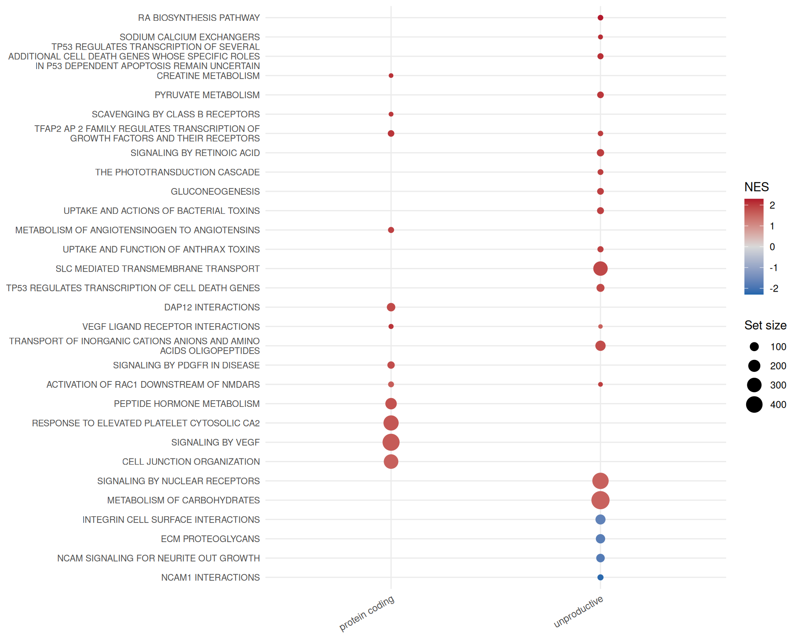
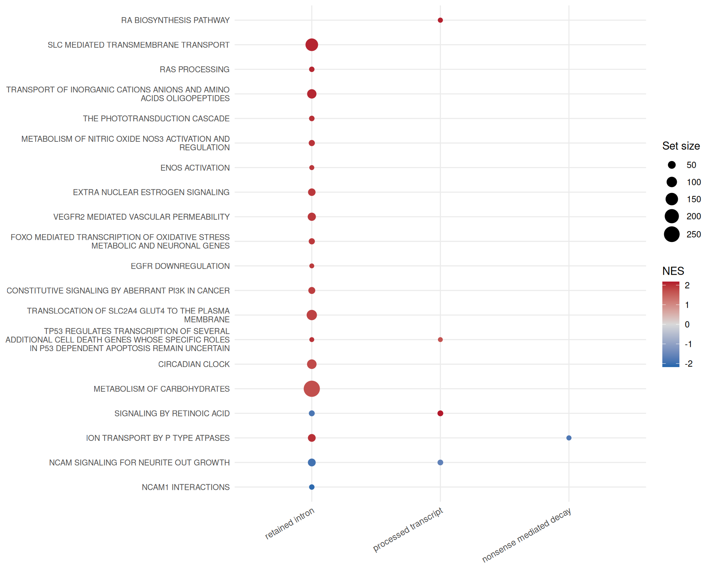

# Functional enrichment by transcript type

A transcript-level table has many more significant features than a
gene-level one, and most functional annotations are defined on genes.
This article runs gene set enrichment on the transcript-level results,
separately for protein coding transcripts and for the unproductive
transcript types, so that a pathway enriched only in unproductive
isoforms stands out.

It starts from the object built in the
[introduction](https://luciorq.github.io/isoformic/articles/isoformic-introduction.md):

``` r

library(isoformic)
library(dplyr)

extdata <- fs::path_package("isoformic", "extdata")
annot_dir <- prepare_isoformic_annotation(download_reference(version = "33", file_type = "gff"))
iso <- IsoformicExperiment(
  experiment_name = "preeclampsia_placenta",
  annot_path = annot_dir,
  assays = list(abundance = read_parquet(fs::path(extdata, "pe_abundance.parquet"))),
  col_data = read_parquet(fs::path(extdata, "pe_col_data.parquet"))
)
de_tx(iso) <- read_parquet(fs::path(extdata, "pe_det.parquet"))
de_gene(iso) <- read_parquet(fs::path(extdata, "pe_deg.parquet"))
```

## Gene sets

[`read_gmt()`](https://luciorq.github.io/isoformic/reference/enrichment.md)
reads a GMT file into a named list of gene symbols; the package bundles
a subset of the Reactome collection of MSigDB.

``` r

genesets <- read_gmt(fs::path(extdata, "c2.cp.reactome.v2023.1.Hs.symbols.gmt.txt"))
length(genesets)
#> [1] 1654
head(names(genesets))
#> [1] "REACTOME_INTERLEUKIN_6_SIGNALING"                                                           
#> [2] "REACTOME_APOPTOSIS"                                                                         
#> [3] "REACTOME_HEMOSTASIS"                                                                        
#> [4] "REACTOME_INTRINSIC_PATHWAY_FOR_APOPTOSIS"                                                   
#> [5] "REACTOME_MAPK3_ERK1_ACTIVATION"                                                             
#> [6] "REACTOME_TRANSLESION_SYNTHESIS_BY_Y_FAMILY_DNA_POLYMERASES_BYPASSES_LESIONS_ON_DNA_TEMPLATE"
```

## Enrichment per transcript category

[`run_enrichment()`](https://luciorq.github.io/isoformic/reference/enrichment.md)
expands gene sets to all transcripts of their genes and runs gene set
enrichment analysis (`fgsea`) separately for protein coding transcripts
and for the *unproductive* categories (retained intron,
nonsense-mediated decay and transcripts without a defined coding
sequence), both combined and individually. The result can be stored in
the object so that it is saved with it.

``` r

set.seed(42)
enrichment <- run_enrichment(iso, genesets, pval_cutoff = 0.05)
iso@gsea$reactome <- enrichment
table(enrichment$experiment)
#> 
#> nonsense_mediated_decay    processed_transcript          protein_coding 
#>                      50                      57                     219 
#>         retained_intron            unproductive 
#>                     195                     227
head(enrichment)
#> # A tibble: 6 × 9
#>   pathway           pval   padj log2err    ES   NES  size leadingEdge experiment
#>   <chr>            <dbl>  <dbl>   <dbl> <dbl> <dbl> <int> <list>      <chr>     
#> 1 REACTOME_ABC_… 2.27e-3 0.0572   0.432 0.377  1.45   266 <chr [47]>  protein_c…
#> 2 REACTOME_ABC_… 1.94e-2 0.175    0.352 0.367  1.37   199 <chr [34]>  protein_c…
#> 3 REACTOME_ACTI… 3.88e-2 0.268    0.288 0.613  1.52    16 <chr [5]>   protein_c…
#> 4 REACTOME_ACTI… 5.54e-4 0.0295   0.477 0.729  1.85    19 <chr [10]>  protein_c…
#> 5 REACTOME_ACTI… 6.91e-3 0.101    0.407 0.602  1.61    26 <chr [5]>   protein_c…
#> 6 REACTOME_ACTI… 1.00e-2 0.118    0.381 0.569  1.62    34 <chr [14]>  protein_c…
```

[`plot_enrichment()`](https://luciorq.github.io/isoformic/reference/enrichment.md)
draws the pathways side by side for each transcript category.

``` r

plot_enrichment(enrichment, n = 30, experiments = c("protein_coding", "unproductive"), nes_cutoff = 1.5)
```



``` r

plot_enrichment(enrichment, n = 20, experiments = c("retained_intron", "nonsense_mediated_decay", "processed_transcript"), nes_cutoff = 1.5)
```



## Enrichment on the productive fraction

Ranking genes by the change in their productive fraction rather than by
fold-change targets regulated unproductive splicing;
[`run_productivity_enrichment()`](https://luciorq.github.io/isoformic/reference/productivity.md)
is described in the [productivity
article](https://luciorq.github.io/isoformic/articles/isoformic-productivity.md).

## Session information

``` r

sessionInfo()
#> R version 4.6.2 (2026-10-29)
#> Platform: x86_64-pc-linux-gnu
#> Running under: Ubuntu 24.04.5 LTS
#> 
#> Matrix products: default
#> BLAS:   /usr/lib/x86_64-linux-gnu/openblas-pthread/libblas.so.3 
#> LAPACK: /usr/lib/x86_64-linux-gnu/openblas-pthread/libopenblasp-r0.3.26.so;  LAPACK version 3.12.0
#> 
#> locale:
#>  [1] LC_CTYPE=C.UTF-8       LC_NUMERIC=C           LC_TIME=C.UTF-8       
#>  [4] LC_COLLATE=C.UTF-8     LC_MONETARY=C.UTF-8    LC_MESSAGES=C.UTF-8   
#>  [7] LC_PAPER=C.UTF-8       LC_NAME=C              LC_ADDRESS=C          
#> [10] LC_TELEPHONE=C         LC_MEASUREMENT=C.UTF-8 LC_IDENTIFICATION=C   
#> 
#> time zone: UTC
#> tzcode source: system (glibc)
#> 
#> attached base packages:
#> [1] stats     graphics  grDevices utils     datasets  methods   base     
#> 
#> other attached packages:
#> [1] dplyr_1.2.1          isoformic_0.1.2.9022
#> 
#> loaded via a namespace (and not attached):
#>  [1] Matrix_1.7-6        gtable_0.3.6        jsonlite_2.0.0     
#>  [4] compiler_4.6.2      tidyselect_1.2.1    Rcpp_1.1.2         
#>  [7] parallel_4.6.2      scales_1.4.0        BiocParallel_1.46.0
#> [10] yaml_2.3.12         fastmap_1.2.0       lattice_0.23-1     
#> [13] ggplot2_4.0.3       R6_2.6.1            labeling_0.4.3     
#> [16] generics_0.1.4      curl_8.1.0          knitr_1.52         
#> [19] tibble_3.3.1        DBI_1.3.0           RColorBrewer_1.1-3 
#> [22] pillar_1.11.1       rlang_1.3.0         utf8_1.2.6         
#> [25] fastmatch_1.1-8     xfun_0.62           fs_2.1.0           
#> [28] S7_0.2.2            otel_0.2.0          cli_3.6.6          
#> [31] withr_3.0.3         magrittr_2.0.5      digest_0.6.39      
#> [34] grid_4.6.2          fgsea_1.38.0        cowplot_1.2.0      
#> [37] lifecycle_1.0.5     vctrs_0.7.3         data.table_1.18.6.1
#> [40] evaluate_1.0.5      glue_1.8.1          farver_2.1.2       
#> [43] duckdb_2.0.0        codetools_0.2-20    rmarkdown_2.32     
#> [46] tools_4.6.2         pkgconfig_2.0.3     htmltools_0.5.9
```
