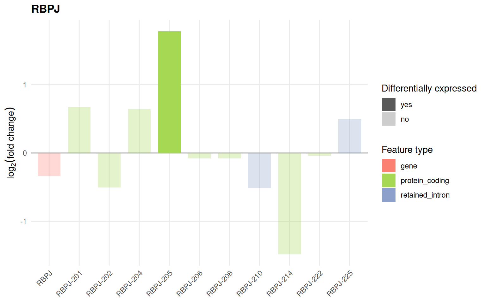

# Introduction to isoformic

## The isoformic method

`isoformic` interprets RNA-seq data at the level of annotated
transcripts. Instead of asking only whether a gene changes between
conditions, it asks which of its isoforms change, what type of
transcript they are (protein coding, retained intron, nonsense-mediated
decay, …) and how the expression of the gene is distributed across them.

Everything revolves around the `IsoformicExperiment` object. It holds,
for the same samples, transcript-level assays, gene-level assays derived
from them, the exon structures of every annotated transcript and the
differential expression results, all backed by Parquet files on disk.

This article builds the object from quantification and differential
expression tables and shows how to look at it. The analyses have one
article each:

- [Transcriptomic
  diversity](https://luciorq.github.io/isoformic/articles/isoformic-diversity.md):
  how many isoforms a gene uses, which one dominates and where isoform
  switches happen.
- [Quantification
  uncertainty](https://luciorq.github.io/isoformic/articles/isoformic-uncertainty.md):
  how well the reads determine each isoform, which isoforms cannot be
  told apart and how confident each differential expression call is.
- [What makes an isoform hard to
  quantify?](https://luciorq.github.io/isoformic/articles/isoformic-quantification-stability.md):
  which isoforms the reads leave uncertain, why, and how many Gibbs
  draws are enough.
- [Isoform structure and
  productivity](https://luciorq.github.io/isoformic/articles/isoformic-productivity.md):
  open reading frames, nonsense-mediated decay, productive fractions,
  poison exons and external evidence.
- [Alternative
  polyadenylation](https://luciorq.github.io/isoformic/articles/isoformic-polyadenylation.md):
  3’ end usage and 3’ UTR length.
- [Functional enrichment by transcript
  type](https://luciorq.github.io/isoformic/articles/isoformic-enrichment.md):
  gene set enrichment run separately for coding and unproductive
  transcripts.
- [Plots](https://luciorq.github.io/isoformic/articles/isoformic-plots.md):
  fold-change, expression profile and genomic context plots.
- [Other
  annotations](https://luciorq.github.io/isoformic/articles/isoformic-references.md):
  T2T-CHM13, Ensembl, RefSeq, haplotype-resolved assemblies, FANTOM CAT
  and long-read catalogs.
- [Working with plain
  tables](https://luciorq.github.io/isoformic/articles/isoformic-tables.md):
  the table-based counterparts of every step.

To start from Salmon output instead of ready-made tables, see [From
Salmon quantifications to an
IsoformicExperiment](https://luciorq.github.io/isoformic/articles/isoformic-preprocess.md).

### The data

The examples use the placenta RNA-seq dataset from [“Landscape of
Dysregulated Placental RNA Editing Associated With
Preeclampsia”](https://pubmed.ncbi.nlm.nih.gov/32306769/): 8
preeclamptic and 17 control placentas quantified with Salmon ([Patro et
al. 2017](#ref-salmon)) against GENCODE v33 and tested for differential
expression at the transcript level with `swish` ([Zhu et al.
2019](#ref-swish)) and at the gene level with `DESeq2`. The tables ship
with the package as Parquet files.

``` r

library(isoformic)
library(dplyr)

extdata <- fs::path_package("isoformic", "extdata")
fs::dir_ls(extdata)
#> /home/runner/work/_temp/Library/isoformic/extdata/c2.cp.reactome.v2023.1.Hs.symbols.gmt.txt
#> /home/runner/work/_temp/Library/isoformic/extdata/coding_model
#> /home/runner/work/_temp/Library/isoformic/extdata/example.gff3
#> /home/runner/work/_temp/Library/isoformic/extdata/example_experiment
#> /home/runner/work/_temp/Library/isoformic/extdata/example_transcripts.fa.gz
#> /home/runner/work/_temp/Library/isoformic/extdata/knockdown
#> /home/runner/work/_temp/Library/isoformic/extdata/knockdown_annotation
#> /home/runner/work/_temp/Library/isoformic/extdata/mini_annotation
#> /home/runner/work/_temp/Library/isoformic/extdata/mini_draws.parquet
#> /home/runner/work/_temp/Library/isoformic/extdata/mini_quants
#> /home/runner/work/_temp/Library/isoformic/extdata/oarfish
#> /home/runner/work/_temp/Library/isoformic/extdata/oarfish_sc
#> /home/runner/work/_temp/Library/isoformic/extdata/pe_abundance.parquet
#> /home/runner/work/_temp/Library/isoformic/extdata/pe_col_data.parquet
#> /home/runner/work/_temp/Library/isoformic/extdata/pe_deg.parquet
#> /home/runner/work/_temp/Library/isoformic/extdata/pe_det.parquet
#> /home/runner/work/_temp/Library/isoformic/extdata/reactome_subset.gmt
```

``` r

abundance <- read_parquet(fs::path(extdata, "pe_abundance.parquet"))
col_data <- read_parquet(fs::path(extdata, "pe_col_data.parquet"))
det <- read_parquet(fs::path(extdata, "pe_det.parquet"))
deg <- read_parquet(fs::path(extdata, "pe_deg.parquet"))

abundance[1:3, 1:4]
#> # A tibble: 3 × 4
#>   transcript_id     SRR11498039 SRR11498040 SRR11498041
#>   <chr>                   <dbl>       <dbl>       <dbl>
#> 1 ENST00000456328.2        6.17         0          4.49
#> 2 ENST00000488147.1       94.0        241.       295.  
#> 3 ENST00000466430.5       30.4         49.4       21.5
col_data
#> # A tibble: 25 × 2
#>    sample_id   condition   
#>    <chr>       <chr>       
#>  1 SRR11498039 preeclampsia
#>  2 SRR11498040 preeclampsia
#>  3 SRR11498041 preeclampsia
#>  4 SRR11498042 preeclampsia
#>  5 SRR11498043 preeclampsia
#>  6 SRR11498044 preeclampsia
#>  7 SRR11498045 preeclampsia
#>  8 SRR11498046 preeclampsia
#>  9 SRR11498063 control     
#> 10 SRR11498064 control     
#> # ℹ 15 more rows
head(det)
#> # A tibble: 6 × 4
#>   transcript_id      log2FC  pvalue qvalue
#>   <chr>               <dbl>   <dbl>  <dbl>
#> 1 ENST00000456328.2 -0.692  0.0199  0.0940
#> 2 ENST00000488147.1  0.0731 0.652   0.812 
#> 3 ENST00000466430.5 -0.146  0.364   0.590 
#> 4 ENST00000442987.3 -0.183  0.0841  0.242 
#> 5 ENST00000494149.2 -0.728  0.00599 0.0420
#> 6 ENST00000595919.1 -0.0789 0.951   0.977
head(deg)
#> # A tibble: 6 × 7
#>   gene_id            log10mean  stat  log2FC pvalue locfdr qvalue
#>   <chr>                  <dbl> <dbl>   <dbl>  <dbl>  <dbl>  <dbl>
#> 1 ENSG00000000003.15      2.40 -31.0 -0.320  0.0485  0.470  0.125
#> 2 ENSG00000000005.6       1.11  25.4  0.381  0.107   0.798  0.222
#> 3 ENSG00000000419.12      2.45 -17.8 -0.0693 0.260   1      0.417
#> 4 ENSG00000000457.14      2.52  13.8  0.107  0.386   1      0.547
#> 5 ENSG00000000460.17      1.95  19.1  0.162  0.229   1      0.380
#> 6 ENSG00000000938.13      1.70 -22.2 -0.162  0.160   1      0.296
```

### The annotation

`isoformic` relies on the transcript types of the
[GENCODE](https://www.gencodegenes.org/human/) annotation. The
annotation must be the one used for quantification, here GENCODE v33.
[`download_reference()`](https://luciorq.github.io/isoformic/reference/download_reference.md)
fetches it into the package cache (this step needs an internet
connection the first time) and
[`prepare_isoformic_annotation()`](https://luciorq.github.io/isoformic/reference/prepare_isoformic_annotation.md)
converts the GFF3 file, once, into a directory of Parquet tables.

``` r

gff_file <- download_reference(version = "33", file_type = "gff")
#> ℹ '/home/runner/.cache/R/isoformic/gencode.v33.chr_patch_hapl_scaff.annotation.gff3.gz'
#>   already exists.
annot_dir <- prepare_isoformic_annotation(gff_file)
#> ℹ Using cached annotation directory
#>   '/home/runner/.cache/R/isoformic/gencode_v33_chr_patch_hapl_scaff_annotation_gff3'.
fs::dir_ls(annot_dir)
#> /home/runner/.cache/R/isoformic/gencode_v33_chr_patch_hapl_scaff_annotation_gff3/annot_data_exons.parquet
#> /home/runner/.cache/R/isoformic/gencode_v33_chr_patch_hapl_scaff_annotation_gff3/annot_data_genes.parquet
#> /home/runner/.cache/R/isoformic/gencode_v33_chr_patch_hapl_scaff_annotation_gff3/annot_data_sequences.parquet
#> /home/runner/.cache/R/isoformic/gencode_v33_chr_patch_hapl_scaff_annotation_gff3/annot_data_transcripts.parquet
#> /home/runner/.cache/R/isoformic/gencode_v33_chr_patch_hapl_scaff_annotation_gff3/annot_metadata.parquet
#> /home/runner/.cache/R/isoformic/gencode_v33_chr_patch_hapl_scaff_annotation_gff3/annot_seq_regions.parquet
```

The tables can be inspected with
[`read_parquet()`](https://luciorq.github.io/isoformic/reference/parquet.md),
but normally the object reads them for you.

``` r

read_parquet(fs::path(annot_dir, "annot_data_transcripts.parquet"), n_max = 3)
#> # A tibble: 3 × 21
#>   transcript_id     transcript_name transcript_type gene_id       source_gene_id
#>   <chr>             <chr>           <chr>           <chr>         <chr>         
#> 1 ENST00000618686.1 BX004987.1-201  protein_coding  ENSG00000278… <NA>          
#> 2 ENST00000613230.1 AC145212.1-201  protein_coding  ENSG00000277… <NA>          
#> 3 ENST00000400754.4 MAFIP-201       protein_coding  ENSG00000274… <NA>          
#> # ℹ 16 more variables: source_transcript_id <chr>, tags <chr>,
#> #   coding_status <chr>, transcript_support_level <chr>, tie_score <dbl>,
#> #   cds_start <int>, cds_end <int>, cds_length <int>, is_canonical <lgl>,
#> #   haplotype <chr>, seqid <chr>, start_pos <int>, end_pos <int>, strand <chr>,
#> #   n_exons <int>, tx_length <int>
```

The cache location and every other setting the package reads are
documented in `?isoformic-options`.

### Building the IsoformicExperiment

A transcript-level abundance table (TPM) with the sample metadata is all
that is needed. Transcript IDs are checked against the annotation,
sample IDs against the metadata.

``` r

iso <- IsoformicExperiment(
  experiment_name = "preeclampsia_placenta",
  annot_path = annot_dir,
  assays = list(abundance = abundance),
  col_data = col_data
)
iso
#> <IsoformicExperiment> preeclampsia_placenta
#>   annotation : gencode_v33_chr_patch_hapl_scaff_annotation_gff3 (67,017 genes, 248,882 transcripts, 1,497,350 exons)
#>   samples    : 25 [condition]
#>   transcripts: 72,385 assayed from 21,637 genes
#>   assays     : abundance
#>   gene assays: derived from transcript assays on demand
#>   DE results : <none>
```

The object behaves like a `SummarizedExperiment`:

``` r

dim(iso)
#> [1] 72385    25
assay(iso, "abundance")[1:3, 1:3]
#>                   SRR11498039 SRR11498040 SRR11498041
#> ENST00000456328.2       6.168       0.000       4.494
#> ENST00000488147.1      93.959     240.922     295.194
#> ENST00000466430.5      30.399      49.359      21.525
head(row_data(iso))
#> # A tibble: 6 × 19
#>   transcript_id     transcript_name transcript_type  gene_id gene_name gene_type
#>   <chr>             <chr>           <chr>            <chr>   <chr>     <chr>    
#> 1 ENST00000456328.2 DDX11L1-202     processed_trans… ENSG00… DDX11L1   transcri…
#> 2 ENST00000488147.1 WASH7P-201      unprocessed_pse… ENSG00… WASH7P    unproces…
#> 3 ENST00000466430.5 AL627309.1-201  lncRNA           ENSG00… AL627309… lncRNA   
#> 4 ENST00000442987.3 CICP27-201      processed_pseud… ENSG00… CICP27    processe…
#> 5 ENST00000494149.2 AL627309.6-201  processed_pseud… ENSG00… AL627309… processe…
#> 6 ENST00000595919.1 AL627309.7-201  processed_pseud… ENSG00… AL627309… processe…
#> # ℹ 13 more variables: source_gene_id <chr>, source_transcript_id <chr>,
#> #   tags <chr>, coding_status <chr>, transcript_support_level <chr>,
#> #   tie_score <dbl>, cds_start <int>, cds_end <int>, cds_length <int>,
#> #   is_canonical <lgl>, haplotype <chr>, n_exons <int>, tx_length <int>
col_data(iso)
#> # A tibble: 25 × 2
#>    sample_id   condition   
#>    <chr>       <chr>       
#>  1 SRR11498039 preeclampsia
#>  2 SRR11498040 preeclampsia
#>  3 SRR11498041 preeclampsia
#>  4 SRR11498042 preeclampsia
#>  5 SRR11498043 preeclampsia
#>  6 SRR11498044 preeclampsia
#>  7 SRR11498045 preeclampsia
#>  8 SRR11498046 preeclampsia
#>  9 SRR11498063 control     
#> 10 SRR11498064 control     
#> # ℹ 15 more rows
iso[1:5, 1:3]
#> <IsoformicExperiment> preeclampsia_placenta
#>   annotation : gencode_v33_chr_patch_hapl_scaff_annotation_gff3 (67,017 genes, 248,882 transcripts, 1,497,350 exons)
#>   samples    : 3 [condition]
#>   transcripts: 5 assayed from 5 genes
#>   assays     : abundance
#>   gene assays: derived from transcript assays on demand
#>   DE results : <none>
```

Gene-level assays are derived on demand by summing the isoforms of each
gene and cached.

``` r

gene_assay(iso, "abundance")[1:3, 1:3]
#>                    SRR11498039 SRR11498040 SRR11498041
#> ENSG00000000003.15     249.107     260.237     225.292
#> ENSG00000000005.6       10.000      14.000      18.000
#> ENSG00000000419.12     300.484     278.667     264.840
head(gene_data(iso))
#> # A tibble: 6 × 14
#>   gene_id   gene_name gene_type source_gene_id gene_class gene_category dhs_type
#>   <chr>     <chr>     <chr>     <chr>          <chr>      <chr>         <chr>   
#> 1 ENSG0000… TSPAN6    protein_… <NA>           <NA>       <NA>          <NA>    
#> 2 ENSG0000… TNMD      protein_… <NA>           <NA>       <NA>          <NA>    
#> 3 ENSG0000… DPM1      protein_… <NA>           <NA>       <NA>          <NA>    
#> 4 ENSG0000… SCYL3     protein_… <NA>           <NA>       <NA>          <NA>    
#> 5 ENSG0000… C1orf112  protein_… <NA>           <NA>       <NA>          <NA>    
#> 6 ENSG0000… FGR       protein_… <NA>           <NA>       <NA>          <NA>    
#> # ℹ 7 more variables: coding_status <chr>, cumulative_support <chr>,
#> #   haplotype <chr>, seqid <chr>, start_pos <int>, end_pos <int>, strand <chr>
```

### Adding differential expression results

Results from any tool can be attached: column names such as
`log2FoldChange`, `padj`, `logFC` or `FDR` are standardised to `log2FC`,
`pvalue` and `qvalue`, and IDs are validated against the annotation.
Significance is flagged with stored cutoffs (absolute log2 fold-change
of 1 and adjusted p-value of 0.05 by default).

``` r

de_tx(iso) <- det
de_gene(iso) <- deg
de_cutoffs(iso)
#> $log2fc
#> [1] 1
#> 
#> $pvalue
#> [1] 0.05
#> 
#> $use_fdr
#> [1] TRUE

head(de_tx(iso, sig_only = TRUE))
#> # A tibble: 6 × 5
#>   transcript_id     log2FC      pvalue    qvalue det_sig
#>   <chr>              <dbl>       <dbl>     <dbl> <chr>  
#> 1 ENST00000334433.7  -8.65 0.000000138 0.0000236 yes    
#> 2 ENST00000084795.9  -8.23 0.000000138 0.0000236 yes    
#> 3 ENST00000601306.1  -8.02 0.0000710   0.00188   yes    
#> 4 ENST00000525681.5  -7.57 0.000267    0.00489   yes    
#> 5 ENST00000392177.8  -7.35 0.000115    0.00267   yes    
#> 6 ENST00000579374.5  -7.17 0.000000138 0.0000236 yes
head(de_gene(iso, sig_only = TRUE))
#> # A tibble: 6 × 8
#>   gene_id            log10mean  stat log2FC      pvalue   locfdr  qvalue deg_sig
#>   <chr>                  <dbl> <dbl>  <dbl>       <dbl>    <dbl>   <dbl> <chr>  
#> 1 ENSG00000174697.5       3.96  68     6.51 0.000000462  5.48e-5 2.58e-5 yes    
#> 2 ENSG00000070404.10      4.20  68     5.23 0.000000462  5.48e-5 2.58e-5 yes    
#> 3 ENSG00000169495.5       3.76  68     4.50 0.000000462  5.48e-5 2.58e-5 yes    
#> 4 ENSG00000196136.18      1.99  53.6   3.72 0.000263     9.92e-3 2.55e-3 yes    
#> 5 ENSG00000104827.12      4.34  68     3.65 0.000000462  5.48e-5 2.58e-5 yes    
#> 6 ENSG00000232434.2       2.28  67.0   3.53 0.000000462  5.48e-5 2.58e-5 yes
```

[`de_table()`](https://luciorq.github.io/isoformic/reference/dea.md)
combines both levels in one long table, one row per feature, which is
what the plots consume.

``` r

de_table(iso) |>
  filter(gene_name == "RBPJ")
#> # A tibble: 11 × 9
#>    feature_id        feature_name feature_type gene_id gene_name  log2FC  pvalue
#>    <chr>             <chr>        <chr>        <chr>   <chr>       <dbl>   <dbl>
#>  1 ENSG00000168214.… RBPJ         gene         ENSG00… RBPJ      -0.333  1.04e-2
#>  2 ENST00000355476.7 RBPJ-205     protein_cod… ENSG00… RBPJ       1.78   4.46e-5
#>  3 ENST00000507561.5 RBPJ-214     protein_cod… ENSG00… RBPJ      -1.49   2.90e-2
#>  4 ENST00000342295.5 RBPJ-201     protein_cod… ENSG00… RBPJ       0.671  7.83e-1
#>  5 ENST00000348160.8 RBPJ-204     protein_cod… ENSG00… RBPJ       0.644  1.20e-2
#>  6 ENST00000505727.1 RBPJ-210     retained_in… ENSG00… RBPJ      -0.508  7.23e-2
#>  7 ENST00000342320.8 RBPJ-202     protein_cod… ENSG00… RBPJ      -0.503  1.26e-5
#>  8 ENST00000514380.5 RBPJ-225     retained_in… ENSG00… RBPJ       0.498  9.92e-2
#>  9 ENST00000504907.5 RBPJ-208     protein_cod… ENSG00… RBPJ      -0.0816 8.37e-1
#> 10 ENST00000361572.… RBPJ-206     protein_cod… ENSG00… RBPJ      -0.0791 9.67e-1
#> 11 ENST00000512351.5 RBPJ-222     protein_cod… ENSG00… RBPJ      -0.0429 5.39e-1
#> # ℹ 2 more variables: qvalue <dbl>, is_de <chr>
```

### A first look

The fold-change plot compares the change of a gene with that of each of
its transcripts, coloured by transcript type; the [plots
article](https://luciorq.github.io/isoformic/articles/isoformic-plots.md)
covers the others.

``` r

plot_log2fc(iso, feature = "RBPJ")
```



### Saving the experiment

The whole object, including results, is written as a directory of
Parquet files and restored with
[`read_isoformic()`](https://luciorq.github.io/isoformic/reference/isoformic-io.md).

``` r

out_dir <- fs::path(tempdir(), "preeclampsia_placenta")
iso <- write_isoformic(iso, out_dir, overwrite = TRUE)
iso@data_path
#> [1] "/tmp/RtmpgLeZsJ/preeclampsia_placenta"
fs::dir_ls(out_dir, recurse = TRUE)
#> /tmp/RtmpgLeZsJ/preeclampsia_placenta/assays
#> /tmp/RtmpgLeZsJ/preeclampsia_placenta/assays/abundance.parquet
#> /tmp/RtmpgLeZsJ/preeclampsia_placenta/col_data.parquet
#> /tmp/RtmpgLeZsJ/preeclampsia_placenta/dea
#> /tmp/RtmpgLeZsJ/preeclampsia_placenta/dea/deg.parquet
#> /tmp/RtmpgLeZsJ/preeclampsia_placenta/dea/det.parquet
#> /tmp/RtmpgLeZsJ/preeclampsia_placenta/experiment.parquet
#> /tmp/RtmpgLeZsJ/preeclampsia_placenta/tx_type_palette.parquet
read_isoformic(out_dir)
#> <IsoformicExperiment> preeclampsia_placenta
#>   annotation : gencode_v33_chr_patch_hapl_scaff_annotation_gff3 (67,017 genes, 248,882 transcripts, 1,497,350 exons)
#>   samples    : 25 [condition]
#>   transcripts: 72,385 assayed from 21,637 genes
#>   assays     : abundance
#>   gene assays: derived from transcript assays on demand
#>   DE results : det (72,385 transcripts), deg (21,637 genes)
#>   on disk    : /tmp/RtmpgLeZsJ/preeclampsia_placenta
```

Every other article starts from this object; the block below is all it
takes to rebuild it.

``` r

library(isoformic)
extdata <- fs::path_package("isoformic", "extdata")
annot_dir <- prepare_isoformic_annotation(download_reference(version = "33", file_type = "gff"))
iso <- IsoformicExperiment(
  experiment_name = "preeclampsia_placenta",
  annot_path = annot_dir,
  assays = list(abundance = read_parquet(fs::path(extdata, "pe_abundance.parquet"))),
  col_data = read_parquet(fs::path(extdata, "pe_col_data.parquet"))
)
de_tx(iso) <- read_parquet(fs::path(extdata, "pe_det.parquet"))
de_gene(iso) <- read_parquet(fs::path(extdata, "pe_deg.parquet"))
```

### Citing isoformic

If you use `isoformic` in publications, please cite Mamede et al.
([2025](#ref-isoformic)); `citation("isoformic")` prints the reference.

### Session information

``` r

sessionInfo()
#> R version 4.6.2 (2026-10-29)
#> Platform: x86_64-pc-linux-gnu
#> Running under: Ubuntu 26.04.1 LTS
#> 
#> Matrix products: default
#> BLAS:   /usr/lib/x86_64-linux-gnu/openblas-pthread/libblas.so.3 
#> LAPACK: /usr/lib/x86_64-linux-gnu/openblas-pthread/libopenblasp-r0.3.32.so;  LAPACK version 3.12.0
#> 
#> locale:
#>  [1] LC_CTYPE=C.UTF-8       LC_NUMERIC=C           LC_TIME=C.UTF-8       
#>  [4] LC_COLLATE=C.UTF-8     LC_MONETARY=C.UTF-8    LC_MESSAGES=C.UTF-8   
#>  [7] LC_PAPER=C.UTF-8       LC_NAME=C              LC_ADDRESS=C          
#> [10] LC_TELEPHONE=C         LC_MEASUREMENT=C.UTF-8 LC_IDENTIFICATION=C   
#> 
#> time zone: UTC
#> tzcode source: system (glibc)
#> 
#> attached base packages:
#> [1] stats     graphics  grDevices utils     datasets  methods   base     
#> 
#> other attached packages:
#> [1] dplyr_1.2.1     isoformic_0.1.3
#> 
#> loaded via a namespace (and not attached):
#>  [1] gtable_0.3.6       jsonlite_2.0.0     compiler_4.6.2     crayon_1.5.3      
#>  [5] tidyselect_1.2.1   scales_1.4.0       yaml_2.3.12        fastmap_1.2.0     
#>  [9] ggplot2_4.0.3      R6_2.6.1           labeling_0.4.3     generics_0.1.4    
#> [13] curl_8.1.0         knitr_1.52         tibble_3.3.1       DBI_1.3.0         
#> [17] pillar_1.11.1      RColorBrewer_1.1-3 rlang_1.3.0        utf8_1.2.6        
#> [21] xfun_0.62          fs_2.1.0           S7_0.2.2           otel_0.3.0        
#> [25] cli_3.6.6          withr_3.0.3        magrittr_2.0.5     digest_0.6.39     
#> [29] grid_4.6.2         lifecycle_1.0.5    vctrs_0.7.3        evaluate_1.0.5    
#> [33] glue_1.8.1         farver_2.1.2       duckdb_2.0.0       rmarkdown_2.32    
#> [37] tools_4.6.2        pkgconfig_2.0.3    htmltools_0.5.9
```

### References

Mamede, Izabela, Lucio R. Queiroz, Carlos Mata-Machado, et al. 2025.
“Isoformic: A Workflow for Transcript-Level RNA-seq Interpretation.”
*NAR Genomics and Bioinformatics* 7 (4): lqaf176.
<https://doi.org/10.1093/nargab/lqaf176>.

Patro, R, G Duggal, MI Love, RA Irizarry, and C Kingsford. 2017. “Salmon
Provides Fast and Bias-Aware Quantification of Transcript Expression.”
*Nature Methods* 14: 417–19. <https://doi.org/10.1038/nmeth.4197>.

Zhu, A, A Srivastava, JG Ibrahim, R Patro, and MI Love. 2019.
“Nonparametric expression analysis using inferential replicate counts.”
*Nucleic Acids Research* 47: e105. <https://doi.org/10.1093/nar/gkz622>.
