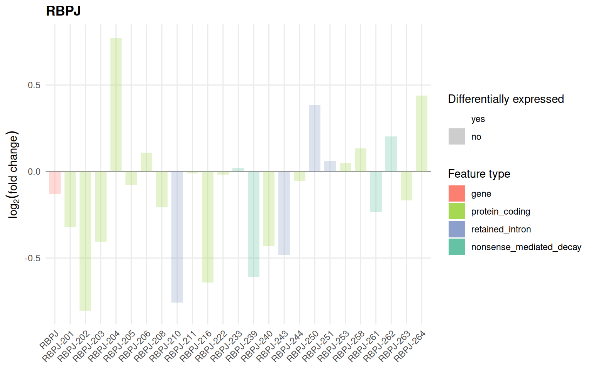

# Introduction to isoformic

## The isoformic method

`isoformic` interprets RNA-seq data at the level of annotated
transcripts. Instead of asking only whether a gene changes between
conditions, it asks which of its isoforms change, what type of
transcript they are (protein coding, retained intron, nonsense-mediated
decay, …) and how the expression of the gene is distributed across them.

Everything revolves around the `IsoformicExperiment` object. It holds,
for the same samples, transcript-level assays, gene-level assays derived
from them, the exon structures of every annotated transcript and the
differential expression results, all backed by Parquet files on disk.

This article builds the object from quantification and differential
expression tables and shows how to look at it. The analyses have one
article each:

- [Transcriptomic
  diversity](https://luciorq.github.io/isoformic/articles/isoformic-diversity.md):
  how many isoforms a gene uses, which one dominates and where isoform
  switches happen.
- [Quantification
  uncertainty](https://luciorq.github.io/isoformic/articles/isoformic-uncertainty.md):
  how well the reads determine each isoform, which isoforms cannot be
  told apart and how stable the direction of each differential
  expression call is over the replicates.
- [What makes an isoform hard to
  quantify?](https://luciorq.github.io/isoformic/articles/isoformic-quantification-stability.md):
  which isoforms the reads leave uncertain, why, and how far 30 Gibbs
  draws can be trusted to measure it.
- [Isoform structure and
  productivity](https://luciorq.github.io/isoformic/articles/isoformic-productivity.md):
  open reading frames, nonsense-mediated decay, productive fractions,
  poison exons and external evidence.
- [Alternative
  polyadenylation](https://luciorq.github.io/isoformic/articles/isoformic-polyadenylation.md):
  3’ end usage, 3’ UTR length and gene set enrichment on their change.
- [Functional enrichment by transcript
  type](https://luciorq.github.io/isoformic/articles/isoformic-enrichment.md):
  gene set enrichment run separately for coding and unproductive
  transcripts, with a choice of ranking statistic and of gene set
  collections.
- [Plots](https://luciorq.github.io/isoformic/articles/isoformic-plots.md):
  fold-change, expression profile and genomic context plots.
- [Other
  annotations](https://luciorq.github.io/isoformic/articles/isoformic-references.md):
  T2T-CHM13, Ensembl, RefSeq, haplotype-resolved assemblies, FANTOM CAT
  and long-read catalogs.
- [Working with plain
  tables](https://luciorq.github.io/isoformic/articles/isoformic-tables.md):
  the table-based counterparts of every step.

To start from Salmon output instead of ready-made tables, see [From
Salmon quantifications to an
IsoformicExperiment](https://luciorq.github.io/isoformic/articles/isoformic-preprocess.md).
Two case studies apply the workflow to complete public datasets:
[chronic stress in the mouse
brain](https://luciorq.github.io/isoformic/articles/isoformic-case-mouse-stress.md)
(short reads, Salmon) and [a splicing kinase inhibitor in nanopore long
reads](https://luciorq.github.io/isoformic/articles/isoformic-case-long-reads.md)
(Oarfish).

### The data

The examples use the placenta RNA-seq dataset from [“Landscape of
Dysregulated Placental RNA Editing Associated With
Preeclampsia”](https://pubmed.ncbi.nlm.nih.gov/32306769/): 8
preeclamptic and 17 control placentas quantified with Salmon ([Patro et
al. 2017](#ref-salmon)) against GENCODE v50 and tested for differential
expression with `swish` ([Zhu et al. 2019](#ref-swish)) on the 30 Gibbs
draws, at the transcript level and at the gene level (counts and draws
summed over the isoforms of each gene). The tables are Parquet files in
the [source
repository](https://github.com/luciorq/isoformic/tree/main/vignettes/articles/data/preeclampsia)
of the package, under `vignettes/articles/data/preeclampsia/`: they are
too large to install with the package, so the code below reads them from
that directory, relative to the article. The abundance table holds the
TPM of the 126,670 transcripts tested by `swish`, the same ones as the
transcript-level results; the other transcripts of each gene come from
the annotation.

``` r

library(isoformic)
library(dplyr)

data_dir <- "data/preeclampsia"
fs::dir_ls(data_dir)
#> data/preeclampsia/c2.cp.reactome.v2023.1.Hs.symbols.gmt.txt
#> data/preeclampsia/pe_abundance.parquet
#> data/preeclampsia/pe_col_data.parquet
#> data/preeclampsia/pe_deg.parquet
#> data/preeclampsia/pe_det.parquet
```

``` r

abundance <- read_parquet(fs::path(data_dir, "pe_abundance.parquet"))
col_data <- read_parquet(fs::path(data_dir, "pe_col_data.parquet"))
det <- read_parquet(fs::path(data_dir, "pe_det.parquet"))
deg <- read_parquet(fs::path(data_dir, "pe_deg.parquet"))

abundance[1:3, 1:4]
#> # A tibble: 3 × 4
#>   transcript_id     SRR11498039 SRR11498040 SRR11498041
#>   <chr>                   <dbl>       <dbl>       <dbl>
#> 1 ENST00000832823.1        0          0          21.4  
#> 2 ENST00000831746.1        4.52       0.437       7.10 
#> 3 ENST00000831361.1        0          0           0.343
col_data
#> # A tibble: 25 × 2
#>    sample_id   condition   
#>    <chr>       <chr>       
#>  1 SRR11498039 preeclampsia
#>  2 SRR11498040 preeclampsia
#>  3 SRR11498041 preeclampsia
#>  4 SRR11498042 preeclampsia
#>  5 SRR11498043 preeclampsia
#>  6 SRR11498044 preeclampsia
#>  7 SRR11498045 preeclampsia
#>  8 SRR11498046 preeclampsia
#>  9 SRR11498063 control     
#> 10 SRR11498064 control     
#> # ℹ 15 more rows
head(det)
#> # A tibble: 6 × 4
#>   transcript_id      log2FC pvalue qvalue
#>   <chr>               <dbl>  <dbl>  <dbl>
#> 1 ENST00000832823.1 -0.265  0.191   0.441
#> 2 ENST00000831746.1 -0.605  0.0245  0.131
#> 3 ENST00000831361.1 -0.119  0.636   0.819
#> 4 ENST00000831289.1  0.0349 0.905   0.959
#> 5 ENST00000831275.1 -0.168  0.710   0.861
#> 6 ENST00000831218.1  0.0995 0.958   0.982
head(deg)
#> # A tibble: 6 × 7
#>   gene_id            log10mean  stat  log2FC pvalue locfdr qvalue
#>   <chr>                  <dbl> <dbl>   <dbl>  <dbl>  <dbl>  <dbl>
#> 1 ENSG00000000003.18      2.44  -8.1 -0.0865 0.608   1      0.791
#> 2 ENSG00000000005.7       1.30  25.2  0.471  0.111   0.750  0.305
#> 3 ENSG00000000419.16      2.60  12.7  0.0415 0.423   1      0.652
#> 4 ENSG00000000457.16      2.54  27    0.193  0.0884  0.660  0.266
#> 5 ENSG00000000460.19      2.15  23.7  0.198  0.134   0.828  0.342
#> 6 ENSG00000000938.15      1.97 -21.0 -0.154  0.186   0.976  0.411
```

### The annotation

`isoformic` relies on the transcript types of the
[GENCODE](https://www.gencodegenes.org/human/) annotation. The
annotation must be the one used for quantification, here GENCODE v50.
[`download_reference()`](https://luciorq.github.io/isoformic/reference/download_reference.md)
fetches it into the package cache (this step needs an internet
connection the first time) and
[`prepare_isoformic_annotation()`](https://luciorq.github.io/isoformic/reference/prepare_isoformic_annotation.md)
converts the GFF3 file, once, into a directory of Parquet tables.

``` r

gff_file <- download_reference(version = "50", file_type = "gff")
#> ℹ '/home/runner/.cache/R/isoformic/gencode.v50.chr_patch_hapl_scaff.annotation.gff3.gz'
#>   already exists.
annot_dir <- prepare_isoformic_annotation(gff_file)
#> ℹ Using cached annotation directory
#>   '/home/runner/.cache/R/isoformic/gencode_v50_chr_patch_hapl_scaff_annotation_gff3'.
fs::dir_ls(annot_dir)
#> /home/runner/.cache/R/isoformic/gencode_v50_chr_patch_hapl_scaff_annotation_gff3/annot_data_exons.parquet
#> /home/runner/.cache/R/isoformic/gencode_v50_chr_patch_hapl_scaff_annotation_gff3/annot_data_genes.parquet
#> /home/runner/.cache/R/isoformic/gencode_v50_chr_patch_hapl_scaff_annotation_gff3/annot_data_transcripts.parquet
#> /home/runner/.cache/R/isoformic/gencode_v50_chr_patch_hapl_scaff_annotation_gff3/annot_metadata.parquet
#> /home/runner/.cache/R/isoformic/gencode_v50_chr_patch_hapl_scaff_annotation_gff3/annot_seq_regions.parquet
```

The tables can be inspected with
[`read_parquet()`](https://luciorq.github.io/isoformic/reference/parquet.md),
but normally the object reads them for you.

``` r

read_parquet(fs::path(annot_dir, "annot_data_transcripts.parquet"), n_max = 3)
#> # A tibble: 3 × 21
#>   transcript_id     transcript_name transcript_type gene_id       source_gene_id
#>   <chr>             <chr>           <chr>           <chr>         <chr>         
#> 1 ENST00000741402.1 ENST00000741402 lncRNA          ENSG00000296… <NA>          
#> 2 ENST00000741407.1 ENST00000741407 lncRNA          ENSG00000296… <NA>          
#> 3 ENST00000741435.1 ENST00000741435 lncRNA          ENSG00000296… <NA>          
#> # ℹ 16 more variables: source_transcript_id <chr>, tags <chr>,
#> #   coding_status <chr>, transcript_support_level <chr>, tie_score <dbl>,
#> #   cds_start <int>, cds_end <int>, cds_length <int>, is_canonical <lgl>,
#> #   haplotype <chr>, seqid <chr>, start_pos <int>, end_pos <int>, strand <chr>,
#> #   n_exons <int>, tx_length <int>
```

The cache location and every other setting the package reads are
documented in `?isoformic-options`.

### Building the IsoformicExperiment

A transcript-level abundance table (TPM) with the sample metadata is all
that is needed. Transcript IDs are checked against the annotation,
sample IDs against the metadata.

``` r

iso <- IsoformicExperiment(
  experiment_name = "preeclampsia_placenta",
  annot_path = annot_dir,
  assays = list(abundance = abundance),
  col_data = col_data
)
iso
#> <IsoformicExperiment> preeclampsia_placenta
#>   annotation : gencode_v50_chr_patch_hapl_scaff_annotation_gff3 (86,411 genes, 670,670 transcripts, 5,227,964 exons)
#>   samples    : 25 [condition]
#>   transcripts: 126,670 assayed from 20,985 genes
#>   assays     : abundance
#>   gene assays: derived from transcript assays on demand
#>   DE results : <none>
```

The object behaves like a `SummarizedExperiment`:

``` r

dim(iso)
#> [1] 126670     25
tx_assay(iso, "abundance")[1:3, 1:3]
#>                   SRR11498039 SRR11498040 SRR11498041
#> ENST00000832823.1    0.000000    0.000000   21.371838
#> ENST00000831746.1    4.517379    0.436699    7.103105
#> ENST00000831361.1    0.000000    0.000000    0.342551
head(row_data(iso))
#> # A tibble: 6 × 19
#>   transcript_id     transcript_name transcript_type gene_id  gene_name gene_type
#>   <chr>             <chr>           <chr>           <chr>    <chr>     <chr>    
#> 1 ENST00000832823.1 DDX11L16-259    lncRNA          ENSG000… DDX11L16  lncRNA   
#> 2 ENST00000831746.1 WASH7P-484      lncRNA          ENSG000… WASH7P    lncRNA   
#> 3 ENST00000831361.1 WASH7P-278      lncRNA          ENSG000… WASH7P    lncRNA   
#> 4 ENST00000831289.1 WASH7P-249      lncRNA          ENSG000… WASH7P    lncRNA   
#> 5 ENST00000831275.1 WASH7P-244      lncRNA          ENSG000… WASH7P    lncRNA   
#> 6 ENST00000831218.1 WASH7P-224      lncRNA          ENSG000… WASH7P    lncRNA   
#> # ℹ 13 more variables: source_gene_id <chr>, source_transcript_id <chr>,
#> #   tags <chr>, coding_status <chr>, transcript_support_level <chr>,
#> #   tie_score <dbl>, cds_start <int>, cds_end <int>, cds_length <int>,
#> #   is_canonical <lgl>, haplotype <chr>, n_exons <int>, tx_length <int>
col_data(iso)
#> # A tibble: 25 × 2
#>    sample_id   condition   
#>    <chr>       <chr>       
#>  1 SRR11498039 preeclampsia
#>  2 SRR11498040 preeclampsia
#>  3 SRR11498041 preeclampsia
#>  4 SRR11498042 preeclampsia
#>  5 SRR11498043 preeclampsia
#>  6 SRR11498044 preeclampsia
#>  7 SRR11498045 preeclampsia
#>  8 SRR11498046 preeclampsia
#>  9 SRR11498063 control     
#> 10 SRR11498064 control     
#> # ℹ 15 more rows
iso[1:5, 1:3]
#> <IsoformicExperiment> preeclampsia_placenta
#>   annotation : gencode_v50_chr_patch_hapl_scaff_annotation_gff3 (86,411 genes, 670,670 transcripts, 5,227,964 exons)
#>   samples    : 3 [condition]
#>   transcripts: 5 assayed from 2 genes
#>   assays     : abundance
#>   gene assays: derived from transcript assays on demand
#>   DE results : <none>
```

Gene-level assays are derived on demand by summing the isoforms of each
gene and cached.

``` r

gene_assay(iso, "abundance")[1:3, 1:3]
#>                    SRR11498039 SRR11498040 SRR11498041
#> ENSG00000000003.18   14.213808   16.588492   11.627883
#> ENSG00000000005.7     0.699687    0.996592    1.166971
#> ENSG00000000419.16   30.235937   30.721446   25.944463
head(gene_data(iso))
#> # A tibble: 6 × 14
#>   gene_id   gene_name gene_type source_gene_id gene_class gene_category dhs_type
#>   <chr>     <chr>     <chr>     <chr>          <chr>      <chr>         <chr>   
#> 1 ENSG0000… TSPAN6    protein_… <NA>           <NA>       <NA>          <NA>    
#> 2 ENSG0000… TNMD      protein_… <NA>           <NA>       <NA>          <NA>    
#> 3 ENSG0000… DPM1      protein_… <NA>           <NA>       <NA>          <NA>    
#> 4 ENSG0000… SCYL3     protein_… <NA>           <NA>       <NA>          <NA>    
#> 5 ENSG0000… FIRRM     protein_… <NA>           <NA>       <NA>          <NA>    
#> 6 ENSG0000… FGR       protein_… <NA>           <NA>       <NA>          <NA>    
#> # ℹ 7 more variables: coding_status <chr>, cumulative_support <chr>,
#> #   haplotype <chr>, seqid <chr>, start_pos <int>, end_pos <int>, strand <chr>
```

### Adding differential expression results

Results from any tool can be attached: column names such as
`log2FoldChange`, `padj`, `logFC` or `FDR` are standardised to `log2FC`,
`pvalue` and `qvalue`, and IDs are validated against the annotation.
Significance is flagged with stored cutoffs (absolute log2 fold-change
of 1 and adjusted p-value of 0.05 by default).

``` r

de_tx(iso) <- det
de_gene(iso) <- deg
de_cutoffs(iso)
#> $log2fc
#> [1] 1
#> 
#> $pvalue
#> [1] 0.05
#> 
#> $use_fdr
#> [1] TRUE

head(de_tx(iso, sig_only = TRUE))
#> # A tibble: 6 × 5
#>   transcript_id     log2FC       pvalue    qvalue det_sig
#>   <chr>              <dbl>        <dbl>     <dbl> <chr>  
#> 1 ENST00001096014.1  -7.07 0.0000000789 0.0000198 yes    
#> 2 ENST00000601306.1  -6.98 0.0000000789 0.0000198 yes    
#> 3 ENST00000948415.2   6.85 0.0000635    0.00218   yes    
#> 4 ENST00000670617.1  -6.75 0.0000000789 0.0000198 yes    
#> 5 ENST00000308868.5   6.73 0.0000000789 0.0000198 yes    
#> 6 ENST00000965599.2   6.42 0.0000000789 0.0000198 yes
head(de_gene(iso, sig_only = TRUE))
#> # A tibble: 6 × 8
#>   gene_id            log10mean  stat log2FC      pvalue   locfdr  qvalue deg_sig
#>   <chr>                  <dbl> <dbl>  <dbl>       <dbl>    <dbl>   <dbl> <chr>  
#> 1 ENSG00000174697.7       3.97  68     6.58 0.000000451 0.000450 3.57e-4 yes    
#> 2 ENSG00000070404.12      4.13  68     4.85 0.000000451 0.000450 3.57e-4 yes    
#> 3 ENSG00000169495.6       3.73  68     4.40 0.000000451 0.000450 3.57e-4 yes    
#> 4 ENSG00000102755.15      4.67  64.6   3.47 0.0000135   0.00285  1.38e-3 yes    
#> 5 ENSG00000298257.1       2.39  66.7   3.41 0.00000361  0.00125  7.48e-4 yes    
#> 6 ENSG00000282810.1       2.12  54.1   3.25 0.000489    0.0260   1.10e-2 yes
```

[`de_table()`](https://luciorq.github.io/isoformic/reference/dea.md)
combines both levels in one long table, one row per feature, which is
what the plots consume.

``` r

de_table(iso) |>
  filter(gene_name == "RBPJ")
#> # A tibble: 25 × 9
#>    feature_id  feature_name feature_type gene_id gene_name log2FC  pvalue qvalue
#>    <chr>       <chr>        <chr>        <chr>   <chr>      <dbl>   <dbl>  <dbl>
#>  1 ENSG000001… RBPJ         gene         ENSG00… RBPJ      -0.129 0.220   0.453 
#>  2 ENST000003… RBPJ-202     protein_cod… ENSG00… RBPJ      -0.805 0.0740  0.257 
#>  3 ENST000003… RBPJ-204     protein_cod… ENSG00… RBPJ       0.772 0.00786 0.0624
#>  4 ENST000005… RBPJ-210     retained_in… ENSG00… RBPJ      -0.757 0.00303 0.0328
#>  5 ENST000005… RBPJ-216     protein_cod… ENSG00… RBPJ      -0.641 0.0744  0.258 
#>  6 ENST000006… RBPJ-239     nonsense_me… ENSG00… RBPJ      -0.609 0.133   0.361 
#>  7 ENST000006… RBPJ-243     retained_in… ENSG00… RBPJ      -0.483 0.0992  0.305 
#>  8 ENST000011… RBPJ-264     protein_cod… ENSG00… RBPJ       0.439 0.0636  0.235 
#>  9 ENST000006… RBPJ-240     protein_cod… ENSG00… RBPJ      -0.433 0.332   0.592 
#> 10 ENST000003… RBPJ-203     protein_cod… ENSG00… RBPJ      -0.405 0.270   0.533 
#> # ℹ 15 more rows
#> # ℹ 1 more variable: is_de <chr>
```

### A first look

The fold-change plot compares the change of a gene with that of each of
its transcripts, coloured by transcript type; the [plots
article](https://luciorq.github.io/isoformic/articles/isoformic-plots.md)
covers the others.

``` r

plot_log2fc(iso, feature = "RBPJ")
```



### Saving the experiment

The whole object, including results, is written as a directory of
Parquet files and restored with
[`read_isoformic()`](https://luciorq.github.io/isoformic/reference/isoformic-io.md).

``` r

out_dir <- fs::path(tempdir(), "preeclampsia_placenta")
iso <- write_isoformic(iso, out_dir, overwrite = TRUE)
iso@data_path
#> [1] "/tmp/RtmpTuRH2v/preeclampsia_placenta"
fs::dir_ls(out_dir, recurse = TRUE)
#> /tmp/RtmpTuRH2v/preeclampsia_placenta/assays
#> /tmp/RtmpTuRH2v/preeclampsia_placenta/assays/abundance.parquet
#> /tmp/RtmpTuRH2v/preeclampsia_placenta/col_data.parquet
#> /tmp/RtmpTuRH2v/preeclampsia_placenta/dea
#> /tmp/RtmpTuRH2v/preeclampsia_placenta/dea/deg.parquet
#> /tmp/RtmpTuRH2v/preeclampsia_placenta/dea/det.parquet
#> /tmp/RtmpTuRH2v/preeclampsia_placenta/experiment.parquet
#> /tmp/RtmpTuRH2v/preeclampsia_placenta/tx_type_palette.parquet
read_isoformic(out_dir)
#> <IsoformicExperiment> preeclampsia_placenta
#>   annotation : gencode_v50_chr_patch_hapl_scaff_annotation_gff3 (86,411 genes, 670,670 transcripts, 5,227,964 exons)
#>   samples    : 25 [condition]
#>   transcripts: 126,670 assayed from 20,985 genes
#>   assays     : abundance
#>   gene assays: derived from transcript assays on demand
#>   DE results : det (126,670 transcripts), deg (22,167 genes)
#>   on disk    : /tmp/RtmpTuRH2v/preeclampsia_placenta
```

Every other article starts from this object; the block below is all it
takes to rebuild it.

``` r

library(isoformic)
data_dir <- "data/preeclampsia" # vignettes/articles/data/preeclampsia in the source repository
annot_dir <- prepare_isoformic_annotation(download_reference(version = "50", file_type = "gff"))
iso <- IsoformicExperiment(
  experiment_name = "preeclampsia_placenta",
  annot_path = annot_dir,
  assays = list(abundance = read_parquet(fs::path(data_dir, "pe_abundance.parquet"))),
  col_data = read_parquet(fs::path(data_dir, "pe_col_data.parquet"))
)
de_tx(iso) <- read_parquet(fs::path(data_dir, "pe_det.parquet"))
de_gene(iso) <- read_parquet(fs::path(data_dir, "pe_deg.parquet"))
```

### Citing isoformic

If you use `isoformic` in publications, please cite Mamede et al.
([2025](#ref-isoformic)); `citation("isoformic")` prints the reference.

### Session information

``` r

sessionInfo()
#> R version 4.6.2 (2026-10-29)
#> Platform: x86_64-pc-linux-gnu
#> Running under: Ubuntu 26.04.1 LTS
#> 
#> Matrix products: default
#> BLAS:   /usr/lib/x86_64-linux-gnu/openblas-pthread/libblas.so.3 
#> LAPACK: /usr/lib/x86_64-linux-gnu/openblas-pthread/libopenblasp-r0.3.32.so;  LAPACK version 3.12.0
#> 
#> locale:
#>  [1] LC_CTYPE=C.UTF-8       LC_NUMERIC=C           LC_TIME=C.UTF-8       
#>  [4] LC_COLLATE=C.UTF-8     LC_MONETARY=C.UTF-8    LC_MESSAGES=C.UTF-8   
#>  [7] LC_PAPER=C.UTF-8       LC_NAME=C              LC_ADDRESS=C          
#> [10] LC_TELEPHONE=C         LC_MEASUREMENT=C.UTF-8 LC_IDENTIFICATION=C   
#> 
#> time zone: UTC
#> tzcode source: system (glibc)
#> 
#> attached base packages:
#> [1] stats     graphics  grDevices utils     datasets  methods   base     
#> 
#> other attached packages:
#> [1] dplyr_1.2.1     isoformic_0.1.3
#> 
#> loaded via a namespace (and not attached):
#>  [1] gtable_0.3.6       jsonlite_2.0.0     compiler_4.6.2     crayon_1.5.3      
#>  [5] tidyselect_1.2.1   parallel_4.6.2     scales_1.4.0       yaml_2.3.12       
#>  [9] fastmap_1.2.0      ggplot2_4.0.4      R6_2.6.1           labeling_0.4.3    
#> [13] generics_0.1.4     knitr_1.52         tibble_3.3.1       DBI_1.3.0         
#> [17] pillar_1.11.1      RColorBrewer_1.1-3 rlang_1.3.0        utf8_1.2.6        
#> [21] xfun_0.62          fs_2.1.0           S7_1.0.0           otel_0.3.0        
#> [25] cli_3.6.6          withr_3.0.3        magrittr_2.0.5     digest_0.6.39     
#> [29] grid_4.6.2         lifecycle_1.0.5    vctrs_0.7.3        evaluate_1.0.5    
#> [33] glue_1.8.1         farver_2.1.2       duckdb_2.0.0       rmarkdown_2.32    
#> [37] tools_4.6.2        pkgconfig_2.0.3    htmltools_0.5.9
```

### References

Mamede, Izabela, Lucio R. Queiroz, Carlos Mata-Machado, et al. 2025.
“Isoformic: A Workflow for Transcript-Level RNA-seq Interpretation.”
*NAR Genomics and Bioinformatics* 7 (4): lqaf176.
<https://doi.org/10.1093/nargab/lqaf176>.

Patro, R, G Duggal, MI Love, RA Irizarry, and C Kingsford. 2017. “Salmon
Provides Fast and Bias-Aware Quantification of Transcript Expression.”
*Nature Methods* 14: 417–19. <https://doi.org/10.1038/nmeth.4197>.

Zhu, A, A Srivastava, JG Ibrahim, R Patro, and MI Love. 2019.
“Nonparametric expression analysis using inferential replicate counts.”
*Nucleic Acids Research* 47: e105. <https://doi.org/10.1093/nar/gkz622>.
