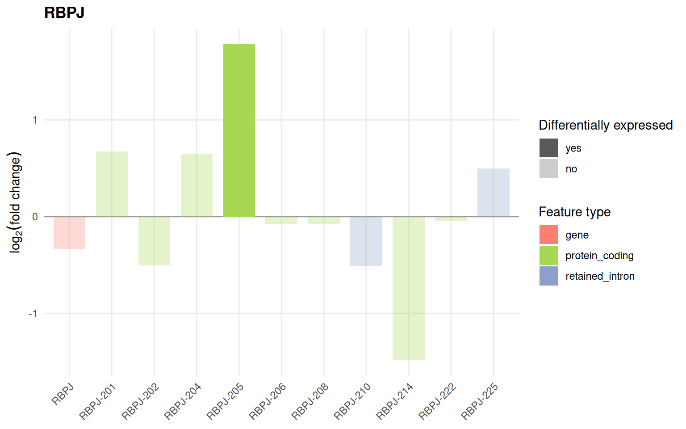
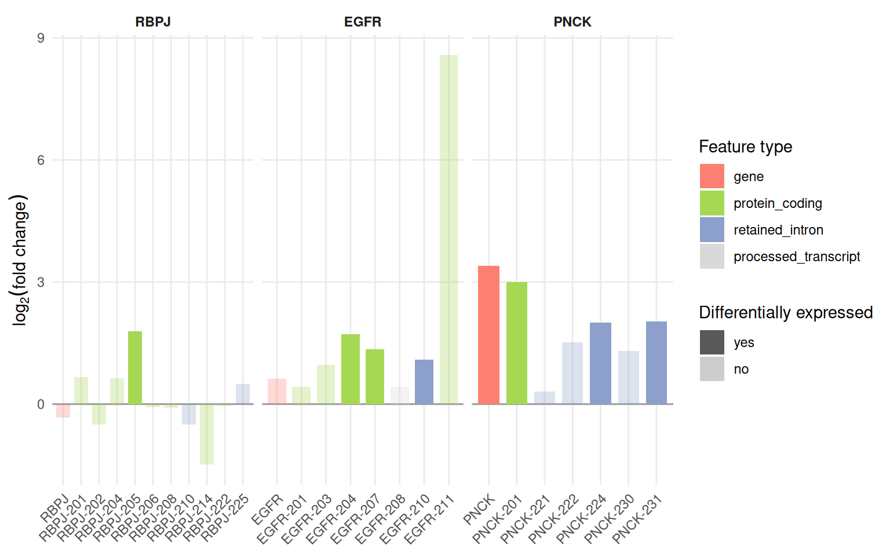
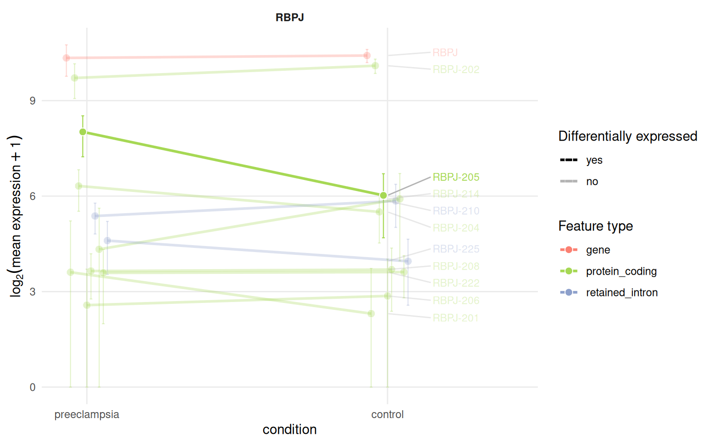
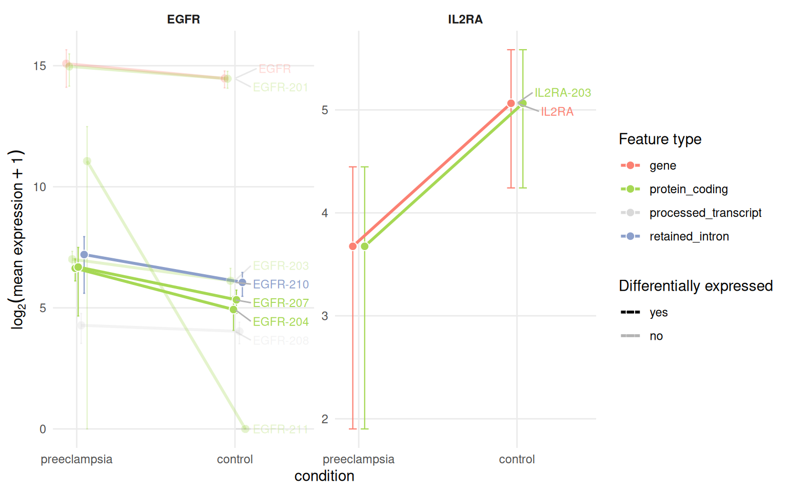
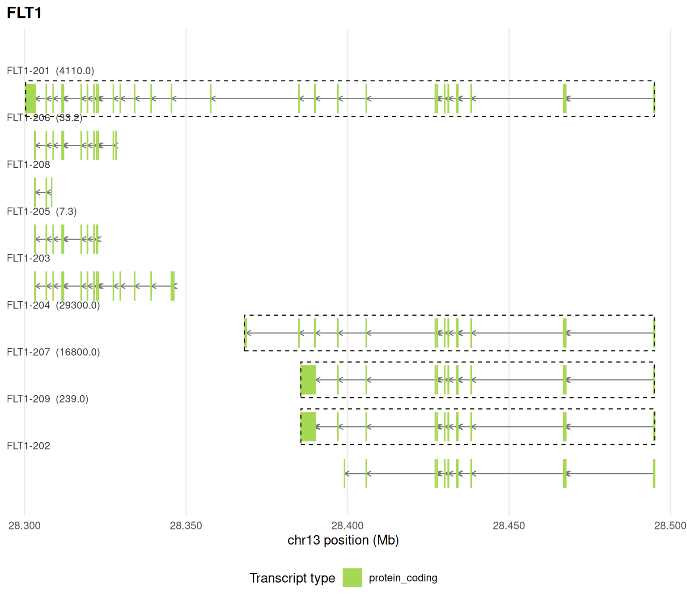
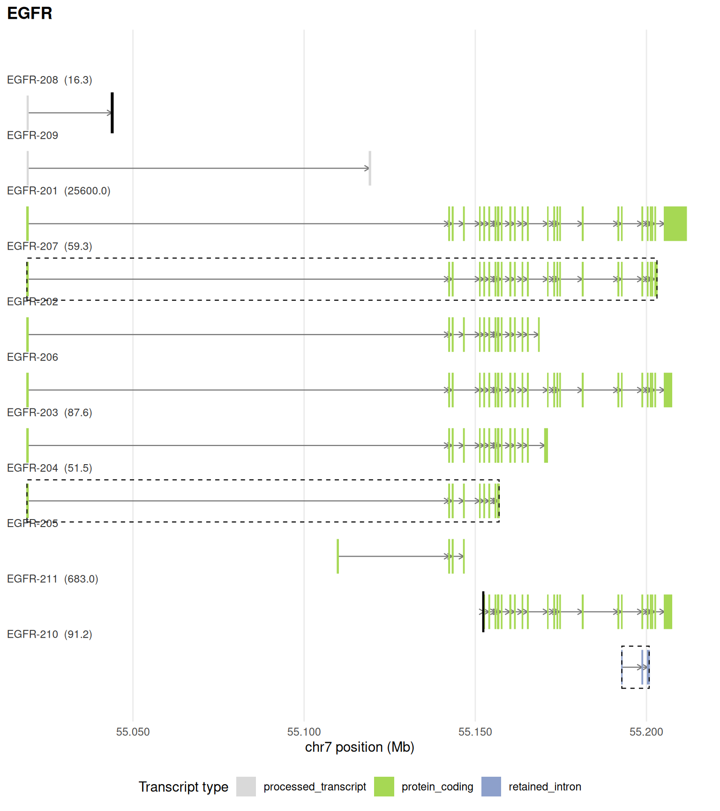
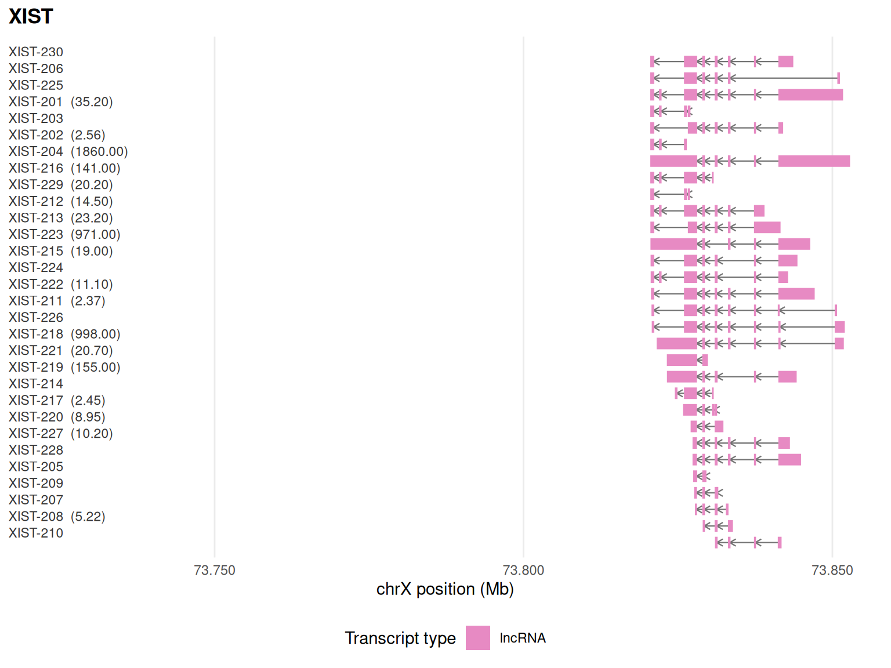

# Plots

Three plots show a gene and its isoforms from three angles: the
fold-change of each isoform next to that of the gene, the expression of
each isoform across conditions and the exon-intron structure of each
isoform along the genome. All of them are `ggplot2` objects and take an
`IsoformicExperiment` (or the equivalent table, see [working with plain
tables](https://luciorq.github.io/isoformic/articles/isoformic-tables.md)).

They start from the object built in the
[introduction](https://luciorq.github.io/isoformic/articles/isoformic-introduction.md):

``` r

library(isoformic)

extdata <- fs::path_package("isoformic", "extdata")
annot_dir <- prepare_isoformic_annotation(download_reference(version = "33", file_type = "gff"))
iso <- IsoformicExperiment(
  experiment_name = "preeclampsia_placenta",
  annot_path = annot_dir,
  assays = list(abundance = read_parquet(fs::path(extdata, "pe_abundance.parquet"))),
  col_data = read_parquet(fs::path(extdata, "pe_col_data.parquet"))
)
de_tx(iso) <- read_parquet(fs::path(extdata, "pe_det.parquet"))
de_gene(iso) <- read_parquet(fs::path(extdata, "pe_deg.parquet"))
```

## Log2 fold-change plot

[`plot_log2fc()`](https://luciorq.github.io/isoformic/reference/plot_log2fc.md)
compares the fold-change of a gene with that of each of its transcripts,
coloured by transcript type and faded when not significant. Several
genes give one panel each.

``` r

plot_log2fc(iso, feature = "RBPJ")
```



``` r

plot_log2fc(iso, feature = c("RBPJ", "EGFR", "PNCK"), ncol = 3)
```



The colours come from
[`tx_type_palette()`](https://luciorq.github.io/isoformic/reference/tx_type_palette.md)
and can be replaced through the `tx_type_palette` property of the
object;
[`productivity_palette()`](https://luciorq.github.io/isoformic/reference/productivity.md)
colours the productivity classes the same way.

``` r

tx_type_palette()
#>                               gene                     protein_coding 
#>                          "#fb8072"                          "#a6d854" 
#>                    retained_intron     protein_coding_CDS_not_defined 
#>                          "#8da0cb"                          "#fc8d62" 
#>            nonsense_mediated_decay                             lncRNA 
#>                          "#66c2a5"                          "#e78ac3" 
#>               processed_pseudogene transcribed_unprocessed_pseudogene 
#>                          "#ffd92f"                          "#e5c494" 
#>             unprocessed_pseudogene                     non_stop_decay 
#>                          "#d9d9d9"                          "#d9d9d9" 
#>     transcribed_unitary_pseudogene                         pseudogene 
#>                          "#d9d9d9"                          "#ffffb3" 
#>                 unitary_pseudogene               processed_transcript 
#>                          "#d9d9d9"                          "#d9d9d9" 
#>                            unknown                              novel 
#>                          "#bdbdbd"                          "#8c6bb1" 
#>                           misc_RNA                              miRNA 
#>                          "#d9d9d9"                          "#d9d9d9" 
#>                              snRNA                             snoRNA 
#>                          "#d9d9d9"                          "#d9d9d9" 
#>                  full-splice_match            incomplete-splice_match 
#>                          "#a6d854"                          "#66c2a5" 
#>                   novel_in_catalog               novel_not_in_catalog 
#>                          "#fdb462"                          "#bc80bd" 
#>                              genic                          antisense 
#>                          "#d9d9d9"                          "#80b1d3" 
#>                             fusion                         intergenic 
#>                          "#fccde5"                          "#d9d9d9" 
#>                       genic_intron                        coding_mRNA 
#>                          "#d9d9d9"                          "#a6d854" 
#>                  lncRNA_intergenic                   lncRNA_antisense 
#>                          "#e78ac3"                          "#8da0cb" 
#>                   lncRNA_divergent              lncRNA_sense_intronic 
#>                          "#fc8d62"                          "#66c2a5" 
#>                  sense_overlap_RNA                        short_ncRNA 
#>                          "#ffd92f"                          "#e5c494" 
#>                   uncertain_coding 
#>                          "#b3b3b3"
```

## Expression profile plot

[`plot_tx_expr()`](https://luciorq.github.io/isoformic/reference/profiles.md)
shows the mean expression of a gene and of each of its isoforms in every
condition, with standard deviations, so that isoform switches become
visible as crossing lines.

``` r

plot_tx_expr(iso, gene_name = "RBPJ", group = "condition")
```



``` r

plot_tx_expr(iso, gene_name = c("IL2RA", "EGFR"), group = "condition", ncol = 2)
```



The underlying table is available with
[`profile_data()`](https://luciorq.github.io/isoformic/reference/profiles.md).

``` r

head(profile_data(iso, gene_name = "RBPJ", group = "condition"))
#> # A tibble: 6 × 10
#>   feature_id feature_name feature_type gene_id gene_name group mean_expr sd_expr
#>   <chr>      <chr>        <chr>        <chr>   <chr>     <fct>     <dbl>   <dbl>
#> 1 ENSG00000… RBPJ         gene         ENSG00… RBPJ      pree…   1297.    427.  
#> 2 ENSG00000… RBPJ         gene         ENSG00… RBPJ      cont…   1367.    195.  
#> 3 ENST00000… RBPJ-201     protein_cod… ENSG00… RBPJ      pree…     11.2    25.1 
#> 4 ENST00000… RBPJ-201     protein_cod… ENSG00… RBPJ      cont…      3.95    8.30
#> 5 ENST00000… RBPJ-202     protein_cod… ENSG00… RBPJ      pree…    838.    303.  
#> 6 ENST00000… RBPJ-202     protein_cod… ENSG00… RBPJ      cont…   1095.    169.  
#> # ℹ 2 more variables: n_samples <int>, is_de <chr>
```

## Genomic context plot

[`plot_genomic_context()`](https://luciorq.github.io/isoformic/reference/plot_genomic_context.md)
draws the exon-intron structure of every annotated isoform of a gene
along the genome, coloured by transcript type, labelled with its mean
expression and outlined when differentially expressed. Poison exons (see
the [productivity
article](https://luciorq.github.io/isoformic/articles/isoformic-productivity.md))
are outlined as well.

``` r

plot_genomic_context(iso, gene_name = "FLT1")
#> duckdb keeps downloaded extensions and secrets in a temporary directory:
#> ℹ /tmp/RtmpN6qp3K/duckdb
#> This is removed when the R session ends.
#> • Extensions are re-downloaded each session.
#> • Secrets are lost.
#> ℹ Run duckdb(shared_home = TRUE) (or create ~/.duckdb) to keep them (suitable for most users).
#> ℹ Run duckdb(shared_home = FALSE) to accept the temporary directory (and silence this message).
#> ℹ See ?duckdb_storage for details and alternatives.
#> duckdb keeps downloaded extensions and secrets in a temporary directory:
#> ℹ /tmp/RtmpN6qp3K/duckdb
#> This is removed when the R session ends.
#> • Extensions are re-downloaded each session.
#> • Secrets are lost.
#> ℹ Run duckdb(shared_home = TRUE) (or create ~/.duckdb) to keep them (suitable for most users).
#> ℹ Run duckdb(shared_home = FALSE) to accept the temporary directory (and silence this message).
#> ℹ See ?duckdb_storage for details and alternatives.
#> duckdb keeps downloaded extensions and secrets in a temporary directory:
#> ℹ /tmp/RtmpN6qp3K/duckdb
#> This is removed when the R session ends.
#> • Extensions are re-downloaded each session.
#> • Secrets are lost.
#> ℹ Run duckdb(shared_home = TRUE) (or create ~/.duckdb) to keep them (suitable for most users).
#> ℹ Run duckdb(shared_home = FALSE) to accept the temporary directory (and silence this message).
#> ℹ See ?duckdb_storage for details and alternatives.
```



``` r

plot_genomic_context(iso, gene_name = "EGFR")
```



`upstream_offset` widens the window, for example to show a neighbouring
gene:

``` r

plot_genomic_context(iso, gene_name = "XIST", upstream_offset = 100000)
```



## Session information

``` r

sessionInfo()
#> R version 4.6.2 (2026-10-29)
#> Platform: x86_64-pc-linux-gnu
#> Running under: Ubuntu 24.04.5 LTS
#> 
#> Matrix products: default
#> BLAS:   /usr/lib/x86_64-linux-gnu/openblas-pthread/libblas.so.3 
#> LAPACK: /usr/lib/x86_64-linux-gnu/openblas-pthread/libopenblasp-r0.3.26.so;  LAPACK version 3.12.0
#> 
#> locale:
#>  [1] LC_CTYPE=C.UTF-8       LC_NUMERIC=C           LC_TIME=C.UTF-8       
#>  [4] LC_COLLATE=C.UTF-8     LC_MONETARY=C.UTF-8    LC_MESSAGES=C.UTF-8   
#>  [7] LC_PAPER=C.UTF-8       LC_NAME=C              LC_ADDRESS=C          
#> [10] LC_TELEPHONE=C         LC_MEASUREMENT=C.UTF-8 LC_IDENTIFICATION=C   
#> 
#> time zone: UTC
#> tzcode source: system (glibc)
#> 
#> attached base packages:
#> [1] stats     graphics  grDevices utils     datasets  methods   base     
#> 
#> other attached packages:
#> [1] isoformic_0.1.2.9022
#> 
#> loaded via a namespace (and not attached):
#>  [1] gtable_0.3.6       jsonlite_2.0.0     dplyr_1.2.1        compiler_4.6.2    
#>  [5] tidyselect_1.2.1   Rcpp_1.1.2         scales_1.4.0       yaml_2.3.12       
#>  [9] fastmap_1.2.0      ggplot2_4.0.3      R6_2.6.1           labeling_0.4.3    
#> [13] generics_0.1.4     curl_8.1.0         knitr_1.52         ggrepel_0.9.8     
#> [17] tibble_3.3.1       DBI_1.3.0          pillar_1.11.1      RColorBrewer_1.1-3
#> [21] rlang_1.3.0        utf8_1.2.6         xfun_0.62          fs_2.1.0          
#> [25] S7_0.2.2           otel_0.2.0         cli_3.6.6          withr_3.0.3       
#> [29] magrittr_2.0.5     digest_0.6.39      grid_4.6.2         lifecycle_1.0.5   
#> [33] vctrs_0.7.3        evaluate_1.0.5     glue_1.8.1         farver_2.1.2      
#> [37] duckdb_2.0.0       rmarkdown_2.32     tools_4.6.2        pkgconfig_2.0.3   
#> [41] htmltools_0.5.9
```
