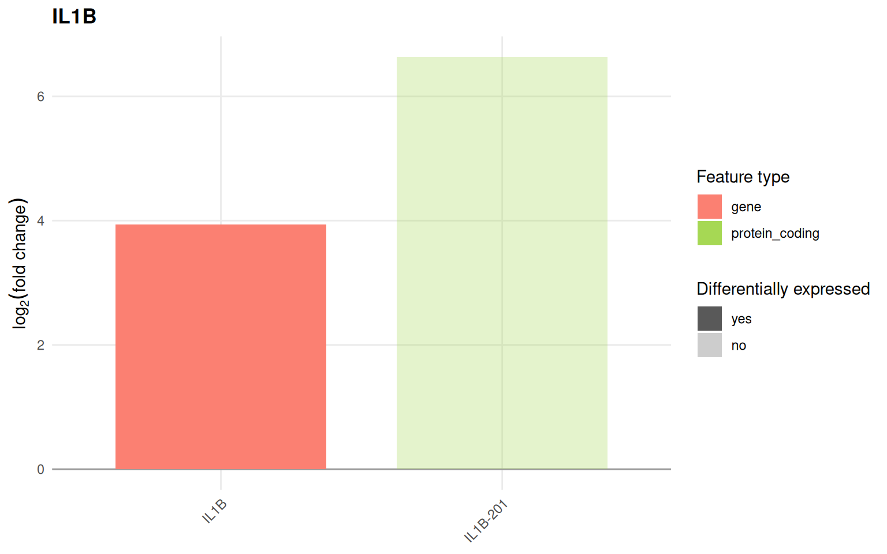
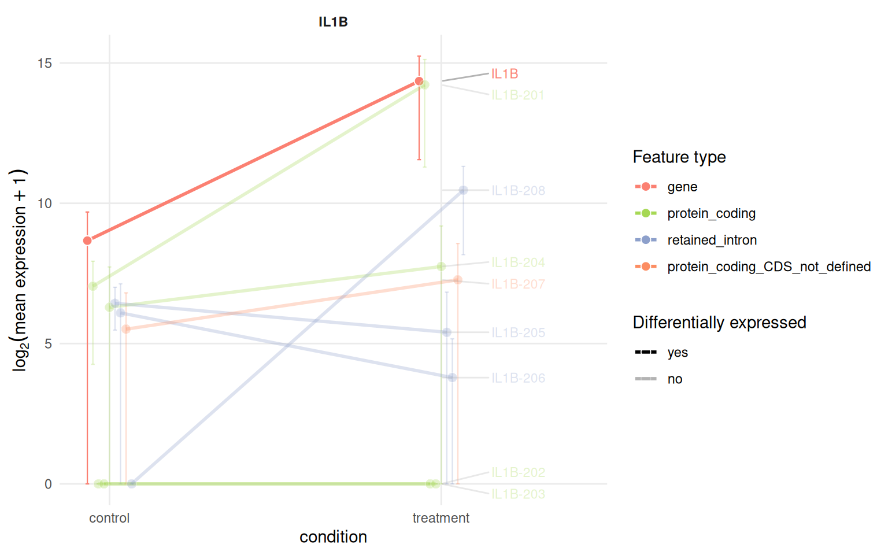
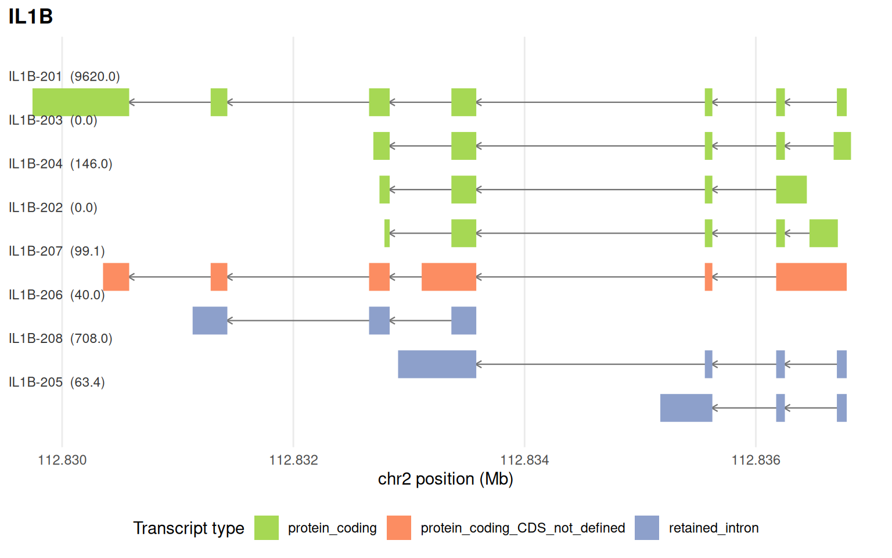

# From Salmon quantifications to an IsoformicExperiment

This article goes from FASTQ files to an `IsoformicExperiment` with
transcript-level and gene-level differential expression results. The
[introduction](https://luciorq.github.io/isoformic/articles/isoformic-introduction.md)
starts one step later, from ready-made tables, and the other articles
analyse the object.

## Quantifying with Salmon

We recommend [Salmon](https://github.com/COMBINE-lab/salmon) ([Patro et
al. 2017](#ref-salmon)) in selective-alignment mode against the GENCODE
transcriptome, with inferential replicates so that `swish` ([Zhu et al.
2019](#ref-swish)) can be used for transcript-level differential
expression.

Salmon 2 is a from-scratch rewrite in Rust (2.8.0 at the time of
writing). The workflow (`salmon index`, `salmon quant`, `quant.sf`) and
the output files are the same, so
[`read_salmon()`](https://luciorq.github.io/isoformic/reference/read_salmon.md),
`tximeta`, `tximport` and `swish` work unchanged, but the index format
is new: an index built with Salmon 1.x is rejected and must be rebuilt
(the last C++ release, 1.12.0, remains available as the `salmon-cpp`
conda package). Other changes worth knowing: selective alignment is the
only mapping mode (`--validateMappings` is a no-op), quantification is
deterministic by default (identical output for any thread count), decoy
sequences no longer appear in `quant.sf`, and `--ignoreTxVersion`
matches transcript identifiers without their version suffix when a gene
map is given. The Salmon [migration
guide](https://github.com/COMBINE-lab/salmon/blob/master/MIGRATION.md)
lists every removed or ignored option.

A typical single-sample invocation from a shell is below: `--libType A`
detects the library type, the index is built from the GENCODE transcript
FASTA with `salmon index --gencode` (which truncates the transcript
names at the first `|`), `--posBias --seqBias --gcBias` correct the
biases, `--dumpEq --dumpEqWeights` keep the equivalence classes and
`--numGibbsSamples` writes the inferential replicates that `swish` needs
into `aux_info/bootstrap/`.

``` bash
salmon index \
  --transcripts gencode.v49.transcripts.fa.gz \
  --index salmon_index \
  --gencode \
  --threads 8

salmon quant \
  --libType A \
  --index salmon_index \
  --mates1 /path/SRR..._1.fastq.gz \
  --mates2 /path/SRR..._2.fastq.gz \
  --output /path/SRR..._quant \
  --threads 8 \
  --allowDovetail --softclipOverhangs \
  --dumpEq --dumpEqWeights \
  --posBias --seqBias --gcBias \
  --numGibbsSamples 30
```

The same can be driven from R through the `condathis` package, which
installs Salmon from Bioconda into a conda environment (Linux and macOS,
or WSL2 on Windows).
[`salmon_index()`](https://luciorq.github.io/isoformic/reference/salmon_index.md)
and
[`salmon_quant()`](https://luciorq.github.io/isoformic/reference/salmon_quant.md)
run the commands above; the first call creates the environment with
Salmon 2.8.0:

``` r

library(isoformic)
tx_fasta <- download_reference(version = "49", file_type = "fasta")
gff_path <- download_reference(version = "49", file_type = "gff")

salmon_index(fasta_path = tx_fasta, index_path = "salmon_index", is_gencode = TRUE, num_threads = 8)
salmon_quant(
  input_r1 = "sample_1.fastq.gz",
  input_r2 = "sample_2.fastq.gz",
  index_path = "salmon_index",
  output_dir = "quants/sample_quant",
  num_threads = 8
)
```

[`salmon_quant()`](https://luciorq.github.io/isoformic/reference/salmon_quant.md)
draws 30 Gibbs samples per sample by default (`num_gibbs = 0` skips
them). Besides `swish`, they quantify how well the reads determine each
isoform, which isoforms cannot be told apart and how confident each
differential expression call is; `read_salmon(inferential = TRUE)` reads
them and the [uncertainty
article](https://luciorq.github.io/isoformic/articles/isoformic-uncertainty.md)
explains how to use and report them.

For a decoy-aware index (recommended by the Salmon authors), build the
`gentrome` FASTA and `decoys.txt` from the genome as described in the
Salmon documentation and pass `--decoys decoys.txt` to `salmon index`.

## Reading quantifications directly

[`read_salmon()`](https://luciorq.github.io/isoformic/reference/read_salmon.md)
reads any number of `quant.sf` files with DuckDB and returns an
`IsoformicExperiment` with `abundance` (TPM), `counts` and `length`
assays. The package ships a down-sampled dataset of six placenta samples
quantified against GENCODE v49.

``` r

library(isoformic)

quants_dir <- fs::path_package("isoformic", "extdata", "mini_quants")
quant_dirs <- fs::dir_ls(quants_dir, type = "directory")
names(quant_dirs) <- sub("_quant$", "", fs::path_file(quant_dirs))

col_data <- tibble::tibble(
  sample_id = names(quant_dirs),
  condition = factor(c(rep("control", 3), rep("treatment", 3)), levels = c("control", "treatment"))
)
col_data
#> # A tibble: 6 × 2
#>   sample_id   condition
#>   <chr>       <fct>    
#> 1 SRR11498039 control  
#> 2 SRR11498040 control  
#> 3 SRR11498041 control  
#> 4 SRR11498079 treatment
#> 5 SRR11498080 treatment
#> 6 SRR11498081 treatment
```

The annotation must match the reference used for quantification, GENCODE
v49 here. For real data it is downloaded once into the package cache and
converted to Parquet once:

``` r

gff_path <- download_reference(version = "49", file_type = "gff")
annot_dir <- prepare_isoformic_annotation(gff_path)
```

The package bundles the subset of that annotation covering the
transcripts of the mini dataset.

``` r

annot_dir <- fs::path_package("isoformic", "extdata", "mini_annotation")

iso <- read_salmon(quant_dirs, annot_path = annot_dir, col_data = col_data, experiment_name = "mini_placenta")
#> duckdb keeps downloaded extensions and secrets in a temporary directory:
#> ℹ /tmp/RtmphiuWoR/duckdb
#> This is removed when the R session ends.
#> • Extensions are re-downloaded each session.
#> • Secrets are lost.
#> ℹ Run duckdb(shared_home = TRUE) (or create ~/.duckdb) to keep them (suitable for most users).
#> ℹ Run duckdb(shared_home = FALSE) to accept the temporary directory (and silence this message).
#> ℹ See ?duckdb_storage for details and alternatives.
#> Warning in duckdb_post_execute(res, out): NAs introduced by coercion
#> Warning in duckdb_post_execute(res, out): NAs introduced by coercion
#> Warning in duckdb_post_execute(res, out): NAs introduced by coercion
#> duckdb keeps downloaded extensions and secrets in a temporary directory:
#> ℹ /tmp/RtmphiuWoR/duckdb
#> This is removed when the R session ends.
#> • Extensions are re-downloaded each session.
#> • Secrets are lost.
#> ℹ Run duckdb(shared_home = TRUE) (or create ~/.duckdb) to keep them (suitable for most users).
#> ℹ Run duckdb(shared_home = FALSE) to accept the temporary directory (and silence this message).
#> ℹ See ?duckdb_storage for details and alternatives.
iso
#> <IsoformicExperiment> mini_placenta
#> duckdb keeps downloaded extensions and secrets in a temporary directory:
#> ℹ /tmp/RtmphiuWoR/duckdb
#> This is removed when the R session ends.
#> • Extensions are re-downloaded each session.
#> • Secrets are lost.
#> ℹ Run duckdb(shared_home = TRUE) (or create ~/.duckdb) to keep them (suitable for most users).
#> ℹ Run duckdb(shared_home = FALSE) to accept the temporary directory (and silence this message).
#> ℹ See ?duckdb_storage for details and alternatives.
#> duckdb keeps downloaded extensions and secrets in a temporary directory:
#> ℹ /tmp/RtmphiuWoR/duckdb
#> This is removed when the R session ends.
#> • Extensions are re-downloaded each session.
#> • Secrets are lost.
#> ℹ Run duckdb(shared_home = TRUE) (or create ~/.duckdb) to keep them (suitable for most users).
#> ℹ Run duckdb(shared_home = FALSE) to accept the temporary directory (and silence this message).
#> ℹ See ?duckdb_storage for details and alternatives.
#> duckdb keeps downloaded extensions and secrets in a temporary directory:
#> ℹ /tmp/RtmphiuWoR/duckdb
#> This is removed when the R session ends.
#> • Extensions are re-downloaded each session.
#> • Secrets are lost.
#> ℹ Run duckdb(shared_home = TRUE) (or create ~/.duckdb) to keep them (suitable for most users).
#> ℹ Run duckdb(shared_home = FALSE) to accept the temporary directory (and silence this message).
#> ℹ See ?duckdb_storage for details and alternatives.
#>   annotation : gencode_v49_mini_subset (15 genes, 111 transcripts, 1,071 exons)
#>   samples    : 6 [condition]
#>   transcripts: 111 assayed from 15 genes
#>   assays     : abundance, counts, length
#>   gene assays: derived from transcript assays on demand
#>   DE results : <none>
assay_names(iso)
#> [1] "abundance" "counts"    "length"
head(row_data(iso))
#> duckdb keeps downloaded extensions and secrets in a temporary directory:
#> ℹ /tmp/RtmphiuWoR/duckdb
#> This is removed when the R session ends.
#> • Extensions are re-downloaded each session.
#> • Secrets are lost.
#> ℹ Run duckdb(shared_home = TRUE) (or create ~/.duckdb) to keep them (suitable for most users).
#> ℹ Run duckdb(shared_home = FALSE) to accept the temporary directory (and silence this message).
#> ℹ See ?duckdb_storage for details and alternatives.
#> # A tibble: 6 × 19
#>   transcript_id      transcript_name transcript_type gene_id gene_name gene_type
#>   <chr>              <chr>           <chr>           <chr>   <chr>     <chr>    
#> 1 ENST00000216797.10 NFKBIA-201      protein_coding  ENSG00… NFKBIA    protein_…
#> 2 ENST00000225831.4  CCL2-201        protein_coding  ENSG00… CCL2      protein_…
#> 3 ENST00000258743.10 IL6-201         protein_coding  ENSG00… IL6       protein_…
#> 4 ENST00000263341.7  IL1B-201        protein_coding  ENSG00… IL1B      protein_…
#> 5 ENST00000264832.8  ICAM1-201       protein_coding  ENSG00… ICAM1     protein_…
#> 6 ENST00000306602.3  CXCL10-201      protein_coding  ENSG00… CXCL10    protein_…
#> # ℹ 13 more variables: source_gene_id <chr>, source_transcript_id <chr>,
#> #   tags <chr>, coding_status <chr>, transcript_support_level <chr>,
#> #   tie_score <dbl>, cds_start <int>, cds_end <int>, cds_length <int>,
#> #   is_canonical <lgl>, haplotype <chr>, n_exons <int>, tx_length <int>
```

## Transcript-level differential expression with swish

`swish` needs the inferential replicates, which `tximeta` imports from
the Salmon output (the bundled quantifications carry them separately to
keep the package small).

``` r

suppressPackageStartupMessages({
  library(SummarizedExperiment)
  library(fishpond)
})

tximeta_coldata <- data.frame(
  files = fs::path(quant_dirs, "quant.sf"),
  names = names(quant_dirs),
  condition = col_data$condition
)
se_tx <- tximeta::tximeta(
  coldata = tximeta_coldata,
  type = "salmon",
  txOut = TRUE,
  skipMeta = TRUE,
  useHub = FALSE,
  ignoreAfterBar = TRUE,
  skipSeqinfo = TRUE
)
mini_draws <- as_inferential_replicates(
  read_parquet(fs::path_package("isoformic", "extdata", "mini_draws.parquet"))
)
names(mini_draws) <- paste0("infRep", seq_along(mini_draws))
assays(se_tx) <- c(as.list(assays(se_tx)), mini_draws)

y <- fishpond::scaleInfReps(se_tx)
y <- fishpond::labelKeep(y, minCount = 10, minN = 3)
set.seed(20261029) # swish uses permutations
y <- fishpond::swish(y, x = "condition")

swish_results <- mcols(y) |>
  as.data.frame() |>
  tibble::rownames_to_column("transcript_id")
head(swish_results)
#>        transcript_id log10mean  keep stat   log2FC    pvalue locfdr    qvalue
#> 1 ENST00000367468.10  2.923578  TRUE 1.85 1.821603 0.3115385      1 0.5785714
#> 2  ENST00000681605.1  2.553906 FALSE   NA       NA        NA     NA        NA
#> 3  ENST00000680451.1  2.350137 FALSE   NA       NA        NA     NA        NA
#> 4  ENST00000490885.6  2.225321 FALSE   NA       NA        NA     NA        NA
#> 5  ENST00000559627.1  1.959647 FALSE   NA       NA        NA     NA        NA
#> 6  ENST00000466691.1  1.607356 FALSE   NA       NA        NA     NA        NA
```

The results are attached to the object; `tximeta` objects can also be
converted directly with `as_isoformic(se_tx, annot_path = annot_dir)`.

``` r

de_tx(iso) <- swish_results
head(de_tx(iso))
#> # A tibble: 6 × 9
#>   transcript_id     log10mean keep   stat log2FC pvalue locfdr qvalue det_sig
#>   <chr>                 <dbl> <lgl> <dbl>  <dbl>  <dbl>  <dbl>  <dbl> <chr>  
#> 1 ENST00000263341.7      3.59 TRUE   3.25   6.63 0.0727  0.529  0.234 no     
#> 2 ENST00000651122.1      2.72 TRUE   3.5    4.91 0.0562  0.455  0.234 no     
#> 3 ENST00000306602.3      2.44 TRUE  -3.3   -3.75 0.0673  0.506  0.234 no     
#> 4 ENST00000392322.7      2.61 TRUE   2.45   2.62 0.157   0.839  0.407 no     
#> 5 ENST00000698141.1      2.45 TRUE   2      2.24 0.264   1      0.528 no     
#> 6 ENST00000697958.1      2.52 TRUE  -3.65  -2.01 0.0423  0.388  0.234 no
```

## Gene-level differential expression with DESeq2

[`as_summarized_experiment()`](https://luciorq.github.io/isoformic/reference/isoformic-conversion.md)
exports the gene-level assays (isoforms summed, lengths averaged by
abundance) so that `DESeq2` can run on them.

``` r

se_gene <- as_summarized_experiment(iso, level = "gene")
assay(se_gene, "counts") <- round(assay(se_gene, "counts"))
se_gene$condition <- factor(se_gene$condition, levels = c("control", "treatment"))

dds <- DESeq2::DESeqDataSet(se_gene, design = ~condition)
dds <- dds[rowSums(DESeq2::counts(dds) >= 10) >= 3, ]
dds <- DESeq2::DESeq(dds, quiet = TRUE)
res <- DESeq2::results(dds, contrast = c("condition", "treatment", "control"))
shrink_type <- if (rlang::is_installed("apeglm")) "apeglm" else "normal"
res_shr <- DESeq2::lfcShrink(dds, coef = "condition_treatment_vs_control", res = res, type = shrink_type, quiet = TRUE)

de_gene(iso) <- as.data.frame(res_shr)
head(de_gene(iso))
#> # A tibble: 6 × 7
#>   gene_id            baseMean       log2FC   lfcSE   pvalue  qvalue deg_sig
#>   <chr>                 <dbl>        <dbl>   <dbl>    <dbl>   <dbl> <chr>  
#> 1 ENSG00000125538.12    140.   3.94        1.55    0.000218 0.00196 yes    
#> 2 ENSG00000115415.22    435.   0.00000191  0.00144 0.452    0.614   no     
#> 3 ENSG00000100906.13   1212.  -0.00000132  0.00144 0.362    0.614   no     
#> 4 ENSG00000271503.7   20364.  -0.000000869 0.00144 0.477    0.614   no     
#> 5 ENSG00000184557.5     241.   0.000000810 0.00144 0.586    0.659   no     
#> 6 ENSG00000073756.13     63.9  0.000000600 0.00144 0.438    0.614   no
iso
#> <IsoformicExperiment> mini_placenta
#>   annotation : gencode_v49_mini_subset (15 genes, 111 transcripts, 1,071 exons)
#>   samples    : 6 [condition]
#>   transcripts: 111 assayed from 15 genes
#>   assays     : abundance, counts, length
#>   gene assays: derived from transcript assays on demand
#>   DE results : det (111 transcripts), deg (12 genes)
```

## Looking at the results

``` r

top_gene <- de_gene(iso) |>
  dplyr::arrange(qvalue) |>
  dplyr::slice_head(n = 1) |>
  dplyr::pull(gene_id)
gene_name <- gene_data(iso)$gene_name[gene_data(iso)$gene_id == top_gene]
gene_name
#> [1] "IL1B"

plot_log2fc(iso, feature = gene_name)
```



``` r

plot_tx_expr(iso, gene_name = gene_name, group = "condition")
```



``` r

plot_genomic_context(iso, gene_name = gene_name)
#> duckdb keeps downloaded extensions and secrets in a temporary directory:
#> ℹ /tmp/RtmphiuWoR/duckdb
#> This is removed when the R session ends.
#> • Extensions are re-downloaded each session.
#> • Secrets are lost.
#> ℹ Run duckdb(shared_home = TRUE) (or create ~/.duckdb) to keep them (suitable for most users).
#> ℹ Run duckdb(shared_home = FALSE) to accept the temporary directory (and silence this message).
#> ℹ See ?duckdb_storage for details and alternatives.
#> duckdb keeps downloaded extensions and secrets in a temporary directory:
#> ℹ /tmp/RtmphiuWoR/duckdb
#> This is removed when the R session ends.
#> • Extensions are re-downloaded each session.
#> • Secrets are lost.
#> ℹ Run duckdb(shared_home = TRUE) (or create ~/.duckdb) to keep them (suitable for most users).
#> ℹ Run duckdb(shared_home = FALSE) to accept the temporary directory (and silence this message).
#> ℹ See ?duckdb_storage for details and alternatives.
#> duckdb keeps downloaded extensions and secrets in a temporary directory:
#> ℹ /tmp/RtmphiuWoR/duckdb
#> This is removed when the R session ends.
#> • Extensions are re-downloaded each session.
#> • Secrets are lost.
#> ℹ Run duckdb(shared_home = TRUE) (or create ~/.duckdb) to keep them (suitable for most users).
#> ℹ Run duckdb(shared_home = FALSE) to accept the temporary directory (and silence this message).
#> ℹ See ?duckdb_storage for details and alternatives.
```



``` r

isoform_switches(iso) |> head()
#> # A tibble: 0 × 12
#> # ℹ 12 variables: gene_id <chr>, gene_name <chr>, gene_type <chr>,
#> #   n_tx_tested <int>, n_det_sig <int>, n_det_up <int>, n_det_down <int>,
#> #   det_sig_types <chr>, max_abs_log2FC <dbl>, gene_log2FC <dbl>,
#> #   deg_sig <chr>, switch_type <chr>
```

## Saving

The object, with both result tables, is written as a directory of
Parquet files and restored with
[`read_isoformic()`](https://luciorq.github.io/isoformic/reference/isoformic-io.md).

``` r

out_dir <- fs::path(tempdir(), "mini_placenta")
iso <- write_isoformic(iso, out_dir, overwrite = TRUE)
#> duckdb keeps downloaded extensions and secrets in a temporary directory:
#> ℹ /tmp/RtmphiuWoR/duckdb
#> This is removed when the R session ends.
#> • Extensions are re-downloaded each session.
#> • Secrets are lost.
#> ℹ Run duckdb(shared_home = TRUE) (or create ~/.duckdb) to keep them (suitable for most users).
#> ℹ Run duckdb(shared_home = FALSE) to accept the temporary directory (and silence this message).
#> ℹ See ?duckdb_storage for details and alternatives.
#> duckdb keeps downloaded extensions and secrets in a temporary directory:
#> ℹ /tmp/RtmphiuWoR/duckdb
#> This is removed when the R session ends.
#> • Extensions are re-downloaded each session.
#> • Secrets are lost.
#> ℹ Run duckdb(shared_home = TRUE) (or create ~/.duckdb) to keep them (suitable for most users).
#> ℹ Run duckdb(shared_home = FALSE) to accept the temporary directory (and silence this message).
#> ℹ See ?duckdb_storage for details and alternatives.
#> duckdb keeps downloaded extensions and secrets in a temporary directory:
#> ℹ /tmp/RtmphiuWoR/duckdb
#> This is removed when the R session ends.
#> • Extensions are re-downloaded each session.
#> • Secrets are lost.
#> ℹ Run duckdb(shared_home = TRUE) (or create ~/.duckdb) to keep them (suitable for most users).
#> ℹ Run duckdb(shared_home = FALSE) to accept the temporary directory (and silence this message).
#> ℹ See ?duckdb_storage for details and alternatives.
#> duckdb keeps downloaded extensions and secrets in a temporary directory:
#> ℹ /tmp/RtmphiuWoR/duckdb
#> This is removed when the R session ends.
#> • Extensions are re-downloaded each session.
#> • Secrets are lost.
#> ℹ Run duckdb(shared_home = TRUE) (or create ~/.duckdb) to keep them (suitable for most users).
#> ℹ Run duckdb(shared_home = FALSE) to accept the temporary directory (and silence this message).
#> ℹ See ?duckdb_storage for details and alternatives.
#> duckdb keeps downloaded extensions and secrets in a temporary directory:
#> ℹ /tmp/RtmphiuWoR/duckdb
#> This is removed when the R session ends.
#> • Extensions are re-downloaded each session.
#> • Secrets are lost.
#> ℹ Run duckdb(shared_home = TRUE) (or create ~/.duckdb) to keep them (suitable for most users).
#> ℹ Run duckdb(shared_home = FALSE) to accept the temporary directory (and silence this message).
#> ℹ See ?duckdb_storage for details and alternatives.
#> duckdb keeps downloaded extensions and secrets in a temporary directory:
#> ℹ /tmp/RtmphiuWoR/duckdb
#> This is removed when the R session ends.
#> • Extensions are re-downloaded each session.
#> • Secrets are lost.
#> ℹ Run duckdb(shared_home = TRUE) (or create ~/.duckdb) to keep them (suitable for most users).
#> ℹ Run duckdb(shared_home = FALSE) to accept the temporary directory (and silence this message).
#> ℹ See ?duckdb_storage for details and alternatives.
#> duckdb keeps downloaded extensions and secrets in a temporary directory:
#> ℹ /tmp/RtmphiuWoR/duckdb
#> This is removed when the R session ends.
#> • Extensions are re-downloaded each session.
#> • Secrets are lost.
#> ℹ Run duckdb(shared_home = TRUE) (or create ~/.duckdb) to keep them (suitable for most users).
#> ℹ Run duckdb(shared_home = FALSE) to accept the temporary directory (and silence this message).
#> ℹ See ?duckdb_storage for details and alternatives.
#> duckdb keeps downloaded extensions and secrets in a temporary directory:
#> ℹ /tmp/RtmphiuWoR/duckdb
#> This is removed when the R session ends.
#> • Extensions are re-downloaded each session.
#> • Secrets are lost.
#> ℹ Run duckdb(shared_home = TRUE) (or create ~/.duckdb) to keep them (suitable for most users).
#> ℹ Run duckdb(shared_home = FALSE) to accept the temporary directory (and silence this message).
#> ℹ See ?duckdb_storage for details and alternatives.
iso@data_path
#> [1] "/tmp/RtmphiuWoR/mini_placenta"
fs::dir_ls(out_dir)
#> /tmp/RtmphiuWoR/mini_placenta/assays
#> /tmp/RtmphiuWoR/mini_placenta/col_data.parquet
#> /tmp/RtmphiuWoR/mini_placenta/dea
#> /tmp/RtmphiuWoR/mini_placenta/experiment.parquet
#> /tmp/RtmphiuWoR/mini_placenta/tx_type_palette.parquet
```

## Long reads with Oarfish

Oxford Nanopore and PacBio reads are quantified with Oarfish, which
writes bootstrap replicates and a table of unique and shared reads next
to the counts.
[`read_oarfish()`](https://luciorq.github.io/isoformic/reference/read_oarfish.md)
reads them like
[`read_salmon()`](https://luciorq.github.io/isoformic/reference/read_salmon.md)
and the uncertainty functions of the [uncertainty
article](https://luciorq.github.io/isoformic/articles/isoformic-uncertainty.md)
work on them unchanged. The three samples below are simulated nanopore
reads of the RBPJ transcripts, quantified with Oarfish 0.10.3 and 30
bootstrap replicates (`data-raw/oarfish/`), so they only show the file
layout and the functions, not a real library.

``` r

oarfish_dir <- fs::path_package("isoformic", "extdata", "oarfish")
prefixes <- fs::path(oarfish_dir, c("control_1", "control_2", "treated_1"))
names(prefixes) <- fs::path_file(prefixes)
fs::dir_ls(oarfish_dir, regexp = "treated_1")
#> /home/runner/work/_temp/Library/isoformic/extdata/oarfish/treated_1.ambig_info.tsv
#> /home/runner/work/_temp/Library/isoformic/extdata/oarfish/treated_1.infreps.pq
#> /home/runner/work/_temp/Library/isoformic/extdata/oarfish/treated_1.meta_info.json
#> /home/runner/work/_temp/Library/isoformic/extdata/oarfish/treated_1.quant

iso_long <- read_oarfish(
  prefixes,
  annot_path = fs::path_package("isoformic", "extdata", "example_experiment", "annotation"),
  inferential = TRUE
)
#> duckdb keeps downloaded extensions and secrets in a temporary directory:
#> ℹ /tmp/RtmphiuWoR/duckdb
#> This is removed when the R session ends.
#> • Extensions are re-downloaded each session.
#> • Secrets are lost.
#> ℹ Run duckdb(shared_home = TRUE) (or create ~/.duckdb) to keep them (suitable for most users).
#> ℹ Run duckdb(shared_home = FALSE) to accept the temporary directory (and silence this message).
#> ℹ See ?duckdb_storage for details and alternatives.
#> duckdb keeps downloaded extensions and secrets in a temporary directory:
#> ℹ /tmp/RtmphiuWoR/duckdb
#> This is removed when the R session ends.
#> • Extensions are re-downloaded each session.
#> • Secrets are lost.
#> ℹ Run duckdb(shared_home = TRUE) (or create ~/.duckdb) to keep them (suitable for most users).
#> ℹ Run duckdb(shared_home = FALSE) to accept the temporary directory (and silence this message).
#> ℹ See ?duckdb_storage for details and alternatives.
#> duckdb keeps downloaded extensions and secrets in a temporary directory:
#> ℹ /tmp/RtmphiuWoR/duckdb
#> This is removed when the R session ends.
#> • Extensions are re-downloaded each session.
#> • Secrets are lost.
#> ℹ Run duckdb(shared_home = TRUE) (or create ~/.duckdb) to keep them (suitable for most users).
#> ℹ Run duckdb(shared_home = FALSE) to accept the temporary directory (and silence this message).
#> ℹ See ?duckdb_storage for details and alternatives.
#> duckdb keeps downloaded extensions and secrets in a temporary directory:
#> ℹ /tmp/RtmphiuWoR/duckdb
#> This is removed when the R session ends.
#> • Extensions are re-downloaded each session.
#> • Secrets are lost.
#> ℹ Run duckdb(shared_home = TRUE) (or create ~/.duckdb) to keep them (suitable for most users).
#> ℹ Run duckdb(shared_home = FALSE) to accept the temporary directory (and silence this message).
#> ℹ See ?duckdb_storage for details and alternatives.
#> duckdb keeps downloaded extensions and secrets in a temporary directory:
#> ℹ /tmp/RtmphiuWoR/duckdb
#> This is removed when the R session ends.
#> • Extensions are re-downloaded each session.
#> • Secrets are lost.
#> ℹ Run duckdb(shared_home = TRUE) (or create ~/.duckdb) to keep them (suitable for most users).
#> ℹ Run duckdb(shared_home = FALSE) to accept the temporary directory (and silence this message).
#> ℹ See ?duckdb_storage for details and alternatives.
#> duckdb keeps downloaded extensions and secrets in a temporary directory:
#> ℹ /tmp/RtmphiuWoR/duckdb
#> This is removed when the R session ends.
#> • Extensions are re-downloaded each session.
#> • Secrets are lost.
#> ℹ Run duckdb(shared_home = TRUE) (or create ~/.duckdb) to keep them (suitable for most users).
#> ℹ Run duckdb(shared_home = FALSE) to accept the temporary directory (and silence this message).
#> ℹ See ?duckdb_storage for details and alternatives.
#> duckdb keeps downloaded extensions and secrets in a temporary directory:
#> ℹ /tmp/RtmphiuWoR/duckdb
#> This is removed when the R session ends.
#> • Extensions are re-downloaded each session.
#> • Secrets are lost.
#> ℹ Run duckdb(shared_home = TRUE) (or create ~/.duckdb) to keep them (suitable for most users).
#> ℹ Run duckdb(shared_home = FALSE) to accept the temporary directory (and silence this message).
#> ℹ See ?duckdb_storage for details and alternatives.
#> duckdb keeps downloaded extensions and secrets in a temporary directory:
#> ℹ /tmp/RtmphiuWoR/duckdb
#> This is removed when the R session ends.
#> • Extensions are re-downloaded each session.
#> • Secrets are lost.
#> ℹ Run duckdb(shared_home = TRUE) (or create ~/.duckdb) to keep them (suitable for most users).
#> ℹ Run duckdb(shared_home = FALSE) to accept the temporary directory (and silence this message).
#> ℹ See ?duckdb_storage for details and alternatives.
#> duckdb keeps downloaded extensions and secrets in a temporary directory:
#> ℹ /tmp/RtmphiuWoR/duckdb
#> This is removed when the R session ends.
#> • Extensions are re-downloaded each session.
#> • Secrets are lost.
#> ℹ Run duckdb(shared_home = TRUE) (or create ~/.duckdb) to keep them (suitable for most users).
#> ℹ Run duckdb(shared_home = FALSE) to accept the temporary directory (and silence this message).
#> ℹ See ?duckdb_storage for details and alternatives.
#> duckdb keeps downloaded extensions and secrets in a temporary directory:
#> ℹ /tmp/RtmphiuWoR/duckdb
#> This is removed when the R session ends.
#> • Extensions are re-downloaded each session.
#> • Secrets are lost.
#> ℹ Run duckdb(shared_home = TRUE) (or create ~/.duckdb) to keep them (suitable for most users).
#> ℹ Run duckdb(shared_home = FALSE) to accept the temporary directory (and silence this message).
#> ℹ See ?duckdb_storage for details and alternatives.
#> duckdb keeps downloaded extensions and secrets in a temporary directory:
#> ℹ /tmp/RtmphiuWoR/duckdb
#> This is removed when the R session ends.
#> • Extensions are re-downloaded each session.
#> • Secrets are lost.
#> ℹ Run duckdb(shared_home = TRUE) (or create ~/.duckdb) to keep them (suitable for most users).
#> ℹ Run duckdb(shared_home = FALSE) to accept the temporary directory (and silence this message).
#> ℹ See ?duckdb_storage for details and alternatives.
#> duckdb keeps downloaded extensions and secrets in a temporary directory:
#> ℹ /tmp/RtmphiuWoR/duckdb
#> This is removed when the R session ends.
#> • Extensions are re-downloaded each session.
#> • Secrets are lost.
#> ℹ Run duckdb(shared_home = TRUE) (or create ~/.duckdb) to keep them (suitable for most users).
#> ℹ Run duckdb(shared_home = FALSE) to accept the temporary directory (and silence this message).
#> ℹ See ?duckdb_storage for details and alternatives.
#> duckdb keeps downloaded extensions and secrets in a temporary directory:
#> ℹ /tmp/RtmphiuWoR/duckdb
#> This is removed when the R session ends.
#> • Extensions are re-downloaded each session.
#> • Secrets are lost.
#> ℹ Run duckdb(shared_home = TRUE) (or create ~/.duckdb) to keep them (suitable for most users).
#> ℹ Run duckdb(shared_home = FALSE) to accept the temporary directory (and silence this message).
#> ℹ See ?duckdb_storage for details and alternatives.
#> duckdb keeps downloaded extensions and secrets in a temporary directory:
#> ℹ /tmp/RtmphiuWoR/duckdb
#> This is removed when the R session ends.
#> • Extensions are re-downloaded each session.
#> • Secrets are lost.
#> ℹ Run duckdb(shared_home = TRUE) (or create ~/.duckdb) to keep them (suitable for most users).
#> ℹ Run duckdb(shared_home = FALSE) to accept the temporary directory (and silence this message).
#> ℹ See ?duckdb_storage for details and alternatives.
#> duckdb keeps downloaded extensions and secrets in a temporary directory:
#> ℹ /tmp/RtmphiuWoR/duckdb
#> This is removed when the R session ends.
#> • Extensions are re-downloaded each session.
#> • Secrets are lost.
#> ℹ Run duckdb(shared_home = TRUE) (or create ~/.duckdb) to keep them (suitable for most users).
#> ℹ Run duckdb(shared_home = FALSE) to accept the temporary directory (and silence this message).
#> ℹ See ?duckdb_storage for details and alternatives.
#> duckdb keeps downloaded extensions and secrets in a temporary directory:
#> ℹ /tmp/RtmphiuWoR/duckdb
#> This is removed when the R session ends.
#> • Extensions are re-downloaded each session.
#> • Secrets are lost.
#> ℹ Run duckdb(shared_home = TRUE) (or create ~/.duckdb) to keep them (suitable for most users).
#> ℹ Run duckdb(shared_home = FALSE) to accept the temporary directory (and silence this message).
#> ℹ See ?duckdb_storage for details and alternatives.
iso_long
#> <IsoformicExperiment> isoformic_b5ab31fd12
#> duckdb keeps downloaded extensions and secrets in a temporary directory:
#> ℹ /tmp/RtmphiuWoR/duckdb
#> This is removed when the R session ends.
#> • Extensions are re-downloaded each session.
#> • Secrets are lost.
#> ℹ Run duckdb(shared_home = TRUE) (or create ~/.duckdb) to keep them (suitable for most users).
#> ℹ Run duckdb(shared_home = FALSE) to accept the temporary directory (and silence this message).
#> ℹ See ?duckdb_storage for details and alternatives.
#> duckdb keeps downloaded extensions and secrets in a temporary directory:
#> ℹ /tmp/RtmphiuWoR/duckdb
#> This is removed when the R session ends.
#> • Extensions are re-downloaded each session.
#> • Secrets are lost.
#> ℹ Run duckdb(shared_home = TRUE) (or create ~/.duckdb) to keep them (suitable for most users).
#> ℹ Run duckdb(shared_home = FALSE) to accept the temporary directory (and silence this message).
#> ℹ See ?duckdb_storage for details and alternatives.
#> duckdb keeps downloaded extensions and secrets in a temporary directory:
#> ℹ /tmp/RtmphiuWoR/duckdb
#> This is removed when the R session ends.
#> • Extensions are re-downloaded each session.
#> • Secrets are lost.
#> ℹ Run duckdb(shared_home = TRUE) (or create ~/.duckdb) to keep them (suitable for most users).
#> ℹ Run duckdb(shared_home = FALSE) to accept the temporary directory (and silence this message).
#> ℹ See ?duckdb_storage for details and alternatives.
#>   annotation : gencode_v33_example_subset (69 genes, 892 transcripts, 7,032 exons)
#>   samples    : 3 [oarfish_num_processed, oarfish_num_mapped, oarfish_percent_mapped, oarfish_replicate_type, oarfish_num_replicates, oarfish_optimiser, oarfish_alignment_source, oarfish_prob_model, oarfish_qc_flag]
#>   transcripts: 72 assayed from 3 genes
#>   assays     : abundance, counts, length
#>   gene assays: derived from transcript assays on demand
#>   DE results : <none>
tx_uncertainty(iso_long) |>
  dplyr::arrange(dplyr::desc(mean_inf_rv)) |>
  dplyr::select(transcript_name, mean_count, mean_inf_rv, unique_fraction) |>
  head(6)
#> duckdb keeps downloaded extensions and secrets in a temporary directory:
#> ℹ /tmp/RtmphiuWoR/duckdb
#> This is removed when the R session ends.
#> • Extensions are re-downloaded each session.
#> • Secrets are lost.
#> ℹ Run duckdb(shared_home = TRUE) (or create ~/.duckdb) to keep them (suitable for most users).
#> ℹ Run duckdb(shared_home = FALSE) to accept the temporary directory (and silence this message).
#> ℹ See ?duckdb_storage for details and alternatives.
#> # A tibble: 6 × 4
#>   transcript_name mean_count mean_inf_rv unique_fraction
#>   <chr>                <dbl>       <dbl>           <dbl>
#> 1 PNCK-201             46.6         2.17         0      
#> 2 PNCK-230             18.1         1.83         0.0455 
#> 3 PNCK-203             41.9         1.76         0.00234
#> 4 PNCK-220              9.35        1.76         0      
#> 5 PNCK-223              2.49        1.69         0      
#> 6 RBPJ-205             56.2         1.64         0
```

The Oarfish output has no TPM, so the `abundance` assay is computed from
the read counts and the transcript lengths. `unique_fraction` comes from
the unique and shared read counts of `.ambig_info.tsv`; Oarfish has no
equivalence classes, so `n_classes` is not available. Samples quantified
by Oarfish and by Salmon cannot be read together.

In single-cell mode (`--single-cell`, on a transcriptome-aligned BAM
whose reads carry their cell barcode in the `CB:Z` tag) Oarfish writes a
cell by transcript count matrix and no replicates.
[`read_oarfish_sc()`](https://luciorq.github.io/isoformic/reference/read_oarfish_sc_counts.md)
sums the cells of each sample, given a table of barcodes and samples, so
the isoform analyses apply to samples or to cell types (give each
combination of sample and cell type its own `sample_id`). The example
has 60 simulated cells in three samples:

``` r

sc_dir <- fs::path_package("isoformic", "extdata", "oarfish_sc")
cells <- read.delim(fs::path(sc_dir, "cells.tsv"))
head(cells, 3)
#>            barcode sample_id
#> 1 CGGCGCGAACCACCTC control_1
#> 2 GTCTAGCTCGACCATC control_1
#> 3 GAAAACTGGCGGAAAG control_1
iso_sc <- read_oarfish_sc(
  fs::path(sc_dir, "out"),
  cells = cells,
  annot_path = fs::path_package("isoformic", "extdata", "example_experiment", "annotation")
)
#> duckdb keeps downloaded extensions and secrets in a temporary directory:
#> ℹ /tmp/RtmphiuWoR/duckdb
#> This is removed when the R session ends.
#> • Extensions are re-downloaded each session.
#> • Secrets are lost.
#> ℹ Run duckdb(shared_home = TRUE) (or create ~/.duckdb) to keep them (suitable for most users).
#> ℹ Run duckdb(shared_home = FALSE) to accept the temporary directory (and silence this message).
#> ℹ See ?duckdb_storage for details and alternatives.
#> duckdb keeps downloaded extensions and secrets in a temporary directory:
#> ℹ /tmp/RtmphiuWoR/duckdb
#> This is removed when the R session ends.
#> • Extensions are re-downloaded each session.
#> • Secrets are lost.
#> ℹ Run duckdb(shared_home = TRUE) (or create ~/.duckdb) to keep them (suitable for most users).
#> ℹ Run duckdb(shared_home = FALSE) to accept the temporary directory (and silence this message).
#> ℹ See ?duckdb_storage for details and alternatives.
col_data(iso_sc)
#> # A tibble: 3 × 3
#>   sample_id n_cells n_reads
#>   <chr>       <int>   <dbl>
#> 1 control_1      20   3000.
#> 2 control_2      20   3000.
#> 3 treated_1      20   3000.
```

## Next steps

From here the object is analysed like the one of the introduction:
[transcriptomic
diversity](https://luciorq.github.io/isoformic/articles/isoformic-diversity.md),
[isoform structure and
productivity](https://luciorq.github.io/isoformic/articles/isoformic-productivity.md),
[alternative
polyadenylation](https://luciorq.github.io/isoformic/articles/isoformic-polyadenylation.md),
[enrichment by transcript
type](https://luciorq.github.io/isoformic/articles/isoformic-enrichment.md)
and
[plots](https://luciorq.github.io/isoformic/articles/isoformic-plots.md).
The inferential replicates imported above can be stored in
`metadata(iso)$inf_reps` so that
[`productive_fraction()`](https://luciorq.github.io/isoformic/reference/productivity.md)
reports the uncertainty of each fraction.

## Session information

``` r

sessionInfo()
#> R version 4.6.2 (2026-10-29)
#> Platform: x86_64-pc-linux-gnu
#> Running under: Ubuntu 24.04.5 LTS
#> 
#> Matrix products: default
#> BLAS:   /usr/lib/x86_64-linux-gnu/openblas-pthread/libblas.so.3 
#> LAPACK: /usr/lib/x86_64-linux-gnu/openblas-pthread/libopenblasp-r0.3.26.so;  LAPACK version 3.12.0
#> 
#> locale:
#>  [1] LC_CTYPE=C.UTF-8       LC_NUMERIC=C           LC_TIME=C.UTF-8       
#>  [4] LC_COLLATE=C.UTF-8     LC_MONETARY=C.UTF-8    LC_MESSAGES=C.UTF-8   
#>  [7] LC_PAPER=C.UTF-8       LC_NAME=C              LC_ADDRESS=C          
#> [10] LC_TELEPHONE=C         LC_MEASUREMENT=C.UTF-8 LC_IDENTIFICATION=C   
#> 
#> time zone: UTC
#> tzcode source: system (glibc)
#> 
#> attached base packages:
#> [1] stats4    stats     graphics  grDevices utils     datasets  methods  
#> [8] base     
#> 
#> other attached packages:
#>  [1] fishpond_2.18.0             SummarizedExperiment_1.42.0
#>  [3] Biobase_2.72.0              GenomicRanges_1.64.0       
#>  [5] Seqinfo_1.2.0               IRanges_2.46.0             
#>  [7] S4Vectors_0.50.3            BiocGenerics_0.58.1        
#>  [9] generics_0.1.4              MatrixGenerics_1.24.0      
#> [11] matrixStats_1.5.0           isoformic_0.1.2.9022       
#> 
#> loaded via a namespace (and not attached):
#>   [1] DBI_1.3.0                   bitops_1.1-0               
#>   [3] httr2_1.3.0                 biomaRt_2.68.0             
#>   [5] rlang_1.3.0                 magrittr_2.0.5             
#>   [7] otel_0.2.0                  compiler_4.6.2             
#>   [9] RSQLite_3.53.3              GenomicFeatures_1.64.0     
#>  [11] reshape2_1.4.5              png_0.1-9                  
#>  [13] vctrs_0.7.3                 txdbmaker_1.8.0            
#>  [15] stringr_1.6.0               ProtGenerics_1.44.0        
#>  [17] pkgconfig_2.0.3             crayon_1.5.3               
#>  [19] fastmap_1.2.0               dbplyr_2.6.0               
#>  [21] XVector_0.52.0              labeling_0.4.3             
#>  [23] utf8_1.2.6                  Rsamtools_2.28.0           
#>  [25] rmarkdown_2.32              UCSC.utils_1.8.0           
#>  [27] bit_4.6.0                   xfun_0.62                  
#>  [29] cachem_1.1.0                cigarillo_1.2.1            
#>  [31] GenomeInfoDb_1.48.0         jsonlite_2.0.0             
#>  [33] progress_1.2.3              blob_1.3.0                 
#>  [35] DelayedArray_0.38.2         BiocParallel_1.46.0        
#>  [37] parallel_4.6.2              prettyunits_1.2.0          
#>  [39] R6_2.6.1                    RColorBrewer_1.1-3         
#>  [41] stringi_1.8.9               rtracklayer_1.72.0         
#>  [43] numDeriv_2016.8-1.1         Rcpp_1.1.2                 
#>  [45] knitr_1.52                  splines_4.6.2              
#>  [47] Matrix_1.7-6                tidyselect_1.2.1           
#>  [49] qvalue_2.44.0               abind_1.4-8                
#>  [51] yaml_2.3.12                 codetools_0.2-20           
#>  [53] svMisc_1.4.3                curl_8.1.0                 
#>  [55] plyr_1.8.9                  lattice_0.23-1             
#>  [57] tibble_3.3.1                withr_3.0.3                
#>  [59] KEGGREST_1.52.2             S7_0.2.2                   
#>  [61] coda_0.19-4.1               evaluate_1.0.5             
#>  [63] BiocFileCache_3.2.0         Biostrings_2.80.2          
#>  [65] pillar_1.11.1               BiocManager_1.30.27        
#>  [67] filelock_1.0.3              RCurl_1.98-1.20            
#>  [69] emdbook_1.3.14              BiocVersion_3.23.1         
#>  [71] ensembldb_2.36.1            hms_1.1.4                  
#>  [73] ggplot2_4.0.3               scales_1.4.0               
#>  [75] gtools_3.9.5                glue_1.8.1                 
#>  [77] lazyeval_0.2.3              apeglm_1.34.0              
#>  [79] tools_4.6.2                 AnnotationHub_4.2.2        
#>  [81] BiocIO_1.22.0               tximeta_1.30.1             
#>  [83] locfit_1.5-9.12             GenomicAlignments_1.48.0   
#>  [85] mvtnorm_1.4-2               fs_2.1.0                   
#>  [87] XML_3.99-0.25               grid_4.6.2                 
#>  [89] bbmle_1.0.26                bdsmatrix_1.3-7            
#>  [91] AnnotationDbi_1.74.0        SingleCellExperiment_1.34.0
#>  [93] duckdb_2.0.0                restfulr_0.0.17            
#>  [95] cli_3.6.6                   rappdirs_0.3.4             
#>  [97] S4Arrays_1.12.1             dplyr_1.2.1                
#>  [99] AnnotationFilter_1.36.0     gtable_0.3.6               
#> [101] DESeq2_1.52.0               digest_0.6.39              
#> [103] ggrepel_0.9.8               SparseArray_1.12.3         
#> [105] tximport_1.40.0             farver_2.1.2               
#> [107] rjson_0.2.23                memoise_2.0.1              
#> [109] htmltools_0.5.9             lifecycle_1.0.5            
#> [111] httr_1.4.9                  MASS_7.3-66                
#> [113] bit64_4.8.6
```

## References

Patro, R, G Duggal, MI Love, RA Irizarry, and C Kingsford. 2017. “Salmon
Provides Fast and Bias-Aware Quantification of Transcript Expression.”
*Nature Methods* 14: 417–19. <https://doi.org/10.1038/nmeth.4197>.

Zhu, A, A Srivastava, JG Ibrahim, R Patro, and MI Love. 2019.
“Nonparametric expression analysis using inferential replicate counts.”
*Nucleic Acids Research* 47: e105. <https://doi.org/10.1093/nar/gkz622>.
