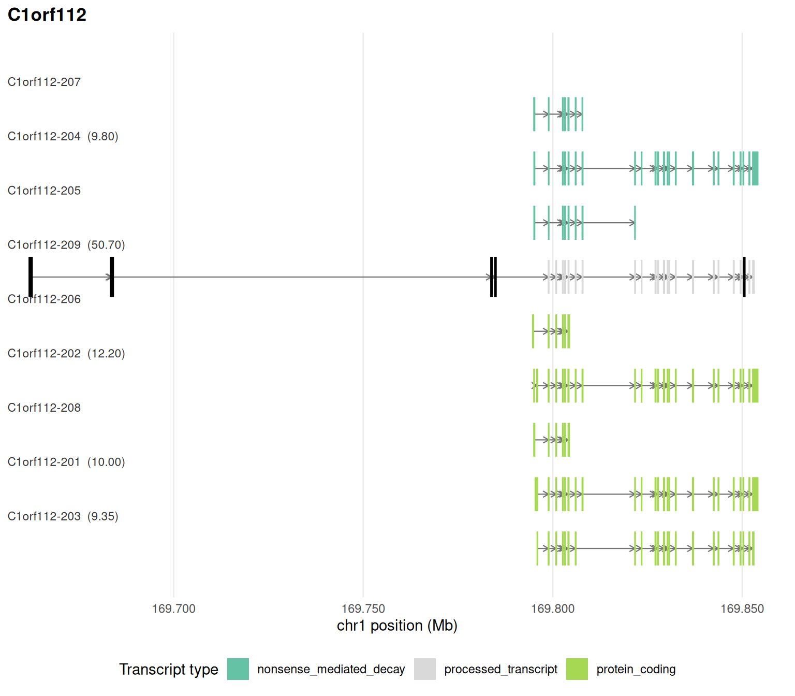

# Isoform structure and productivity

Not every isoform of a coding gene makes the protein. Retained introns,
poison exons and shifted stop codons produce transcripts that are
degraded by nonsense-mediated decay (NMD) or translated into a different
protein. This article derives the open reading frame (ORF) of every
isoform, classifies each one as productive or not, quantifies the
productive share of each gene’s expression, tests its change between
conditions and brings in external evidence of translation and decay.

It starts from the object built in the
[introduction](https://luciorq.github.io/isoformic/articles/isoformic-introduction.md):

``` r

library(isoformic)
library(dplyr)

extdata <- fs::path_package("isoformic", "extdata")
annot_dir <- prepare_isoformic_annotation(download_reference(version = "33", file_type = "gff"))
iso <- IsoformicExperiment(
  experiment_name = "preeclampsia_placenta",
  annot_path = annot_dir,
  assays = list(abundance = read_parquet(fs::path(extdata, "pe_abundance.parquet"))),
  col_data = read_parquet(fs::path(extdata, "pe_col_data.parquet"))
)
de_tx(iso) <- read_parquet(fs::path(extdata, "pe_det.parquet"))
de_gene(iso) <- read_parquet(fs::path(extdata, "pe_deg.parquet"))
```

## Structural features from the annotation

Beyond the biotype label,
[`transcript_features()`](https://luciorq.github.io/isoformic/reference/transcript_features.md)
derives from the exon and CDS coordinates the ORF and UTR lengths, the
distance from the stop codon to the last exon junction (the 50-nt rule
of NMD), the promoter and 3’-end groups of each gene, the canonical
isoform (MANE Select or Ensembl canonical) and the splicing events of
every isoform relative to it:

``` r

feats <- transcript_features(iso, gene_name = "RBPJ")
#> duckdb keeps downloaded extensions and secrets in a temporary directory:
#> ℹ /tmp/Rtmpvz5UCB/duckdb
#> This is removed when the R session ends.
#> • Extensions are re-downloaded each session.
#> • Secrets are lost.
#> ℹ Run duckdb(shared_home = TRUE) (or create ~/.duckdb) to keep them (suitable for most users).
#> ℹ Run duckdb(shared_home = FALSE) to accept the temporary directory (and silence this message).
#> ℹ See ?duckdb_storage for details and alternatives.
#> duckdb keeps downloaded extensions and secrets in a temporary directory:
#> ℹ /tmp/Rtmpvz5UCB/duckdb
#> This is removed when the R session ends.
#> • Extensions are re-downloaded each session.
#> • Secrets are lost.
#> ℹ Run duckdb(shared_home = TRUE) (or create ~/.duckdb) to keep them (suitable for most users).
#> ℹ Run duckdb(shared_home = FALSE) to accept the temporary directory (and silence this message).
#> ℹ See ?duckdb_storage for details and alternatives.
#> duckdb keeps downloaded extensions and secrets in a temporary directory:
#> ℹ /tmp/Rtmpvz5UCB/duckdb
#> This is removed when the R session ends.
#> • Extensions are re-downloaded each session.
#> • Secrets are lost.
#> ℹ Run duckdb(shared_home = TRUE) (or create ~/.duckdb) to keep them (suitable for most users).
#> ℹ Run duckdb(shared_home = FALSE) to accept the temporary directory (and silence this message).
#> ℹ See ?duckdb_storage for details and alternatives.
feats[, c("transcript_name", "orf_length", "utr3_length", "stop_to_last_junction", "nmd_predicted", "tss_group", "n_skipped_exons", "n_retained_introns")]
#> # A tibble: 10 × 8
#>    transcript_name orf_length utr3_length stop_to_last_junction nmd_predicted
#>    <chr>                <int>       <dbl>                 <dbl> <lgl>        
#>  1 RBPJ-222               283           0                  -131 FALSE        
#>  2 RBPJ-201              1503        4121                  -316 FALSE        
#>  3 RBPJ-206              1503           0                  -316 FALSE        
#>  4 RBPJ-225                NA          NA                    NA FALSE        
#>  5 RBPJ-204              1464          59                  -316 FALSE        
#>  6 RBPJ-205              1461        4121                  -316 FALSE        
#>  7 RBPJ-214              1398         176                  -316 FALSE        
#>  8 RBPJ-208              1149         357                  -108 FALSE        
#>  9 RBPJ-202              1461        4124                  -316 FALSE        
#> 10 RBPJ-210                NA          NA                    NA FALSE        
#> # ℹ 3 more variables: tss_group <int>, n_skipped_exons <int>,
#> #   n_retained_introns <int>
```

## Productivity calls

[`transcript_productivity()`](https://luciorq.github.io/isoformic/reference/productivity.md)
turns those features into a graded call, each with its reason:

- `productive`: complete ORF identical to the canonical one;
- `altered_productive`: complete ORF, no NMD, but a different protein;
- `unproductive`: no ORF, NMD predicted or an unproductive biotype;
- `noncoding`;
- `uncertain`: not enough information (for example an incomplete CDS
  annotation).

[`productive_fraction()`](https://luciorq.github.io/isoformic/reference/productivity.md)
is the share of a gene’s expression carried by productive isoforms, per
condition, with its change. A gene whose total expression is flat while
its productive fraction falls is regulated post-transcriptionally.

``` r

prod <- transcript_productivity(iso)
#> duckdb keeps downloaded extensions and secrets in a temporary directory:
#> ℹ /tmp/Rtmpvz5UCB/duckdb
#> This is removed when the R session ends.
#> • Extensions are re-downloaded each session.
#> • Secrets are lost.
#> ℹ Run duckdb(shared_home = TRUE) (or create ~/.duckdb) to keep them (suitable for most users).
#> ℹ Run duckdb(shared_home = FALSE) to accept the temporary directory (and silence this message).
#> ℹ See ?duckdb_storage for details and alternatives.
#> Warning: ! 91 transcripts have a sequence length differing from the exon length; their
#>   ORFs are skipped.
#> duckdb keeps downloaded extensions and secrets in a temporary directory:
#> ℹ /tmp/Rtmpvz5UCB/duckdb
#> This is removed when the R session ends.
#> • Extensions are re-downloaded each session.
#> • Secrets are lost.
#> ℹ Run duckdb(shared_home = TRUE) (or create ~/.duckdb) to keep them (suitable for most users).
#> ℹ Run duckdb(shared_home = FALSE) to accept the temporary directory (and silence this message).
#> ℹ See ?duckdb_storage for details and alternatives.
#> duckdb keeps downloaded extensions and secrets in a temporary directory:
#> ℹ /tmp/Rtmpvz5UCB/duckdb
#> This is removed when the R session ends.
#> • Extensions are re-downloaded each session.
#> • Secrets are lost.
#> ℹ Run duckdb(shared_home = TRUE) (or create ~/.duckdb) to keep them (suitable for most users).
#> ℹ Run duckdb(shared_home = FALSE) to accept the temporary directory (and silence this message).
#> ℹ See ?duckdb_storage for details and alternatives.
#> duckdb keeps downloaded extensions and secrets in a temporary directory:
#> ℹ /tmp/Rtmpvz5UCB/duckdb
#> This is removed when the R session ends.
#> • Extensions are re-downloaded each session.
#> • Secrets are lost.
#> ℹ Run duckdb(shared_home = TRUE) (or create ~/.duckdb) to keep them (suitable for most users).
#> ℹ Run duckdb(shared_home = FALSE) to accept the temporary directory (and silence this message).
#> ℹ See ?duckdb_storage for details and alternatives.
#> duckdb keeps downloaded extensions and secrets in a temporary directory:
#> ℹ /tmp/Rtmpvz5UCB/duckdb
#> This is removed when the R session ends.
#> • Extensions are re-downloaded each session.
#> • Secrets are lost.
#> ℹ Run duckdb(shared_home = TRUE) (or create ~/.duckdb) to keep them (suitable for most users).
#> ℹ Run duckdb(shared_home = FALSE) to accept the temporary directory (and silence this message).
#> ℹ See ?duckdb_storage for details and alternatives.
#> duckdb keeps downloaded extensions and secrets in a temporary directory:
#> ℹ /tmp/Rtmpvz5UCB/duckdb
#> This is removed when the R session ends.
#> • Extensions are re-downloaded each session.
#> • Secrets are lost.
#> ℹ Run duckdb(shared_home = TRUE) (or create ~/.duckdb) to keep them (suitable for most users).
#> ℹ Run duckdb(shared_home = FALSE) to accept the temporary directory (and silence this message).
#> ℹ See ?duckdb_storage for details and alternatives.
#> duckdb keeps downloaded extensions and secrets in a temporary directory:
#> ℹ /tmp/Rtmpvz5UCB/duckdb
#> This is removed when the R session ends.
#> • Extensions are re-downloaded each session.
#> • Secrets are lost.
#> ℹ Run duckdb(shared_home = TRUE) (or create ~/.duckdb) to keep them (suitable for most users).
#> ℹ Run duckdb(shared_home = FALSE) to accept the temporary directory (and silence this message).
#> ℹ See ?duckdb_storage for details and alternatives.
#> duckdb keeps downloaded extensions and secrets in a temporary directory:
#> ℹ /tmp/Rtmpvz5UCB/duckdb
#> This is removed when the R session ends.
#> • Extensions are re-downloaded each session.
#> • Secrets are lost.
#> ℹ Run duckdb(shared_home = TRUE) (or create ~/.duckdb) to keep them (suitable for most users).
#> ℹ Run duckdb(shared_home = FALSE) to accept the temporary directory (and silence this message).
#> ℹ See ?duckdb_storage for details and alternatives.
#> duckdb keeps downloaded extensions and secrets in a temporary directory:
#> ℹ /tmp/Rtmpvz5UCB/duckdb
#> This is removed when the R session ends.
#> • Extensions are re-downloaded each session.
#> • Secrets are lost.
#> ℹ Run duckdb(shared_home = TRUE) (or create ~/.duckdb) to keep them (suitable for most users).
#> ℹ Run duckdb(shared_home = FALSE) to accept the temporary directory (and silence this message).
#> ℹ See ?duckdb_storage for details and alternatives.
table(prod$productivity)
#> 
#>         productive altered_productive       unproductive          noncoding 
#>              18292              14271              24301              10123 
#>          uncertain 
#>               5398
pf <- productive_fraction(iso, group = "condition")
head(pf)
#> # A tibble: 6 × 7
#>   gene_id    gene_name mean_gene_expr productive_fraction productive_fraction_…¹
#>   <chr>      <chr>              <dbl>               <dbl>                  <dbl>
#> 1 ENSG00000… SEC16B              9.63               0.561                  0.963
#> 2 ENSG00000… RGPD6             741.                 0.820                  0.458
#> 3 ENSG00000… ACP7               16.2                0.337                  0.677
#> 4 ENSG00000… RRM2              106.                 0.766                  0.439
#> 5 ENSG00000… AHNAK2             19.0                0.560                  0.875
#> 6 ENSG00000… RPL18            3565.                 0.658                  0.970
#> # ℹ abbreviated name: ¹​productive_fraction_preeclampsia
#> # ℹ 2 more variables: productive_fraction_control <dbl>,
#> #   delta_productive_fraction <dbl>
```

## Sequence-aware ORFs

The annotation only describes the CDS it was given, and novel
transcripts have none.
[`extract_transcript_sequences()`](https://luciorq.github.io/isoformic/reference/transcript_sequences.md)
adds the spliced sequence of every transcript to an annotation
directory, from a genome FASTA (which also covers novel transcripts of
long-read or assembly annotations) or, as here, from the matching
GENCODE transcript FASTA (the bundled
[`example_isoformic()`](https://luciorq.github.io/isoformic/reference/example_isoformic.md)
annotation already carries them).

With sequences,
[`transcript_orfs()`](https://luciorq.github.io/isoformic/reference/transcript_orfs.md)
projects the canonical start codon of each gene onto every isoform and
translates it, so the ORF, its stop codon, upstream ORFs, the frame
relative to the canonical protein and the NMD class are computed rather
than read from the annotation, and
[`transcript_productivity()`](https://luciorq.github.io/isoformic/reference/productivity.md)
reports `source = "sequence"`:

``` r

fasta_file <- download_reference(version = "33", file_type = "fasta")
#> ℹ '/home/runner/.cache/R/isoformic/gencode.v33.transcripts.fa.gz' already
#>   exists.
extract_transcript_sequences(annot_dir, transcript_fasta = fasta_file)
#> ℹ '/home/runner/.cache/R/isoformic/gencode_v33_chr_patch_hapl_scaff_annotation_gff3/annot_data_sequences.parquet'
#>   already exists; use `overwrite = TRUE` to replace it.
has_sequences(iso)
#> [1] TRUE
orfs <- transcript_orfs(iso, gene_name = "RBPJ")
orfs[, c("transcript_name", "orf_source", "orf_length", "stop_codon", "nmd_class", "n_uorf", "frame_vs_canonical", "coding_probability")]
#> # A tibble: 10 × 8
#>    transcript_name orf_source         orf_length stop_codon nmd_class n_uorf
#>    <chr>           <chr>                   <dbl> <chr>      <chr>      <int>
#>  1 RBPJ-222        annotation_partial        283 <NA>       <NA>           6
#>  2 RBPJ-201        annotation               1503 TAA        none           2
#>  3 RBPJ-206        annotation               1503 TAA        none           0
#>  4 RBPJ-225        projected                1140 TGA        none           0
#>  5 RBPJ-204        annotation               1464 TAA        none           0
#>  6 RBPJ-205        annotation               1461 TAA        none           5
#>  7 RBPJ-214        annotation               1398 TAA        none           0
#>  8 RBPJ-208        annotation               1149 TGA        none           4
#>  9 RBPJ-202        annotation               1461 TAA        none           4
#> 10 RBPJ-210        longest                   462 TAA        none           4
#> # ℹ 2 more variables: frame_vs_canonical <chr>, coding_probability <dbl>
prod <- transcript_productivity(iso, gene_name = "RBPJ")
prod[, c("transcript_name", "productivity", "reason", "source")]
#> # A tibble: 10 × 4
#>    transcript_name productivity       reason                              source
#>    <chr>           <fct>              <chr>                               <chr> 
#>  1 RBPJ-222        uncertain          incomplete 3' end, no stop codon r… seque…
#>  2 RBPJ-201        productive         complete ORF identical to the cano… seque…
#>  3 RBPJ-206        productive         complete ORF identical to the cano… seque…
#>  4 RBPJ-225        unproductive       unproductive biotype                annot…
#>  5 RBPJ-204        altered_productive alternative start codon             seque…
#>  6 RBPJ-205        altered_productive alternative start codon             seque…
#>  7 RBPJ-214        altered_productive alternative start codon             seque…
#>  8 RBPJ-208        altered_productive alternative start codon             seque…
#>  9 RBPJ-202        altered_productive alternative start codon             seque…
#> 10 RBPJ-210        unproductive       unproductive biotype                annot…
```

`orf_source` records where the ORF came from: `annotation` (the
annotated CDS, re-read from the sequence), `projected` (the canonical
start codon projected onto the isoform), `annotation_partial` (a CDS
flagged incomplete), `longest` (the longest ORF, when nothing could be
projected) or `none`. `coding_probability` comes from a Fickett +
hexamer logistic model trained on GENCODE coding and lncRNA transcripts;
it decides whether a longest ORF is believable.

[`benchmark_productivity()`](https://luciorq.github.io/isoformic/reference/productivity.md)
measures the rules against the annotation biotypes: how many
`nonsense_mediated_decay` and `retained_intron` transcripts the sequence
rules alone call unproductive, and how many coding and canonical
transcripts they call productive:

``` r

benchmark_productivity(iso)$summary
#> # A tibble: 5 × 4
#>   metric                                  n value source  
#>   <chr>                               <int> <dbl> <chr>   
#> 1 nmd_biotype_called_unproductive      5088 0.994 sequence
#> 2 retained_intron_called_unproductive 13074 0.569 sequence
#> 3 protein_coding_called_productive    38376 0.848 sequence
#> 4 canonical_called_productive         15242 0.963 sequence
#> 5 lncrna_called_noncoding              7343 1     sequence
```

## Fractions, tests and uncertainty

[`productivity_fractions()`](https://luciorq.github.io/isoformic/reference/productivity.md)
splits each gene’s expression over the classes and, for unproductive
isoforms, over the mechanism (NMD, retained intron, no ORF, non-stop
decay).

[`test_productive_fraction()`](https://luciorq.github.io/isoformic/reference/productivity.md)
tests the change in productive fraction between two groups with a
quasi-binomial model per gene. It runs on the `counts` assay when the
object has one; this object only carries TPM, so the test is run on
abundances here.

``` r

head(productivity_fractions(iso, group = "condition"))
#> # A tibble: 6 × 7
#>   gene_id gene_name productivity fraction fraction_preeclampsia fraction_control
#>   <chr>   <chr>     <fct>           <dbl>                 <dbl>            <dbl>
#> 1 ENSG00… TSPAN6    productive     1                     1                1     
#> 2 ENSG00… TNMD      productive     1                     1                1     
#> 3 ENSG00… DPM1      altered_pro…   0.915                 0.930            0.908 
#> 4 ENSG00… DPM1      other          0.0394                0.0388           0.0396
#> 5 ENSG00… DPM1      uncertain      0.0460                0.0316           0.0528
#> 6 ENSG00… SCYL3     productive     0.720                 0.614            0.770 
#> # ℹ 1 more variable: delta_fraction <dbl>
head(test_productive_fraction(iso, group = "condition", assay = "abundance"))
#> # A tibble: 6 × 13
#>   gene_id gene_name mean_gene_expr productive_fraction_…¹ productive_fraction_…²
#>   <chr>   <chr>              <dbl>                  <dbl>                  <dbl>
#> 1 ENSG00… RPL35A             1749.                  0.389                  0.853
#> 2 ENSG00… UQCRB               856.                  0.589                  0.215
#> 3 ENSG00… RPL36A             1448.                  0.985                  0.929
#> 4 ENSG00… SKP1               3755.                  0.548                  0.641
#> 5 ENSG00… H3-3A              1555.                  0.820                  0.691
#> 6 ENSG00… SNX6               1302.                  0.880                  0.975
#> # ℹ abbreviated names: ¹​productive_fraction_preeclampsia,
#> #   ²​productive_fraction_control
#> # ℹ 8 more variables: delta_productive_fraction <dbl>, log_odds_ratio <dbl>,
#> #   se <dbl>, statistic <dbl>, dispersion <dbl>, df <dbl>, pvalue <dbl>,
#> #   padj <dbl>
```

[`productive_fraction()`](https://luciorq.github.io/isoformic/reference/productivity.md)
also accepts an expression floor (`min_expr`), Salmon inferential
replicates (`inf_reps`, or `metadata(iso)$inf_reps`) for the uncertainty
of each fraction, and a healthy-tissue `reference` from GTEx (below).

## Poison exons and enrichment

Genes ranked by the change in productive fraction can be tested for
enrichment directly, which targets regulated unproductive splicing such
as AS-NMD. Exons found only in unproductive isoforms (poison exons) are
listed by
[`poison_exons()`](https://luciorq.github.io/isoformic/reference/productivity.md)
and outlined in the genomic context plot:

``` r

genesets <- read_gmt(fs::path(extdata, "c2.cp.reactome.v2023.1.Hs.symbols.gmt.txt"))
set.seed(42)
prod_enrichment <- run_productivity_enrichment(iso, genesets, group = "condition")
head(prod_enrichment[order(prod_enrichment$padj), c("pathway", "NES", "padj")])
#> # A tibble: 6 × 3
#>   pathway                                                            NES    padj
#>   <chr>                                                            <dbl>   <dbl>
#> 1 REACTOME_OLFACTORY_SIGNALING_PATHWAY                              1.99 2.29e-4
#> 2 REACTOME_INWARDLY_RECTIFYING_K_CHANNELS                           1.91 5.55e-4
#> 3 REACTOME_AMINE_LIGAND_BINDING_RECEPTORS                           1.81 1.08e-2
#> 4 REACTOME_CHEMOKINE_RECEPTORS_BIND_CHEMOKINES                     -1.71 1.50e-2
#> 5 REACTOME_PLATELET_HOMEOSTASIS                                    -1.63 1.20e-1
#> 6 REACTOME_FACTORS_INVOLVED_IN_MEGAKARYOCYTE_DEVELOPMENT_AND_PLAT… -1.52 1.33e-1
poison <- poison_exons(iso)
head(poison)
#> # A tibble: 6 × 9
#>   gene_id gene_name seqid start_pos end_pos strand n_unproductive transcript_ids
#>   <chr>   <chr>     <chr>     <int>   <int> <chr>           <int> <chr>         
#> 1 ENSG00… C1orf112  chr1  169662007  1.70e8 +                   1 ENST000004982…
#> 2 ENSG00… C1orf112  chr1  169683469  1.70e8 +                   1 ENST000004982…
#> 3 ENSG00… C1orf112  chr1  169683756  1.70e8 +                   1 ENST000004982…
#> 4 ENSG00… C1orf112  chr1  169783811  1.70e8 +                   1 ENST000004982…
#> 5 ENSG00… C1orf112  chr1  169784877  1.70e8 +                   1 ENST000004982…
#> 6 ENSG00… C1orf112  chr1  169850454  1.70e8 +                   1 ENST000004982…
#> # ℹ 1 more variable: exon_length <int>
```

``` r

plot_genomic_context(iso, gene_name = unique(poison$gene_name)[1])
```



## External evidence from frozen datasets

Observed translation and decay beat rules. The package pins versioned
evidence tables
([`frozen_datasets()`](https://luciorq.github.io/isoformic/reference/frozen_data.md))
that are downloaded once from the first mirror that has them, or rebuilt
from their sources (`data-raw/README.md` in the repository documents the
procedure), and joined into the annotation;
[`transcript_productivity()`](https://luciorq.github.io/isoformic/reference/productivity.md)
then reports `source = "evidence"` for the transcripts they cover:

``` r

frozen_datasets()[, c("name", "version")]
#> # A tibble: 6 × 2
#>   name                version      
#>   <chr>               <chr>        
#> 1 appris              e113v49      
#> 2 appris_domains      e113v49      
#> 3 riboseq_orfs        phase1_phase2
#> 4 nmd_exons           karousis2021 
#> 5 polyasite           2.0_GRCh38.96
#> 6 gtex_transcript_tpm v8
```

``` r

add_appris(iso)          # APPRIS principal isoforms and method scores
add_riboseq_orfs(iso)    # GENCODE Ribo-seq ORFs: translated main ORFs and uORFs
add_nmd_exons(iso)       # NMD-inducing exons validated by NMD inhibition
transcript_productivity(iso, gene_name = "RBPJ")[, c("transcript_name", "productivity", "reason", "source")]

# Pfam domains retained, partial or lost relative to the canonical isoform
domain_retention(iso, gene_name = "RBPJ")

# Healthy-tissue baseline: productive fraction and dominant isoform in GTEx
ref <- gtex_reference(iso, tissue = "Whole Blood")
productive_fraction(iso, group = "condition", reference = ref)
```

The evidence columns are consulted in a fixed order: a
`productivity_evidence` column overrides everything, then a validated
NMD exon, then a translated main ORF, then APPRIS principal status. Any
other per-transcript evidence is attached with
[`add_annotation_columns()`](https://luciorq.github.io/isoformic/reference/add_annotation_columns.md).

To reproduce an analysis with one deposit of the frozen files, pin the
mirror before calling the `add_*()` functions (see
`?isoformic-options`):

``` r

options(isoformic.frozen_mirrors = "https://zenodo.org/records/<record>/files/")
```

## Session information

``` r

sessionInfo()
#> R version 4.6.2 (2026-10-29)
#> Platform: x86_64-pc-linux-gnu
#> Running under: Ubuntu 24.04.5 LTS
#> 
#> Matrix products: default
#> BLAS:   /usr/lib/x86_64-linux-gnu/openblas-pthread/libblas.so.3 
#> LAPACK: /usr/lib/x86_64-linux-gnu/openblas-pthread/libopenblasp-r0.3.26.so;  LAPACK version 3.12.0
#> 
#> locale:
#>  [1] LC_CTYPE=C.UTF-8       LC_NUMERIC=C           LC_TIME=C.UTF-8       
#>  [4] LC_COLLATE=C.UTF-8     LC_MONETARY=C.UTF-8    LC_MESSAGES=C.UTF-8   
#>  [7] LC_PAPER=C.UTF-8       LC_NAME=C              LC_ADDRESS=C          
#> [10] LC_TELEPHONE=C         LC_MEASUREMENT=C.UTF-8 LC_IDENTIFICATION=C   
#> 
#> time zone: UTC
#> tzcode source: system (glibc)
#> 
#> attached base packages:
#> [1] stats     graphics  grDevices utils     datasets  methods   base     
#> 
#> other attached packages:
#> [1] dplyr_1.2.1          isoformic_0.1.2.9022
#> 
#> loaded via a namespace (and not attached):
#>  [1] Matrix_1.7-6        gtable_0.3.6        jsonlite_2.0.0     
#>  [4] compiler_4.6.2      tidyselect_1.2.1    Rcpp_1.1.2         
#>  [7] parallel_4.6.2      scales_1.4.0        BiocParallel_1.46.0
#> [10] yaml_2.3.12         fastmap_1.2.0       lattice_0.23-1     
#> [13] ggplot2_4.0.3       R6_2.6.1            labeling_0.4.3     
#> [16] generics_0.1.4      curl_8.1.0          knitr_1.52         
#> [19] tibble_3.3.1        DBI_1.3.0           RColorBrewer_1.1-3 
#> [22] pillar_1.11.1       rlang_1.3.0         fastmatch_1.1-8    
#> [25] utf8_1.2.6          xfun_0.62           fs_2.1.0           
#> [28] S7_0.2.2            otel_0.2.0          cli_3.6.6          
#> [31] withr_3.0.3         magrittr_2.0.5      grid_4.6.2         
#> [34] digest_0.6.39       fgsea_1.38.0        cowplot_1.2.0      
#> [37] lifecycle_1.0.5     vctrs_0.7.3         data.table_1.18.6.1
#> [40] evaluate_1.0.5      glue_1.8.1          farver_2.1.2       
#> [43] duckdb_2.0.0        codetools_0.2-20    rmarkdown_2.32     
#> [46] tools_4.6.2         pkgconfig_2.0.3     htmltools_0.5.9
```
