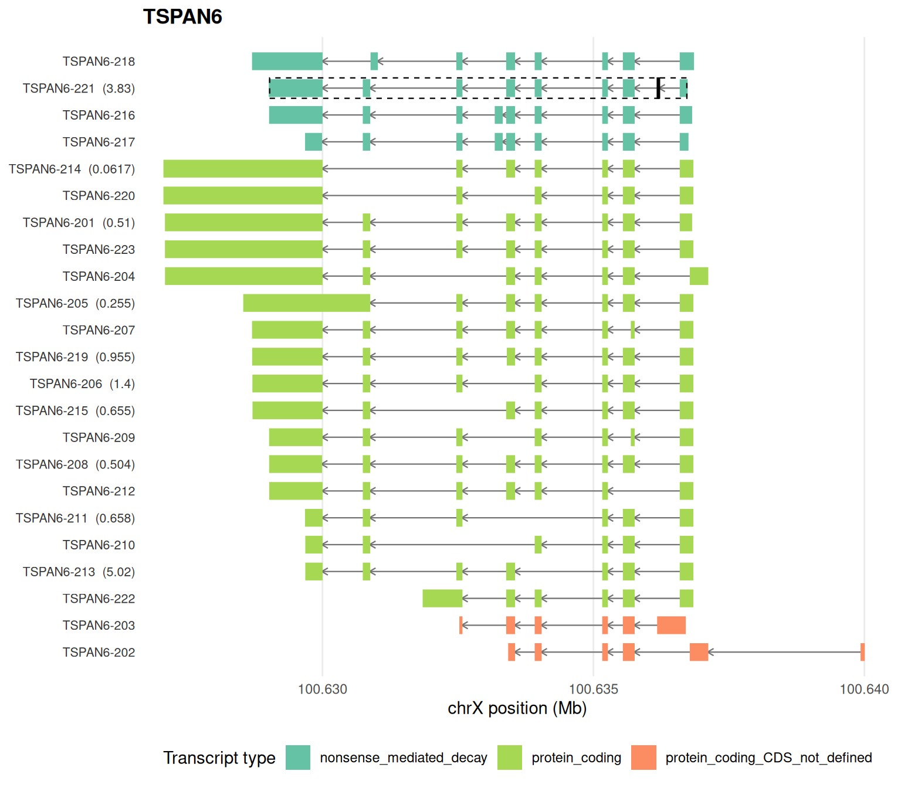

# Isoform structure and productivity

Not every isoform of a coding gene makes the protein. Retained introns,
poison exons and shifted stop codons produce transcripts that are
degraded by nonsense-mediated decay (NMD) or translated into a different
protein. This article derives the open reading frame (ORF) of every
isoform, classifies each one as productive or not, quantifies the
productive share of each gene’s expression, tests its change between
conditions and brings in external evidence of translation and decay.

It starts from the object built in the
[introduction](https://luciorq.github.io/isoformic/articles/isoformic-introduction.md):

``` r

library(isoformic)
library(dplyr)

data_dir <- "data/preeclampsia"
annot_dir <- prepare_isoformic_annotation(download_reference(version = "50", file_type = "gff"))
iso <- IsoformicExperiment(
  experiment_name = "preeclampsia_placenta",
  annot_path = annot_dir,
  assays = list(abundance = read_parquet(fs::path(data_dir, "pe_abundance.parquet"))),
  col_data = read_parquet(fs::path(data_dir, "pe_col_data.parquet"))
)
de_tx(iso) <- read_parquet(fs::path(data_dir, "pe_det.parquet"))
de_gene(iso) <- read_parquet(fs::path(data_dir, "pe_deg.parquet"))
```

## Structural features from the annotation

Beyond the biotype label,
[`transcript_features()`](https://luciorq.github.io/isoformic/reference/transcript_features.md)
derives from the exon and CDS coordinates the ORF and UTR lengths, the
distance from the stop codon to the last exon junction (the 50-nt rule
of NMD), the promoter and 3’-end groups of each gene, the canonical
isoform (MANE Select or Ensembl canonical) and the splicing events of
every isoform relative to it:

``` r

feats <- transcript_features(iso, gene_name = "RBPJ")
feats[, c("transcript_name", "orf_length", "utr3_length", "stop_to_last_junction", "nmd_predicted", "tss_group", "n_skipped_exons", "n_retained_introns")]
#> # A tibble: 24 × 8
#>    transcript_name orf_length utr3_length stop_to_last_junction nmd_predicted
#>    <chr>                <int>       <dbl>                 <dbl> <lgl>        
#>  1 RBPJ-222               283           0                  -131 FALSE        
#>  2 RBPJ-243                NA          NA                    NA FALSE        
#>  3 RBPJ-201              1503        4124                  -316 FALSE        
#>  4 RBPJ-203              1398        4124                  -316 FALSE        
#>  5 RBPJ-206              1503           0                  -316 FALSE        
#>  6 RBPJ-264              1101         277                  -213 FALSE        
#>  7 RBPJ-258              1152        4332                  -108 FALSE        
#>  8 RBPJ-204              1461        4124                  -316 FALSE        
#>  9 RBPJ-262               756         895                   384 TRUE         
#> 10 RBPJ-253              1386        4124                  -316 FALSE        
#> # ℹ 14 more rows
#> # ℹ 3 more variables: tss_group <int>, n_skipped_exons <int>,
#> #   n_retained_introns <int>
```

## Productivity calls

[`transcript_productivity()`](https://luciorq.github.io/isoformic/reference/productivity.md)
turns those features into a graded call, each with its reason:

- `productive`: complete ORF identical to the canonical one;
- `altered_productive`: complete ORF, no NMD, but a different protein;
- `unproductive`: no ORF, NMD predicted or an unproductive biotype;
- `noncoding`;
- `uncertain`: not enough information (for example an incomplete CDS
  annotation).

[`productive_fraction()`](https://luciorq.github.io/isoformic/reference/productivity.md)
is the share of a gene’s expression carried by productive isoforms, per
condition, with its change. A gene whose total expression is flat while
its productive fraction falls is regulated post-transcriptionally. The
first call below uses only the annotation (`use_sequence = FALSE`).
[`productive_fraction()`](https://luciorq.github.io/isoformic/reference/productivity.md)
has no such argument: like
[`transcript_productivity()`](https://luciorq.github.io/isoformic/reference/productivity.md)
by default, it uses the transcript sequences whenever the annotation
directory has them, as after the next section (the annotation directory
is shared with the other articles, which may already have added them, so
`pf` below can already come from the sequences).

``` r

prod <- transcript_productivity(iso, use_sequence = FALSE)
table(prod$productivity)
#> 
#>         productive altered_productive       unproductive          noncoding 
#>              29573              35693              45200              12016 
#>          uncertain 
#>               4188
pf <- productive_fraction(iso, group = "condition")
head(pf)
#> # A tibble: 6 × 7
#>   gene_id    gene_name mean_gene_expr productive_fraction productive_fraction_…¹
#>   <chr>      <chr>              <dbl>               <dbl>                  <dbl>
#> 1 ENSG00000… HLA-DPA1          0.357                0.362                  0.965
#> 2 ENSG00000… PRRT1B            0.302                0.583                  0    
#> 3 ENSG00000… SLC38A4           0.150                0.5                    1    
#> 4 ENSG00000… MST1R             0.0641               0.5                    0    
#> 5 ENSG00000… EXOG              0.839                0.450                  1    
#> 6 ENSG00000… HLA-DPA1          2.32                 0.312                  0    
#> # ℹ abbreviated name: ¹​productive_fraction_preeclampsia
#> # ℹ 2 more variables: productive_fraction_control <dbl>,
#> #   delta_productive_fraction <dbl>
```

## Sequence-aware ORFs

The annotation only describes the CDS it was given, and novel
transcripts have none.
[`extract_transcript_sequences()`](https://luciorq.github.io/isoformic/reference/transcript_sequences.md)
adds the spliced sequence of every transcript to an annotation
directory, from a genome FASTA (which also covers novel transcripts of
long-read or assembly annotations) or, as here, from the matching
GENCODE transcript FASTA (the bundled
[`example_isoformic()`](https://luciorq.github.io/isoformic/reference/example_isoformic.md)
annotation already carries them).

[`extract_transcript_sequences()`](https://luciorq.github.io/isoformic/reference/transcript_sequences.md)
does nothing, and says so, when the annotation directory already has the
sequences (`overwrite = TRUE` writes them again).

With sequences,
[`transcript_orfs()`](https://luciorq.github.io/isoformic/reference/transcript_orfs.md)
projects the canonical start codon of each gene onto every isoform and
translates it, so the ORF, its stop codon, upstream ORFs, the frame
relative to the canonical protein and the NMD class are computed rather
than read from the annotation, and
[`transcript_productivity()`](https://luciorq.github.io/isoformic/reference/productivity.md)
reports `source = "sequence"`:

``` r

fasta_file <- download_reference(version = "50", file_type = "fasta")
#> ℹ '/home/runner/.cache/R/isoformic/gencode.v50.transcripts.fa.gz' already
#>   exists.
extract_transcript_sequences(annot_dir, transcript_fasta = fasta_file)
#> ℹ '/home/runner/.cache/R/isoformic/gencode_v50_chr_patch_hapl_scaff_annotation_gff3/annot_data_sequences.parquet'
#>   already exists; use `overwrite = TRUE` to replace it.
has_sequences(iso)
#> [1] TRUE
# The calls of the previous section, now from the sequences
table(transcript_productivity(iso)$productivity)
#> 
#>         productive altered_productive       unproductive          noncoding 
#>              29555              35695              45266              12039 
#>          uncertain 
#>               4115
orfs <- transcript_orfs(iso, gene_name = "RBPJ")
orfs[, c("transcript_name", "orf_source", "orf_length", "stop_codon", "nmd_class", "n_uorf", "frame_vs_canonical", "coding_probability")]
#> # A tibble: 24 × 8
#>    transcript_name orf_source         orf_length stop_codon nmd_class n_uorf
#>    <chr>           <chr>                   <dbl> <chr>      <chr>      <int>
#>  1 RBPJ-222        annotation_partial        283 <NA>       <NA>           6
#>  2 RBPJ-243        longest                  1098 TGA        none           6
#>  3 RBPJ-201        annotation               1503 TAA        none           2
#>  4 RBPJ-203        annotation               1398 TAA        none           1
#>  5 RBPJ-206        annotation               1503 TAA        none           0
#>  6 RBPJ-264        annotation               1101 TGA        none           0
#>  7 RBPJ-258        annotation               1152 TGA        none           0
#>  8 RBPJ-204        annotation               1461 TAA        none           5
#>  9 RBPJ-262        annotation                756 TGA        ptc            0
#> 10 RBPJ-253        annotation               1386 TAA        none           0
#> # ℹ 14 more rows
#> # ℹ 2 more variables: frame_vs_canonical <chr>, coding_probability <dbl>
prod <- transcript_productivity(iso, gene_name = "RBPJ")
prod[, c("transcript_name", "productivity", "reason", "source")]
#> # A tibble: 24 × 4
#>    transcript_name productivity       reason                              source
#>    <chr>           <fct>              <chr>                               <chr> 
#>  1 RBPJ-222        uncertain          incomplete 3' end, no stop codon r… seque…
#>  2 RBPJ-243        unproductive       unproductive biotype                annot…
#>  3 RBPJ-201        altered_productive alternative start codon             seque…
#>  4 RBPJ-203        altered_productive alternative start codon             seque…
#>  5 RBPJ-206        altered_productive alternative start codon             seque…
#>  6 RBPJ-264        altered_productive stop codon in sequence absent from… seque…
#>  7 RBPJ-258        altered_productive frameshift relative to the canonic… seque…
#>  8 RBPJ-204        altered_productive alternative start codon             seque…
#>  9 RBPJ-262        unproductive       unproductive biotype                annot…
#> 10 RBPJ-253        altered_productive in-frame internal change of the ORF seque…
#> # ℹ 14 more rows
```

`orf_source` records where the ORF came from: `annotation` (the
annotated CDS, re-read from the sequence), `projected` (the canonical
start codon projected onto the isoform), `annotation_partial` (a CDS
flagged incomplete), `longest` (the longest ORF, when nothing could be
projected) or `none`. `coding_probability` comes from a logistic model
of the Fickett score, the hexamer usage, the ORF length and the share of
the transcript the ORF covers, trained on GENCODE 50 human coding and
lncRNA transcripts; it decides whether a longest ORF is believable. The
ORFs of a whole annotation take minutes, so
[`transcript_orfs()`](https://luciorq.github.io/isoformic/reference/transcript_orfs.md)
stores the rows it computes in the annotation directory
(`annot_data_orfs.parquet`) and later calls read them back;
`options(isoformic.orf_cache = FALSE)` turns the table off (see
`?isoformic-options`).

[`benchmark_productivity()`](https://luciorq.github.io/isoformic/reference/productivity.md)
measures the rules against the annotation biotypes: how many
`nonsense_mediated_decay` and `retained_intron` transcripts the sequence
rules alone call unproductive, and how many coding and canonical
transcripts they call productive:

``` r

benchmark_productivity(iso)$summary
#> # A tibble: 5 × 4
#>   metric                                  n value source  
#>   <chr>                               <int> <dbl> <chr>   
#> 1 nmd_biotype_called_unproductive     26560 0.999 sequence
#> 2 retained_intron_called_unproductive 14202 0.533 sequence
#> 3 protein_coding_called_productive    69571 0.938 sequence
#> 4 canonical_called_productive         15457 0.963 sequence
#> 5 lncrna_called_noncoding             10704 1     sequence
```

[`splice_site_strength()`](https://luciorq.github.io/isoformic/reference/splice_sites.md)
scores the donor and acceptor site of every intron with position weight
matrices built from the introns of the canonical transcripts of the same
annotation, and reports the weakest site of every transcript
(`by = "intron"` gives one row per intron). A weak site is evidence to
read next to the productivity call, not a classifier. The scores need
the sequences around the splice sites, which come from the genome:
[`extract_splice_sites()`](https://luciorq.github.io/isoformic/reference/splice_sites.md)
cuts them out of a genome FASTA, and
[`extract_transcript_sequences()`](https://luciorq.github.io/isoformic/reference/transcript_sequences.md)
stores them as well when it is given one.

``` r

genome <- download_reference(version = "50", file_type = "genome_fasta", region = "primary")
extract_splice_sites(annot_dir, genome_fasta = genome)
splice_site_strength(iso, gene_name = "RBPJ")
```

## Fractions, tests and uncertainty

[`productivity_fractions()`](https://luciorq.github.io/isoformic/reference/productivity.md)
splits each gene’s expression over the classes and, for unproductive
isoforms, over the mechanism (NMD, retained intron, no ORF, non-stop
decay).

[`test_productive_fraction()`](https://luciorq.github.io/isoformic/reference/productivity.md)
tests the change in productive fraction between two groups with a
quasi-binomial model per gene. It runs on the `counts` assay when the
object has one; this object only carries TPM, so the test is run on
abundances here.

``` r

head(productivity_fractions(iso, group = "condition"))
#> # A tibble: 6 × 7
#>   gene_id gene_name productivity fraction fraction_preeclampsia fraction_control
#>   <chr>   <chr>     <fct>           <dbl>                 <dbl>            <dbl>
#> 1 ENSG00… TSPAN6    productive    0.0903                0.144            0.0650 
#> 2 ENSG00… TSPAN6    altered_pro…  0.636                 0.722            0.596  
#> 3 ENSG00… TSPAN6    nmd           0.273                 0.134            0.339  
#> 4 ENSG00… TNMD      productive    1                     1                1      
#> 5 ENSG00… DPM1      productive    0.773                 0.773            0.773  
#> 6 ENSG00… DPM1      altered_pro…  0.00338               0.00326          0.00344
#> # ℹ 1 more variable: delta_fraction <dbl>
head(test_productive_fraction(iso, group = "condition", assay = "abundance"))
#> # A tibble: 6 × 13
#>   gene_id gene_name mean_gene_expr productive_fraction_…¹ productive_fraction_…²
#>   <chr>   <chr>              <dbl>                  <dbl>                  <dbl>
#> 1 ENSG00… RASA1               299.                  0.914                  0.363
#> 2 ENSG00… EEF1A1             3549.                  0.635                  0.880
#> 3 ENSG00… SRSF5               405.                  0.482                  0.266
#> 4 ENSG00… CDO1                152.                  0.516                  0.755
#> 5 ENSG00… ALPP               1967.                  0.605                  0.787
#> 6 ENSG00… RPS6                562.                  0.733                  0.892
#> # ℹ abbreviated names: ¹​productive_fraction_preeclampsia,
#> #   ²​productive_fraction_control
#> # ℹ 8 more variables: delta_productive_fraction <dbl>, log_odds_ratio <dbl>,
#> #   se <dbl>, statistic <dbl>, dispersion <dbl>, df <dbl>, pvalue <dbl>,
#> #   padj <dbl>
```

[`productive_fraction()`](https://luciorq.github.io/isoformic/reference/productivity.md)
also accepts an expression floor (`min_expr`), Salmon inferential
replicates (`inf_reps`, or the draws stored in `iso@metadata$inf_reps`)
for the uncertainty of each fraction, and a healthy-tissue `reference`
from GTEx (below). The replicates are counts: they are put on the scale
of `assay` (TPM by default) before the fractions are computed, and
`productive_fraction_sd` is the standard deviation of each fraction over
the replicates, averaged over the samples (see
[`?productivity`](https://luciorq.github.io/isoformic/reference/productivity.md)).
`levels` chooses the groups and their order (the change is the last
level minus the first); the samples of other groups are left out, as if
the object had been subset to the samples kept.

## Poison exons and enrichment

Genes ranked by the change in productive fraction can be tested for
enrichment directly, which targets regulated unproductive splicing such
as AS-NMD. With inferential replicates, `rank_by = "delta_z"` ranks by
the change divided by its standard deviation over the replicates, and
`levels` chooses the two groups when the object has more. Like
[`run_enrichment()`](https://luciorq.github.io/isoformic/reference/enrichment.md),
it takes one collection of gene sets or a named list of collections,
each tested on its own (see the [enrichment
article](https://luciorq.github.io/isoformic/articles/isoformic-enrichment.md)).
The function also takes the table of
[`productive_fraction()`](https://luciorq.github.io/isoformic/reference/productivity.md),
which avoids computing it again for each call; `inf_reps = FALSE` skips
stored replicates when only the fractions are needed, and the replicates
are read only for `rank_by = "delta_z"`. Exons found only in
unproductive isoforms (poison exons) are listed by
[`poison_exons()`](https://luciorq.github.io/isoformic/reference/productivity.md)
and outlined in the genomic context plot:

``` r

genesets <- read_gmt(fs::path(data_dir, "c2.cp.reactome.v2023.1.Hs.symbols.gmt.txt"))
set.seed(42)
prod_enrichment <- run_productivity_enrichment(iso, genesets, group = "condition")
head(prod_enrichment[order(prod_enrichment$padj), c("pathway", "NES", "padj")])
#> # A tibble: 6 × 3
#>   pathway                                                         NES  padj
#>   <chr>                                                         <dbl> <dbl>
#> 1 REACTOME_LAMININ_INTERACTIONS                                 -1.79 0.163
#> 2 REACTOME_ADP_SIGNALLING_THROUGH_P2Y_PURINOCEPTOR_12           -1.60 0.396
#> 3 REACTOME_BINDING_AND_UPTAKE_OF_LIGANDS_BY_SCAVENGER_RECEPTORS -1.56 0.396
#> 4 REACTOME_COLLAGEN_CHAIN_TRIMERIZATION                         -1.54 0.396
#> 5 REACTOME_DNA_DOUBLE_STRAND_BREAK_REPAIR                       -1.41 0.396
#> 6 REACTOME_ECM_PROTEOGLYCANS                                    -1.58 0.396
poison <- poison_exons(iso)
head(poison)
#> # A tibble: 6 × 9
#>   gene_id gene_name seqid start_pos end_pos strand n_unproductive transcript_ids
#>   <chr>   <chr>     <chr>     <int>   <int> <chr>           <int> <chr>         
#> 1 ENSG00… TSPAN6    chrX  100636191  1.01e8 -                   1 ENST000011019…
#> 2 ENSG00… SCYL3     chr1  169864700  1.70e8 -                   1 ENST000009851…
#> 3 ENSG00… SCYL3     chr1  169893476  1.70e8 -                   1 ENST000010500…
#> 4 ENSG00… FIRRM     chr1  169745506  1.70e8 +                   1 ENST000011173…
#> 5 ENSG00… FIRRM     chr1  169783811  1.70e8 +                   1 ENST000011173…
#> 6 ENSG00… FIRRM     chr1  169784877  1.70e8 +                   1 ENST000011173…
#> # ℹ 1 more variable: exon_length <int>
```

``` r

plot_genomic_context(iso, gene_name = unique(poison$gene_name)[1])
```



## External evidence from frozen datasets

Observed translation and decay beat rules. The package pins versioned
evidence tables
([`frozen_datasets()`](https://luciorq.github.io/isoformic/reference/frozen_data.md))
that are downloaded once from the first mirror that has them, or rebuilt
from their sources (`data-raw/README.md` in the repository documents the
procedure), and joined into the annotation;
[`transcript_productivity()`](https://luciorq.github.io/isoformic/reference/productivity.md)
then reports `source = "evidence"` for the transcripts they cover:

``` r

frozen_datasets()[, c("name", "version")]
#> # A tibble: 6 × 2
#>   name                version      
#>   <chr>               <chr>        
#> 1 appris              e116v50      
#> 2 appris_domains      e116v50      
#> 3 riboseq_orfs        phase1_phase2
#> 4 nmd_exons           karousis2021 
#> 5 polyasite           2.0_GRCh38.96
#> 6 gtex_transcript_tpm v8
```

``` r

add_appris(iso)          # APPRIS principal isoforms and method scores
add_riboseq_orfs(iso)    # GENCODE Ribo-seq ORFs: translated main ORFs and uORFs
add_nmd_exons(iso)       # NMD-inducing exons validated by NMD inhibition
transcript_productivity(iso, gene_name = "RBPJ")[, c("transcript_name", "productivity", "reason", "source")]

# Pfam domains retained, partial or lost relative to the canonical isoform
domain_retention(iso, gene_name = "RBPJ")

# Healthy-tissue baseline: productive fraction and dominant isoform in GTEx
ref <- gtex_reference(iso, tissue = "Whole Blood")
productive_fraction(iso, group = "condition", reference = ref)
```

The evidence columns are consulted in a fixed order: a
`productivity_evidence` column overrides everything, then a validated
NMD exon, then a translated main ORF, then APPRIS principal status. Any
other per-transcript evidence is attached with
[`add_annotation_columns()`](https://luciorq.github.io/isoformic/reference/add_annotation_columns.md).

To reproduce an analysis with one deposit of the frozen files, pin the
mirror before calling the `add_*()` functions (see
`?isoformic-options`):

``` r

options(isoformic.frozen_mirrors = "https://zenodo.org/records/<record>/files/")
```

## Session information

``` r

sessionInfo()
#> R version 4.6.2 (2026-10-29)
#> Platform: x86_64-pc-linux-gnu
#> Running under: Ubuntu 26.04.1 LTS
#> 
#> Matrix products: default
#> BLAS:   /usr/lib/x86_64-linux-gnu/openblas-pthread/libblas.so.3 
#> LAPACK: /usr/lib/x86_64-linux-gnu/openblas-pthread/libopenblasp-r0.3.32.so;  LAPACK version 3.12.0
#> 
#> locale:
#>  [1] LC_CTYPE=C.UTF-8       LC_NUMERIC=C           LC_TIME=C.UTF-8       
#>  [4] LC_COLLATE=C.UTF-8     LC_MONETARY=C.UTF-8    LC_MESSAGES=C.UTF-8   
#>  [7] LC_PAPER=C.UTF-8       LC_NAME=C              LC_ADDRESS=C          
#> [10] LC_TELEPHONE=C         LC_MEASUREMENT=C.UTF-8 LC_IDENTIFICATION=C   
#> 
#> time zone: UTC
#> tzcode source: system (glibc)
#> 
#> attached base packages:
#> [1] stats     graphics  grDevices utils     datasets  methods   base     
#> 
#> other attached packages:
#> [1] dplyr_1.2.1     isoformic_0.1.3
#> 
#> loaded via a namespace (and not attached):
#>  [1] Matrix_1.7-6        gtable_0.3.6        jsonlite_2.0.0     
#>  [4] compiler_4.6.2      tidyselect_1.2.1    Rcpp_1.1.2         
#>  [7] parallel_4.6.2      scales_1.4.0        BiocParallel_1.46.0
#> [10] yaml_2.3.12         fastmap_1.2.0       lattice_0.23-1     
#> [13] ggplot2_4.0.4       R6_2.6.1            labeling_0.4.3     
#> [16] generics_0.1.4      knitr_1.52          tibble_3.3.1       
#> [19] DBI_1.3.0           RColorBrewer_1.1-3  pillar_1.11.1      
#> [22] rlang_1.3.0         fastmatch_1.1-8     utf8_1.2.6         
#> [25] xfun_0.62           fs_2.1.0            S7_1.0.0           
#> [28] otel_0.3.0          cli_3.6.6           withr_3.0.3        
#> [31] magrittr_2.0.5      digest_0.6.39       grid_4.6.2         
#> [34] fgsea_1.38.0        cowplot_1.2.0       lifecycle_1.0.5    
#> [37] vctrs_0.7.3         data.table_1.18.6.1 evaluate_1.0.5     
#> [40] glue_1.8.1          farver_2.1.2        duckdb_2.0.0       
#> [43] codetools_0.2-20    rmarkdown_2.32      tools_4.6.2        
#> [46] pkgconfig_2.0.3     htmltools_0.5.9
```
