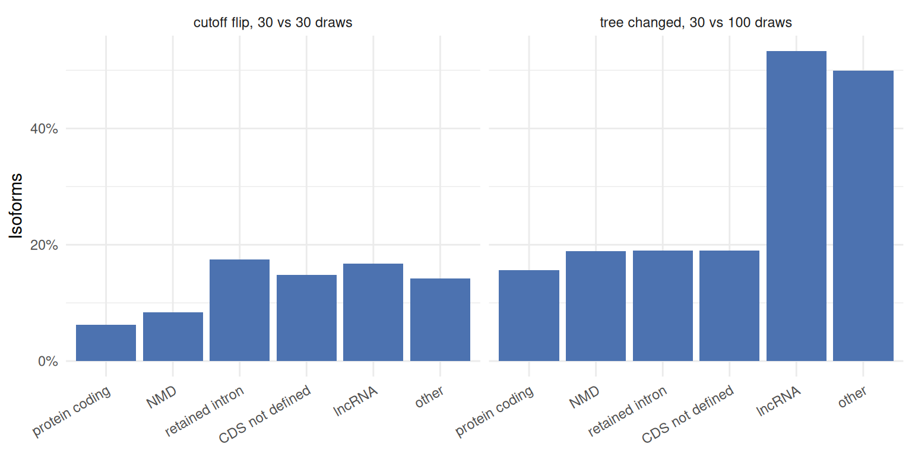
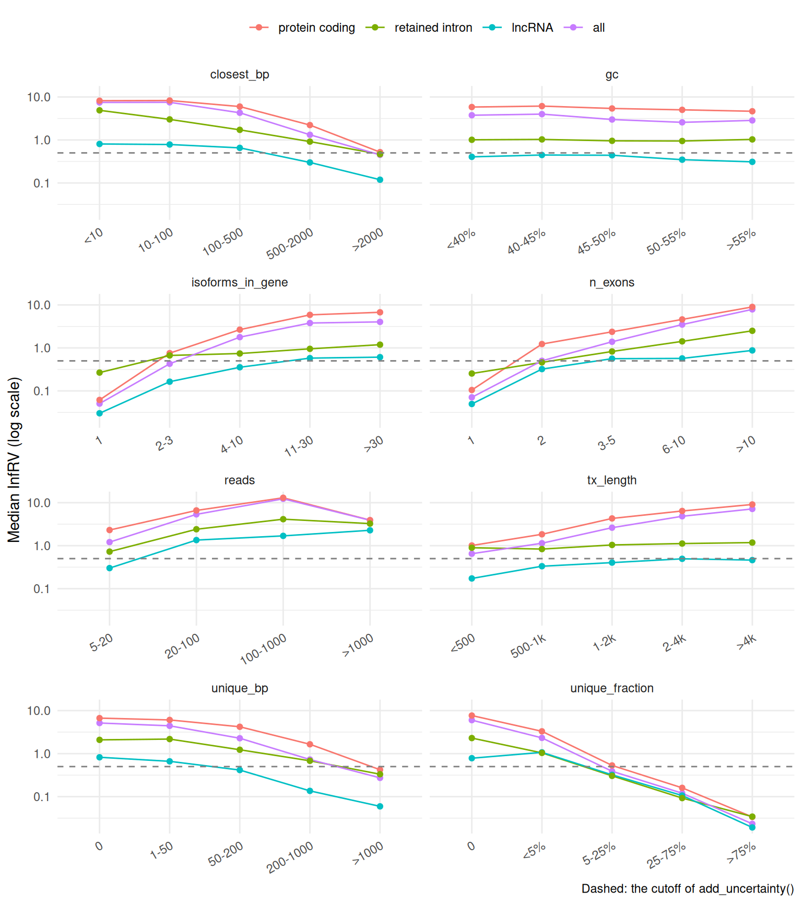
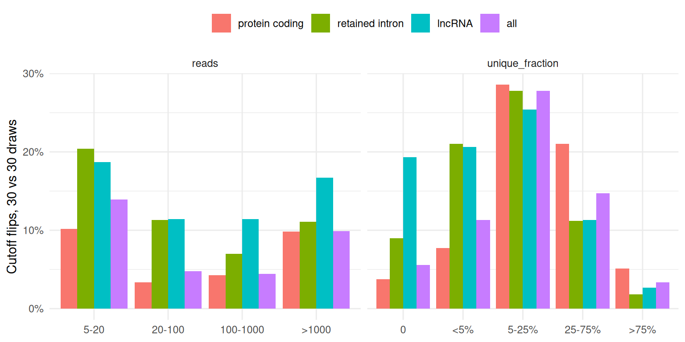
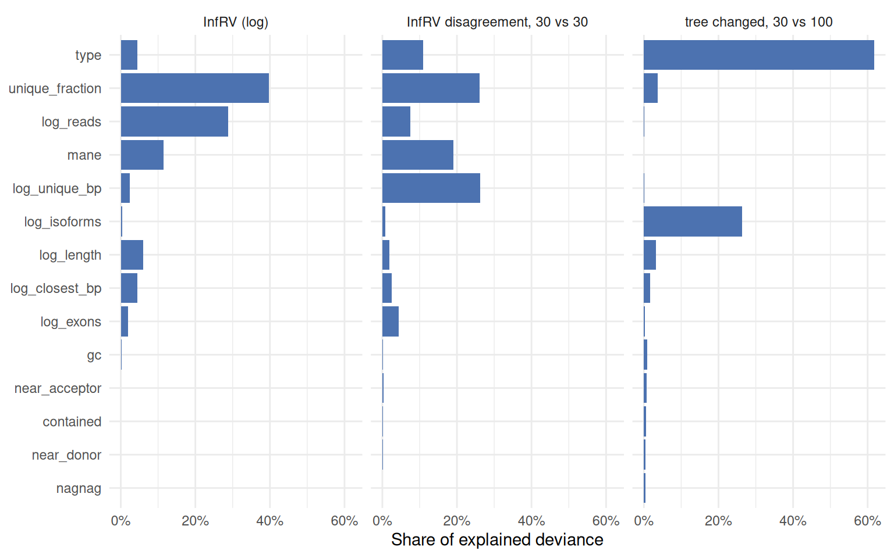

# What makes an isoform hard to quantify?

The [uncertainty
article](https://luciorq.github.io/isoformic/articles/isoformic-uncertainty.md)
turns Salmon’s inferential replicates into an uncertainty for every
isoform and a confidence for every call. This article asks the next
questions: which isoforms are uncertain, why, and how far the replicates
themselves can be trusted. It looks at three things for every isoform:

- **how uncertain** its abundance is: the inferential relative variance
  (InfRV) ([Zhu et al. 2019](#ref-swish)) with 100 Gibbs draws;
- **how reliably** 30 draws measure that uncertainty: whether two
  independent sets of 30 draws put the isoform on different sides of the
  0.5 cutoff that
  [`add_uncertainty()`](https://luciorq.github.io/isoformic/reference/uncertainty.md)
  uses to call it uncertain (a *cutoff flip*), and how much the two
  estimates differ;
- **how stable** its TreeTerminus tree is ([Singh et al.
  2023](#ref-treeterminus)): whether the transcripts of its tree change
  between trees built from 30 and from 100 draws.

and relates them to the transcript type and to molecular features of the
isoform and its gene.

## The data

Three samples of the prostate ESRP2 knockdown of the uncertainty article
(two controls and one knockdown; 12 million read pairs each) were
quantified with Salmon 2.8.0 against GENCODE v49, with 100 Gibbs draws,
and once more with 30. Isoforms with at least 5 estimated reads in a
sample are kept, and the measures are averaged over the samples where
the isoform is expressed. The features come from the annotation, the
transcript sequences and the equivalence classes:

| Feature | Meaning |
|----|----|
| `reads` | estimated reads of the isoform |
| `tx_length`, `n_exons` | length and exons of the isoform |
| `isoforms_in_gene` | annotated isoforms of its gene |
| `gc` | GC content of the transcript sequence |
| `mane`, `tsl` | MANE Select tag; transcript support level |
| `unique_bp` | exonic bases no other isoform of the gene covers |
| `closest_bp` | exonic bases that differ from the most similar sibling (both directions) |
| `contained` | all its exonic bases are inside another isoform’s |
| `nagnag` | an acceptor site three bases from an acceptor of another isoform (NAGNAG) |
| `near_acceptor`, `near_donor` | a splice site 1 to 30 bases from another isoform’s |
| `unique_fraction` | share of its fragments compatible with it alone (equivalence classes) |

`data-raw/knockdown/isoform_features.R` computes everything; the tables
used below ship with the package.

``` r

library(isoformic)
library(dplyr)
library(ggplot2)

stability <- function(name) {
  read_parquet(fs::path_package("isoformic", "extdata", "knockdown", "stability", paste0(name, ".parquet")))
}
type_labels <- c(
  protein_coding = "protein coding",
  nonsense_mediated_decay = "NMD",
  retained_intron = "retained intron",
  protein_coding_CDS_not_defined = "CDS not defined",
  lncRNA = "lncRNA",
  other = "other",
  all = "all"
)
```

## By transcript type

``` r

by_type <- stability("by_type")
by_type |>
  select(type, isoforms, median_reads, median_isoforms_in_gene, median_unique_fraction, median_inf_rv, cutoff_flip, tree_changed)
#> # A tibble: 6 × 8
#>   type       isoforms median_reads median_isoforms_in_g…¹ median_unique_fraction
#>   <chr>         <int>        <dbl>                  <dbl>                  <dbl>
#> 1 protein_c…    59427         35.4                     22                0      
#> 2 nonsense_…     5604         16                       24                0.00108
#> 3 retained_…     8975         12.2                     26                0.00748
#> 4 protein_c…     4203         11.8                     19                0.00845
#> 5 lncRNA         8652         10.7                     17                0.0119 
#> 6 other           569         10                        1                0.031  
#> # ℹ abbreviated name: ¹​median_isoforms_in_gene
#> # ℹ 3 more variables: median_inf_rv <dbl>, cutoff_flip <dbl>,
#> #   tree_changed <dbl>
```

Three different pictures emerge.

- **Protein-coding isoforms are the most uncertain and the most reliably
  measured.** Their median InfRV is the highest (5.28): they belong to
  genes with many isoforms (median 22) that share their exons, and half
  of them have no fragment of their own. But their InfRV is far above
  the cutoff, so 30 draws rarely put one on the other side (6.2% flip).
- **Retained-intron, CDS-not-defined and lncRNA isoforms flip most**
  (17.5%, 14.8% and 16.8%): they have fewer reads and their InfRV sits
  near the cutoff, where a noisier estimate decides the call.
- **lncRNA trees are the least stable**: 53.3% of lncRNA isoforms are in
  a tree whose transcripts change between 30 and 100 draws, against
  15.6% of protein-coding ones.

``` r

by_type |>
  tidyr::pivot_longer(c("cutoff_flip", "tree_changed"), names_to = "measure", values_to = "share") |>
  mutate(
    type = factor(type_labels[type], levels = type_labels),
    measure = c(cutoff_flip = "cutoff flip, 30 vs 30 draws", tree_changed = "tree changed, 30 vs 100 draws")[measure]
  ) |>
  ggplot(aes(x = type, y = share)) +
  geom_col(fill = "#4C72B0") +
  facet_wrap(vars(measure)) +
  scale_y_continuous(labels = scales::percent) +
  labs(x = NULL, y = "Isoforms") +
  theme_minimal() +
  theme(axis.text.x = element_text(angle = 30, hjust = 1))
```



The tree changes matter for the isoforms that a cut of the trees would
group, the uncertain ones; for lncRNAs they are as frequent among those:

``` r

stability("tree_uncertainty") |>
  filter(type %in% c("protein_coding", "retained_intron", "lncRNA"))
#> # A tibble: 6 × 5
#>   type            uncertain isoforms cutoff_flip tree_changed
#>   <chr>           <lgl>        <int>       <dbl>        <dbl>
#> 1 protein_coding  FALSE         5598      0.243         0.216
#> 2 protein_coding  TRUE         53829      0.0437        0.15 
#> 3 retained_intron FALSE         2709      0.243         0.218
#> 4 retained_intron TRUE          6266      0.146         0.179
#> 5 lncRNA          FALSE         4892      0.151         0.549
#> 6 lncRNA          TRUE          3760      0.189         0.518
```

## What the features say

The median InfRV across the levels of each feature, for all isoforms and
within the three largest types:

``` r

bins <- stability("feature_bins")
bins |>
  filter(
    feature %in% c("reads", "unique_fraction", "isoforms_in_gene", "tx_length", "closest_bp", "unique_bp", "n_exons", "gc"),
    type %in% c("all", "protein_coding", "retained_intron", "lncRNA")
  ) |>
  mutate(
    type = factor(type_labels[type], levels = type_labels),
    level = reorder(level, level_order)
  ) |>
  ggplot(aes(x = level, y = median_inf_rv, colour = type, group = type)) +
  geom_line() +
  geom_point() +
  geom_hline(yintercept = 0.5, linetype = "dashed", colour = "grey50") +
  scale_y_log10() +
  facet_wrap(vars(feature), scales = "free_x", ncol = 2) +
  labs(x = NULL, y = "Median InfRV (log scale)", colour = NULL, caption = "Dashed: the cutoff of add_uncertainty()") +
  theme_minimal() +
  theme(axis.text.x = element_text(angle = 30, hjust = 1), legend.position = "top")
```



- **Fragments of its own decide whether an isoform is determined.** The
  median InfRV falls from about 6 for isoforms without a unique fragment
  to 0.02 for those with most fragments unique, within every type.
- **Sequence identity to siblings works the same way**: isoforms that
  differ from their closest sibling by few bases, or that have few
  exonic bases of their own, are the most uncertain.
- **More isoforms in the gene, more uncertainty**: from 0.05 for genes
  with one isoform to about 4 for genes with more than 30.
- **Uncertainty is not a problem of low counts.** The InfRV rises with
  the number of reads up to a thousand reads: an ambiguous isoform stays
  ambiguous however deep it is sequenced, plausibly because the variance
  that assignment adds grows with the reads that have to be assigned.
  Length works the same way for protein-coding isoforms, which share
  more exons as they grow.
- **GC content hardly matters** once the rest is known.

The cutoff flips follow a different pattern: they are rare where the
InfRV is far from the cutoff in either direction and frequent near it.

``` r

bins |>
  filter(feature %in% c("unique_fraction", "reads"), type %in% c("all", "protein_coding", "retained_intron", "lncRNA")) |>
  mutate(type = factor(type_labels[type], levels = type_labels), level = reorder(level, level_order)) |>
  ggplot(aes(x = level, y = cutoff_flip, fill = type)) +
  geom_col(position = "dodge") +
  facet_wrap(vars(feature), scales = "free_x") +
  scale_y_continuous(labels = scales::percent) +
  labs(x = NULL, y = "Cutoff flips, 30 vs 30 draws", fill = NULL) +
  theme_minimal() +
  theme(legend.position = "top")
```



Isoforms with some but few unique fragments (5% to 25%) flip most, and
low-count isoforms flip more than well-covered ones: these are the
isoforms whose call depends on the replicates, and for which more draws
help.

### Splice sites

NAGNAG acceptors, where two isoforms differ by three bases at an
acceptor, are a classical hard case for read assignment.

``` r

bins |>
  filter(feature %in% c("nagnag", "near_acceptor", "near_donor", "contained", "mane"), type %in% c("all", "protein_coding")) |>
  select(feature, type, level, isoforms, median_inf_rv, cutoff_flip, tree_changed)
#> # A tibble: 20 × 7
#>    feature       type      level isoforms median_inf_rv cutoff_flip tree_changed
#>    <chr>         <chr>     <chr>    <int>         <dbl>       <dbl>        <dbl>
#>  1 contained     all       no       59897          2.28      0.105         0.208
#>  2 contained     all       yes      27533          5.56      0.058         0.175
#>  3 contained     protein_… no       37319          4.41      0.0746        0.159
#>  4 contained     protein_… yes      22108          6.83      0.0422        0.152
#>  5 nagnag        all       no       67152          2.46      0.101         0.209
#>  6 nagnag        all       yes      20278          6.41      0.0545        0.161
#>  7 nagnag        protein_… no       42658          4.42      0.0714        0.161
#>  8 nagnag        protein_… yes      16769          7.83      0.0399        0.145
#>  9 near_acceptor all       no       34737          1.35      0.125         0.228
#> 10 near_acceptor all       yes      52693          4.96      0.068         0.179
#> 11 near_acceptor protein_… no       18873          2.87      0.0941        0.171
#> 12 near_acceptor protein_… yes      40554          6.6       0.0478        0.15 
#> 13 near_donor    all       no       52293          2.07      0.11          0.203
#> 14 near_donor    all       yes      35137          5.26      0.0618        0.19 
#> 15 near_donor    protein_… no       32421          4.02      0.0794        0.15 
#> 16 near_donor    protein_… yes      27006          6.88      0.0423        0.163
#> 17 mane          all       no       76688          3.13      0.0891        0.205
#> 18 mane          all       yes      10742          3.2       0.101         0.149
#> 19 mane          protein_… no       48693          5.73      0.0541        0.158
#> 20 mane          protein_… yes      10734          3.21      0.101         0.149
```

Isoforms with a NAGNAG or a nearby alternative acceptor or donor are
more uncertain, but the model below attributes almost none of that to
the splice sites themselves once the unique fragments are known: a
three-base difference leaves the isoform with very few fragments of its
own, and that is what the replicates register. MANE Select isoforms are
less uncertain than the other protein-coding isoforms of their genes,
and closer to the cutoff, so they flip more often.

## Separating the factors

The features are correlated (long isoforms have more exons; genes with
many isoforms have isoforms with few unique bases), so their individual
effects come from models that include them all, with the continuous
features standardised. The share of the explained deviance of each
feature:

``` r

importance <- stability("importance")
importance |>
  mutate(
    outcome = c(
      log_inf_rv = "InfRV (log)",
      log_rv_disagreement = "InfRV disagreement, 30 vs 30",
      tree_changed = "tree changed, 30 vs 100"
    )[outcome],
    term = reorder(term, share)
  ) |>
  ggplot(aes(x = share, y = term)) +
  geom_col(fill = "#4C72B0") +
  facet_wrap(vars(outcome), nrow = 1) +
  scale_x_continuous(labels = scales::percent) +
  labs(x = "Share of explained deviance", y = NULL) +
  theme_minimal()
```



``` r

stability("model_fit")
#> # A tibble: 2 × 3
#>   outcome             r_squared isoforms
#>   <chr>                   <dbl>    <int>
#> 1 log_inf_rv             0.629     85236
#> 2 log_rv_disagreement    0.0788    85236
```

- **How uncertain an isoform is** is well explained (R² 0.629): the
  unique fragments, the reads, the MANE tag, the length and the distance
  to the closest sibling carry most of it.
- **How much two sets of 30 draws disagree** is mostly not explained by
  any feature (R² 0.0788): it is sampling noise of the draws, which only
  more draws reduce. The disagreement on the log scale is largest for
  the best-determined isoforms, whose InfRV is close to zero; on the
  decisions that matter (the cutoff) the flips above are the better
  summary.
- **Whether the tree changes** depends mostly on the transcript type and
  on the number of isoforms of the gene: lncRNA loci and genes with many
  isoforms have the least stable trees.

The direction of each effect:

``` r

stability("model_terms") |>
  filter(!grepl("^type|Intercept", term)) |>
  select(outcome, term, estimate, p_value) |>
  tidyr::pivot_wider(names_from = outcome, values_from = c(estimate, p_value))
#> # A tibble: 13 × 7
#>    term         estimate_log_inf_rv estimate_log_rv_disa…¹ estimate_tree_changed
#>    <chr>                      <dbl>                  <dbl>                 <dbl>
#>  1 log_reads                0.248                  0.022                  0.0229
#>  2 log_length               0.131                 -0.0129                -0.132 
#>  3 log_exons                0.0821                -0.0211                -0.0376
#>  4 log_isoforms            -0.0286                 0.00737                0.328 
#>  5 gc                      -0.0161                 0.00308               -0.0548
#>  6 log_unique_…            -0.0913                 0.0528                 0.0251
#>  7 log_closest…            -0.114                  0.015                  0.103 
#>  8 unique_frac…            -0.29                   0.0409                 0.126 
#>  9 containedTR…            -0.00766                0.0058                -0.113 
#> 10 nagnagTRUE               0.0115                -0.0023                -0.0917
#> 11 near_accept…             0.0301                -0.00907               -0.114 
#> 12 near_donorT…             0.0312                -0.00639                0.0718
#> 13 maneTRUE                -0.465                  0.105                  0.0226
#> # ℹ abbreviated name: ¹​estimate_log_rv_disagreement
#> # ℹ 3 more variables: p_value_log_inf_rv <dbl>,
#> #   p_value_log_rv_disagreement <dbl>, p_value_tree_changed <dbl>
```

## How to read the uncertainty of an isoform

- **A high InfRV means an isoform shares its reads, not that it has
  few.** Look at `unique_fraction` in
  [`tx_uncertainty()`](https://luciorq.github.io/isoformic/reference/uncertainty.md):
  an isoform with almost no fragment of its own will stay uncertain at
  any depth, and the honest unit for it is a group (`collapse_groups`,
  Terminus or TreeTerminus).
- **Calls near the cutoff are the fragile ones.** Isoforms with a few
  unique fragments, few reads, retained introns, lncRNAs and transcripts
  without a defined CDS are where 30 draws can tip the call; for those,
  100 draws make the classes more stable
  (`salmon_quant(num_gibbs = 100)`).
- **TreeTerminus on lncRNA-rich questions needs more draws.** About half
  of the lncRNA trees change between 30 and 100 draws, also for
  uncertain isoforms.
- **Splice-site structure acts through the reads.** NAGNAG and nearby
  alternative splice sites make isoforms hard to separate because they
  leave them without unique fragments; `unique_fraction` already
  measures that, so there is no need to correct for it separately.
- **The MANE isoform is the easiest isoform of a coding gene to
  quantify**, which also makes it the most common reference when the
  other isoforms are uncertain.

## Cautions

The measures come from three samples of one experiment, quantified with
one tool (Salmon 2.8.0) on 12 million read pairs; deeper libraries may
move isoforms relative to the cutoff (not tested here), and other
quantifiers distribute ambiguous reads differently. The cutoff flips
compare two halves of one Salmon run, a clean comparison of 30 draws
with 30 draws; the tree changes compare two separate Salmon runs, so
they mix the effect of the number of draws with the randomness of an
independent run. The features describe the annotation; isoforms absent
from it, and reads from them, are outside this picture.

## Session information

``` r

sessionInfo()
#> R version 4.6.2 (2026-10-29)
#> Platform: x86_64-pc-linux-gnu
#> Running under: Ubuntu 26.04.1 LTS
#> 
#> Matrix products: default
#> BLAS:   /usr/lib/x86_64-linux-gnu/openblas-pthread/libblas.so.3 
#> LAPACK: /usr/lib/x86_64-linux-gnu/openblas-pthread/libopenblasp-r0.3.32.so;  LAPACK version 3.12.0
#> 
#> locale:
#>  [1] LC_CTYPE=C.UTF-8       LC_NUMERIC=C           LC_TIME=C.UTF-8       
#>  [4] LC_COLLATE=C.UTF-8     LC_MONETARY=C.UTF-8    LC_MESSAGES=C.UTF-8   
#>  [7] LC_PAPER=C.UTF-8       LC_NAME=C              LC_ADDRESS=C          
#> [10] LC_TELEPHONE=C         LC_MEASUREMENT=C.UTF-8 LC_IDENTIFICATION=C   
#> 
#> time zone: UTC
#> tzcode source: system (glibc)
#> 
#> attached base packages:
#> [1] stats     graphics  grDevices utils     datasets  methods   base     
#> 
#> other attached packages:
#> [1] ggplot2_4.0.3   dplyr_1.2.1     isoformic_0.1.3
#> 
#> loaded via a namespace (and not attached):
#>  [1] gtable_0.3.6       jsonlite_2.0.0     compiler_4.6.2     tidyselect_1.2.1  
#>  [5] tidyr_1.3.2        scales_1.4.0       yaml_2.3.12        fastmap_1.2.0     
#>  [9] R6_2.6.1           labeling_0.4.3     generics_0.1.4     knitr_1.52        
#> [13] tibble_3.3.1       DBI_1.3.0          pillar_1.11.1      RColorBrewer_1.1-3
#> [17] rlang_1.3.0        utf8_1.2.6         xfun_0.62          fs_2.1.0          
#> [21] S7_0.2.2           otel_0.3.0         cli_3.6.6          withr_3.0.3       
#> [25] magrittr_2.0.5     digest_0.6.39      grid_4.6.2         lifecycle_1.0.5   
#> [29] vctrs_0.7.3        evaluate_1.0.5     glue_1.8.1         farver_2.1.2      
#> [33] duckdb_2.0.0       purrr_1.2.2        rmarkdown_2.32     tools_4.6.2       
#> [37] pkgconfig_2.0.3    htmltools_0.5.9
```

## References

Singh, Noor Pratap, Michael I Love, and Rob Patro. 2023. “TreeTerminus –
Creating Transcript Trees Using Inferential Replicate Counts.”
*iScience* 26 (6): 106961. <https://doi.org/10.1016/j.isci.2023.106961>.

Zhu, A, A Srivastava, JG Ibrahim, R Patro, and MI Love. 2019.
“Nonparametric expression analysis using inferential replicate counts.”
*Nucleic Acids Research* 47: e105. <https://doi.org/10.1093/nar/gkz622>.
