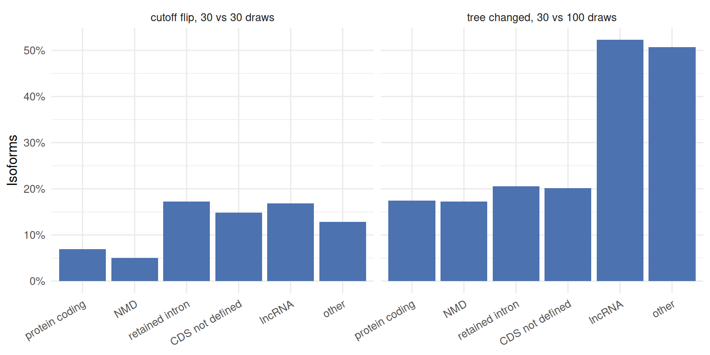
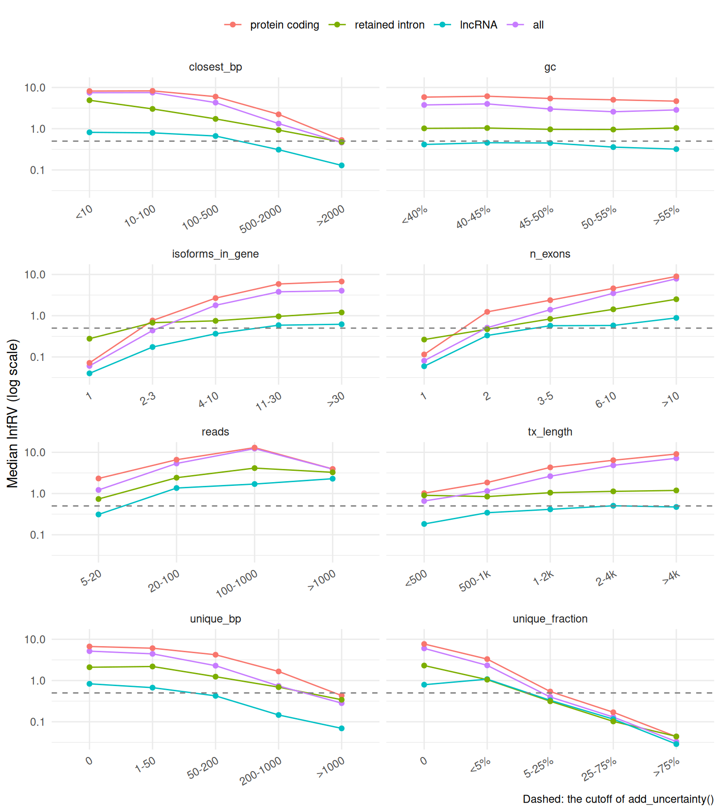
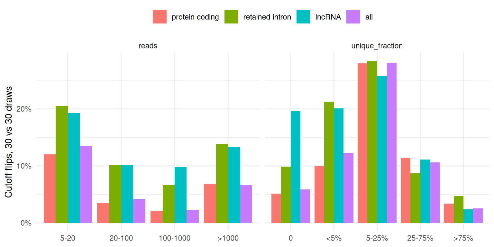
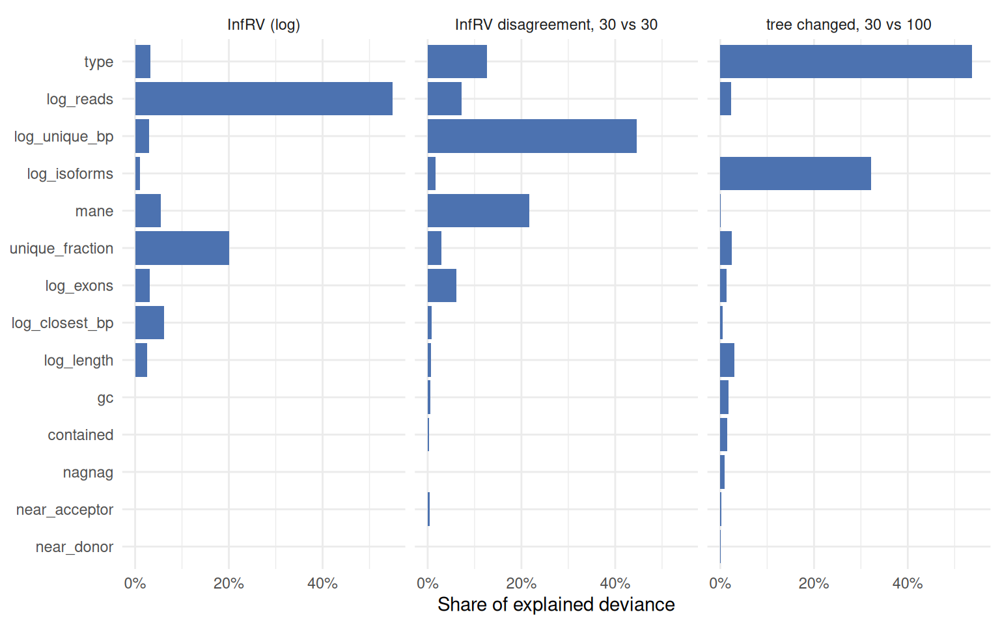

# What makes an isoform hard to quantify?

The [uncertainty
article](https://luciorq.github.io/isoformic/articles/isoformic-uncertainty.md)
turns Salmon’s inferential replicates into an uncertainty for every
isoform and a check of the direction of every call. This article asks
the next questions: which isoforms are uncertain, why, and how far the
replicates themselves can be trusted. It looks at three things for every
isoform:

- **how uncertain** its abundance is: the inferential relative variance
  (InfRV) ([Zhu et al. 2019](#ref-swish)) with 100 Gibbs draws;
- **how reliably** 30 draws measure that uncertainty: whether two
  disjoint sets of 30 draws from the same Gibbs run (draws 1-30 and
  31-60) put the isoform on different sides of the 0.5 cutoff with which
  [`add_uncertainty()`](https://luciorq.github.io/isoformic/reference/uncertainty.md)
  flags it as `uncertain` (a *cutoff flip*), and how much the two
  estimates differ;
- **how stable** its TreeTerminus tree is ([Singh et al.
  2023](#ref-treeterminus)): whether the transcripts of its tree change
  between trees built from 30 and from 100 draws.

and relates them to the transcript type and to molecular features of the
isoform and its gene.

## The data

Three samples of the prostate ESRP2 knockdown of the uncertainty article
(two controls and one knockdown; 12 million read pairs each) were
quantified with Salmon 2.8.0 against GENCODE v50, with 100 Gibbs draws,
and once more with 30. Isoforms with at least 5 estimated reads in a
sample are kept, and the measures are averaged over the samples where
the isoform is expressed. The features come from the annotation, the
transcript sequences and the equivalence classes:

| Feature | Meaning |
|----|----|
| `reads` | estimated reads of the isoform |
| `tx_length`, `n_exons` | length and exons of the isoform |
| `isoforms_in_gene` | annotated isoforms of its gene |
| `gc` | GC content of the transcript sequence |
| `mane`, `tsl` | MANE Select tag; transcript support level |
| `unique_bp` | exonic bases no other isoform of the gene covers |
| `closest_bp` | exonic bases that differ from the most similar sibling (both directions) |
| `contained` | all its exonic bases are inside another isoform’s |
| `nagnag` | an acceptor site three bases from an acceptor of another isoform (NAGNAG) |
| `near_acceptor`, `near_donor` | a splice site 1 to 30 bases from another isoform’s |
| `unique_fraction` | share of its fragments compatible with it alone (equivalence classes) |

`data-raw/knockdown/isoform_features.R` computes everything; the tables
used below ship with the package.

``` r

library(isoformic)
library(dplyr)
library(ggplot2)

stability <- function(name) {
  read_parquet(fs::path_package("isoformic", "extdata", "knockdown", "stability", paste0(name, ".parquet")))
}
type_labels <- c(
  protein_coding = "protein coding",
  nonsense_mediated_decay = "NMD",
  retained_intron = "retained intron",
  protein_coding_CDS_not_defined = "CDS not defined",
  lncRNA = "lncRNA",
  other = "other",
  all = "all"
)
```

## By transcript type

``` r

by_type <- stability("by_type")
by_type |>
  select(type, isoforms, median_reads, median_isoforms_in_gene, median_unique_fraction, median_inf_rv, cutoff_flip, tree_changed)
#> # A tibble: 6 × 8
#>   type       isoforms median_reads median_isoforms_in_g…¹ median_unique_fraction
#>   <chr>         <int>        <dbl>                  <dbl>                  <dbl>
#> 1 protein_c…    58316         26.6                     31                0      
#> 2 nonsense_…    22806         22                       38                0      
#> 3 retained_…     8579         12.3                     38                0.00456
#> 4 protein_c…     3849         12.5                     29                0.0029 
#> 5 lncRNA         8622         10.7                     17                0.0115 
#> 6 other           553         10                        1                0.0228 
#> # ℹ abbreviated name: ¹​median_isoforms_in_gene
#> # ℹ 3 more variables: median_inf_rv <dbl>, cutoff_flip <dbl>,
#> #   tree_changed <dbl>
```

Three different pictures emerge.

- **NMD and protein-coding isoforms are the most uncertain and the most
  reliably measured.** Their median InfRV is the highest (5.14 and
  4.66): they belong to genes with many isoforms (median 38 and 31) that
  share their exons, and half of them have no fragment of their own. But
  their InfRV is far above the cutoff, so 30 draws rarely put one on the
  other side (5% and 6.9% flip). NMD isoforms are 22% of the isoforms
  expressed in these three samples.
- **Retained-intron, CDS-not-defined and lncRNA isoforms flip most**
  (17.2%, 14.8% and 16.8%): they have fewer reads and their InfRV sits
  near the cutoff, where a noisier estimate decides the call.
- **lncRNA trees are the least stable**: 52.3% of lncRNA isoforms are in
  a tree whose transcripts change between 30 and 100 draws, against
  17.4% of protein-coding ones.

``` r

by_type |>
  tidyr::pivot_longer(c("cutoff_flip", "tree_changed"), names_to = "measure", values_to = "share") |>
  mutate(
    type = factor(type_labels[type], levels = type_labels),
    measure = c(cutoff_flip = "cutoff flip, 30 vs 30 draws", tree_changed = "tree changed, 30 vs 100 draws")[measure]
  ) |>
  ggplot(aes(x = type, y = share)) +
  geom_col(fill = "#4C72B0") +
  facet_wrap(vars(measure)) +
  scale_y_continuous(labels = scales::percent) +
  labs(x = NULL, y = "Isoforms") +
  theme_minimal() +
  theme(axis.text.x = element_text(angle = 30, hjust = 1))
```



The tree changes matter for the isoforms that a cut of the trees would
group, the uncertain ones; for lncRNAs they are as frequent among those:

``` r

stability("tree_uncertainty") |>
  filter(type %in% c("protein_coding", "retained_intron", "lncRNA"))
#> # A tibble: 6 × 5
#>   type            uncertain isoforms cutoff_flip tree_changed
#>   <chr>           <lgl>        <int>       <dbl>        <dbl>
#> 1 protein_coding  FALSE         5587      0.247         0.213
#> 2 protein_coding  TRUE         52729      0.0499        0.17 
#> 3 retained_intron FALSE         2479      0.254         0.222
#> 4 retained_intron TRUE          6100      0.139         0.199
#> 5 lncRNA          FALSE         4889      0.155         0.541
#> 6 lncRNA          TRUE          3733      0.186         0.505
```

## What the features say

The median InfRV across the levels of each feature, for all isoforms and
within the three largest types:

``` r

bins <- stability("feature_bins")
bins |>
  filter(
    feature %in% c("reads", "unique_fraction", "isoforms_in_gene", "tx_length", "closest_bp", "unique_bp", "n_exons", "gc"),
    type %in% c("all", "protein_coding", "retained_intron", "lncRNA")
  ) |>
  mutate(
    type = factor(type_labels[type], levels = type_labels),
    level = reorder(level, level_order)
  ) |>
  ggplot(aes(x = level, y = median_inf_rv, colour = type, group = type)) +
  geom_line() +
  geom_point() +
  geom_hline(yintercept = 0.5, linetype = "dashed", colour = "grey50") +
  scale_y_log10() +
  facet_wrap(vars(feature), scales = "free_x", ncol = 2) +
  labs(x = NULL, y = "Median InfRV (log scale)", colour = NULL, caption = "Dashed: the uncertain cutoff of add_uncertainty() (inf_rv_cutoff, 0.5)") +
  theme_minimal() +
  theme(axis.text.x = element_text(angle = 30, hjust = 1), legend.position = "top")
```



- **Fragments of its own decide whether an isoform is determined.** The
  median InfRV falls from about 5 for isoforms without a unique fragment
  (about 6 for protein-coding and NMD isoforms) to 0.03 for those with
  most fragments unique. The fall holds within every type, to between
  0.01 and 0.035, but from a lower start for retained-intron and
  non-coding isoforms of protein-coding genes (about 2) and for lncRNA
  and other isoforms (about 1 or less; lncRNA isoforms rise slightly
  before they fall).
- **Sequence identity to siblings works the same way**: isoforms that
  differ from their closest sibling by few bases, or that have few
  exonic bases of their own, are the most uncertain.
- **More isoforms in the gene, more uncertainty**: from 0.05 for genes
  with one isoform to about 4 for genes with more than 30.
- **A high InfRV is not a sign of low counts.** The InfRV rises with the
  number of reads up to a thousand reads: an ambiguous isoform stays
  ambiguous however deep it is sequenced, plausibly because the variance
  that assignment adds grows with the reads that have to be assigned.
  Length works the same way for protein-coding isoforms, which share
  more exons as they grow. Low counts still matter for decisions:
  low-count isoforms flip across the cutoff more often (below), and in
  the [evidence
  article](https://luciorq.github.io/isoformic/articles/isoformic-uncertainty-evidence.md)
  calls with an unstable direction, and point fold-changes outside the
  range of the per-draw refits, are concentrated in isoforms with few
  reads.
- **GC content hardly matters** once the rest is known.

The cutoff flips follow a different pattern: they are rare where the
InfRV is far from the cutoff in either direction and frequent near it.

``` r

bins |>
  filter(feature %in% c("unique_fraction", "reads"), type %in% c("all", "protein_coding", "retained_intron", "lncRNA")) |>
  mutate(type = factor(type_labels[type], levels = type_labels), level = reorder(level, level_order)) |>
  ggplot(aes(x = level, y = cutoff_flip, fill = type)) +
  geom_col(position = "dodge") +
  facet_wrap(vars(feature), scales = "free_x") +
  scale_y_continuous(labels = scales::percent) +
  labs(x = NULL, y = "Cutoff flips, 30 vs 30 draws", fill = NULL) +
  theme_minimal() +
  theme(legend.position = "top")
```



Isoforms with some but few unique fragments (5% to 25%) flip most, and
low-count isoforms flip more than well-covered ones: these are the
isoforms whose `uncertain` flag depends on the replicates, and for which
more draws would be expected to help (not tested here).

### Splice sites

NAGNAG acceptors, where two isoforms differ by three bases at an
acceptor, are a classical hard case for read assignment.

``` r

bins |>
  filter(feature %in% c("nagnag", "near_acceptor", "near_donor", "contained", "mane"), type %in% c("all", "protein_coding")) |>
  select(feature, type, level, isoforms, median_reads, median_inf_rv, cutoff_flip, tree_changed)
#> # A tibble: 20 × 8
#>    feature       type      level isoforms median_reads median_inf_rv cutoff_flip
#>    <chr>         <chr>     <chr>    <int>        <dbl>         <dbl>       <dbl>
#>  1 contained     all       no       53288         15            1.9       0.113 
#>  2 contained     all       yes      49437         32.8          5.67      0.0545
#>  3 contained     protein_… no       23510         17.7          2.93      0.0961
#>  4 contained     protein_… yes      34806         38.6          6.11      0.0504
#>  5 nagnag        all       no       77332         19.1          2.83      0.0942
#>  6 nagnag        all       yes      25393         25.2          5.42      0.057 
#>  7 nagnag        protein_… no       42220         25.6          4.14      0.0755
#>  8 nagnag        protein_… yes      16096         29.3          6.06      0.0514
#>  9 near_acceptor all       no       30653         15.7          1.33      0.126 
#> 10 near_acceptor all       yes      72072         23            4.55      0.0677
#> 11 near_acceptor protein_… no       15045         24.2          2.83      0.0972
#> 12 near_acceptor protein_… yes      43271         27.5          5.3       0.059 
#> 13 near_donor    all       no       50067         17.8          2.12      0.106 
#> 14 near_donor    all       yes      52658         23.5          4.8       0.0649
#> 15 near_donor    protein_… no       26961         25.4          3.67      0.0829
#> 16 near_donor    protein_… yes      31355         27.7          5.49      0.0567
#> 17 mane          all       no       92539         17.9          3.15      0.0878
#> 18 mane          all       yes      10186        197            7.87      0.0593
#> 19 mane          protein_… no       48139         20.6          4.25      0.0708
#> 20 mane          protein_… yes      10177        197            7.89      0.0594
#> # ℹ 1 more variable: tree_changed <dbl>
# Protein-coding isoforms: MANE against the others, overall and at equal depth
pc <- bins[bins$type == "protein_coding", ]
mane_reads <- setNames(pc$median_reads[pc$feature == "mane"], pc$level[pc$feature == "mane"])
mane_by_reads <- pc[pc$feature == "reads_by_mane", ] |>
  tidyr::separate_wider_delim(level, delim = " / ", names = c("reads", "mane")) |>
  arrange(level_order) |>
  select(reads, mane, median_inf_rv) |>
  tidyr::pivot_wider(names_from = mane, values_from = median_inf_rv)
mane_by_reads
#> # A tibble: 4 × 3
#>   reads       no    yes
#>   <chr>    <dbl>  <dbl>
#> 1 5-20      1.97  0.647
#> 2 20-100    6.09  4.44 
#> 3 100-1000 18.9  15.5  
#> 4 >1000    13.7   7.37
tree_by_isoforms <- function(type, level) {
  bins$tree_changed[bins$feature == "isoforms_in_gene" & bins$type == type & bins$level == level]
}
```

Isoforms with a NAGNAG or a nearby alternative acceptor or donor are
more uncertain, but the model below attributes almost none of that to
the splice sites themselves once the unique fragments are known: a
three-base difference leaves the isoform with very few fragments of its
own, and that is what the replicates register. MANE Select isoforms have
a higher median InfRV than the other protein-coding isoforms (7.89
against 4.25) mainly because they carry most of the reads of their genes
(median 197 estimated reads against 21) and the InfRV grows with the
reads: at the same depth they are less uncertain, in every bin of reads
(median InfRV 0.647 against 1.97, 4.44 against 6.09, 15.5 against 18.9,
7.37 against 13.7 for 5-20, 20-100, 100-1000, \>1000 reads), and the
model below gives the MANE tag a lower InfRV.

## Separating the factors

The features are correlated (long isoforms have more exons; genes with
many isoforms have isoforms with few unique bases), so their individual
effects come from models that include them all, with the continuous
features standardised. The share of the explained deviance of each
feature:

``` r

importance <- stability("importance")
importance |>
  mutate(
    outcome = c(
      log_inf_rv = "InfRV (log)",
      log_rv_disagreement = "InfRV disagreement, 30 vs 30",
      tree_changed = "tree changed, 30 vs 100"
    )[outcome],
    term = reorder(term, share)
  ) |>
  ggplot(aes(x = share, y = term)) +
  geom_col(fill = "#4C72B0") +
  facet_wrap(vars(outcome), nrow = 1) +
  scale_x_continuous(labels = scales::percent) +
  labs(x = "Share of explained deviance", y = NULL) +
  theme_minimal()
```



``` r

stability("model_fit")
#> # A tibble: 2 × 3
#>   outcome             r_squared isoforms
#>   <chr>                   <dbl>    <int>
#> 1 log_inf_rv             0.606    100708
#> 2 log_rv_disagreement    0.0442   100708
```

- **How uncertain an isoform is** is well explained (R² 0.606): the
  reads and the unique fragments carry most of it (55% and 20% of the
  explained deviance), followed by the distance to the closest sibling
  and the MANE tag.
- **How much two sets of 30 draws disagree** is mostly not explained by
  any feature (R² 0.0442): it is sampling noise of the draws, which only
  more draws reduce. The disagreement on the log scale is largest for
  the best-determined isoforms, whose InfRV is close to zero; on the
  decisions that matter (the cutoff) the flips above are the better
  summary.
- **Whether the tree changes** depends mostly on the transcript type
  (54% of the explained deviance) and on the number of isoforms of the
  gene (32%). lncRNA isoforms have the least stable trees, and at equal
  type, reads and sequence features, more isoforms in the gene make a
  change more likely. The raw pattern differs: over all types the
  isoforms of single-isoform genes change most often (46%, mostly lncRNA
  and other non-coding loci), while within lncRNA the share reaches 69%
  in genes with more than 30 isoforms.

The direction of each effect:

``` r

stability("model_terms") |>
  filter(!grepl("^type|Intercept", term)) |>
  select(outcome, term, estimate, p_value) |>
  tidyr::pivot_wider(names_from = outcome, values_from = c(estimate, p_value))
#> # A tibble: 13 × 7
#>    term         estimate_log_inf_rv estimate_log_rv_disa…¹ estimate_tree_changed
#>    <chr>                      <dbl>                  <dbl>                 <dbl>
#>  1 log_reads                0.309                  0.0177                0.089  
#>  2 log_length               0.0764                -0.00631              -0.118  
#>  3 log_exons                0.0911                -0.0203               -0.0881 
#>  4 log_isoforms            -0.0437                 0.00879               0.351  
#>  5 gc                      -0.0135                 0.00437              -0.0727 
#>  6 log_unique_…            -0.0925                 0.0562                0.00417
#>  7 log_closest…            -0.119                  0.00698               0.0506 
#>  8 unique_frac…            -0.187                  0.0113                0.0994 
#>  9 containedTR…            -0.0157                 0.0085               -0.166  
#> 10 nagnagTRUE              -0.00876                0.00229              -0.132  
#> 11 near_accept…             0.0337                -0.0105               -0.0749 
#> 12 near_donorT…             0.0241                -0.00345               0.0234 
#> 13 maneTRUE                -0.328                  0.104                -0.0578 
#> # ℹ abbreviated name: ¹​estimate_log_rv_disagreement
#> # ℹ 3 more variables: p_value_log_inf_rv <dbl>,
#> #   p_value_log_rv_disagreement <dbl>, p_value_tree_changed <dbl>
```

## How to read the uncertainty of an isoform

- **A high InfRV means an isoform shares its reads, not that it has
  few.** Look at `unique_fraction` in
  [`tx_uncertainty()`](https://luciorq.github.io/isoformic/reference/uncertainty.md):
  an isoform with almost no fragment of its own will stay uncertain at
  any depth, and the honest unit for it is a group (`collapse_groups`,
  Terminus or TreeTerminus).
- **Flags near the cutoff are the fragile ones.** Isoforms with a few
  unique fragments, few reads, retained introns, lncRNAs and transcripts
  without a defined CDS are where 30 draws can tip the `uncertain` flag;
  for those, more draws are expected to make it more stable, since InfRV
  from more draws has a smaller sampling error
  (`salmon_quant(num_gibbs = 100)`; flips at 100 draws were not measured
  here). The flag describes the isoform:
  [`add_uncertainty()`](https://luciorq.github.io/isoformic/reference/uncertainty.md)
  does not use it to judge a differential expression call, and in a
  human cohort it marked most expressed isoforms (see the [evidence
  article](https://luciorq.github.io/isoformic/articles/isoformic-uncertainty-evidence.md)),
  so the value of `mean_inf_rv` says more than which side of 0.5 it
  falls on.
- **lncRNA trees are the least stable between runs.** About half of
  lncRNA isoforms sit in a TreeTerminus tree that differs between a
  30-draw and a separate 100-draw run, also among the uncertain ones.
  That comparison mixes the number of draws with the randomness of an
  independent run, so check lncRNA trees across runs before relying on
  them.
- **Splice-site structure acts through the reads.** NAGNAG and nearby
  alternative splice sites make isoforms hard to separate because they
  leave them without unique fragments; `unique_fraction` already
  measures that, so there is no need to correct for it separately.
- **Compare InfRV between isoforms of similar depth.** The MANE isoform
  is easier to quantify than its siblings at the same number of reads,
  but it usually carries most of the reads of its gene, and so a higher
  InfRV.

## Cautions

The measures come from three samples of one experiment, quantified with
one tool (Salmon 2.8.0) on 12 million read pairs; deeper libraries may
move isoforms relative to the cutoff (not tested here), and other
quantifiers distribute ambiguous reads differently. The cutoff flips
compare two disjoint sets of 30 draws (1-30 and 31-60) of one Salmon
run, a clean comparison of 30 draws with 30 draws; the tree changes
compare two separate Salmon runs, so they mix the effect of the number
of draws with the randomness of an independent run. The features
describe the annotation; isoforms absent from it, and reads from them,
are outside this picture.

## Session information

``` r

sessionInfo()
#> R version 4.6.2 (2026-10-29)
#> Platform: x86_64-pc-linux-gnu
#> Running under: Ubuntu 26.04.1 LTS
#> 
#> Matrix products: default
#> BLAS:   /usr/lib/x86_64-linux-gnu/openblas-pthread/libblas.so.3 
#> LAPACK: /usr/lib/x86_64-linux-gnu/openblas-pthread/libopenblasp-r0.3.32.so;  LAPACK version 3.12.0
#> 
#> locale:
#>  [1] LC_CTYPE=C.UTF-8       LC_NUMERIC=C           LC_TIME=C.UTF-8       
#>  [4] LC_COLLATE=C.UTF-8     LC_MONETARY=C.UTF-8    LC_MESSAGES=C.UTF-8   
#>  [7] LC_PAPER=C.UTF-8       LC_NAME=C              LC_ADDRESS=C          
#> [10] LC_TELEPHONE=C         LC_MEASUREMENT=C.UTF-8 LC_IDENTIFICATION=C   
#> 
#> time zone: UTC
#> tzcode source: system (glibc)
#> 
#> attached base packages:
#> [1] stats     graphics  grDevices utils     datasets  methods   base     
#> 
#> other attached packages:
#> [1] ggplot2_4.0.4   dplyr_1.2.1     isoformic_0.1.3
#> 
#> loaded via a namespace (and not attached):
#>  [1] gtable_0.3.6       jsonlite_2.0.0     compiler_4.6.2     tidyselect_1.2.1  
#>  [5] stringr_1.6.0      parallel_4.6.2     tidyr_1.3.2        scales_1.4.0      
#>  [9] yaml_2.3.12        fastmap_1.2.0      R6_2.6.1           labeling_0.4.3    
#> [13] generics_0.1.4     knitr_1.52         tibble_3.3.1       DBI_1.3.0         
#> [17] pillar_1.11.1      RColorBrewer_1.1-3 rlang_1.3.0        utf8_1.2.6        
#> [21] stringi_1.8.9      xfun_0.62          fs_2.1.0           S7_1.0.0          
#> [25] otel_0.3.0         cli_3.6.6          withr_3.0.3        magrittr_2.0.5    
#> [29] digest_0.6.39      grid_4.6.2         lifecycle_1.0.5    vctrs_0.7.3       
#> [33] evaluate_1.0.5     glue_1.8.1         farver_2.1.2       duckdb_2.0.0      
#> [37] purrr_1.2.2        rmarkdown_2.32     tools_4.6.2        pkgconfig_2.0.3   
#> [41] htmltools_0.5.9
```

## References

Singh, Noor Pratap, Michael I Love, and Rob Patro. 2023. “TreeTerminus –
Creating Transcript Trees Using Inferential Replicate Counts.”
*iScience* 26 (6): 106961. <https://doi.org/10.1016/j.isci.2023.106961>.

Zhu, A, A Srivastava, JG Ibrahim, R Patro, and MI Love. 2019.
“Nonparametric expression analysis using inferential replicate counts.”
*Nucleic Acids Research* 47: e105. <https://doi.org/10.1093/nar/gkz622>.
