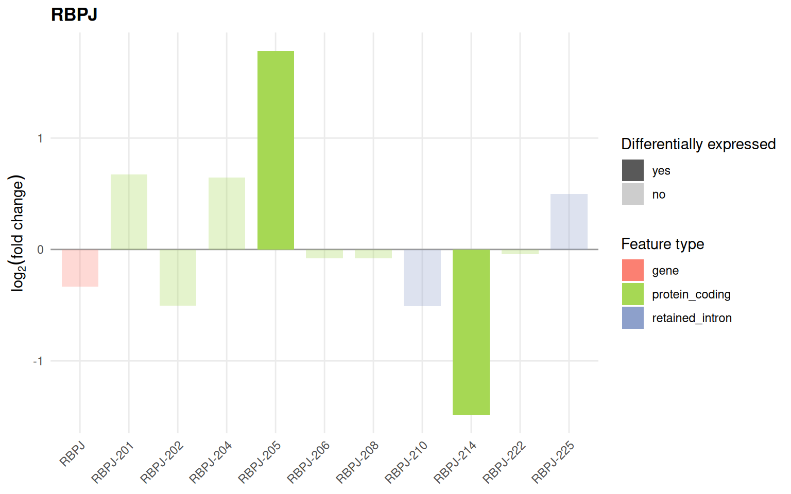
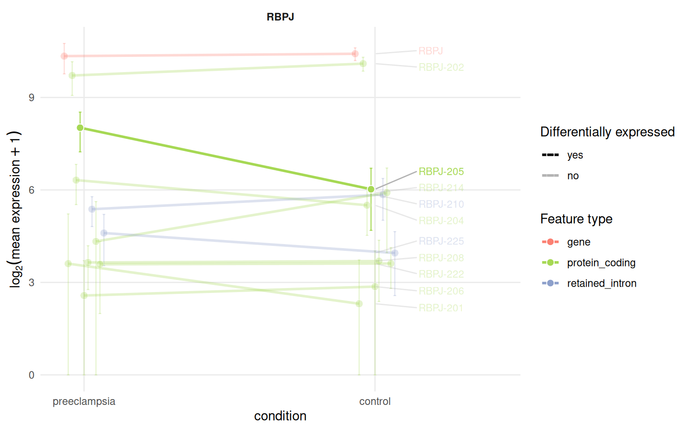
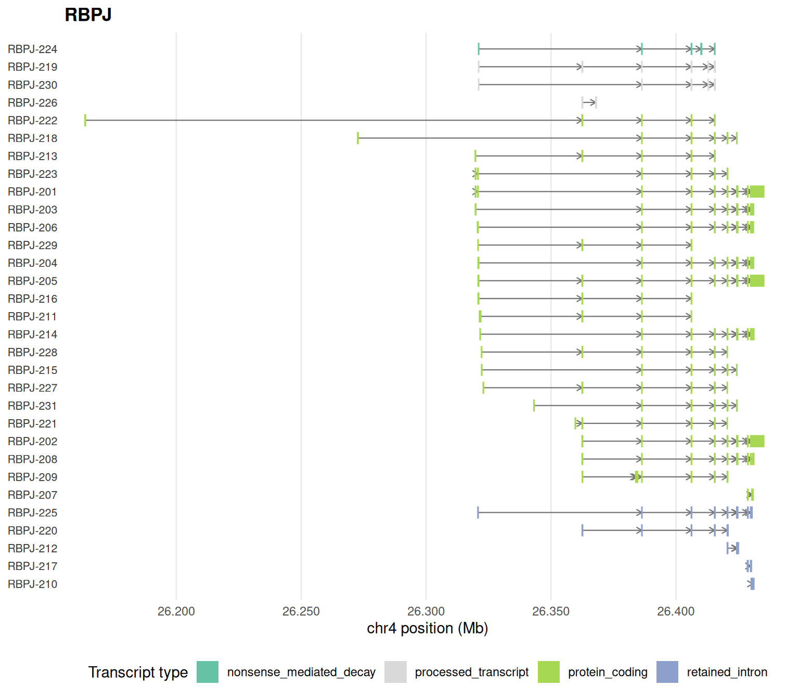

# Working with plain tables

Every analysis in the other articles is a method of the
`IsoformicExperiment` object, and each has a table-based counterpart for
data that does not fit in the object, for example results already joined
in a spreadsheet or a single gene exported from another tool. This
article shows those counterparts on the tables of the
[introduction](https://luciorq.github.io/isoformic/articles/isoformic-introduction.md).

``` r

library(isoformic)
library(dplyr)

extdata <- fs::path_package("isoformic", "extdata")
abundance <- read_parquet(fs::path(extdata, "pe_abundance.parquet"))
col_data <- read_parquet(fs::path(extdata, "pe_col_data.parquet"))
det <- read_parquet(fs::path(extdata, "pe_det.parquet"))
deg <- read_parquet(fs::path(extdata, "pe_deg.parquet"))
annot_dir <- prepare_isoformic_annotation(download_reference(version = "33", file_type = "gff"))
```

## Transcript-to-gene table

[`make_tx_to_gene()`](https://luciorq.github.io/isoformic/reference/make_tx_to_gene.md)
builds the transcript-to-gene table from an annotation directory, a
GENCODE transcript FASTA or a GFF3 file.

``` r

tx2gene <- make_tx_to_gene(annot_dir)
head(tx2gene)
#> # A tibble: 6 × 8
#>   transcript_id     gene_id  havana_gene_id havana_transcript_id transcript_name
#>   <chr>             <chr>    <chr>          <chr>                <chr>          
#> 1 ENST00000618686.1 ENSG000… <NA>           <NA>                 BX004987.1-201 
#> 2 ENST00000613230.1 ENSG000… <NA>           <NA>                 AC145212.1-201 
#> 3 ENST00000400754.4 ENSG000… <NA>           <NA>                 MAFIP-201      
#> 4 ENST00000618679.1 ENSG000… <NA>           <NA>                 AC011043.2-201 
#> 5 ENST00000612465.1 ENSG000… <NA>           <NA>                 AC011043.1-201 
#> 6 ENST00000611619.1 ENSG000… <NA>           <NA>                 AC011043.3-201 
#> # ℹ 3 more variables: gene_name <chr>, tx_length <int>, transcript_type <chr>
```

## Differential expression tables

[`join_DEG_DET()`](https://luciorq.github.io/isoformic/reference/join_DEG_DET.md)
builds the long table that
[`plot_log2fc()`](https://luciorq.github.io/isoformic/reference/plot_log2fc.md)
consumes from gene-level and transcript-level results, and
[`is_deg_sig()`](https://luciorq.github.io/isoformic/reference/is_deg_sig.md)
flags significance with the same cutoffs the object uses.

``` r

de_long <- join_DEG_DET(
  deg_table = left_join(deg, distinct(tx2gene, gene_id, gene_name), by = "gene_id"),
  det_table = left_join(det, tx2gene, by = "transcript_id"),
  logfc_cut = 1,
  pval_cut = 0.05
)
head(de_long)
#> # A tibble: 6 × 9
#>   feature_id   feature_name feature_type gene_id gene_name  log2FC pvalue qvalue
#>   <chr>        <chr>        <chr>        <chr>   <chr>       <dbl>  <dbl>  <dbl>
#> 1 ENSG0000000… TSPAN6       gene         ENSG00… TSPAN6    -0.320  0.0485  0.125
#> 2 ENSG0000000… TNMD         gene         ENSG00… TNMD       0.381  0.107   0.222
#> 3 ENSG0000000… DPM1         gene         ENSG00… DPM1      -0.0693 0.260   0.417
#> 4 ENSG0000000… SCYL3        gene         ENSG00… SCYL3      0.107  0.386   0.547
#> 5 ENSG0000000… C1orf112     gene         ENSG00… C1orf112   0.162  0.229   0.380
#> 6 ENSG0000000… FGR          gene         ENSG00… FGR       -0.162  0.160   0.296
#> # ℹ 1 more variable: is_de <chr>
plot_log2fc(de_long, feature = "RBPJ")
```



## Expression profiles

[`prepare_profile_data()`](https://luciorq.github.io/isoformic/reference/prepare_profile_data.md)
builds the table for
[`plot_tx_expr()`](https://luciorq.github.io/isoformic/reference/profiles.md)
from the abundance table, the sample metadata and the transcript-to-gene
table.

``` r

profile <- prepare_profile_data(
  txi_transcript = abundance,
  sample_metadata = col_data,
  tx_to_gene = tx2gene,
  de_result_gene = deg,
  de_result_transcript = det,
  var = "condition",
  gene_name = "RBPJ"
)
head(profile)
#> # A tibble: 6 × 10
#>   feature_id feature_name feature_type gene_id gene_name group mean_expr sd_expr
#>   <chr>      <chr>        <chr>        <chr>   <chr>     <fct>     <dbl>   <dbl>
#> 1 ENSG00000… RBPJ         gene         ENSG00… RBPJ      pree…   1297.    427.  
#> 2 ENSG00000… RBPJ         gene         ENSG00… RBPJ      cont…   1367.    195.  
#> 3 ENST00000… RBPJ-201     protein_cod… ENSG00… RBPJ      pree…     11.2    25.1 
#> 4 ENST00000… RBPJ-201     protein_cod… ENSG00… RBPJ      cont…      3.95    8.30
#> 5 ENST00000… RBPJ-202     protein_cod… ENSG00… RBPJ      pree…    838.    303.  
#> 6 ENST00000… RBPJ-202     protein_cod… ENSG00… RBPJ      cont…   1095.    169.  
#> # ℹ 2 more variables: n_samples <int>, is_de <chr>
plot_tx_expr(profile, gene_name = "RBPJ", group = "condition")
```



## Exon structures

[`prepare_exon_annotation()`](https://luciorq.github.io/isoformic/reference/prepare_exon_annotation.md)
extracts the exon table of a set of genes from a GFF3 or GTF file for
[`plot_genomic_context()`](https://luciorq.github.io/isoformic/reference/plot_genomic_context.md);
here from the small GFF3 bundled with the package.

``` r

gff <- fs::path(extdata, "example.gff3")
exons <- prepare_exon_annotation("RBPJ", gff, output_path = tempdir())
#> ℹ Parsing 'example.gff3' (GFF) into '/tmp/RtmpKEX5bm/example'.
head(exons)
#> # A tibble: 6 × 12
#>   gene_id      gene_name transcript_id transcript_name transcript_type haplotype
#>   <chr>        <chr>     <chr>         <chr>           <chr>           <chr>    
#> 1 ENSG0000016… RBPJ      ENST00000342… RBPJ-201        protein_coding  <NA>     
#> 2 ENSG0000016… RBPJ      ENST00000342… RBPJ-201        protein_coding  <NA>     
#> 3 ENSG0000016… RBPJ      ENST00000342… RBPJ-201        protein_coding  <NA>     
#> 4 ENSG0000016… RBPJ      ENST00000342… RBPJ-201        protein_coding  <NA>     
#> 5 ENSG0000016… RBPJ      ENST00000342… RBPJ-201        protein_coding  <NA>     
#> 6 ENSG0000016… RBPJ      ENST00000342… RBPJ-201        protein_coding  <NA>     
#> # ℹ 6 more variables: exon_id <chr>, exon_number <int>, seqid <chr>,
#> #   start_pos <int>, end_pos <int>, strand <chr>
plot_genomic_context(exons, gene_name = "RBPJ")
```



## Structural features and enrichment

[`transcript_features()`](https://luciorq.github.io/isoformic/reference/transcript_features.md),
[`transcript_orfs()`](https://luciorq.github.io/isoformic/reference/transcript_orfs.md),
[`transcript_productivity()`](https://luciorq.github.io/isoformic/reference/productivity.md)
and
[`polya_sites()`](https://luciorq.github.io/isoformic/reference/polyadenylation.md)
accept an annotation directory in place of the object, and
[`run_enrichment()`](https://luciorq.github.io/isoformic/reference/enrichment.md)
accepts a transcript table together with a `tx_to_gene` table.

``` r

feats <- transcript_features(annot_dir, gene_name = "RBPJ")
feats[, c("transcript_name", "orf_length", "utr3_length", "nmd_predicted", "tss_group")]
#> # A tibble: 31 × 5
#>    transcript_name orf_length utr3_length nmd_predicted tss_group
#>    <chr>                <int>       <dbl> <lgl>             <int>
#>  1 RBPJ-222               283           0 FALSE                 1
#>  2 RBPJ-218               689           0 FALSE                 2
#>  3 RBPJ-213               291           0 FALSE                 3
#>  4 RBPJ-223               535           0 FALSE                 3
#>  5 RBPJ-201              1503        4121 FALSE                 3
#>  6 RBPJ-203              1458          59 FALSE                 3
#>  7 RBPJ-206              1503           0 FALSE                 4
#>  8 RBPJ-225                NA          NA FALSE                 5
#>  9 RBPJ-229               145           0 FALSE                 6
#> 10 RBPJ-204              1464          59 FALSE                 6
#> # ℹ 21 more rows
```

## Citing isoformic

If you use `isoformic` in publications, please cite Mamede et al.
([2025](#ref-isoformic)); `citation("isoformic")` prints the reference.

## Session information

``` r

sessionInfo()
#> R version 4.6.2 (2026-10-29)
#> Platform: x86_64-pc-linux-gnu
#> Running under: Ubuntu 26.04.1 LTS
#> 
#> Matrix products: default
#> BLAS:   /usr/lib/x86_64-linux-gnu/openblas-pthread/libblas.so.3 
#> LAPACK: /usr/lib/x86_64-linux-gnu/openblas-pthread/libopenblasp-r0.3.32.so;  LAPACK version 3.12.0
#> 
#> locale:
#>  [1] LC_CTYPE=C.UTF-8       LC_NUMERIC=C           LC_TIME=C.UTF-8       
#>  [4] LC_COLLATE=C.UTF-8     LC_MONETARY=C.UTF-8    LC_MESSAGES=C.UTF-8   
#>  [7] LC_PAPER=C.UTF-8       LC_NAME=C              LC_ADDRESS=C          
#> [10] LC_TELEPHONE=C         LC_MEASUREMENT=C.UTF-8 LC_IDENTIFICATION=C   
#> 
#> time zone: UTC
#> tzcode source: system (glibc)
#> 
#> attached base packages:
#> [1] stats     graphics  grDevices utils     datasets  methods   base     
#> 
#> other attached packages:
#> [1] dplyr_1.2.1     isoformic_0.1.3
#> 
#> loaded via a namespace (and not attached):
#>  [1] gtable_0.3.6       jsonlite_2.0.0     compiler_4.6.2     Rcpp_1.1.2        
#>  [5] tidyselect_1.2.1   scales_1.4.0       yaml_2.3.12        fastmap_1.2.0     
#>  [9] ggplot2_4.0.3      R6_2.6.1           labeling_0.4.3     generics_0.1.4    
#> [13] curl_8.1.0         knitr_1.52         ggrepel_0.9.8      tibble_3.3.1      
#> [17] DBI_1.3.0          pillar_1.11.1      RColorBrewer_1.1-3 rlang_1.3.0       
#> [21] utf8_1.2.6         xfun_0.62          fs_2.1.0           S7_0.2.2          
#> [25] otel_0.3.0         cli_3.6.6          withr_3.0.3        magrittr_2.0.5    
#> [29] digest_0.6.39      grid_4.6.2         lifecycle_1.0.5    vctrs_0.7.3       
#> [33] evaluate_1.0.5     glue_1.8.1         farver_2.1.2       duckdb_2.0.0      
#> [37] rmarkdown_2.32     tools_4.6.2        pkgconfig_2.0.3    htmltools_0.5.9
```

## References

Mamede, Izabela, Lucio R. Queiroz, Carlos Mata-Machado, et al. 2025.
“Isoformic: A Workflow for Transcript-Level RNA-seq Interpretation.”
*NAR Genomics and Bioinformatics* 7 (4): lqaf176.
<https://doi.org/10.1093/nargab/lqaf176>.
