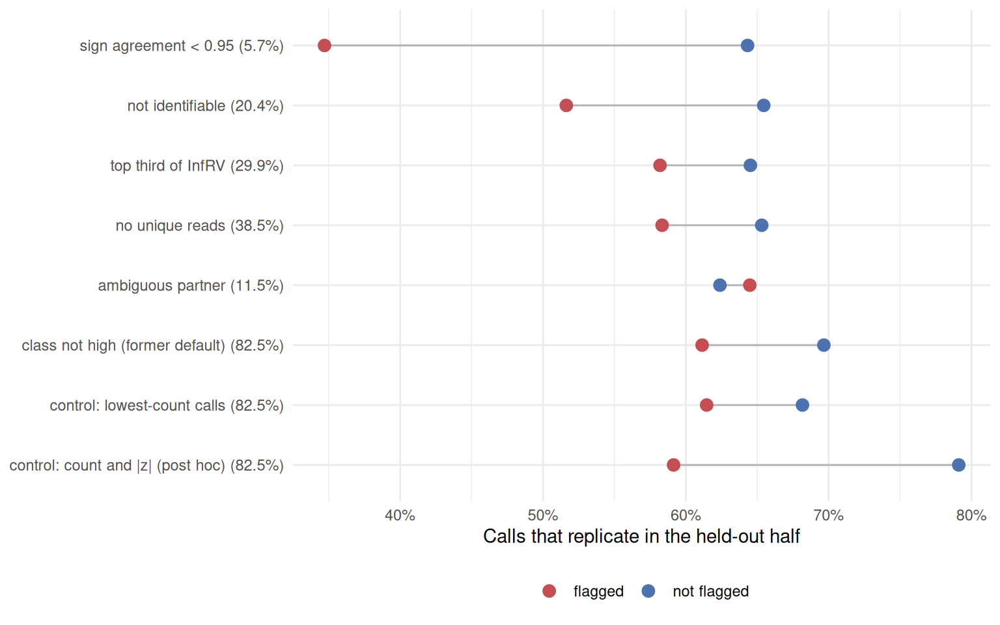
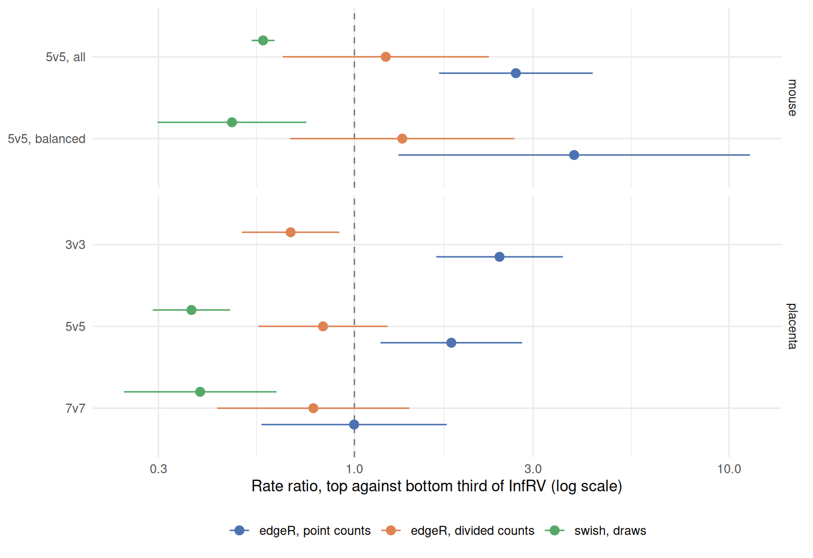

# Is quantification uncertainty worth checking? Genome-wide evidence

Salmon and other quantifiers do not return one count per isoform. They
return a most likely count and a measure of how far that count could
move, here 30 Gibbs draws per sample. The [uncertainty
article](https://luciorq.github.io/isoformic/articles/isoformic-uncertainty.md)
shows how `isoformic` turns the draws into per-isoform summaries and a
check of the direction of every call (at the time of this evaluation it
also gave every call a confidence class, since removed; see the end of
[What we recommend](#what-we-recommend)). That article works on a small
panel of genes from two knockdown series in cell lines. This one asks
whether any of it changes the results of a genome-wide analysis of a
real cohort. The evaluation was planned in writing before any test was
run, and it reports what did not work as well as what did. The plan
fixed two decision rules, R-A and R-B (below); one failed and one passed
only narrowly. The result this article leads with, the sign agreement
flag, was not one of them. Only its threshold (0.95, the package
default) was fixed in the plan; the flag was one of several secondary
flags that the analysis scripts defined before the replication was run,
and it was made the headline after the results were known. The plan and
its amendments are files in the package repository, not entries in an
external registry, and they were committed to it together with the
results. So the repository history does not show that the plan came
first; that rests on the time stamp written inside the plan, which also
records the hash of the frozen package code it was run on.

**In short**

- **One check pays off: the sign of the fold-change across the draws.**
  In a real preeclampsia against control comparison, split in halves of
  the cohort (4 preeclampsia samples against 7 or 8 control units in
  each discovery half), 5.7% of the transcript calls of the discovery
  halves (q \< 0.10) have a fold-change whose sign changes in more than
  5% of the draws (`sign_agreement` below 0.95); in the full cohort the
  share is 2.1% of the 6,636 transcript calls at q \< 0.05, since the
  halves, with fewer samples and a looser threshold, make more
  borderline calls. Those calls of the discovery halves replicate in the
  held-out half in 34.7% of cases, against 64.3% for the other calls
  (adjusted odds ratio 0.36, 95% CI 0.31 to 0.41 with genes resampled as
  clusters; the interval holds for this cohort and does not include the
  variation from the choice of samples). Setting them aside costs 3.2%
  of the calls that do replicate. The check is narrow: it marks only 10%
  of the calls that fail to replicate, and it is not a general screen
  for false positives. It sees only the uncertainty of the
  quantification, and in the null comparison below 93% of the false
  calls had a fold-change whose sign was stable over the draws (7 v 7).
  This was a secondary analysis, not one of the plan’s decision rules.
- **With few samples, uncertain isoforms collect more than their share
  of the nominal false positives.** With 3 or 5 samples per group, false
  calls at nominal p \< 0.01 were 2.4 and 1.8 times as frequent in the
  most uncertain third of isoforms as in the best-determined third. At q
  \< 0.05 false calls were rare (0.20 per 3 v 3 split and 0.11 per 5 v 5
  split). With 7 per group no excess was detected (1.00; raw jackknife
  0.56 to 1.76, which still allows an excess of up to 1.76, close to the
  1.81 seen at 5 v 5, and overlaps the raw 5 v 5 interval, 1.17 to
  2.80), so the pre-registered rule R-A, judged at 7 per group,
  **failed** (the plan named no group size; the analysis used its
  largest design, as described below).
- **The former default confidence class is a weak filter, and the InfRV
  cut-off of 0.5 is too broad to be one.** The class (the package’s
  default summary at the time) marks 83% of the calls and separates
  replicating calls only modestly within cells of equal count and \|z\|
  (a gap of 0.099 in replication rate), so a filter on it would remove
  81% of the calls that replicate; the InfRV cut-off of 0.5 marks 87% of
  the expressed isoforms, so it was not tested as a flag in the placenta
  (in the read halves it marks about 90% of the calls, and several of
  its odds ratios are near separation).
- **Dividing the counts by the overdispersion is not free, and its
  effect on real data is unclear.** In the null with 3 or 5 samples per
  group it removes the concentration of nominal false calls in uncertain
  isoforms (there is none to remove with 7 per group), but not the false
  calls themselves, and with known changes added it finds fewer of those
  changes. In the real comparison it made more calls than point counts
  on the transcripts both tested (about as many when each applied its
  own expression filter); these data cannot say whether the extra calls
  are true.

## What the draws are, and what each flag means

A read that is compatible with several isoforms of a gene has to be
shared out between them. The quantifier finds the most likely split (the
*point estimate*), but other splits explain the reads almost as well.
Gibbs sampling draws plausible splits from that range: each *draw* is a
complete set of counts that the reads could have produced. If an isoform
has a similar count in every draw, the reads determine it; if its count
swings between draws, they do not. The draws describe only this
assignment uncertainty, not biological variability between samples.

The evaluation tests these summaries of the draws (all computed by
[`add_uncertainty()`](https://luciorq.github.io/isoformic/reference/uncertainty.md)
and
[`de_confidence()`](https://luciorq.github.io/isoformic/reference/uncertainty.md)):

| Flag | What it says | Definition here |
|----|----|----|
| sign agreement below 0.95 | the direction of this call depends on how the reads are assigned | the fold-change of the contrast, repeated on each draw, has the sign of its median in fewer than 95% of the draws |
| top third of InfRV | the abundance of the isoform is poorly determined | inferential relative variance ([Zhu et al. 2019](#ref-swish)) in the highest third of the expressed isoforms |
| uncertain | the same, with a fixed cut-off | InfRV of at least 0.5 (the package default) |
| not identifiable | the reads cannot separate the isoform from another one, whatever the depth | its abundance is not fixed by the totals of the equivalence classes, in at least one sample |
| no unique reads | no read is compatible with this isoform alone | from the equivalence classes |
| ambiguous partner | another isoform of the gene takes reads from it | draws negatively correlated (at most -0.5) with a sibling |
| confidence class not `high` | the package’s default summary at the time (since removed) | `high` needs sign agreement of at least 0.95, not uncertain, and no ambiguous partner |

*Divided counts* go one step further: the overdispersion that the read
assignment adds to each isoform is estimated from the draws, and the
counts are divided by it before the test ([Baldoni et al.
2024](#ref-baldoni2024)), so that uncertain isoforms count for less.

## Data and design

**Placenta.** The main cohort is the placenta RNA-seq of Yang et al.
([2020](#ref-yang2020placenta)) (GEO
[GSE148241](https://www.ncbi.nlm.nih.gov/geo/query/acc.cgi?acc=GSE148241),
BioProject
[PRJNA622166](https://www.ncbi.nlm.nih.gov/bioproject/PRJNA622166)): 8
preeclampsia and 17 control samples, quantified with Salmon ([Patro et
al. 2017](#ref-salmon)) on GENCODE 50 ([Frankish et al.
2018](#ref-gencode)) with 30 Gibbs draws per sample. Two pairs of
control samples are labelled as pairs (A and B) in GEO; they are
probably twin placentas and so not independent, and one member of each
pair was kept, leaving 15 control units. The analysis uses the 57,294
transcripts of 14,844 genes expressed in the preeclampsia samples. The
InfRV thirds (cut points 2.17 and 7.59) were also measured in the
preeclampsia samples only, so they do not depend on the control samples
that the null splits use.

**Mouse.** The 10 control males of a mouse brain study ([Degroat et al.
2024](#ref-degroat2024)) (BioProject
[PRJNA984605](https://www.ncbi.nlm.nih.gov/bioproject/PRJNA984605)),
quantified on GENCODE vM39, give a second null in another species.

**Knockdown read halves.** The two knockdown series of the uncertainty
article,
[GSE129540](https://www.ncbi.nlm.nih.gov/geo/query/acc.cgi?acc=GSE129540)
([Munkley et al. 2019](#ref-munkley2019)) and
[GSE75489](https://www.ncbi.nlm.nih.gov/geo/query/acc.cgi?acc=GSE75489)
([Yang et al. 2016](#ref-yang2016)), were split into random halves of
the reads of each library and quantified again. As a sensitivity check,
GSE129540 was also analysed on the consecutive halves of the uncertainty
article (the first and second 6 million read pairs of each library; the
rows “consecutive” in the table of the read halves below). Here the
calls of both kinds of halves are made at q \< 0.10 in both directions
(half A checked in half B, and B in A) and pooled, so they number more
than the 110 edgeR calls at FDR \< 0.05 in half 1 reported in that
article.

Two tests were written down before the results were known
(`data-raw/uncertainty_evidence/prereg.yaml` in the package repository);
a third, the mouse null, was added afterwards by analogy with the first
(amendment A19):

1.  **A null comparison.** Control placentas were split at random into
    two groups (3 v 3, 5 v 5 and 7 v 7, at least 100 splits per size).
    Nothing differs between the groups, so every call is false. Rule R-A
    asked that edgeR on the point counts make more false calls in the
    top third of InfRV than in the bottom third, that an
    uncertainty-aware method remove that excess, and that gene-level
    tests show no such excess. The plan named no group size for the
    rule. The analysis judged it at 7 v 7, the largest design and the
    one given the most splits (210, each leaving out one control unit),
    set in an amendment made after a pilot. The pilot ran 3 null splits
    per size through every method to time them. It printed only timings
    and two validation checks (the swish control with 2 against 30
    copies of the counts, and the confidence class of the scripts
    against the package), but it also wrote the null results of those 9
    splits, which were kept as part of the full run; nothing records
    whether they were looked at before the amendment. That 7 v 7 decides
    the rule was written only in the analysis scripts and is recorded as
    a post hoc amendment.
2.  **Held-out replication.** The real comparison was split into halves
    30 times, each used in both directions (60 directed pairs). A call
    made on one half (q \< 0.10, a threshold set in the analysis
    scripts, not in the plan) *replicates* when the other half has the
    same sign at one-sided p \< 0.05. Each flag is computed from the
    discovery half only, except “no unique reads”, which uses all
    preeclampsia samples. Rule R-B asked that the default flag (class
    not `high`) predict non-replication, and do so better than a
    count-matched flag, which the plan described as having the same
    mean-count distribution. The analysis implemented that control as a
    flag of the same size made of the lowest-count calls of each pair,
    which is a different control; the departure was recorded only after
    the results. The plan listed two more controls, a placebo flag of
    the same size and a permutation baseline of the labels. The placebo
    was implemented as the default flag shuffled within cells of equal
    count and \|z\|, and the permutation baseline turned out not to be a
    null (both are reported below); neither change was recorded before
    the results. The plan registered only this one flag. Sign agreement,
    InfRV, identifiability, unique reads and ambiguous partners were
    secondary flags of the same analysis.
3.  **The mouse null (not pre-registered)**, split 5 v 5 in all 126
    possible ways. It applies the pre-registered R-A rule and model to a
    dataset that the plan does not name; its dataset, animals and split
    design were chosen without being registered, so it is an external
    check, not a pre-registered test.

The tests used edgeR quasi-likelihood ([Chen et al. 2016](#ref-edgerql))
on point counts and on divided counts, `swish` on the draws ([Zhu et al.
2019](#ref-swish)), and, for transcript usage, edgeR `diffSplice`,
`satuRn` ([Gilis et al. 2021](#ref-saturn)) and `DEXSeq` ([Anders et al.
2012](#ref-dexseq)). The null also ran limma-voom on both kinds of
counts (7 v 7 only), the DESeq2 Wald test on point counts (20 splits at
7 v 7), a Wilcoxon test and gene-level edgeR; the main text follows
edgeR, and the [supplementary tables](#every-method-in-the-null) give
every method. Changes to the plan are recorded as amendments; those made
after the results were seen are marked as post hoc here and in
`data-raw/uncertainty_evidence/prereg_amendments.yaml`.

**Intervals.** All are 95% intervals, by part: in the placenta null, a
jackknife that leaves out one control unit (with a Monte Carlo
correction where it is valid; where the correction removes most of the
variance, the uncorrected “raw” interval is given as well and is the
conservative one); in the mouse, the exact jackknife over all splits for
each animal left out; in the replication, the two-level bootstrap of the
plan, called the *planned bootstrap* below: half-splits, then the genes
of each directed pair, with all the calls of a gene moving together (the
plan said transcripts within splits; resampling genes keeps the
correlated calls of a gene together, so its intervals should be no
narrower than those of the plan, and the change is recorded as amendment
A15). The splits share samples, so intervals from a plain bootstrap over
splits would be far too narrow.

## The result that holds: sign agreement predicts replication



Figure 1: Held-out replication of the transcript calls in the placenta
half-splits, for the calls with and without each flag (pooled over the
60 directed pairs). The label gives the share of calls that the flag
marks. A useful flag marks few calls whose replication is much lower.
The two controls mark as many calls as the former default class: the
lowest-count calls of each pair (the control R-B was judged on, as
implemented), and the calls of lowest replication predicted from count
and test statistic (post hoc).

Over the 60 directed half-splits, edgeR on the discovery halves made
167,318 transcript calls, and 62.6% of them replicated. The calls with
sign agreement below 0.95:

|  |  |
|----|----|
| Share of calls flagged | 5.7% |
| Replicate, flagged against not flagged | 34.7% against 64.3% |
| Difference within cells of equal count and test statistic (post hoc) | 0.249; 95% CI 0.232 to 0.266 (planned bootstrap, too narrow; see below) |
| Adjusted odds ratio of replication | 0.36; 95% CI 0.31 to 0.41 (genes as clusters), 0.33 to 0.39 (planned bootstrap) |
| Flagged calls that fail to replicate | 65% (all calls: 37%) |
| Share of all failures it catches | 10% |
| Replicating calls it would remove | 3.2% |

The odds ratio is adjusted for the count, the test statistic (\|z\|),
the number of isoforms of the gene and the transcript type. The flag is
narrow, so it catches few of the calls that fail; what it marks, though,
mostly fails, at a small cost.

**How robust is it?**

- **It is not just low power.** Flagged calls have fewer reads (median
  about 27 against 100 mean reads), and replication depends on power.
  But the difference survives matching on count and \|z\| (table above),
  flexible splines on both (odds ratio 0.36, post hoc), and fixed
  effects for each directed pair (0.35, post hoc). At the same size, it
  also beats flags made of the lowest-count calls, the lowest-\|z\|
  calls and the calls with the lowest replication predicted from count
  and \|z\| (post hoc): a replication gap of 0.296 against 0.056, 0.123
  and 0.184, 10.0% of the failures caught against 6.5%, 7.5% and 8.4%,
  and a larger gap in 60, 60 and 57 of the 60 directed pairs.
- **It holds in every directed pair (raw rates).** Flagged calls
  replicate less in 60 of the 60 directed pairs (flagged 24.0% to 51.1%,
  not flagged 51.3% to 85.9%).
- **The rates are specific to this design.** The 34.7% and 64.3% above
  are pooled over the pairs. The pairs differ a lot: a discovery half
  made 649 to 5,090 calls, and the more calls a half made, the fewer
  replicated (correlation -0.95 over pairs). Pooling weights the large,
  low-replication pairs most; with every pair weighted equally the rates
  are 36.4% against 67.8%. Read them as rates of this half-split design,
  not as probabilities that a call is true.
- **The same transcripts recur.** The 9,557 flagged calls come from
  3,448 transcripts in 2,670 genes, because all half-splits draw on the
  same 23 samples. The planned bootstrap resampled genes separately in
  each pair and so gives intervals that are too narrow (0.33 to 0.39);
  resampling each gene once over all pairs gives 0.31 to 0.41, and
  crossing that with the half-splits 0.31 to 0.43 (post hoc). Either way
  the odds ratio stays far below 1. Neither scheme resamples the samples
  themselves, so both intervals hold for this cohort of 23 samples; the
  rates of single pairs (above) show how much one split of it can differ
  from another.
- **The direction itself replicates less.** With “same sign in the
  held-out half” as the outcome (post hoc), which needs less power than
  p \< 0.05, the odds ratio is 0.29 (95% CI 0.27 to 0.32, genes as
  clusters): 75.0% of flagged calls keep their sign, against 93.2%. This
  outcome is not free of power either: among unflagged calls it rises
  from 0.884 to 0.967 from the lowest to the highest decile of \|z\|.
- **Technical read halves agree.** In the two knockdown series, calls
  made on one random half of the reads were checked in the other half.
  The odds ratio of the same flag is 0.069 (95% CI 0.030 to 0.130) for
  GSE129540 and 0.154 (95% CI 0.079 to 0.268) for GSE75489. This is a
  favourable consistency check, not an independent replication: the two
  halves share the libraries and all their biology and differ only by
  the sampling and assignment noise that the draws model. The calls are
  few (566 and 1,000), the flag marks far more of them than in the
  placenta (18% and 56%), and in GSE75489 only 29 and 45 transcripts
  passed q \< 0.10, so the test fell back on the 500 lowest p-values in
  each direction, most of them not significant (a fallback written into
  the analysis scripts, like the q \< 0.10 threshold; the read halves
  are not in the plan). Sign agreement is not special there: with the
  same adjustment as in the placenta, every flag of the read halves has
  an odds ratio well below 1, several of them lower than sign agreement
  (table below). The read halves therefore support the general point
  that the draws carry information about which calls repeat, not sign
  agreement in particular.

| Series | Flag | Calls | Share flagged | Replicate, flagged against not flagged | Adjusted odds ratio (95% CI) |
|:---|:---|:---|:---|:---|:---|
| GSE129540 consecutive | sign agreement \< 0.95 | 562 | 19% | 10% against 84% | 0.069 (0.030 to 0.131) |
| GSE129540 consecutive | top third of InfRV | 562 | 77% | 62% against 95% | 0.019 (\< 0.001 to 0.071) |
| GSE129540 consecutive | uncertain (InfRV \>= 0.5) | 562 | 89% | 66% against 98% | \< 0.001 (\< 0.001 to \< 0.001) |
| GSE129540 consecutive | ambiguous partner | 562 | 24% | 69% against 70% | 0.200 (0.089 to 0.384) |
| GSE129540 random | sign agreement \< 0.95 | 566 | 18% | 14% against 86% | 0.069 (0.030 to 0.130) |
| GSE129540 random | top third of InfRV | 566 | 76% | 66% against 95% | 0.029 (0.002 to 0.088) |
| GSE129540 random | uncertain (InfRV \>= 0.5) | 566 | 89% | 70% against 97% | 0.024 (\< 0.001 to 0.124) |
| GSE129540 random | ambiguous partner | 566 | 26% | 72% against 74% | 0.149 (0.063 to 0.292) |
| GSE75489 random | sign agreement \< 0.95 | 1,000 | 56% | 5% against 57% | 0.154 (0.079 to 0.268) |
| GSE75489 random | top third of InfRV | 1,000 | 80% | 22% against 52% | 0.232 (0.123 to 0.436) |
| GSE75489 random | uncertain (InfRV \>= 0.5) | 1,000 | 93% | 24% against 81% | 0.104 (0.044 to 0.250) |
| GSE75489 random | ambiguous partner | 1,000 | 14% | 30% against 28% | 0.104 (0.038 to 0.205) |

Table 1

The InfRV and “uncertain” flags mark most of the calls in the read
halves, so several of their odds ratios are near separation and
unstable. The ambiguous partner marks few calls, and its raw replication
rates hardly differ from those of the other calls, but once count and
\|z\| are accounted for its odds ratio is 0.10 in GSE75489 and 0.15 in
GSE129540 (random halves), against 0.87 in the placenta. Which flag
predicts best depends on the data; only the placenta half-splits, a
biological comparison, put sign agreement first, by odds ratio and by
replication gap.

In the placenta, other flags carry less. Non-identifiable calls (20.4%
of the calls) replicate in 51.6% against 65.5% (odds ratio 0.56, 95% CI
0.54 to 0.58 from the planned bootstrap). It is a broader but weaker
descriptor than sign agreement: it covers 26% of the calls that fail to
replicate (against 10% for an unstable direction), but also 17% of those
that replicate, so it can be reported next to `sign_agreement` as a
description, not used as a filter. The top third of InfRV and the
absence of unique reads have odds ratios of 0.63 and 0.69, and an
ambiguous partner predicts little (0.87).

## What did not work

### The pre-registered null rule fails at 7 v 7



Figure 2: Rate of false calls (p \< 0.01) in the top third of InfRV
against the bottom third, adjusted for expression decile and number of
isoforms in the gene (the pre-registered model). Above 1, uncertain
isoforms collect more false calls. Placenta: control placentas only, by
group size; mouse: control males, 5 v 5, all splits and the splits
balanced for a library batch. Bars: 95% jackknife intervals; for the
placenta the uncorrected (raw) jackknife, the conservative one.

At 7 v 7, the size at which the analysis judged the rule, false calls of
edgeR on point counts were **not detectably** more frequent in uncertain
isoforms: the adjusted rate ratio is 1.00 (95% CI with the raw jackknife
0.56 to 1.76; the Monte Carlo corrected 0.92 to 1.08 keeps only about 2%
of the jackknife variance, a remainder within the noise of the Monte
Carlo estimate, so it is not reliable), so R-A fails. Its other criteria
cannot rescue it: there is no excess to remove (the ratio of divided to
point counts is 0.78, 95% CI 0.47 to 1.28). Point counts were calibrated
at this size: 0.095 false calls per split at q \< 0.05, and an observed
share at p \< 0.01 of 0.83 times the expected one (95% CI 0.30 to 2.35).
That holds for edgeR’s quasi-likelihood test, not for every test of the
same counts: the DESeq2 Wald test made 43.9 false calls per split at q
\< 0.05 on 20 of the 7 v 7 splits (raw jackknife interval 0.0 to 115.2;
observed over expected share at p \< 0.01 1.82, 95% CI 0.74 to 4.49),
while limma-voom made 0.076 ([supplementary
tables](#every-method-in-the-null)). A sensitivity model that also
adjusts for identifiability (not pre-registered) gives 1.09, the same
conclusion.

**With fewer samples per group the excess appears** (secondary results:
the plan listed these sizes, but the analysis did not judge R-A on
them). The adjusted rate ratio is 1.81 at 5 v 5 (raw jackknife 1.17 to
2.80) and 2.44 (95% CI 1.65 to 3.60) at 3 v 3. The false calls are not
more numerous overall (at 3 v 3 the observed share at p \< 0.01 is 1.13
times the expected one, 95% CI 0.79 to 1.61); they fall more often on
uncertain isoforms (1.67 in the top third against 0.73 in the bottom
third). It is not explained by differences in mapping rate between the
groups (at 3 v 3 the ratio is 2.29 in splits with a small difference in
mapping rate and 2.29 with a large one).

**The mouse null agrees with the small-sample placenta result, with
caveats.** Mouse controls at 5 v 5 give 2.70 (95% CI 1.68 to 4.33), in
the same direction as the placenta at the same size (1.81); divided
counts and `swish` reduce it, and gene-level tests show no excess (0.98,
95% CI 0.73 to 1.31). Read with the pre-registered R-A rule, it passes
only with an exact jackknife over all splits per animal and a reading of
the gene-level criterion that the plan did not spell out (amendment A8).
The mouse design itself was not pre-registered (amendment A19), so this
is supporting evidence, not a confirmatory test. The mouse controls also
turned out to hold two library batches (mean fragment lengths 119 to 150
bp against 172 to 179 bp): of the 26 splits that line up with the batch,
only one made false calls on point counts at q \< 0.05: the split that
puts the 5 animals of the short-fragment batch in one group, with 170
calls. The other 25 made none, and the 100 balanced splits made 0.01 per
split. On the balanced splits alone the ratio is 3.86 (95% CI 1.31 to
11.36).

### The former default confidence class is a weak filter

The pre-registered flag, class other than `high`, marks 82.5% of the
calls. They replicate somewhat less (61.1% against 69.7%; odds ratio
0.68, 95% CI 0.65 to 0.73, or 0.62 to 0.77 with genes as clusters). Rule
R-B also asked it to beat a count-matched flag. As implemented, that
control is a flag of the same size made of the lowest-count calls of
each pair, not the flag with the same count distribution that the plan
described (a post hoc amendment records the difference). The class beat
it by 0.018 in replication rate, 95% CI 0.004 to 0.031 under the planned
bootstrap, so **R-B passes formally, but the pass is fragile**: with
genes resampled as clusters across the half-splits (post hoc) the
interval is -0.018 to 0.053, and it includes 0. A same-size flag built
from count and \|z\| alone (post hoc) separates much better than the
class: its gap in replication is 0.200 against 0.085. Closer to the
control the plan described, the class keeps a gap within cells of equal
count and \|z\| (gap 0.099, 95% CI 0.087 to 0.110, planned bootstrap;
the matched gap itself is post hoc), while the class shuffled within
those cells, which has nearly the same count distribution by
construction, has a gap of -0.017 (-0.023 to -0.011 over the shuffles).
That shuffle is how the analysis implemented the plan’s placebo flag,
which the plan described only as a random flag of the same size in each
split. The plan’s last control, a permutation baseline of the labels,
turned out not to be a null. It relabelled the samples of the discovery
half 100 times, but a discovery half holds only 4 preeclampsia samples,
so every permutation kept part of the real contrast or reversed it.
Under the permuted labels the calls replicated in 16.6% of cases
(against 62.6% with the true labels), and the class separated them by
0.096, no less than with the true labels (0.085; difference -0.011, 95%
CI -0.022 to 0.000 under the planned bootstrap). That gap shrank as more
samples were relabelled, from 0.167 with 2 to -0.037 with 8, so it
follows the real contrast left in the permutations. Read literally, this
control would say that the class separates calls no better under the
true labels than under permuted ones; because the permutations are not
nulls, it cannot be used either for or against the class, and the
analysis did not use it. These comparisons were not the rule as run, and
they do not change the verdict on R-B. Used as a filter, the class would
remove 81% of the calls that replicate.

In the null the class did not help to pick out the false calls. The
`high` class holds 8.4% of the tested transcripts but 18.5% of the false
calls at p \< 0.01 (7 v 7; enrichment 2.22, 95% CI 1.76 to 2.79). This
excess is not an inversion of the class: it is what any summary of the
direction over the draws shows once calls are selected by their p-value.
A call at p \< 0.01 has a large fold-change, so its sign is stable over
the draws whether the call is true or false, while most tested
transcripts have a fold-change near 0 and an unstable sign. A stable
direction alone holds 31% of the tested transcripts and 93% of the null
calls (enrichment 3.00, 95% CI 2.57 to 3.50): the draws describe the
quantification, and a false call driven by biological noise is stable
over them. The test that bears on the class as a filter is the removal
at equal cost. Keeping only class `high` removes 91.6% of the tested
transcripts, and at equal removal it is no better than dropping the
least expressed ones (difference in the share of false calls removed
-0.10, 95% CI -0.24 to 0.05).

### The InfRV cut-off of 0.5 marks almost everything

Of the expressed placenta transcripts, 87.1% have InfRV of at least 0.5,
38.7% are not identifiable in at least one sample, and 48.2% have no
read of their own; 89.6% are in genes with 10 or more annotated
isoforms. The bottom third of InfRV ends at 2.17, 4.3 times the cut-off,
so on a genome-wide human annotation the cut-off separates almost
nothing. The thirds themselves are stable: computed from 15 draws
instead of 30, 93.5% of the transcripts stay in the same third.

### Dividing the counts costs power and does not remove false discoveries

Dividing the counts by the overdispersion removes the small-sample
concentration of nominal false calls in uncertain isoforms: the ratio of
the rate ratios (divided over point counts) is 0.45 (95% CI 0.32 to
0.65) at 5 v 5 and 0.28 (95% CI 0.19 to 0.40) at 3 v 3 (0.78 (95% CI
0.47 to 1.28) at 7 v 7, where there was no excess to remove). It does
not lower the number of false discoveries. At q \< 0.05, point counts
made 0.20 false calls per 3 v 3 split and divided counts 1.21 (0.39
without their worst split); at 7 v 7, 0.095 against 0.80, 88% of them
from a single split. Divided counts also test fewer transcripts (18,116
per 7 v 7 split against 30,067).

To measure power, known changes were added to 30 of the 7 v 7 null
splits (and as many 5 v 5 splits, in the supplementary tables): 5% of
the genes with several isoforms (sampled within each third of InfRV) and
as many single-isoform genes were thinned, each gene in one of the two
groups (chosen at random) and by its own factor of 1.5 to 4 (log2
fold-change drawn between 0.58 and 2), the same factor for every isoform
of the gene. This keeps the isoform ratios, so it measures power and the
false discovery rate between genes, not misattribution between isoforms.
At q \< 0.05:

| Method | Empirical FDR | True calls | True calls, top third of InfRV |
|:---|:---|:---|:---|
| edgeR, point counts | 0.046 (95% CI 0.019 to 0.072) | 31,886 | 7,254 |
| edgeR, divided counts | 0.067 (95% CI 0.000 to 0.194) | 21,349 | 2,507 |
| swish, draws | 0.066 (95% CI 0.000 to 0.185) | 28,403 | 4,747 |
| edgeR, then keep class high only | 0.020 (95% CI 0.000 to 0.044) | 10,969 | 7 |

Table 2

For the four methods in the table, the empirical false discovery rate at
q \< 0.05 lies between 2% and 7%: below 5% for point counts and for
keeping class `high` only, above it for divided counts and `swish`,
whose intervals are wide (upper ends 19% and 18%). At an equal number of
calls, the number divided counts make in each split, point counts had
the lower false discovery rate (0.008 against 0.067). Point counts find
the most true changes, and the gap is largest in the top third of InfRV,
where divided counts and `swish` lose most of their power and keeping
class `high` removes nearly every call. `swish` also behaves differently
in the null: it makes fewer false calls in uncertain isoforms than in
certain ones (placenta 7 v 7 0.39 (95% CI 0.34 to 0.45); mouse 0.57 (95%
CI 0.53 to 0.61)), which is the method working as designed but is the
same loss of power seen from the other side, and it was the only
expression test with frequent false calls on the batch-balanced mouse
splits (at least one call at q \< 0.05 in 57% of them). It made more
false calls than point counts in the placenta too: 2.39 (95% CI 1.71 to
3.07) per 5 v 5 split at q \< 0.05 against 0.11 for edgeR on point
counts, and 0.67 against 0.095 at 7 v 7.

**In the real comparison divided counts made about as many calls or
more.** The overdispersion part of the evaluation also ran edgeR on the
whole placenta comparison (8 preeclampsia samples against 15 control
units). Each with its own expression filter, point counts made 7,975
calls at q \< 0.05 and divided counts 7,889. Refitted together on the
33,362 transcripts that both filters kept, point counts made 6,235 calls
and divided counts 7,887 (53 lost, 1,705 gained); point counts make up
the difference by testing transcripts that division pushes below the
filter. A real comparison has no known truth, so these data cannot say
whether the extra calls of divided counts are true changes; the power
arm above measured changes of whole genes in 7 v 7 null splits, a
different setting, and does not settle it. This check read the Salmon
counts directly, without folding the copies of transcripts on alternate
haplotypes, so its numbers of calls differ from those of the main
analysis. The prior of the overdispersion mattered little. The draws
bundled for the knockdown panels give a prior 2.9 and 2.4 times the
genome-wide one, yet using the genome-wide prior changed no knockdown
call on the transcripts both runs tested; in the placenta, replacing the
genome-wide prior with that of a median random panel of 39 genes moved
the calls from 7,882 to 7,876.

### Transcript usage

For `diffSplice`, divided counts help at 5 v 5 (3.49 false genes per
split on point counts against 0.17), while at 7 v 7 both are low (0.40
and 0.12). For `satuRn` the observed over expected share at p \< 0.01
rose from 0.71 (95% CI 0.15 to 3.48) on point counts to 1.25 (95% CI
0.13 to 11.68) on divided counts (30 splits); the intervals overlap
almost entirely, so these splits cannot tell the two apart, and `DEXSeq`
made many false calls either way (28.3 and 13.5 genes per split, 10
splits only). Tests of the productive fraction made almost no false
calls either way (0.033 and 0.000 genes per 7 v 7 split).

## The genes named in the plan

The plan named FLT1 as its isoform-level example, ENG and LEP as its
gene-level examples, and two rules to pick one fragile and one robust
gene from the results. All of them are reported here. The classes
`high`, `moderate` and `low` in this section are the confidence classes
of the evaluated snapshot of the package, which the current version no
longer computes.

### FLT1

FLT1, whose soluble form is raised in preeclampsia, was the plan’s
isoform-level example.

| Isoform | Mean count | InfRV | log2FC, point counts | log2FC, refit on each draw (2.5% to 97.5%) | Class (snapshot) | Replicated when called |
|:---|:---|:---|:---|:---|:---|:---|
| FLT1-204 | 31,634 | 0.4 | 3.35 | 3.30 to 3.34 | high | 100% of 56 |
| FLT1-207 | 18,359 | 0.6 | 3.85 | 3.81 to 3.85 | moderate | 100% of 60 |
| FLT1-201 | 4,319 | 1.9 | 2.97 | 3.01 to 3.09 | moderate | 100% of 57 |
| FLT1-209 | 221 | 9.4 | 4.72 | 3.42 to 4.32 | moderate | 100% of 50 |
| FLT1-211 | 68 | 7.7 | 3.22 | 2.07 to 3.19 | moderate | 78% of 23 |
| FLT1-212 | 52 | 5.4 | 2.76 | 1.94 to 2.79 | moderate | 93% of 30 |
| FLT1-214 | 40 | 6.0 | 5.28 | 2.51 to 3.75 | moderate | 100% of 51 |
| FLT1-215 | 24 | 2.1 | 3.54 | 2.40 to 3.22 | moderate | 100% of 55 |

Table 3

FLT1-214 has 40 reads on average and an InfRV of 6.0. On the point
counts its log2 fold-change is 5.28 (Wald interval 3.66 to 6.90);
refitted on each Gibbs draw with the same model it lies between 2.51 and
3.75: the point estimate is larger than every refit. Its direction is
never in doubt, and it replicates in all 51 half-splits that call it.
What is in doubt is the size of the effect: the point estimate and the
refits disagree, and neither is the truth (see below). FLT1-214 is not
special within its gene: 6 of the 8 tested FLT1 isoforms have a point
estimate outside the range of their refits, 5 of them further from zero
than the whole range. The gap is negligible for the abundant ones
(FLT1-204, 3.348 against 3.304 to 3.337) and can be much larger for
those with a few hundred reads or fewer, up to 1.53 log2 units for
FLT1-214, though not for all of them (FLT1-212, with 52 reads, lies
inside its range). FLT1-204, with 31,634 reads, is the only FLT1 isoform
in class `high`; 7 of the 8 tested isoforms are `moderate` because of
their InfRV, yet they replicate in 78% to 100% of the half-splits that
call them. The class does not separate them.

FLT1-214 is not unique (a check added after the results were known). Of
the 6,636 transcript calls of the full comparison (q \< 0.05), 1,529
(23.0%) have a point fold-change outside the range of their per-draw
refits, 286 by more than one log2 unit, and 134 (2.0%) at least as far
as FLT1-214 (1.53 log2 units beyond the range). LEP-203, an isoform of
LEP (a gene-level example of the plan, below), comes close (6.77 against
4.21 to 5.26, 1.51 log2 units beyond). This is frequent in classes
`moderate` and `low` (27.0% and 39.4%) and rare in `high` (1.8%). Two
cautions apply. For 1,440 of the 1,529 the Wald interval of the point
estimate overlaps the range of the refits, and in 1,239 the point
estimate is further from zero than the whole range: the refits on the
draws are pulled towards zero relative to the point estimate. The point
estimate comes from the EM algorithm (the most likely split of the
reads) and the draws from a Gibbs sampler (which averages over plausible
splits), and the two differ systematically for poorly determined
isoforms; neither is ground truth, and these data cannot say which is
closer to it. The range of the refits is not a confidence interval for
the point estimate.

### ENG and LEP

At gene level both are clear: ENG has a log2 fold-change of 1.88 (refits
on the draws 1.91 to 1.95) and replicates in 59 of 59 of the directed
pairs that call it; LEP has 6.79 (6.75 to 6.84) and replicates in 60 of
60. The isoforms tell the same story as FLT1. ENG has 27 expressed
isoforms, of which 24 were tested and 19 called at q \< 0.05; only 1 of
the tested ones is in class `high`. Its two most abundant isoforms are
in class `low`, yet replicate whenever called: ENG-202 (12,749 reads, 42
of 42) and ENG-216 (3,927 reads, 60 of 60). 10 of the 24 tested ENG
isoforms have a point estimate outside the range of their refits, for
example ENG-255 (2.47 against 0.65 to 1.93, 17 reads). All 3 LEP
isoforms are called and replicate whenever called, two of them in class
`low`; 3 lie outside the range of their refits, LEP-201 on the side
nearer zero (6.74 against 6.87 to 7.17), so the gap does not always go
the same way.

### The fragile and the robust rule

The plan’s fragile rule asked for the gene with the most isoform calls
(q \< 0.05) that are all outside class `high` and are supported (same
sign, one-sided p \< 0.05) in fewer than half of the 60 validation
halves (the plan’s “held-out support”; for a call on the whole cohort
these halves are not held out, because the sign comes from all 23
samples and every half is part of them). No gene qualified (0
candidates), so it picked none. A substitute rule, defined in the
analysis scripts and not in the plan (post hoc amendment A20), takes the
switch or productive-fraction result with the smallest p-value among
genes with a gene-level call (q \< 0.05), keeping only results whose
test, refitted on each draw, is significant in fewer than half of the
draws. It picked LAS1L out of 120 candidate results (switch or
productive-fraction tests; a gene can contribute more than one). At gene
level its point log2 fold-change is 0.40 (q = 0.010), while only 3% of
the refits on the draws share its sign (-0.46 to -0.10), yet the gene
call replicates in 14 of 16 of the pairs that call it. Its isoform
LAS1L-202 (60 reads, class low) has a point log2 fold-change of 4.74
against refits of -0.96 to 1.61 (47% with the sign of the point
estimate), and replicates in 40 of 40. So the gene that looks most
fragile by the draws replicates well in the held-out halves. That is not
a contradiction: the held-out halves are quantified by the same EM
algorithm, so replication cannot tell a real change from a distortion of
the quantification that repeats in every sample. It is a reminder that a
flag that predicts replication on average says little about a single
gene. (The sign agreement in this section is the share of edgeR refits
on the draws with the sign of the point estimate, not the
`sign_agreement` of
[`de_confidence()`](https://luciorq.github.io/isoformic/reference/uncertainty.md).)

The plan’s robust rule asked for the gene with the smallest gene-level
q-value whose top isoform is in class `high` and is supported in at
least 90% of the same validation halves (again not held out for a call
on the whole cohort). It picked TBC1D26 out of 411 candidate genes, a
gene with a single expressed isoform. At gene level its log2 fold-change
is 3.62 (refits 3.09 to 3.98), replicated in 60 of 60 of the pairs that
call it; its only expressed isoform, TBC1D26-204, has 3.60 (refits 3.03
to 3.94), replicated in 60 of 60.

## What we recommend

- **Report `sign_agreement` next to every isoform call you interpret**
  ([`de_confidence()`](https://luciorq.github.io/isoformic/reference/uncertainty.md)),
  and look again at calls below 0.95. In these data they were a small
  share of calls that replicated about half as often as the rest (34.7%
  against 64.3%). Do not read a value above 0.95 as a clean bill: the
  flag marked only 10% of the calls that failed to replicate, and false
  calls driven by biological variability are mostly stable over the
  draws.
- **Do not filter on the confidence class.** It marks most calls and
  separates them only modestly beyond count and test statistic, so a
  filter on it would discard most calls that replicate, and in the null,
  at equal removal, it removed no more false calls than dropping the
  least expressed transcripts. (This advice led the package to remove
  the class; it is kept here as the record of the evaluation.)
- **Do not use the InfRV cut-off of 0.5 as a filter on a genome-wide
  human annotation**; it marks nearly every expressed isoform.
- **With 3 to 5 samples per group, expect nominal false positives (p \<
  0.01) to fall more often on uncertain isoforms**, and check the
  uncertainty of each isoform you interpret; at q \< 0.05 edgeR on point
  counts made at most 0.20 false calls per null split at any size
  tested. Divided counts
  ([`scale_counts()`](https://luciorq.github.io/isoformic/reference/inferential-overdispersion.md))
  remove the concentration but not the false calls, and in the null they
  cost power; in the real comparison they made more calls on the same
  transcripts, of unknown truth.
- **With 7 samples per group, the largest size tested, edgeR on point
  counts was calibrated here at q \< 0.05** (0.095 false calls per null
  split); no concentration of false calls in uncertain isoforms was
  detected, though the conservative interval cannot rule one out, and
  accounting for uncertainty mostly cost power. This is a result for
  edgeR’s quasi-likelihood test (and limma-voom): the DESeq2 Wald test
  on the same counts made many more false calls.
- **For low-count isoforms, do not quote the point fold-change alone.**
  What was evaluated here is the primary model (edgeR) refitted on each
  draw. When the point estimate lies outside the range of those refits,
  report both and treat the size of the effect as uncertain; neither
  number is the true one. The `lfc_median`, `lfc_lo` and `lfc_hi` of
  [`de_confidence()`](https://luciorq.github.io/isoformic/reference/uncertainty.md)
  come from a simpler statistic (the difference between the groups of
  the mean of log2 counts with a pseudocount of 5, a log ratio of
  geometric means), which pulls low-count fold-changes towards zero.
  They were not compared with the point estimate in this evaluation, so
  a gap between the two is expected for low counts and is not by itself
  a sign of a problem.

After this evaluation the package removed the confidence class and now
reports `unstable` (sign agreement below 0.95) as the flag of a call,
keeping InfRV, ambiguity and identifiability as descriptions of the
isoform. This change follows the results above and was not part of the
plan; the flag catches about 10% of the calls that do not replicate. The
[uncertainty
article](https://luciorq.github.io/isoformic/articles/isoformic-uncertainty.md)
shows the current columns.

## Every method in the null

The main text follows edgeR. These tables give every expression method
that the placenta null ran, including those that do not fit the story
told above. Intervals are the delete-one-unit jackknife (Monte Carlo
corrected where valid, raw otherwise; the type of each is in the bundled
table). Intervals are cut at the lowest possible value, so counts often
have a lower end of 0. The rate ratio was computed only for the methods
it is shown for, and its interval here is the primary one; the wider raw
jackknife intervals are in the figure of the rate ratios above.

| Size | Method | Splits | False calls per split, q \< 0.05 | Observed over expected, p \< 0.01 | Rate ratio, top against bottom third of InfRV |
|:---|:---|:---|:---|:---|:---|
| 7 v 7 | edgeR QL, point counts | 210 | 0.095 (95% CI 0.000 to 0.986) | 0.835 (95% CI 0.296 to 2.352) | 1.00 (95% CI 0.92 to 1.08) |
| 7 v 7 | edgeR QL, divided counts | 210 | 0.800 (95% CI 0.000 to 2.804) | 1.11 (95% CI 0.39 to 3.12) | 0.78 (95% CI 0.65 to 0.93) |
| 7 v 7 | limma-voom, point counts | 210 | 0.076 (95% CI 0.000 to 0.852) | 0.816 (95% CI 0.312 to 2.133) |  |
| 7 v 7 | limma-voom, divided counts | 210 | 0.362 (95% CI 0.000 to 8.355) | 1.02 (95% CI 0.36 to 2.89) |  |
| 7 v 7 | DESeq2 Wald, point counts | 20 | 43.85 (95% CI 0.00 to 115.16) | 1.82 (95% CI 0.74 to 4.49) |  |
| 7 v 7 | swish, draws | 210 | 0.667 (95% CI 0.000 to 2.593) | 1.10 (95% CI 0.39 to 3.11) | 0.39 (95% CI 0.34 to 0.45) |
| 7 v 7 | swish, every draw set to the point counts (control) | 210 | 19.20 (95% CI 0.00 to 43.66) | 1.17 (95% CI 0.46 to 2.97) | 0.99 (95% CI 0.70 to 1.40) |
| 7 v 7 | Wilcoxon, log CPM | 210 | 0.000 (95% CI 0.000 to 0.000) | 0.752 (95% CI 0.305 to 1.850) |  |
| 7 v 7 | edgeR, point counts, class high only | 210 | 0.005 (95% CI 0.000 to 0.135) | 0.155 (95% CI 0.056 to 0.429) |  |
| 7 v 7 | edgeR, point counts, without uncertain or ambiguous | 210 | 0.005 (95% CI 0.000 to 0.135) | 0.155 (95% CI 0.056 to 0.428) |  |
| 7 v 7 | edgeR, point counts, as many low-expression transcripts removed as M9a | 210 | 0.019 (95% CI 0.000 to 0.319) | 0.093 (95% CI 0.023 to 0.369) |  |
| 7 v 7 | edgeR, point counts, as many low-expression transcripts removed as M9b | 210 | 0.033 (95% CI 0.000 to 0.535) | 0.187 (95% CI 0.043 to 0.808) |  |
| 7 v 7 | edgeR QL, gene level, point counts | 210 | 4.50 (95% CI 0.00 to 41.35) | 1.21 (95% CI 0.14 to 10.18) |  |
| 7 v 7 | edgeR QL, gene level, divided counts | 210 | 4.84 (95% CI 0.00 to 65.29) | 1.23 (95% CI 0.15 to 10.18) |  |
| 5 v 5 | edgeR QL, point counts | 100 | 0.110 (95% CI 0.000 to 0.782) | 0.964 (95% CI 0.544 to 1.707) | 1.81 (95% CI 1.68 to 1.96) |
| 5 v 5 | edgeR QL, divided counts | 100 | 0.110 (95% CI 0.000 to 0.719) | 1.04 (95% CI 0.52 to 2.06) | 0.82 (95% CI 0.66 to 1.03) |
| 5 v 5 | DESeq2 Wald, point counts | 3 | 13.00 (95% CI 6.47 to 19.53) | 1.45 (95% CI 1.40 to 1.50) |  |
| 5 v 5 | swish, draws | 100 | 2.39 (95% CI 1.71 to 3.07) | 0.955 (95% CI 0.485 to 1.879) | 0.37 (95% CI 0.29 to 0.47) |
| 5 v 5 | swish, every draw set to the point counts (control) | 100 | 200.46 (95% CI 99.11 to 301.81) | 1.53 (95% CI 1.00 to 2.35) | 1.00 (95% CI 0.77 to 1.31) |
| 5 v 5 | Wilcoxon, log CPM | 100 | 0.000 (95% CI 0.000 to 0.000) | 0.771 (95% CI 0.489 to 1.213) |  |
| 5 v 5 | edgeR, point counts, class high only | 100 | 0.010 (95% CI 0.000 to 0.103) | 0.140 (95% CI 0.070 to 0.282) |  |
| 5 v 5 | edgeR, point counts, without uncertain or ambiguous | 100 | 0.010 (95% CI 0.000 to 0.103) | 0.141 (95% CI 0.070 to 0.282) |  |
| 5 v 5 | edgeR, point counts, as many low-expression transcripts removed as M9a | 100 | 0.010 (95% CI 0.000 to 0.107) | 0.087 (95% CI 0.029 to 0.264) |  |
| 5 v 5 | edgeR, point counts, as many low-expression transcripts removed as M9b | 100 | 0.030 (95% CI 0.000 to 0.080) | 0.192 (95% CI 0.078 to 0.472) |  |
| 5 v 5 | edgeR QL, gene level, point counts | 100 | 0.050 (95% CI 0.000 to 0.308) | 0.982 (95% CI 0.409 to 2.357) |  |
| 5 v 5 | edgeR QL, gene level, divided counts | 100 | 0.040 (95% CI 0.000 to 0.253) | 1.01 (95% CI 0.42 to 2.43) |  |
| 3 v 3 | edgeR QL, point counts | 100 | 0.200 (95% CI 0.000 to 0.489) | 1.13 (95% CI 0.79 to 1.61) | 2.44 (95% CI 1.65 to 3.60) |
| 3 v 3 | edgeR QL, divided counts | 100 | 1.21 (95% CI 0.00 to 5.90) | 1.23 (95% CI 0.76 to 2.00) | 0.68 (95% CI 0.50 to 0.91) |
| 3 v 3 | DESeq2 Wald, point counts | 3 | 41.00 (95% CI 29.77 to 52.23) | 1.57 (95% CI 1.11 to 2.22) |  |
| 3 v 3 | Wilcoxon, log CPM | 100 | 0.000 (95% CI 0.000 to 0.000) | 0.000 |  |
| 3 v 3 | edgeR, point counts, class high only | 100 | 0.090 (95% CI 0.000 to 0.227) | 0.121 (95% CI 0.072 to 0.205) |  |
| 3 v 3 | edgeR, point counts, without uncertain or ambiguous | 100 | 0.090 (95% CI 0.000 to 0.227) | 0.122 (95% CI 0.072 to 0.206) |  |
| 3 v 3 | edgeR, point counts, as many low-expression transcripts removed as M9a | 100 | 0.060 (95% CI 0.000 to 0.186) | 0.116 (95% CI 0.061 to 0.218) |  |
| 3 v 3 | edgeR, point counts, as many low-expression transcripts removed as M9b | 100 | 0.070 (95% CI 0.000 to 0.201) | 0.250 (95% CI 0.152 to 0.409) |  |
| 3 v 3 | edgeR QL, gene level, point counts | 100 | 4.81 (95% CI 0.00 to 30.17) | 1.26 (95% CI 0.62 to 2.54) |  |
| 3 v 3 | edgeR QL, gene level, divided counts | 100 | 4.30 (95% CI 0.00 to 26.87) | 1.31 (95% CI 0.65 to 2.64) |  |

Table 4

DESeq2 was run on 20 splits at 7 v 7 and, in the pilot only, on 3 splits
at 5 and at 3 per group, so its small-sample rows rest on very few
splits. Gene-level rows count genes, not transcripts. With 3 samples per
group the Wilcoxon test cannot reach p \< 0.01. The filtered methods (M9
and M10) remove calls after the test, so their observed over expected
share is low by construction. The swish control (M7) is a diagnostic,
not a calibrated reference: on 30 identical copies of the counts, the
permutation p-values of `swish` pile up at some values.

| Size | Method | Empirical FDR | True calls | True calls, top third of InfRV |
|:---|:---|:---|:---|:---|
| 7 v 7 | edgeR QL, point counts | 0.046 (95% CI 0.019 to 0.072) | 31,886 | 7,254 |
| 7 v 7 | edgeR QL, divided counts | 0.067 (95% CI 0.000 to 0.194) | 21,349 | 2,507 |
| 7 v 7 | swish, draws | 0.066 (95% CI 0.000 to 0.185) | 28,403 | 4,747 |
| 7 v 7 | edgeR, point counts, class high only | 0.020 (95% CI 0.000 to 0.044) | 10,969 | 7 |
| 7 v 7 | edgeR, point counts, as many low-expression transcripts removed as M9a | 0.073 (95% CI 0.000 to 0.438) | 2,565 | 845 |
| 5 v 5 | edgeR QL, point counts | 0.036 (95% CI 0.000 to 0.078) | 25,380 | 6,229 |
| 5 v 5 | edgeR QL, divided counts | 0.039 (95% CI 0.000 to 0.088) | 17,272 | 2,021 |
| 5 v 5 | swish, draws | 0.028 (95% CI 0.000 to 0.058) | 18,738 | 2,501 |
| 5 v 5 | edgeR, point counts, class high only | 0.012 (95% CI 0.000 to 0.028) | 8,540 | 7 |
| 5 v 5 | edgeR, point counts, as many low-expression transcripts removed as M9a | 0.035 (95% CI 0.000 to 0.089) | 2,131 | 652 |

Table 5

The power arm at 5 v 5 tells the same story as at 7 v 7: the empirical
false discovery rate of every method is between 1.2% and 3.9%, below 5%,
though the upper ends of the intervals reach 9%; point counts find the
most true changes, most of all in the top third of InfRV (q \< 0.05, 30
splits per size).

| Variant | Splits | All transcripts | Top third of InfRV | Bottom third of InfRV | Main run on the same splits |
|:---|:---|:---|:---|:---|:---|
| the other member of each A/B pair | 210 | 0.84 (95% CI 0.37 to 1.90) | 0.81 (95% CI 0.42 to 1.57) | 0.83 (95% CI 0.34 to 2.04) | 0.83 (95% CI 0.30 to 2.35) |
| haplotype copies not folded | 30 | 0.93 (95% CI 0.05 to 17.10) | 0.94 (95% CI 0.04 to 19.64) | 0.89 (95% CI 0.22 to 3.62) | 0.93 (95% CI 0.70 to 1.22) |
| splits drawn without balancing sex | 30 | 0.75 (95% CI 0.32 to 1.73) | 0.70 (95% CI 0.50 to 0.98) | 0.76 (95% CI 0.33 to 1.74) |  |
| main run, only splits with the same sex counts in both groups | 126 | 0.81 (95% CI 0.39 to 1.68) | 0.80 (95% CI 0.31 to 2.06) | 0.79 (95% CI 0.40 to 1.57) |  |
| main run, chrX and chrY transcripts removed | 210 | 0.84 (95% CI 0.29 to 2.37) |  |  |  |

Table 6

The robustness variants of the 7 v 7 null give the observed over
expected share of false calls at p \< 0.01 for edgeR on point counts. In
the column of all transcripts the share stays below or near 1 and every
interval includes 1. One interval elsewhere in the table excludes 1: the
top third of InfRV in the splits drawn without balancing sex, 0.70 (95%
CI 0.50 to 0.98), which is fewer false calls than expected, not more. A
variant on draws 16 to 30 changes only the methods that use the draws;
for point counts it is identical by construction, and its effect on the
other methods is not in the bundled tables.

## Limits

- One real biological contrast (placenta, 8 against 17 samples, analysed
  as 15 independent control units) and one biological null in another
  species (mouse, with a hidden batch). Long reads were not tested.
- Replication between half-splits of one cohort is agreement between
  subsets of the same samples, not truth, and it depends on power. None
  of the intervals of the held-out replication includes the variation
  from the choice of samples.
- The read halves are a technical check of the noise the draws model, on
  few calls. There, the former default class flags almost every call and
  its odds ratios are degenerate (quasi-separation), so they are not
  quoted.
- Not pre-registered: the choice of sign agreement as the main result
  (its threshold was), the group size at which R-A was judged, the p \<
  0.01 event of the R-A rate ratio (the plan listed p and q thresholds
  without choosing one), the q \< 0.10 discovery rule and its fallback,
  the small-sample excess as a finding, the covariates of the R-B odds
  ratio (count, \|z\|, number of isoforms of the gene, type class), the
  replication-rate difference on which “beats the count-matched flag”
  was judged, the mouse batch analysis, the gene-clustered intervals,
  the pair fixed effects, the spline adjustment, the same-size controls
  of the sign-agreement flag, the matched deficit within cells of the
  joint deciles of count and \|z\| (the plan defines only the
  replication metric and three controls), the sign-concordance outcome
  (same sign in the held-out half, without the p threshold) and its odds
  ratio, the point-against-draws check, the gene (not transcript) unit
  of the planned bootstrap, the comparison of the read-half flags, the
  substitute fragile rule that picked LAS1L, and the mouse null itself
  (its dataset and 5 v 5 design; only the R-A rule and model applied to
  it were registered).
- R-B was judged against a control (the lowest-count calls) that differs
  from the count-matched flag the plan described. The plan’s placebo
  flag (“a random flag of the same size per split”) was implemented as
  the default flag shuffled within cells of equal count and \|z\|, and
  its permutation baseline of the labels is not a null with 4
  preeclampsia samples per discovery half, so it was reported but not
  used; both departures were recorded only after the results.
- The plan and its amendments are kept in the package repository, not in
  an external registry, and were committed together with the results;
  that the plan came first rests on the time stamp inside it. The 9
  pilot splits of the null were run before the design amendment and are
  part of the reported results (the only ones for DESeq2 at 5 and 3 per
  group).
- Several Monte Carlo corrected placenta intervals are much narrower
  than the raw jackknife; the raw intervals are given where it matters.
- All reported calls use 30 draws; subsets of 15 draws were used only as
  stability checks, and more draws (100 or more) were not tested for the
  calls. Only the prior of the overdispersion was computed from 100
  draws, in a knockdown series, where it was 2.0% higher than from 30.
- The numbers come from a frozen snapshot of the package code, not from
  the current development version. The sign agreement of the current
  [`de_confidence()`](https://luciorq.github.io/isoformic/reference/uncertainty.md)
  was recomputed on the discovery half of all 60 directed pairs
  (`92_package_flag_check.R`, a post hoc check of the code, amendment
  A24): its `unstable` flag differs from the evaluated one on 0 of
  167,318 assessed calls, and from the flag scored in the replication
  table on 0 of 167,318, so the replication results above describe the
  current `unstable` flag (rerun that script after a change to
  [`de_confidence()`](https://luciorq.github.io/isoformic/reference/uncertainty.md));
  the class columns (`confidence` in the tables of FLT1, ENG, LEP and
  LAS1L) are those of the evaluated snapshot.
- The package’s flag is a secondary flag of this analysis, made the
  headline after the results: its effect in another cohort, with another
  primary test (DESeq2, swish) or with other replicates (bootstrap, long
  reads) is an out-of-sample question.

## Reproducing these numbers

The scripts are in `data-raw/uncertainty_evidence/` of the package
repository, numbered in the order they run; the header of each gives its
inputs, settings and memory, and `prereg.yaml` and
`prereg_amendments.yaml` give the plan and its changes.
`90_article_tables.R` copies every number into four small tables, which
this article reads:

``` r

data_dir <- "data/uncertainty_evidence" # vignettes/articles/data/uncertainty_evidence in the source repository
ev <- read_parquet(file.path(data_dir, "evidence_numbers.parquet"))
ev[ev$key == "B.flags.flag_unstable.adjusted_or", c("key", "estimate", "ci_lo", "ci_hi", "ci_type", "source")]
#> # A tibble: 1 × 6
#>   key                               estimate ci_lo ci_hi ci_type          source
#>   <chr>                                <dbl> <dbl> <dbl> <chr>            <chr> 
#> 1 B.flags.flag_unstable.adjusted_or    0.359 0.332 0.387 two-level boots… place…
```

## Session information

``` r

sessionInfo()
#> R version 4.6.2 (2026-10-29)
#> Platform: x86_64-pc-linux-gnu
#> Running under: Ubuntu 26.04.1 LTS
#> 
#> Matrix products: default
#> BLAS:   /usr/lib/x86_64-linux-gnu/openblas-pthread/libblas.so.3 
#> LAPACK: /usr/lib/x86_64-linux-gnu/openblas-pthread/libopenblasp-r0.3.32.so;  LAPACK version 3.12.0
#> 
#> locale:
#>  [1] LC_CTYPE=C.UTF-8       LC_NUMERIC=C           LC_TIME=C.UTF-8       
#>  [4] LC_COLLATE=C.UTF-8     LC_MONETARY=C.UTF-8    LC_MESSAGES=C.UTF-8   
#>  [7] LC_PAPER=C.UTF-8       LC_NAME=C              LC_ADDRESS=C          
#> [10] LC_TELEPHONE=C         LC_MEASUREMENT=C.UTF-8 LC_IDENTIFICATION=C   
#> 
#> time zone: UTC
#> tzcode source: system (glibc)
#> 
#> attached base packages:
#> [1] stats     graphics  grDevices utils     datasets  methods   base     
#> 
#> other attached packages:
#> [1] ggplot2_4.0.4   isoformic_0.1.3
#> 
#> loaded via a namespace (and not attached):
#>  [1] gtable_0.3.6       jsonlite_2.0.0     dplyr_1.2.1        compiler_4.6.2    
#>  [5] tidyselect_1.2.1   parallel_4.6.2     scales_1.4.0       yaml_2.3.12       
#>  [9] fastmap_1.2.0      R6_2.6.1           labeling_0.4.3     generics_0.1.4    
#> [13] knitr_1.52         tibble_3.3.1       DBI_1.3.0          pillar_1.11.1     
#> [17] RColorBrewer_1.1-3 rlang_1.3.0        utf8_1.2.6         xfun_0.62         
#> [21] fs_2.1.0           S7_1.0.0           otel_0.3.0         cli_3.6.6         
#> [25] withr_3.0.3        magrittr_2.0.5     digest_0.6.39      grid_4.6.2        
#> [29] lifecycle_1.0.5    vctrs_0.7.3        evaluate_1.0.5     glue_1.8.1        
#> [33] farver_2.1.2       duckdb_2.0.0       rmarkdown_2.32     tools_4.6.2       
#> [37] pkgconfig_2.0.3    htmltools_0.5.9
```

## References

Anders, Simon, Alejandro Reyes, and Wolfgang Huber. 2012. “Detecting
Differential Usage of Exons from RNA-seq Data.” *Genome Research* 22
(10): 2008–17. <https://doi.org/10.1101/gr.133744.111>.

Baldoni, Pedro L, Yunshun Chen, Soroor Hediyeh-Zadeh, et al. 2024.
“Dividing Out Quantification Uncertainty Allows Efficient Assessment of
Differential Transcript Expression with edgeR.” *Nucleic Acids Research*
52 (3): e13. <https://doi.org/10.1093/nar/gkad1167>.

Chen, Yunshun, Aaron T L Lun, and Gordon K Smyth. 2016. “From Reads to
Genes to Pathways: Differential Expression Analysis of RNA-Seq
Experiments Using Rsubread and the edgeR Quasi-Likelihood Pipeline.”
*F1000Research* 5: 1438.
<https://doi.org/10.12688/f1000research.8987.2>.

Degroat, Thomas J., Kimberly Wiersielis, Katherine Denney, et al. 2024.
“Chronic Stress and Its Effects on Behavior, RNA Expression of the Bed
Nucleus of the Stria Terminalis, and the M-current of NPY Neurons.”
*Psychoneuroendocrinology* 161: 106920.
<https://doi.org/10.1016/j.psyneuen.2023.106920>.

Frankish, A, GENCODE-consoritum, and P Flicek. 2018. “GENCODE reference
annotation for the human and mouse genomes.” *Nucleic Acids Research*,
ahead of print. <https://doi.org/10.1093/nar/gky955>.

Gilis, Jeroen, Kristoffer Vitting-Seerup, Koen Van den Berge, and Lieven
Clement. 2021. “satuRn: Scalable Analysis of Differential Transcript
Usage for Bulk and Single-Cell RNA-sequencing Applications.”
*F1000Research* 10: 374.
<https://doi.org/10.12688/f1000research.51749.2>.

Munkley, Jennifer, Li Ling, S R Gokul Krishnan, et al. 2019.
“Androgen-Regulated Transcription of ESRP2 Drives Alternative Splicing
Patterns in Prostate Cancer.” *eLife* 8: e47678.
<https://doi.org/10.7554/eLife.47678>.

Patro, R, G Duggal, MI Love, RA Irizarry, and C Kingsford. 2017. “Salmon
Provides Fast and Bias-Aware Quantification of Transcript Expression.”
*Nature Methods* 14: 417–19. <https://doi.org/10.1038/nmeth.4197>.

Yang, Xiaoxue, Jing Yang, Xiaozhen Liang, et al. 2020. “Landscape of
Dysregulated Placental RNA Editing Associated with Preeclampsia.”
*Hypertension* 75 (6): 1532–41.
<https://doi.org/10.1161/HYPERTENSIONAHA.120.14756>.

Yang, Yueqin, Juw Won Park, Thomas W Bebee, et al. 2016. “Determination
of a Comprehensive Alternative Splicing Regulatory Network and
Combinatorial Regulation by Key Factors During the
Epithelial-to-Mesenchymal Transition.” *Molecular and Cellular Biology*
36 (11): 1704–19. <https://doi.org/10.1128/MCB.00019-16>.

Zhu, A, A Srivastava, JG Ibrahim, R Patro, and MI Love. 2019.
“Nonparametric expression analysis using inferential replicate counts.”
*Nucleic Acids Research* 47: e105. <https://doi.org/10.1093/nar/gkz622>.
