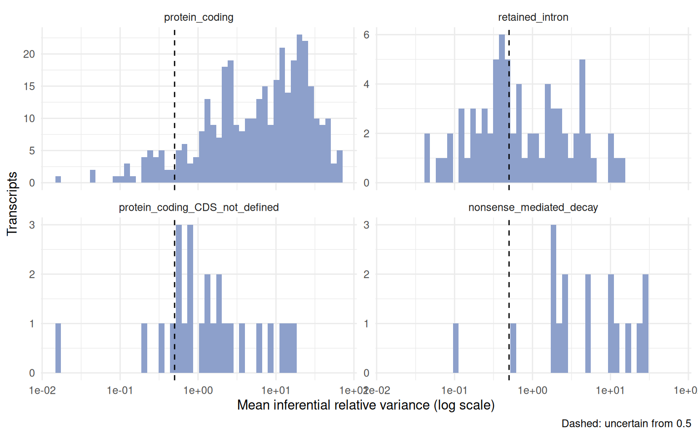
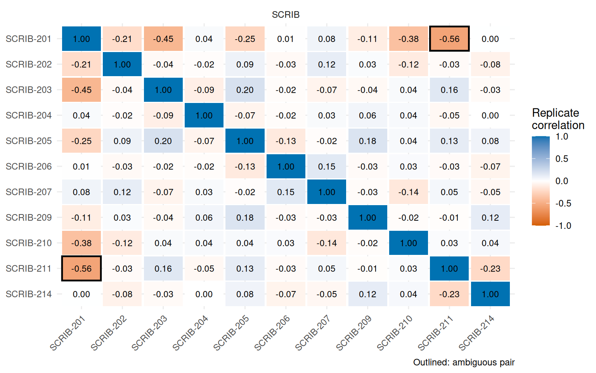
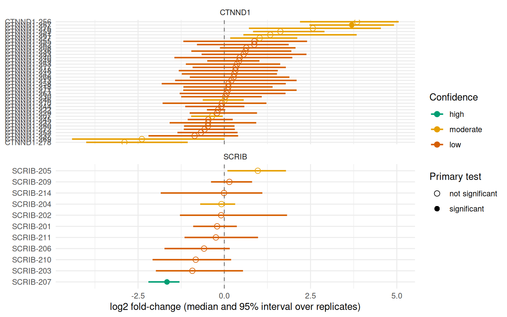
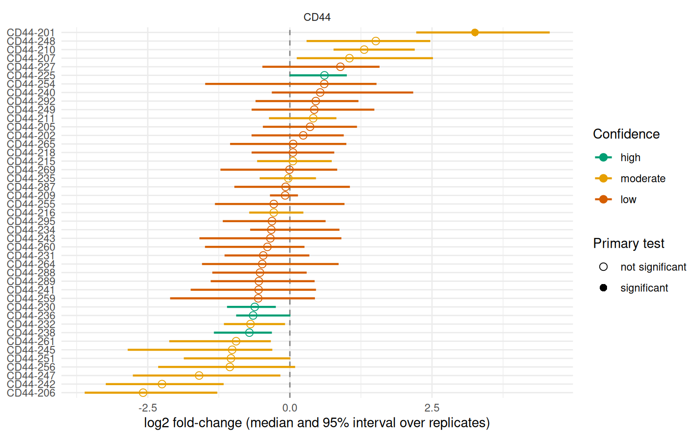

# How confident are we in an isoform-level result?

Reads that map to several isoforms of a gene can be shared out between
them in more than one way, so the abundance of an isoform is estimated
with an uncertainty that has nothing to do with biological variability.
A fold-change between two isoforms that share most of their reads can be
an artefact of how those reads were apportioned in each sample, however
clean the statistics look.

Salmon ([Patro et al. 2017](#ref-salmon)) measures this *inferential
uncertainty* by drawing replicates from the posterior of the abundances
(Gibbs sampling, `--numGibbsSamples`, 30 by default in
[`salmon_quant()`](https://luciorq.github.io/isoformic/reference/salmon_quant.md))
and by writing the equivalence classes (`--dumpEq`) and a run summary
(`meta_info.json`). `isoformic` turns them into four kinds of evidence
for every isoform and one confidence class for every differential
expression call:

| Evidence | Question it answers | Columns |
|----|----|----|
| Quantification uncertainty | Is the abundance determined by the reads? | `mean_inf_rv`, `uncertain` |
| Identifiability | Can the isoform be told apart from its siblings? | `min_sibling_cor`, `ambiguity_group` |
| Read support | How many of its reads map to it alone? | `unique_fraction` |
| Fold-change stability | Does the contrast survive resampling the quantification? | `lfc_lo`, `lfc_hi`, `sign_agreement`, `frac_draws_sig` |

The first three are properties of the quantification; the last one is a
property of one contrast.

## Quantifying with replicates

Ask Salmon for the replicates and the equivalence classes.
[`salmon_quant()`](https://luciorq.github.io/isoformic/reference/salmon_quant.md)
does it by default; from a shell:

``` bash
salmon quant ... --numGibbsSamples 30 --dumpEq --dumpEqWeights
```

Thirty replicates are enough for the summaries below. More cost time and
disk space and change little. Then read everything in one call, from the
same output directories used for
[`read_salmon()`](https://luciorq.github.io/isoformic/reference/read_salmon.md):

``` r

iso <- read_salmon(quant_dirs, annot_path = annot_dir, col_data = col_data, inferential = TRUE)

# or, with a contrast and other cutoffs
iso <- read_salmon(quant_dirs, annot_path = annot_dir, col_data = col_data)
iso <- add_uncertainty(iso, paths = quant_dirs, group = "condition")
```

The replicates are read for the transcripts with an estimated mean count
of at least one, and the run metadata of every sample is added to
[`col_data()`](https://luciorq.github.io/isoformic/reference/IsoformicExperiment-accessors.md).
The replicates stay in memory (`metadata(iso)$inf_reps`); the tables
derived from them are stored in the object and written by
[`write_isoformic()`](https://luciorq.github.io/isoformic/reference/isoformic-io.md).

## The example

The package ships two small real datasets in which an isoform switch
defines the phenotype. ESRP1 and ESRP2 are epithelial splicing
regulators that keep cells in an epithelial isoform program; their loss
moves many genes (CD44, CTNND1, ENAH, SCRIB, …) to the isoforms of
mesenchymal cells. In prostate cancer the androgen receptor controls
`ESRP2`, which makes this switch part of the androgen response ([Munkley
et al. 2019](#ref-munkley2019)).

| Series | Cells | Knockdown | Reference |
|----|----|----|----|
| GSE129540 | prostate cancer | `ESRP2` siRNA, 3 vs 3 | Munkley et al. ([2019](#ref-munkley2019)) |
| GSE75489 | H358 lung epithelial | `ESRP1` and `ESRP2` shRNA, 3 vs 3 | Yang et al. ([2016](#ref-yang2016)) |

Both were re-quantified from the public reads (the first 12 million read
pairs of each sample) with Salmon 2.8.0 against GENCODE v49, with 30
Gibbs draws and equivalence classes. The `swish` test ([Zhu et al.
2019](#ref-swish)) was run on the complete quantification, so its
q-values are those of the full analysis; only the transcripts of 41
genes (known ESRP targets and the genes with the most significant
transcripts) are bundled. `data-raw/build_knockdown_example.R` rebuilds
everything from the Salmon output.

``` r

library(isoformic)
library(dplyr)

extdata <- fs::path_package("isoformic", "extdata")

read_knockdown <- function(series) {
  dir <- fs::path(extdata, "knockdown", series)
  iso <- IsoformicExperiment(
    experiment_name = series,
    annot_path = fs::path(extdata, "knockdown_annotation"),
    assays = list(
      abundance = read_parquet(fs::path(dir, "abundance.parquet")),
      counts = read_parquet(fs::path(dir, "counts.parquet"))
    ),
    col_data = read_parquet(fs::path(dir, "col_data.parquet"))
  )
  de_tx(iso) <- read_parquet(fs::path(dir, "det.parquet"))
  # The draws and the equivalence classes of the Salmon runs
  iso@metadata$inf_reps <- as_inferential_replicates(
    read_parquet(fs::path(dir, "draws.parquet"))
  )
  list(iso = iso, equivalence = read_parquet(fs::path(dir, "equivalence.parquet")))
}

prostate <- read_knockdown("GSE129540")
iso <- prostate$iso
iso
#> <IsoformicExperiment> GSE129540
#>   annotation : gencode_v49_knockdown_subset (54 genes, 1,400 transcripts, 16,374 exons)
#>   samples    : 6 [condition, library_size, run, salmon_version, library_type, detected_library_type, num_processed, num_mapped, percent_mapped, replicate_type, num_replicates, optimiser, em_converged, seq_bias_correct, gc_bias_correct, pos_bias_correct, frag_length_mean, frag_length_sd, qc_flag]
#>   transcripts: 481 assayed from 46 genes
#>   assays     : abundance, counts
#>   gene assays: derived from transcript assays on demand
#>   DE results : det (481 transcripts)
```

The small result tables of the checks further down (read-split
experiments, tool comparisons) are bundled; this helper reads them.

``` r

read_split <- function(name) {
  read_parquet(fs::path(extdata, "knockdown", "read_split", paste0(name, ".parquet")))
}
```

Run-level checks come first: the mapping rate, the library type and
whether the optimiser converged are in the sample table, from
[`salmon_run_qc()`](https://luciorq.github.io/isoformic/reference/inferential-io.md).

``` r

col_data(iso) |>
  select(sample_id, condition, num_mapped, percent_mapped, num_replicates, qc_flag)
#> # A tibble: 6 × 6
#>   sample_id   condition num_mapped percent_mapped num_replicates qc_flag
#>   <chr>       <chr>          <dbl>          <dbl>          <dbl> <chr>  
#> 1 control_1   control     11140615           92.8             30 <NA>   
#> 2 control_2   control     11205689           93.4             30 <NA>   
#> 3 control_3   control     11205662           93.4             30 <NA>   
#> 4 knockdown_1 knockdown   11320687           94.3             30 <NA>   
#> 5 knockdown_2 knockdown   11269264           93.9             30 <NA>   
#> 6 knockdown_3 knockdown   11336987           94.5             30 <NA>
```

The `library_size` column holds the total estimated count of the
complete quantification. Because the object keeps only a subset of the
transcripts,
[`add_uncertainty()`](https://luciorq.github.io/isoformic/reference/uncertainty.md)
uses it to scale the counts before it computes the fold-changes.

The bundled `swish` result flags the isoforms that change:

``` r

sum(de_tx(iso)$qvalue < 0.05, na.rm = TRUE)
#> [1] 41
```

## Computing the uncertainty

[`add_uncertainty()`](https://luciorq.github.io/isoformic/reference/uncertainty.md)
computes the tables and, given a `group`, repeats the contrast on every
draw. Without `paths` it uses the draws already in the object.

``` r

iso <- add_uncertainty(
  iso,
  group = "condition",
  levels = c("control", "knockdown"),
  equivalence = prostate$equivalence
)
#> duckdb keeps downloaded extensions and secrets in a temporary directory:
#> ℹ /tmp/RtmpwDQBuH/duckdb
#> This is removed when the R session ends.
#> • Extensions are re-downloaded each session.
#> • Secrets are lost.
#> ℹ Run duckdb(shared_home = TRUE) (or create ~/.duckdb) to keep them (suitable for most users).
#> ℹ Run duckdb(shared_home = FALSE) to accept the temporary directory (and silence this message).
#> ℹ See ?duckdb_storage for details and alternatives.
iso
#> <IsoformicExperiment> GSE129540
#> duckdb keeps downloaded extensions and secrets in a temporary directory:
#> ℹ /tmp/RtmpwDQBuH/duckdb
#> This is removed when the R session ends.
#> • Extensions are re-downloaded each session.
#> • Secrets are lost.
#> ℹ Run duckdb(shared_home = TRUE) (or create ~/.duckdb) to keep them (suitable for most users).
#> ℹ Run duckdb(shared_home = FALSE) to accept the temporary directory (and silence this message).
#> ℹ See ?duckdb_storage for details and alternatives.
#>   annotation : gencode_v49_knockdown_subset (54 genes, 1,400 transcripts, 16,374 exons)
#>   samples    : 6 [condition, library_size, run, salmon_version, library_type, detected_library_type, num_processed, num_mapped, percent_mapped, replicate_type, num_replicates, optimiser, em_converged, seq_bias_correct, gc_bias_correct, pos_bias_correct, frag_length_mean, frag_length_sd, qc_flag]
#>   transcripts: 481 assayed from 46 genes
#>   assays     : abundance, counts
#>   gene assays: derived from transcript assays on demand
#>   DE results : det (481 transcripts)
```

## Which isoforms are not determined by the reads?

[`tx_uncertainty()`](https://luciorq.github.io/isoformic/reference/uncertainty.md)
has one row per assessed transcript. `mean_inf_rv` is the inferential
relative variance ([Zhu et al. 2019](#ref-swish)): the variance of the
draws in excess of the counting noise (the mean), relative to the
expression, averaged over samples. A well-determined isoform has a value
near zero; the value of one that shares its reads with others can be
several units.

``` r

unc <- tx_uncertainty(iso)
unc |>
  arrange(desc(mean_inf_rv)) |>
  select(any_of(c("gene_name", "transcript_name", "mean_count", "mean_inf_rv", "uncertain", "unique_fraction"))) |>
  head(8)
#> # A tibble: 8 × 6
#>   gene_name transcript_name mean_count mean_inf_rv uncertain unique_fraction
#>   <chr>     <chr>                <dbl>       <dbl> <lgl>               <dbl>
#> 1 FLNA      FLNA-227              84.4        65.6 TRUE            0.0000416
#> 2 MYO6      MYO6-222             888.         65.6 TRUE            0        
#> 3 MYO6      MYO6-201            1646.         63.2 TRUE            0        
#> 4 APLP2     APLP2-227            219.         61.7 TRUE            0        
#> 5 CLSTN1    CLSTN1-201           276.         60.7 TRUE            0        
#> 6 CTNND1    CTNND1-283           203.         60.2 TRUE            0.000234 
#> 7 FLNA      FLNA-202             261.         59.2 TRUE            0        
#> 8 EXOC7     EXOC7-227            150.         51.7 TRUE            0

table(unc$transcript_type, unc$uncertain)
#>                                 
#>                                  FALSE TRUE
#>   nonsense_mediated_decay            1   16
#>   protein_coding                    31  333
#>   protein_coding_CDS_not_defined     4   21
#>   retained_intron                   34   41
```

The distribution per transcript type, with the cutoff that separates
uncertain isoforms (0.5 by default; with 30 draws, sampling noise puts
well-determined, highly expressed transcripts near 0.1):

``` r

plot_inf_rv(iso)
```



`unique_fraction` is the share of the fragments of an isoform that are
compatible with it alone, read from the equivalence classes of
`--dumpEq`. It is the most direct measure of read support. With `paths`,
[`add_uncertainty()`](https://luciorq.github.io/isoformic/reference/uncertainty.md)
reads the classes itself; here the table returned by
[`equivalence_support()`](https://luciorq.github.io/isoformic/reference/inferential-io.md)
is passed instead.

## Which isoforms cannot be told apart?

When two isoforms share their reads, every fragment given to one is
taken from the other, and their draws are negatively correlated.
[`isoform_ambiguity()`](https://luciorq.github.io/isoformic/reference/uncertainty.md)
reports the mean correlation of every pair of isoforms of the same gene;
pairs at or below `cor_cutoff` (-0.5) are ambiguous and connected into
`ambiguity_group`s.

``` r

isoform_ambiguity(iso, ambiguous_only = TRUE) |>
  select(gene_name, transcript_name_1, transcript_name_2, mean_cor, min_cor, n_samples)
#> # A tibble: 14 × 6
#>    gene_name transcript_name_1 transcript_name_2 mean_cor min_cor n_samples
#>    <chr>     <chr>             <chr>                <dbl>   <dbl>     <int>
#>  1 DHRS7     DHRS7-212         DHRS7-202           -0.836  -0.923         6
#>  2 SLC45A3   SLC45A3-201       SLC45A3-214         -0.821  -0.906         6
#>  3 TLN1      TLN1-209          TLN1-210            -0.681  -0.862         6
#>  4 RPL17     RPL17-222         RPL17-220           -0.639  -0.769         6
#>  5 MYO6      MYO6-219          MYO6-215            -0.621  -0.842         6
#>  6 ADAMTS1   ADAMTS1-201       ADAMTS1-211         -0.612  -0.881         6
#>  7 RPS24     RPS24-214         RPS24-202           -0.606  -0.722         6
#>  8 DHRS7     DHRS7-208         DHRS7-206           -0.603  -0.754         6
#>  9 KIF13A    KIF13A-203        KIF13A-206          -0.602  -0.796         6
#> 10 ZC3HAV1   ZC3HAV1-201       ZC3HAV1-206         -0.600  -0.840         6
#> 11 SCRIB     SCRIB-201         SCRIB-211           -0.561  -0.733         6
#> 12 DHRS7     DHRS7-202         DHRS7-208           -0.547  -0.690         6
#> 13 UBE3B     UBE3B-202         UBE3B-216           -0.521  -0.757         6
#> 14 APLP2     APLP2-203         APLP2-202           -0.506  -0.716         6
```

``` r

plot_isoform_correlation(iso, gene_name = "SCRIB")
```



An ambiguous pair is a statement about this quantification: one isoform
of the pair may be up and the other down, or both unchanged, with the
same data. The sum of the pair is better determined than either part.

## How stable is each fold-change?

[`de_confidence()`](https://luciorq.github.io/isoformic/reference/uncertainty.md)
repeats the contrast on every draw and summarises the log2 fold-change:
its median and 95% interval, the share of draws that agree on its
direction (`sign_agreement`) and the share in which the isoform is
called differentially expressed (`frac_draws_sig`). Combined with the
quantification uncertainty and the ambiguity it gives a confidence
class:

- `high`: the fold-change is stable (`sign_agreement >= 0.95`), the
  isoform is not `uncertain` and has no ambiguous sibling;
- `moderate`: exactly one of these fails;
- `low`: two or more fail.

The class says how far a call on this isoform can be trusted, so read it
for the isoforms flagged by the primary test; for the others it only
says that nothing would be believed.

``` r

conf <- de_confidence(iso)
conf |>
  filter(n_det_sig > 0) |>
  select(gene_name, transcript_name, det_log2FC, lfc_lo, lfc_hi, sign_agreement, mean_inf_rv, confidence, reason) |>
  head(10)
#> # A tibble: 10 × 9
#>    gene_name transcript_name det_log2FC lfc_lo lfc_hi sign_agreement mean_inf_rv
#>    <chr>     <chr>                <dbl>  <dbl>  <dbl>          <dbl>       <dbl>
#>  1 OASL      OASL-206              7.11   7.02   7.79              1        2.35
#>  2 OASL      OASL-211              6.83   6.39   7.35              1        2.36
#>  3 OASL      OASL-201              5.62   5.29   6.08              1        1.32
#>  4 ZC3HAV1   ZC3HAV1-204           5.43   5.04   6.53              1        4.71
#>  5 OASL      OASL-202              4.62   4.21   5.23              1        4.41
#>  6 FLNB      FLNB-202              4.30   3.28   6.23              1       45.7 
#>  7 UBE3B     UBE3B-214             3.86   3.02   5.03              1       15.1 
#>  8 CTNND1    CTNND1-257            3.36   2.47   4.92              1       25.3 
#>  9 MYO6      MYO6-203             -3.27  -5.05  -2.57              1       22.3 
#> 10 ADAMTS1   ADAMTS1-201           3.05   2.22   5.51              1       48.3 
#> # ℹ 2 more variables: confidence <ord>, reason <chr>

table(significant = conf$n_det_sig > 0, confidence = conf$confidence, useNA = "ifany")
#>            confidence
#> significant high moderate low
#>       FALSE   13      155 285
#>       TRUE     3       20   5
```

``` r

plot_de_confidence(iso, gene_name = c("SCRIB", "CTNND1"))
```



A significant isoform with a low class is not wrong: it is a call that
the quantification does not support strongly. Typical reasons are shown
in `reason`; a fold-change interval that crosses zero is the clearest
sign.

Two things stand out in these data. First, the isoforms with the largest
fold-changes are not the ESRP targets: `OASL` and `ZC3HAV1` are
interferon-stimulated genes, which is a common response to transfected
siRNA (an interpretation, not something these data test), and they are
also the best-determined calls (a narrow interval and a moderate class
from an inferential variance of a few units). Second, the ESRP targets
themselves are mostly in genes with dozens of annotated isoforms, where
the reads cannot decide between near-identical transcripts. Compare the
two genes of the plot above:

``` r

conf |>
  left_join(unc[, c("transcript_id", "unique_fraction")], by = c("feature_id" = "transcript_id")) |>
  filter(gene_name %in% c("SCRIB", "CTNND1", "ENAH"), abs(lfc_median) > 1.5) |>
  arrange(gene_name, desc(abs(lfc_median))) |>
  slice_head(n = 3, by = gene_name) |>
  select(gene_name, transcript_name, lfc_median, lfc_lo, lfc_hi, sign_agreement, mean_inf_rv, unique_fraction, confidence)
#> # A tibble: 7 × 9
#>   gene_name transcript_name lfc_median lfc_lo lfc_hi sign_agreement mean_inf_rv
#>   <chr>     <chr>                <dbl>  <dbl>  <dbl>          <dbl>       <dbl>
#> 1 CTNND1    CTNND1-256            3.85  2.19   5.05               1      34.7  
#> 2 CTNND1    CTNND1-257            3.69  2.47   4.92               1      25.3  
#> 3 CTNND1    CTNND1-278           -2.89 -4.00  -1.06               1      20.3  
#> 4 ENAH      ENAH-217             -2.03 -3.26  -0.291              1      23.3  
#> 5 ENAH      ENAH-212              1.99  0.291  3.06               1      18.6  
#> 6 ENAH      ENAH-215              1.94  0.498  3.53               1      39.5  
#> 7 SCRIB     SCRIB-207            -1.66 -2.20  -1.30               1       0.340
#> # ℹ 2 more variables: unique_fraction <dbl>, confidence <ord>
```

`SCRIB-207` is the clean case: an interval far from zero, an inferential
variance of 0.3 and no ambiguous partner, so a high confidence call that
the primary test also flags. The `CTNND1` and `ENAH` isoforms change by
several log2 units with every draw agreeing on the direction, but their
inferential variance is 18 to 50 against a cutoff of 0.5 and practically
no fragment is unique to them (`unique_fraction` is zero or nearly): the
data say that something in these genes changes, not which of the
transcripts it is. `SCRIB` has an ambiguous pair as well (`SCRIB-201`
and `SCRIB-211`, above), which `collapse_groups` handles by testing
their sum as one feature.

## A second dataset: the CD44 switch

The H358 series is the classical case. Without ESRP1 and ESRP2, `CD44`
moves from long variant transcripts (13 to 18 exons) to the short
transcript `CD44-201` (9 exons). The reads tell the same story, with the
confidence the quantification allows:

``` r

lung <- read_knockdown("GSE75489")
#> duckdb keeps downloaded extensions and secrets in a temporary directory:
#> ℹ /tmp/RtmpwDQBuH/duckdb
#> This is removed when the R session ends.
#> • Extensions are re-downloaded each session.
#> • Secrets are lost.
#> ℹ Run duckdb(shared_home = TRUE) (or create ~/.duckdb) to keep them (suitable for most users).
#> ℹ Run duckdb(shared_home = FALSE) to accept the temporary directory (and silence this message).
#> ℹ See ?duckdb_storage for details and alternatives.
#> duckdb keeps downloaded extensions and secrets in a temporary directory:
#> ℹ /tmp/RtmpwDQBuH/duckdb
#> This is removed when the R session ends.
#> • Extensions are re-downloaded each session.
#> • Secrets are lost.
#> ℹ Run duckdb(shared_home = TRUE) (or create ~/.duckdb) to keep them (suitable for most users).
#> ℹ Run duckdb(shared_home = FALSE) to accept the temporary directory (and silence this message).
#> ℹ See ?duckdb_storage for details and alternatives.
#> duckdb keeps downloaded extensions and secrets in a temporary directory:
#> ℹ /tmp/RtmpwDQBuH/duckdb
#> This is removed when the R session ends.
#> • Extensions are re-downloaded each session.
#> • Secrets are lost.
#> ℹ Run duckdb(shared_home = TRUE) (or create ~/.duckdb) to keep them (suitable for most users).
#> ℹ Run duckdb(shared_home = FALSE) to accept the temporary directory (and silence this message).
#> ℹ See ?duckdb_storage for details and alternatives.
#> duckdb keeps downloaded extensions and secrets in a temporary directory:
#> ℹ /tmp/RtmpwDQBuH/duckdb
#> This is removed when the R session ends.
#> • Extensions are re-downloaded each session.
#> • Secrets are lost.
#> ℹ Run duckdb(shared_home = TRUE) (or create ~/.duckdb) to keep them (suitable for most users).
#> ℹ Run duckdb(shared_home = FALSE) to accept the temporary directory (and silence this message).
#> ℹ See ?duckdb_storage for details and alternatives.
#> duckdb keeps downloaded extensions and secrets in a temporary directory:
#> ℹ /tmp/RtmpwDQBuH/duckdb
#> This is removed when the R session ends.
#> • Extensions are re-downloaded each session.
#> • Secrets are lost.
#> ℹ Run duckdb(shared_home = TRUE) (or create ~/.duckdb) to keep them (suitable for most users).
#> ℹ Run duckdb(shared_home = FALSE) to accept the temporary directory (and silence this message).
#> ℹ See ?duckdb_storage for details and alternatives.
#> duckdb keeps downloaded extensions and secrets in a temporary directory:
#> ℹ /tmp/RtmpwDQBuH/duckdb
#> This is removed when the R session ends.
#> • Extensions are re-downloaded each session.
#> • Secrets are lost.
#> ℹ Run duckdb(shared_home = TRUE) (or create ~/.duckdb) to keep them (suitable for most users).
#> ℹ Run duckdb(shared_home = FALSE) to accept the temporary directory (and silence this message).
#> ℹ See ?duckdb_storage for details and alternatives.
iso_lung <- add_uncertainty(
  lung$iso,
  group = "condition",
  levels = c("control", "knockdown"),
  equivalence = lung$equivalence
)
de_confidence(iso_lung, gene_name = "CD44") |>
  left_join(
    tx_uncertainty(iso_lung)[, c("transcript_id", "unique_fraction")],
    by = c("feature_id" = "transcript_id")
  ) |>
  filter(abs(lfc_median) > 1.5) |>
  arrange(desc(lfc_median)) |>
  select(transcript_name, lfc_median, lfc_lo, lfc_hi, sign_agreement, mean_inf_rv, unique_fraction, confidence)
#> # A tibble: 5 × 8
#>   transcript_name lfc_median lfc_lo lfc_hi sign_agreement mean_inf_rv
#>   <chr>                <dbl>  <dbl>  <dbl>          <dbl>       <dbl>
#> 1 CD44-201              3.26  2.22   4.57           1            9.90
#> 2 CD44-248              1.51  0.293  2.47           1            4.87
#> 3 CD44-247             -1.60 -2.76  -0.167          0.967        6.80
#> 4 CD44-242             -2.25 -3.24  -1.16           1           12.1 
#> 5 CD44-206             -2.58 -3.61  -1.28           1            8.19
#> # ℹ 2 more variables: unique_fraction <dbl>, confidence <ord>
```

``` r

plot_de_confidence(iso_lung, gene_name = "CD44")
```



The direction of the switch is certain: the short `CD44-201` goes up, as
does `CD44-248`, and the long variant transcripts `CD44-242`, `CD44-206`
and `CD44-247` go down, with at least 97% of the draws agreeing on every
direction. Which transcript carries each change is not, because the
transcripts differ by single exons and none has reads of its own
(`unique_fraction` is zero), so none gets better than a moderate class.
Reporting the class next to the fold-change is the honest summary: *CD44
switches towards its short form (high agreement), but the individual
variant isoforms cannot be resolved with short reads*.

### Testing ambiguous isoforms as one feature

When a pair cannot be told apart, test the part that can be measured,
the sum. `collapse_groups = TRUE` sums the draws of each ambiguity group
before the contrast:

``` r

de_confidence(iso, group = "condition", levels = c("control", "knockdown"), collapse_groups = TRUE) |>
  filter(feature_type == "group") |>
  select(feature_id, transcript_ids, lfc_median, lfc_lo, lfc_hi, sign_agreement, mean_inf_rv, confidence)
#> # A tibble: 12 × 8
#>    feature_id            transcript_ids lfc_median lfc_lo  lfc_hi sign_agreement
#>    <chr>                 <chr>               <dbl>  <dbl>   <dbl>          <dbl>
#>  1 ENSG00000154734.17_a… ENST000002849…     1.54    1.40   1.66            1    
#>  2 ENSG00000158715.7_am… ENST000003671…     1.10    1.05   1.20            1    
#>  3 ENSG00000196586.18_a… ENST000009278…     0.840   0.672  1.12            1    
#>  4 ENSG00000151148.15_a… ENST000003424…     0.816   0.478  1.10            1    
#>  5 ENSG00000100612.15_a… ENST000009318…     0.708   0.665  0.740           1    
#>  6 ENSG00000105939.15_a… ENST000002423…     0.705   0.655  0.758           1    
#>  7 ENSG00000265681.9_am… ENST000006173…     0.440   0.316  0.529           1    
#>  8 ENSG00000084234.19_a… ENST000003381…    -0.354  -0.565 -0.245           1    
#>  9 ENSG00000180900.21_a… ENST000003204…    -0.290  -0.509  0.156           0.9  
#> 10 ENSG00000138326.22_a… ENST000006138…     0.255   0.239  0.272           1    
#> 11 ENSG00000137076.23_a… ENST000007069…    -0.0489 -0.201  0.0758          0.767
#> 12 ENSG00000137177.20_a… ENST000003788…     0.0121 -0.187  0.301           0.533
#> # ℹ 2 more variables: mean_inf_rv <dbl>, confidence <ord>
```

### Groups from Terminus

Terminus ([*Terminus Enables the Discovery of Data-Driven, Robust
Transcript Groups from RNA-seq Data* 2020](#ref-terminus)) groups the
transcripts whose abundances the reads cannot estimate separately, from
the equivalence classes and the replicates of all samples, and gives one
consensus grouping.
[`run_terminus()`](https://luciorq.github.io/isoformic/reference/run_terminus.md)
runs it from R on the Salmon output directories, installing Terminus
with `condathis` the first time, and returns the consensus groups;
`add_uncertainty(groups = )` uses them in place of the groups built from
the correlation of the replicates, and the confidence classes and
`collapse_groups` follow them. Terminus needs replicates and equivalence
classes with their weights (`--dumpEq --dumpEqWeights`), which
[`salmon_quant()`](https://luciorq.github.io/isoformic/reference/salmon_quant.md)
writes;
[`run_terminus()`](https://luciorq.github.io/isoformic/reference/run_terminus.md)
checks them before it starts.

``` r

groups <- run_terminus(quant_dirs, output_dir = "terminus", workers = 4)
iso <- add_uncertainty(iso, paths = quant_dirs, group = "condition", groups = groups)

# Groups from an earlier run, or from Terminus run outside R
groups <- read_terminus_groups("terminus/sample1")
```

On the six prostate samples (`data-raw/knockdown/compare_terminus.R`,
Terminus 0.1.0), the consensus holds 14,029 groups of 52,911
transcripts. The two groupings point at the same isoforms but differ in
reach:

``` r

read_split("terminus_comparison")
#> duckdb keeps downloaded extensions and secrets in a temporary directory:
#> ℹ /tmp/RtmpwDQBuH/duckdb
#> This is removed when the R session ends.
#> • Extensions are re-downloaded each session.
#> • Secrets are lost.
#> ℹ Run duckdb(shared_home = TRUE) (or create ~/.duckdb) to keep them (suitable for most users).
#> ℹ Run duckdb(shared_home = FALSE) to accept the temporary directory (and silence this message).
#> ℹ See ?duckdb_storage for details and alternatives.
#> # A tibble: 15 × 2
#>    quantity                                                       value
#>    <chr>                                                          <dbl>
#>  1 assessed transcripts                                       116229   
#>  2 transcripts in a correlation group                           8076   
#>  3 transcripts in a Terminus group                             20703   
#>  4 correlation-grouped transcripts also grouped by Terminus     5420   
#>  5 Terminus-grouped transcripts also in a correlation group     5420   
#>  6 correlation pairs also in the same Terminus group            2831   
#>  7 median InfRV, correlation-grouped                               8.59
#>  8 median InfRV, Terminus-grouped                                 15.5 
#>  9 median InfRV, in neither                                        1.44
#> 10 large changes (|log2FC| > 1): high, correlation groups        203   
#> 11 large changes (|log2FC| > 1): moderate, correlation groups   2450   
#> 12 large changes (|log2FC| > 1): low, correlation groups        1893   
#> 13 large changes (|log2FC| > 1): high, Terminus groups           203   
#> 14 large changes (|log2FC| > 1): moderate, Terminus groups      1525   
#> 15 large changes (|log2FC| > 1): low, Terminus groups           2818
```

Two thirds of the transcripts that the correlation rule groups are also
in a Terminus group, and the same share of its pairs fall in the same
group. Terminus groups more transcripts (20,703 against 8,076 of the
assessed ones), and the isoforms it groups are the most uncertain
(median inferential relative variance 15.5, against 8.6 for the
correlation groups and 1.4 for the isoforms in neither). Among the large
changes the high class stays at 203 isoforms, and about 900 isoforms
move from moderate to low because a Terminus group counts as an
ambiguous sibling. Both groupings are heuristics built from the same
replicates; neither is the truth, and the Terminus groups come from the
12 million read pairs of these samples.

### Trees from TreeTerminus

A flat group either collapses isoforms or does not. TreeTerminus ([Singh
et al. 2023](#ref-treeterminus)) builds trees instead: the leaves are
isoforms and every node is the sum of the isoforms below it, so the
resolution can change from one isoform to the next.
[`read_treeterminus()`](https://luciorq.github.io/isoformic/reference/treeterminus.md)
reads the trees and
[`cut_transcript_trees()`](https://luciorq.github.io/isoformic/reference/treeterminus.md)
cuts them with the replicates in the object: an isoform the reads
determine stays itself, one they do not is replaced by its lowest
ancestor whose inferential relative variance is below the cutoff, and
nested choices are merged so that no isoform is in two groups.

``` r

# treeterminus group -d <folder with the Salmon runs> -o tt --mean_inf true
trees <- read_treeterminus("tt", salmon_dir = quant_dirs[[1]])
groups <- cut_transcript_trees(trees, iso, cutoff = 0.5)
iso <- add_uncertainty(iso, group = "condition", groups = groups)
```

On the six prostate samples
(`data-raw/knockdown/compare_treeterminus.R`; TreeTerminus Mean trees of
the six samples), the three groupings compare as follows:

``` r

read_split("grouping_comparison")
#> duckdb keeps downloaded extensions and secrets in a temporary directory:
#> ℹ /tmp/RtmpwDQBuH/duckdb
#> This is removed when the R session ends.
#> • Extensions are re-downloaded each session.
#> • Secrets are lost.
#> ℹ Run duckdb(shared_home = TRUE) (or create ~/.duckdb) to keep them (suitable for most users).
#> ℹ Run duckdb(shared_home = FALSE) to accept the temporary directory (and silence this message).
#> ℹ See ?duckdb_storage for details and alternatives.
#> # A tibble: 3 × 11
#>   grouping   assessed grouped groups uncertain_left_alone features_after_colla…¹
#>   <chr>         <int>   <int>  <int>                <int>                  <int>
#> 1 correlati…   116229    8076   3945                78892                 112258
#> 2 Terminus     116229   20703   8011                67138                 103692
#> 3 TreeTermi…   116229   31606   5543                58225                  90326
#> # ℹ abbreviated name: ¹​features_after_collapse
#> # ℹ 5 more variables: median_group_inf_rv <dbl>, groups_below_cutoff <dbl>,
#> #   large_high <int>, large_moderate <int>, large_low <int>
```

The trees reach many more of the uncertain isoforms (58,225 are left
alone, against 67,138 with Terminus and 78,892 with the correlation
rule), and the features they produce are the ones the reads determine:
the median inferential relative variance of a group is 0.19, against
2.87 for the Terminus groups, most of which stay uncertain after
summing. Grouping more isoforms also flags more of them as ambiguous, so
fewer large changes stay in the high class (159 against 203). The
isoforms still left alone are those whose whole tree stays above the
cutoff; `unresolved = "root"` merges such trees into one group each.
TreeTerminus needed 24 minutes and 18 GB of memory for the six samples;
reading and cutting the trees took about four minutes.

## Does the confidence predict what does not reproduce?

A confidence class is only useful if it separates the calls that hold up
from those that do not. The prostate dataset allows a direct check,
because a library can be quantified twice. Each of the six libraries was
split into its first and second 6 million read pairs and quantified
separately (`data-raw/knockdown/split_halves.sh`,
`data-raw/knockdown/validate_uncertainty.R`), which gives technical
replicates and two kinds of contrast:

- **null contrasts**, half 1 against half 2 of the same libraries, for
  the controls and for the knockdowns, where every difference is noise;
- **the real contrast** (control against knockdown), called in half 1
  and checked in half 2.

**Stability alone is not enough.** The null contrasts contain hundreds
of transcripts whose fold-change exceeds two-fold and is stable over the
draws (at least 95% of them agree on the direction), because the draws
describe the quantification and the two halves differ in the reads that
were sampled. Nearly all of them are demoted by the confidence class:

``` r

read_split("null_stable")
#> duckdb keeps downloaded extensions and secrets in a temporary directory:
#> ℹ /tmp/RtmpwDQBuH/duckdb
#> This is removed when the R session ends.
#> • Extensions are re-downloaded each session.
#> • Secrets are lost.
#> ℹ Run duckdb(shared_home = TRUE) (or create ~/.duckdb) to keep them (suitable for most users).
#> ℹ Run duckdb(shared_home = FALSE) to accept the temporary directory (and silence this message).
#> ℹ See ?duckdb_storage for details and alternatives.
#> # A tibble: 2 × 5
#>   contrast       stable_large_changes  high moderate   low
#>   <chr>                         <int> <int>    <int> <int>
#> 1 null_control                    575     3      444   128
#> 2 null_knockdown                  539     1      441    97
```

**Uncertain isoforms reproduce less.** Among the isoforms called by
`edgeR` in half 1, the share that goes the same way in half 2 and that
is called again falls from the high to the low class:

``` r

read_split("replication_class")
#> duckdb keeps downloaded extensions and secrets in a temporary directory:
#> ℹ /tmp/RtmpwDQBuH/duckdb
#> This is removed when the R session ends.
#> • Extensions are re-downloaded each session.
#> • Secrets are lost.
#> ℹ Run duckdb(shared_home = TRUE) (or create ~/.duckdb) to keep them (suitable for most users).
#> ℹ Run duckdb(shared_home = FALSE) to accept the temporary directory (and silence this message).
#> ℹ See ?duckdb_storage for details and alternatives.
#> # A tibble: 3 × 4
#>   class    calls same_direction significant_again
#>   <chr>    <int>          <dbl>             <dbl>
#> 1 high        52          1                 0.769
#> 2 moderate   119          0.983             0.65 
#> 3 low         62          0.758             0.291
```

The inferential relative variance shows the same gradient on every
large, stable change, and puts a scale on the cutoff: the direction
agrees in 98% of the isoforms below 0.5, which is the default cutoff for
`uncertain`, and in 78% of those above 10.

``` r

read_split("replication_rv")
#> duckdb keeps downloaded extensions and secrets in a temporary directory:
#> ℹ /tmp/RtmpwDQBuH/duckdb
#> This is removed when the R session ends.
#> • Extensions are re-downloaded each session.
#> • Secrets are lost.
#> ℹ Run duckdb(shared_home = TRUE) (or create ~/.duckdb) to keep them (suitable for most users).
#> ℹ Run duckdb(shared_home = FALSE) to accept the temporary directory (and silence this message).
#> ℹ See ?duckdb_storage for details and alternatives.
#> # A tibble: 4 × 3
#>   inferential_rv transcripts same_direction
#>   <chr>                <int>          <dbl>
#> 1 below 0.5              104          0.981
#> 2 0.5 to 2               204          0.951
#> 3 2 to 10                687          0.86 
#> 4 above 10               728          0.782
```

## Dividing out the uncertainty

The classes describe a call after the test. The same replicates can also
go into the test:
[`inferential_overdispersion()`](https://luciorq.github.io/isoformic/reference/inferential-overdispersion.md)
estimates how much more variable than Poisson the count of each isoform
is because of the read ambiguity, as
[`edgeR::catchSalmon()`](https://rdrr.io/pkg/edgeR/man/catchSalmon.html)
does ([Baldoni et al. 2024](#ref-baldoni2024)), and
[`scale_counts()`](https://luciorq.github.io/isoformic/reference/inferential-overdispersion.md)
divides the counts by it. The scaled counts can then be given to any
count-based test. In the null contrasts above, `edgeR` on the raw counts
calls about twice as many transcripts at a p-value below 0.001 as chance
allows, and on the scaled counts it calls fewer than chance allows:

``` r

read_split("null_calls")
#> duckdb keeps downloaded extensions and secrets in a temporary directory:
#> ℹ /tmp/RtmpwDQBuH/duckdb
#> This is removed when the R session ends.
#> • Extensions are re-downloaded each session.
#> • Secrets are lost.
#> ℹ Run duckdb(shared_home = TRUE) (or create ~/.duckdb) to keep them (suitable for most users).
#> ℹ Run duckdb(shared_home = FALSE) to accept the temporary directory (and silence this message).
#> ℹ See ?duckdb_storage for details and alternatives.
#> # A tibble: 6 × 6
#>   contrast       method tested q_below_0.05 p_below_0.001 expected_p_below_0.001
#>   <chr>          <chr>   <int>        <int>         <int>                  <dbl>
#> 1 null_control   swish   32206            1            NA                   32.2
#> 2 null_control   edgeR   32168            0            68                   32.2
#> 3 null_control   edgeR…  13795            0             4                   13.8
#> 4 null_knockdown swish   31677            0            NA                   31.7
#> 5 null_knockdown edgeR   31651            0            73                   31.7
#> 6 null_knockdown edgeR…  13733            0            12                   13.7
```

The scaled test is conservative here, with fewer transcripts passing the
expression filter (13,800 against 32,000), and these null contrasts
compare technical replicates of the same libraries, a favourable case;
no biological variability is involved. The classes and the scaling
answer different questions and can be used together.

``` r

overdispersion <- inferential_overdispersion(iso)
summary(overdispersion$overdispersion)
#>    Min. 1st Qu.  Median    Mean 3rd Qu.    Max. 
#>   1.000   2.876   6.815  12.459  18.020  69.872

iso <- scale_counts(iso)
scaled <- edgeR::DGEList(assay(iso, "counts_scaled"), group = col_data(iso)$condition)
design <- stats::model.matrix(~group, scaled$samples)
scaled <- edgeR::estimateDisp(scaled, design)
fit <- edgeR::glmQLFit(scaled, design)
scaled_test <- edgeR::topTags(edgeR::glmQLFTest(fit, coef = 2), n = 5)$table
scaled_test |>
  tibble::rownames_to_column("transcript_id") |>
  left_join(unc[, c("transcript_id", "gene_name", "transcript_name", "mean_inf_rv")], by = "transcript_id") |>
  select(gene_name, transcript_name, logFC, FDR, mean_inf_rv)
#>   gene_name transcript_name     logFC          FDR mean_inf_rv
#> 1      OASL        OASL-211  7.314540 1.634817e-10    2.355846
#> 2      OASL        OASL-206  8.320536 2.016338e-10    2.350012
#> 3     ESRP2       ESRP2-202 -2.051695 1.310068e-09    3.126908
#> 4      OASL        OASL-201  6.929644 1.764658e-09    1.317612
#> 5   ZC3HAV1     ZC3HAV1-204  9.691498 2.307520e-07    4.709698
```

## Testing transcript usage

The tests above ask whether an isoform changes. Switches are also tested
as a change in the *share* of a gene that an isoform carries.
[`test_usage()`](https://luciorq.github.io/isoformic/reference/test_usage.md)
runs `edgeR` `diffSplice`, `satuRn` or `DEXSeq` on the counts, divided
by the overdispersion of the replicates when the object has them, and
returns the same table for the three backends. With more than two groups
it tests every level against the first, or every pair with
`contrasts = "pairwise"`, and the `contrast` column says which
comparison each row belongs to; `contrasts = "omnibus"` gives one
p-value per isoform for a difference among any of the groups:

``` r

usage <- test_usage(iso, group = "condition", levels = c("control", "knockdown"), method = "diffsplice")
usage |>
  filter(gene_qvalue < 0.05) |>
  select(gene_name, transcript_name, usage_log2FC, qvalue, gene_qvalue, scaled) |>
  head(8)
#> # A tibble: 8 × 6
#>   gene_name transcript_name usage_log2FC       qvalue  gene_qvalue scaled
#>   <chr>     <chr>                  <dbl>        <dbl>        <dbl> <lgl> 
#> 1 FLNB      FLNB-202               5.54  0.0000000424 0.0000000501 TRUE  
#> 2 CTNND1    CTNND1-257             1.90  0.000000322  0.000000381  TRUE  
#> 3 RPS24     RPS24-202              0.764 0.0000312    0.0000246    TRUE  
#> 4 TLN1      TLN1-209              -0.690 0.00234      0.00184      TRUE  
#> 5 ESRP2     ESRP2-203              0.812 0.00290      0.00228      TRUE  
#> 6 SCRIB     SCRIB-207             -1.29  0.00902      0.00742      TRUE  
#> 7 FLNB      FLNB-201              -0.389 0.00902      0.0000000501 TRUE  
#> 8 UBE3B     UBE3B-202             -0.562 0.0116       0.0157       TRUE
```

The division matters. In the null contrasts of the read-split
experiment, where every call is a false positive, the unscaled
`diffSplice` and `DEXSeq` call dozens to hundreds of transcripts. The
calls of the real contrast made in one half of the reads go the same way
in the other half in 47% of the cases for unscaled `diffSplice`, which
is chance, and in 65% for `DEXSeq`. With the scaling the false positives
nearly vanish, and the calls reproduce (100% and 94%):

``` r

read_split("usage_null") |>
  select(contrast, method, scaled, transcripts, q_below_0.05, p_below_0.001, expected_p_below_0.001)
#> duckdb keeps downloaded extensions and secrets in a temporary directory:
#> ℹ /tmp/RtmpwDQBuH/duckdb
#> This is removed when the R session ends.
#> • Extensions are re-downloaded each session.
#> • Secrets are lost.
#> ℹ Run duckdb(shared_home = TRUE) (or create ~/.duckdb) to keep them (suitable for most users).
#> ℹ Run duckdb(shared_home = FALSE) to accept the temporary directory (and silence this message).
#> ℹ See ?duckdb_storage for details and alternatives.
#> # A tibble: 12 × 7
#>    contrast       method     scaled transcripts q_below_0.05 p_below_0.001
#>    <chr>          <chr>      <lgl>        <int>        <int>         <int>
#>  1 null_control   diffsplice FALSE        16194           41            75
#>  2 null_control   diffsplice TRUE          5319            7            10
#>  3 null_control   satuRn     FALSE        16194            0             3
#>  4 null_control   satuRn     TRUE          5319            0             9
#>  5 null_control   DEXSeq     FALSE        16194          195           203
#>  6 null_control   DEXSeq     TRUE          5319           12            20
#>  7 null_knockdown diffsplice FALSE        15950           59            90
#>  8 null_knockdown diffsplice TRUE          5318            2             8
#>  9 null_knockdown satuRn     FALSE        15950            0             2
#> 10 null_knockdown satuRn     TRUE          5318            2             6
#> 11 null_knockdown DEXSeq     FALSE        15950          244           250
#> 12 null_knockdown DEXSeq     TRUE          5318            4             8
#> # ℹ 1 more variable: expected_p_below_0.001 <dbl>
read_split("usage_replication")
#> duckdb keeps downloaded extensions and secrets in a temporary directory:
#> ℹ /tmp/RtmpwDQBuH/duckdb
#> This is removed when the R session ends.
#> • Extensions are re-downloaded each session.
#> • Secrets are lost.
#> ℹ Run duckdb(shared_home = TRUE) (or create ~/.duckdb) to keep them (suitable for most users).
#> ℹ Run duckdb(shared_home = FALSE) to accept the temporary directory (and silence this message).
#> ℹ See ?duckdb_storage for details and alternatives.
#> # A tibble: 6 × 6
#>   method     scaled calls_half1 tested_in_half2 same_direction significant_again
#>   <chr>      <lgl>        <int>           <int>          <dbl>             <dbl>
#> 1 diffsplice FALSE           77              36          0.472             0.083
#> 2 diffsplice TRUE            20              17          1                 0.353
#> 3 satuRn     FALSE            0               0        NaN               NaN    
#> 4 satuRn     TRUE            21              20          1                 0.3  
#> 5 DEXSeq     FALSE          365             224          0.647             0.165
#> 6 DEXSeq     TRUE           130             107          0.944             0.43
```

`satuRn` is the most conservative of the three without the scaling, and
still gains calls that reproduce with it. The scaled runs test fewer
transcripts, because fewer pass the expression filter once the counts
are divided; the false positives are fewer partly for that reason. These
are technical replicates of the same libraries, which is the most
favourable comparison for a usage test: biological variability is
absent, so they say how well a method resists read ambiguity and nothing
else.

### Against IsoformSwitchAnalyzeR

IsoformSwitchAnalyzeR (version 2.10.0) tests isoform usage with `DEXSeq`
too, adds its own expression and effect-size filters, and calls an
isoform a switch when its adjusted p-value is below 0.05 and its usage
changes by at least 0.1. Run on the same six prostate samples
(`data-raw/knockdown/compare_isar.R`), with the same two thresholds
applied to
[`test_usage()`](https://luciorq.github.io/isoformic/reference/test_usage.md),
it gives:

``` r

read_split("isar_comparison") |>
  select(tool, tested, calls, shared_with_isar, uncertain, ambiguous, unstable, high_confidence)
#> duckdb keeps downloaded extensions and secrets in a temporary directory:
#> ℹ /tmp/RtmpwDQBuH/duckdb
#> This is removed when the R session ends.
#> • Extensions are re-downloaded each session.
#> • Secrets are lost.
#> ℹ Run duckdb(shared_home = TRUE) (or create ~/.duckdb) to keep them (suitable for most users).
#> ℹ Run duckdb(shared_home = FALSE) to accept the temporary directory (and silence this message).
#> ℹ See ?duckdb_storage for details and alternatives.
#> # A tibble: 3 × 8
#>   tool                tested calls shared_with_isar uncertain ambiguous unstable
#>   <chr>                <int> <int>            <int>     <int>     <int>    <int>
#> 1 IsoformSwitchAnaly…  79463    40               40        39         7       17
#> 2 isoformic DEXSeq, …  19171   372                8       357        85      181
#> 3 isoformic DEXSeq, …   8779   139                1       123        43       25
#> # ℹ 1 more variable: high_confidence <int>
```

There is no ground truth for this contrast, so the table says how the
tools differ and not which is right. The three call sets overlap very
little: eight of the 372 calls on raw counts are also
IsoformSwitchAnalyzeR switches, and one of the 139 calls on scaled
counts. The tools tested different isoforms (79,463 for
IsoformSwitchAnalyzeR against 19,171 and 8,779 here, which apply their
expression filters at different points), so part of the disagreement is
the filters.

What the uncertainty tables add is a way to read each call. Most calls
of every tool (88% to 98%) are on isoforms with an inferential relative
variance of at least 0.5, as usage switches mostly occur in genes with
many near-identical isoforms. The calls differ in their stability over
the replicates: 17 of the 40 switches of IsoformSwitchAnalyzeR and 181
of the 372 calls on raw counts have a fold-change that fewer than 95% of
the replicates agree on, against 25 of the 139 calls on scaled counts,
which are also the calls that reproduce between read halves above.

## Using the confidence downstream

Isoform switches count significant isoforms, which is where ambiguous
quantification does most damage. With the confidence stored,
[`isoform_switches()`](https://luciorq.github.io/isoformic/reference/diversity.md)
reports how many significant isoforms of each gene are confident and
`confident_only = TRUE` keeps only those:

``` r

isoform_switches(iso) |>
  select(gene_name, n_det_sig, n_det_confident, switch_type) |>
  head(8)
#> # A tibble: 8 × 4
#>   gene_name n_det_sig n_det_confident switch_type       
#>   <chr>         <int>           <int> <chr>             
#> 1 MYO6              3               0 opposite_direction
#> 2 OASL              5               0 det_not_deg       
#> 3 UBE3B             3               1 det_not_deg       
#> 4 ADAMTS1           3               0 det_not_deg       
#> 5 ZC3HAV1           2               0 det_not_deg       
#> 6 RAC1              2               1 det_not_deg       
#> 7 SLC45A3           2               0 det_not_deg       
#> 8 FLNB              1               0 det_not_deg
isoform_switches(iso, confident_only = TRUE) |>
  select(gene_name, n_det_sig, n_det_confident, switch_type) |>
  head(8)
#> # A tibble: 3 × 4
#>   gene_name n_det_sig n_det_confident switch_type
#>   <chr>         <int>           <int> <chr>      
#> 1 UBE3B             1               1 det_not_deg
#> 2 RAC1              1               1 det_not_deg
#> 3 SCRIB             1               1 det_not_deg
```

[`dominant_isoform()`](https://luciorq.github.io/isoformic/reference/diversity.md)
adds the uncertainty of the dominant isoform (`dominant_inf_rv`,
`dominant_ambiguous`), and
[`productive_fraction()`](https://luciorq.github.io/isoformic/reference/productivity.md)
uses the same draws to put an uncertainty on the share of expression
carried by productive isoforms (see the [productivity
article](https://luciorq.github.io/isoformic/articles/isoformic-productivity.md)).

``` r

dominant_isoform(iso, group = "condition") |>
  filter(dominant_switch) |>
  select(gene_name, condition, dominant_transcript_name, dominant_fraction, dominant_inf_rv, dominant_ambiguous) |>
  head(6)
#> # A tibble: 6 × 6
#>   gene_name condition dominant_transcript_name dominant_fraction dominant_inf_rv
#>   <chr>     <chr>     <chr>                                <dbl>           <dbl>
#> 1 SLK       control   SLK-207                              0.256          14.1  
#> 2 SLK       knockdown SLK-213                              0.317          26.3  
#> 3 FGFR2     control   FGFR2-215                            0.433           0.290
#> 4 FGFR2     knockdown FGFR2-222                            0.259           0.101
#> 5 ITGA6     control   ITGA6-212                            0.437          49.2  
#> 6 ITGA6     knockdown ITGA6-202                            0.704          16.5  
#> # ℹ 1 more variable: dominant_ambiguous <lgl>
```

## Reporting the uncertainty

Report the numbers next to the classes, and the settings that produced
them.
[`uncertainty_report()`](https://luciorq.github.io/isoformic/reference/uncertainty.md)
collects the tables a methods or results section needs:

``` r

report <- uncertainty_report(iso)
names(report)
#> [1] "settings"    "run"         "transcripts" "genes"       "de"         
#> [6] "switches"
report$transcripts
#> # A tibble: 4 × 7
#>   transcript_type n_assessed n_uncertain pct_uncertain median_inf_rv n_ambiguous
#>   <chr>                <int>       <int>         <dbl>         <dbl>       <int>
#> 1 protein_coding         364         333          91.5         7.47           25
#> 2 retained_intron         75          41          54.7         0.589           1
#> 3 protein_coding…         25          21          84           1.32            0
#> 4 nonsense_media…         17          16          94.1         4.76            0
#> # ℹ 1 more variable: median_unique_fraction <dbl>
report$de
#> # A tibble: 3 × 5
#>   confidence n_significant n_unstable n_uncertain n_ambiguous
#>   <ord>              <int>      <int>       <int>       <int>
#> 1 high                   3          0           0           0
#> 2 moderate              20          0          20           0
#> 3 low                    5          0           5           5
report$switches
#> NULL
```

- **Results.** State how many of the significant isoforms have each
  confidence class and why the others do not (`report$de`: unstable
  fold-change, uncertain quantification, ambiguous sibling), and how
  many switches or genes remain once only confident isoforms are kept
  (`report$switches`).
- **Tables.** For every isoform you discuss, give the fold-change with
  its interval (`lfc_median`, `lfc_lo`, `lfc_hi`), `sign_agreement`,
  `mean_inf_rv`, `unique_fraction` and the ambiguous partner, if any,
  next to the p-value of the primary test.
- **Figures.**
  [`plot_de_confidence()`](https://luciorq.github.io/isoformic/reference/uncertainty-plots.md)
  for the isoforms of a gene,
  [`plot_isoform_correlation()`](https://luciorq.github.io/isoformic/reference/uncertainty-plots.md)
  for the ambiguous ones.
- **Methods.**
  [`uncertainty_methods()`](https://luciorq.github.io/isoformic/reference/uncertainty.md)
  writes a paragraph with the Salmon version, the number of draws and
  the cutoffs; edit it to fit.

``` r

uncertainty_methods(iso)
#> [1] "Transcript abundances were quantified with Salmon 2.8.0 and 30 Gibbs samples per sample were used to measure the inferential uncertainty of each isoform. For every transcript, the inferential relative variance (InfRV; Zhu et al. 2019) was averaged over samples, and transcripts with an InfRV of at least 0.5 were called uncertain. The correlation between the replicates of isoforms of the same gene was averaged over samples, and isoform pairs with a correlation of -0.5 or lower were called ambiguous and grouped. The log2 fold-change of each isoform was recomputed on every replicate (counts scaled to a common library size, pseudocount 5), and a fold-change was called stable when at least 95% of the replicates agreed on its direction. Differentially expressed isoforms were assigned high confidence when the fold-change was stable, the quantification was not uncertain and no sibling isoform was ambiguous, moderate confidence when one of these conditions failed and low confidence when two or more failed. Only transcripts with a mean estimated count of at least 1 were assessed. The contrast was knockdown versus control in the condition variable."
```

Some cautions belong in the text as well. The draws describe the
uncertainty of the quantification only; they do not replace biological
replicates, and an isoform with a stable fold-change can still be a
false positive of the primary test. The cutoffs (`inf_rv_cutoff`,
`cor_cutoff`, `min_agreement`) are heuristics: rerun
[`add_uncertainty()`](https://luciorq.github.io/isoformic/reference/uncertainty.md)
with other values and report how the numbers change. The classes are
calibrated against nothing but the data at hand. Finally, the contrast
repeated on each draw is a screening statistic (a Welch test on the log
scale, with a pseudocount of 5) and does not replace `swish` or
`DESeq2`.

## Saving

The tables, the settings and the run metadata are saved with the object;
the draws are not, and are re-read from the Salmon directories with
`add_uncertainty(iso, paths = )` when the tables need to be recomputed.

``` r

out_dir <- fs::path(tempdir(), "knockdown_uncertainty")
invisible(write_isoformic(iso, out_dir, overwrite = TRUE))
#> duckdb keeps downloaded extensions and secrets in a temporary directory:
#> ℹ /tmp/RtmpwDQBuH/duckdb
#> This is removed when the R session ends.
#> • Extensions are re-downloaded each session.
#> • Secrets are lost.
#> ℹ Run duckdb(shared_home = TRUE) (or create ~/.duckdb) to keep them (suitable for most users).
#> ℹ Run duckdb(shared_home = FALSE) to accept the temporary directory (and silence this message).
#> ℹ See ?duckdb_storage for details and alternatives.
#> duckdb keeps downloaded extensions and secrets in a temporary directory:
#> ℹ /tmp/RtmpwDQBuH/duckdb
#> This is removed when the R session ends.
#> • Extensions are re-downloaded each session.
#> • Secrets are lost.
#> ℹ Run duckdb(shared_home = TRUE) (or create ~/.duckdb) to keep them (suitable for most users).
#> ℹ Run duckdb(shared_home = FALSE) to accept the temporary directory (and silence this message).
#> ℹ See ?duckdb_storage for details and alternatives.
#> duckdb keeps downloaded extensions and secrets in a temporary directory:
#> ℹ /tmp/RtmpwDQBuH/duckdb
#> This is removed when the R session ends.
#> • Extensions are re-downloaded each session.
#> • Secrets are lost.
#> ℹ Run duckdb(shared_home = TRUE) (or create ~/.duckdb) to keep them (suitable for most users).
#> ℹ Run duckdb(shared_home = FALSE) to accept the temporary directory (and silence this message).
#> ℹ See ?duckdb_storage for details and alternatives.
#> duckdb keeps downloaded extensions and secrets in a temporary directory:
#> ℹ /tmp/RtmpwDQBuH/duckdb
#> This is removed when the R session ends.
#> • Extensions are re-downloaded each session.
#> • Secrets are lost.
#> ℹ Run duckdb(shared_home = TRUE) (or create ~/.duckdb) to keep them (suitable for most users).
#> ℹ Run duckdb(shared_home = FALSE) to accept the temporary directory (and silence this message).
#> ℹ See ?duckdb_storage for details and alternatives.
#> duckdb keeps downloaded extensions and secrets in a temporary directory:
#> ℹ /tmp/RtmpwDQBuH/duckdb
#> This is removed when the R session ends.
#> • Extensions are re-downloaded each session.
#> • Secrets are lost.
#> ℹ Run duckdb(shared_home = TRUE) (or create ~/.duckdb) to keep them (suitable for most users).
#> ℹ Run duckdb(shared_home = FALSE) to accept the temporary directory (and silence this message).
#> ℹ See ?duckdb_storage for details and alternatives.
#> duckdb keeps downloaded extensions and secrets in a temporary directory:
#> ℹ /tmp/RtmpwDQBuH/duckdb
#> This is removed when the R session ends.
#> • Extensions are re-downloaded each session.
#> • Secrets are lost.
#> ℹ Run duckdb(shared_home = TRUE) (or create ~/.duckdb) to keep them (suitable for most users).
#> ℹ Run duckdb(shared_home = FALSE) to accept the temporary directory (and silence this message).
#> ℹ See ?duckdb_storage for details and alternatives.
#> duckdb keeps downloaded extensions and secrets in a temporary directory:
#> ℹ /tmp/RtmpwDQBuH/duckdb
#> This is removed when the R session ends.
#> • Extensions are re-downloaded each session.
#> • Secrets are lost.
#> ℹ Run duckdb(shared_home = TRUE) (or create ~/.duckdb) to keep them (suitable for most users).
#> ℹ Run duckdb(shared_home = FALSE) to accept the temporary directory (and silence this message).
#> ℹ See ?duckdb_storage for details and alternatives.
#> duckdb keeps downloaded extensions and secrets in a temporary directory:
#> ℹ /tmp/RtmpwDQBuH/duckdb
#> This is removed when the R session ends.
#> • Extensions are re-downloaded each session.
#> • Secrets are lost.
#> ℹ Run duckdb(shared_home = TRUE) (or create ~/.duckdb) to keep them (suitable for most users).
#> ℹ Run duckdb(shared_home = FALSE) to accept the temporary directory (and silence this message).
#> ℹ See ?duckdb_storage for details and alternatives.
#> duckdb keeps downloaded extensions and secrets in a temporary directory:
#> ℹ /tmp/RtmpwDQBuH/duckdb
#> This is removed when the R session ends.
#> • Extensions are re-downloaded each session.
#> • Secrets are lost.
#> ℹ Run duckdb(shared_home = TRUE) (or create ~/.duckdb) to keep them (suitable for most users).
#> ℹ Run duckdb(shared_home = FALSE) to accept the temporary directory (and silence this message).
#> ℹ See ?duckdb_storage for details and alternatives.
#> duckdb keeps downloaded extensions and secrets in a temporary directory:
#> ℹ /tmp/RtmpwDQBuH/duckdb
#> This is removed when the R session ends.
#> • Extensions are re-downloaded each session.
#> • Secrets are lost.
#> ℹ Run duckdb(shared_home = TRUE) (or create ~/.duckdb) to keep them (suitable for most users).
#> ℹ Run duckdb(shared_home = FALSE) to accept the temporary directory (and silence this message).
#> ℹ See ?duckdb_storage for details and alternatives.
#> duckdb keeps downloaded extensions and secrets in a temporary directory:
#> ℹ /tmp/RtmpwDQBuH/duckdb
#> This is removed when the R session ends.
#> • Extensions are re-downloaded each session.
#> • Secrets are lost.
#> ℹ Run duckdb(shared_home = TRUE) (or create ~/.duckdb) to keep them (suitable for most users).
#> ℹ Run duckdb(shared_home = FALSE) to accept the temporary directory (and silence this message).
#> ℹ See ?duckdb_storage for details and alternatives.
fs::dir_ls(fs::path(out_dir, "dea"))
#> /tmp/RtmpwDQBuH/knockdown_uncertainty/dea/ambiguity.parquet
#> /tmp/RtmpwDQBuH/knockdown_uncertainty/dea/confidence.parquet
#> /tmp/RtmpwDQBuH/knockdown_uncertainty/dea/det.parquet
#> /tmp/RtmpwDQBuH/knockdown_uncertainty/dea/uncertainty.parquet
tx_uncertainty(read_isoformic(out_dir)) |> head(3)
#> duckdb keeps downloaded extensions and secrets in a temporary directory:
#> ℹ /tmp/RtmpwDQBuH/duckdb
#> This is removed when the R session ends.
#> • Extensions are re-downloaded each session.
#> • Secrets are lost.
#> ℹ Run duckdb(shared_home = TRUE) (or create ~/.duckdb) to keep them (suitable for most users).
#> ℹ Run duckdb(shared_home = FALSE) to accept the temporary directory (and silence this message).
#> ℹ See ?duckdb_storage for details and alternatives.
#> duckdb keeps downloaded extensions and secrets in a temporary directory:
#> ℹ /tmp/RtmpwDQBuH/duckdb
#> This is removed when the R session ends.
#> • Extensions are re-downloaded each session.
#> • Secrets are lost.
#> ℹ Run duckdb(shared_home = TRUE) (or create ~/.duckdb) to keep them (suitable for most users).
#> ℹ Run duckdb(shared_home = FALSE) to accept the temporary directory (and silence this message).
#> ℹ See ?duckdb_storage for details and alternatives.
#> duckdb keeps downloaded extensions and secrets in a temporary directory:
#> ℹ /tmp/RtmpwDQBuH/duckdb
#> This is removed when the R session ends.
#> • Extensions are re-downloaded each session.
#> • Secrets are lost.
#> ℹ Run duckdb(shared_home = TRUE) (or create ~/.duckdb) to keep them (suitable for most users).
#> ℹ Run duckdb(shared_home = FALSE) to accept the temporary directory (and silence this message).
#> ℹ See ?duckdb_storage for details and alternatives.
#> duckdb keeps downloaded extensions and secrets in a temporary directory:
#> ℹ /tmp/RtmpwDQBuH/duckdb
#> This is removed when the R session ends.
#> • Extensions are re-downloaded each session.
#> • Secrets are lost.
#> ℹ Run duckdb(shared_home = TRUE) (or create ~/.duckdb) to keep them (suitable for most users).
#> ℹ Run duckdb(shared_home = FALSE) to accept the temporary directory (and silence this message).
#> ℹ See ?duckdb_storage for details and alternatives.
#> duckdb keeps downloaded extensions and secrets in a temporary directory:
#> ℹ /tmp/RtmpwDQBuH/duckdb
#> This is removed when the R session ends.
#> • Extensions are re-downloaded each session.
#> • Secrets are lost.
#> ℹ Run duckdb(shared_home = TRUE) (or create ~/.duckdb) to keep them (suitable for most users).
#> ℹ Run duckdb(shared_home = FALSE) to accept the temporary directory (and silence this message).
#> ℹ See ?duckdb_storage for details and alternatives.
#> duckdb keeps downloaded extensions and secrets in a temporary directory:
#> ℹ /tmp/RtmpwDQBuH/duckdb
#> This is removed when the R session ends.
#> • Extensions are re-downloaded each session.
#> • Secrets are lost.
#> ℹ Run duckdb(shared_home = TRUE) (or create ~/.duckdb) to keep them (suitable for most users).
#> ℹ Run duckdb(shared_home = FALSE) to accept the temporary directory (and silence this message).
#> ℹ See ?duckdb_storage for details and alternatives.
#> duckdb keeps downloaded extensions and secrets in a temporary directory:
#> ℹ /tmp/RtmpwDQBuH/duckdb
#> This is removed when the R session ends.
#> • Extensions are re-downloaded each session.
#> • Secrets are lost.
#> ℹ Run duckdb(shared_home = TRUE) (or create ~/.duckdb) to keep them (suitable for most users).
#> ℹ Run duckdb(shared_home = FALSE) to accept the temporary directory (and silence this message).
#> ℹ See ?duckdb_storage for details and alternatives.
#> duckdb keeps downloaded extensions and secrets in a temporary directory:
#> ℹ /tmp/RtmpwDQBuH/duckdb
#> This is removed when the R session ends.
#> • Extensions are re-downloaded each session.
#> • Secrets are lost.
#> ℹ Run duckdb(shared_home = TRUE) (or create ~/.duckdb) to keep them (suitable for most users).
#> ℹ Run duckdb(shared_home = FALSE) to accept the temporary directory (and silence this message).
#> ℹ See ?duckdb_storage for details and alternatives.
#> duckdb keeps downloaded extensions and secrets in a temporary directory:
#> ℹ /tmp/RtmpwDQBuH/duckdb
#> This is removed when the R session ends.
#> • Extensions are re-downloaded each session.
#> • Secrets are lost.
#> ℹ Run duckdb(shared_home = TRUE) (or create ~/.duckdb) to keep them (suitable for most users).
#> ℹ Run duckdb(shared_home = FALSE) to accept the temporary directory (and silence this message).
#> ℹ See ?duckdb_storage for details and alternatives.
#> duckdb keeps downloaded extensions and secrets in a temporary directory:
#> ℹ /tmp/RtmpwDQBuH/duckdb
#> This is removed when the R session ends.
#> • Extensions are re-downloaded each session.
#> • Secrets are lost.
#> ℹ Run duckdb(shared_home = TRUE) (or create ~/.duckdb) to keep them (suitable for most users).
#> ℹ Run duckdb(shared_home = FALSE) to accept the temporary directory (and silence this message).
#> ℹ See ?duckdb_storage for details and alternatives.
#> duckdb keeps downloaded extensions and secrets in a temporary directory:
#> ℹ /tmp/RtmpwDQBuH/duckdb
#> This is removed when the R session ends.
#> • Extensions are re-downloaded each session.
#> • Secrets are lost.
#> ℹ Run duckdb(shared_home = TRUE) (or create ~/.duckdb) to keep them (suitable for most users).
#> ℹ Run duckdb(shared_home = FALSE) to accept the temporary directory (and silence this message).
#> ℹ See ?duckdb_storage for details and alternatives.
#> # A tibble: 3 × 18
#>   transcript_id     gene_id gene_name transcript_name transcript_type mean_count
#>   <chr>             <chr>   <chr>     <chr>           <chr>                <dbl>
#> 1 ENST00000424832.6 ENSG00… HLA-C     HLA-C-268       protein_coding      755.  
#> 2 ENST00000494158.5 ENSG00… HLA-C     HLA-C-275       retained_intron       3.83
#> 3 ENST00000496419.5 ENSG00… HLA-C     HLA-C-276       retained_intron      21.1 
#> # ℹ 12 more variables: assessed <lgl>, mean_inf_rv <dbl>, max_inf_rv <dbl>,
#> #   mean_inf_cv <dbl>, uncertain <lgl>, min_sibling_cor <dbl>,
#> #   n_ambiguous_partners <int>, ambiguity_group <chr>, n_classes <dbl>,
#> #   n_fragments <dbl>, n_unique_fragments <dbl>, unique_fraction <dbl>
```

## Session information

``` r

sessionInfo()
#> R version 4.6.2 (2026-10-29)
#> Platform: x86_64-pc-linux-gnu
#> Running under: Ubuntu 24.04.5 LTS
#> 
#> Matrix products: default
#> BLAS:   /usr/lib/x86_64-linux-gnu/openblas-pthread/libblas.so.3 
#> LAPACK: /usr/lib/x86_64-linux-gnu/openblas-pthread/libopenblasp-r0.3.26.so;  LAPACK version 3.12.0
#> 
#> locale:
#>  [1] LC_CTYPE=C.UTF-8       LC_NUMERIC=C           LC_TIME=C.UTF-8       
#>  [4] LC_COLLATE=C.UTF-8     LC_MONETARY=C.UTF-8    LC_MESSAGES=C.UTF-8   
#>  [7] LC_PAPER=C.UTF-8       LC_NAME=C              LC_ADDRESS=C          
#> [10] LC_TELEPHONE=C         LC_MEASUREMENT=C.UTF-8 LC_IDENTIFICATION=C   
#> 
#> time zone: UTC
#> tzcode source: system (glibc)
#> 
#> attached base packages:
#> [1] stats     graphics  grDevices utils     datasets  methods   base     
#> 
#> other attached packages:
#> [1] dplyr_1.2.1          isoformic_0.1.2.9022
#> 
#> loaded via a namespace (and not attached):
#>  [1] limma_3.68.5       gtable_0.3.6       jsonlite_2.0.0     crayon_1.5.3      
#>  [5] compiler_4.6.2     tidyselect_1.2.1   scales_1.4.0       statmod_1.5.2     
#>  [9] yaml_2.3.12        fastmap_1.2.0      lattice_0.23-1     ggplot2_4.0.3     
#> [13] R6_2.6.1           labeling_0.4.3     generics_0.1.4     knitr_1.52        
#> [17] tibble_3.3.1       DBI_1.3.0          pillar_1.11.1      RColorBrewer_1.1-3
#> [21] rlang_1.3.0        utf8_1.2.6         xfun_0.62          fs_2.1.0          
#> [25] S7_0.2.2           otel_0.2.0         cli_3.6.6          withr_3.0.3       
#> [29] magrittr_2.0.5     locfit_1.5-9.12    digest_0.6.39      grid_4.6.2        
#> [33] edgeR_4.10.7       lifecycle_1.0.5    vctrs_0.7.3        evaluate_1.0.5    
#> [37] glue_1.8.1         farver_2.1.2       duckdb_2.0.0       rmarkdown_2.32    
#> [41] tools_4.6.2        pkgconfig_2.0.3    htmltools_0.5.9
```

## References

Baldoni, Pedro L, Yunshun Chen, Soroor Hediyeh-Zadeh, et al. 2024.
“Dividing Out Quantification Uncertainty Allows Efficient Assessment of
Differential Transcript Expression with edgeR.” *Nucleic Acids Research*
52 (3): e13. <https://doi.org/10.1093/nar/gkad1167>.

Munkley, Jennifer, Li Ling, S R Gokul Krishnan, et al. 2019.
“Androgen-Regulated Transcription of ESRP2 Drives Alternative Splicing
Patterns in Prostate Cancer.” *eLife* 8: e47678.
<https://doi.org/10.7554/eLife.47678>.

Patro, R, G Duggal, MI Love, RA Irizarry, and C Kingsford. 2017. “Salmon
Provides Fast and Bias-Aware Quantification of Transcript Expression.”
*Nature Methods* 14: 417–19. <https://doi.org/10.1038/nmeth.4197>.

Singh, Noor Pratap, Michael I Love, and Rob Patro. 2023. “TreeTerminus –
Creating Transcript Trees Using Inferential Replicate Counts.”
*iScience* 26 (6): 106961. <https://doi.org/10.1016/j.isci.2023.106961>.

*Terminus Enables the Discovery of Data-Driven, Robust Transcript Groups
from RNA-seq Data*. 2020. bioRxiv.
<https://doi.org/10.1101/2020.04.07.029967>.

Yang, Yueqin, Juw Won Park, Thomas W Bebee, et al. 2016. “Determination
of a Comprehensive Alternative Splicing Regulatory Network and
Combinatorial Regulation by Key Factors During the
Epithelial-to-Mesenchymal Transition.” *Molecular and Cellular Biology*
36 (11): 1704–19. <https://doi.org/10.1128/MCB.00019-16>.

Zhu, A, A Srivastava, JG Ibrahim, R Patro, and MI Love. 2019.
“Nonparametric expression analysis using inferential replicate counts.”
*Nucleic Acids Research* 47: e105. <https://doi.org/10.1093/nar/gkz622>.
