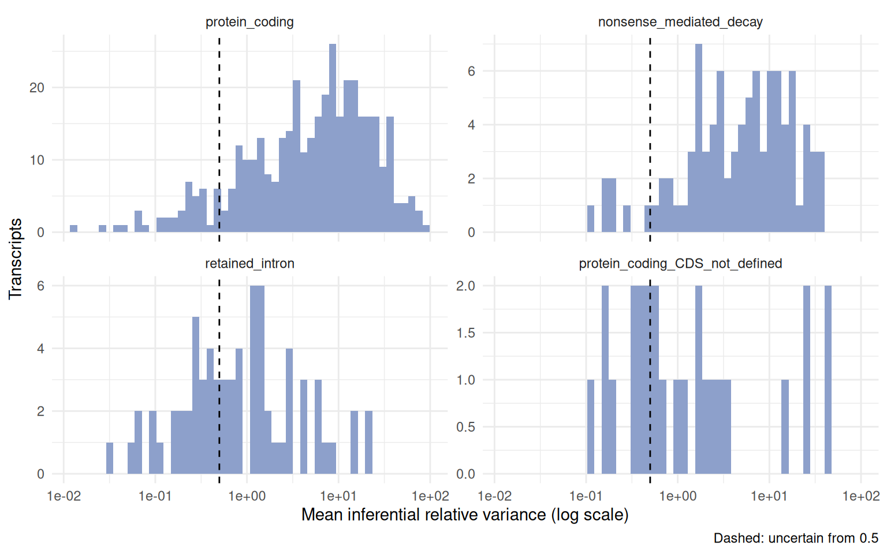
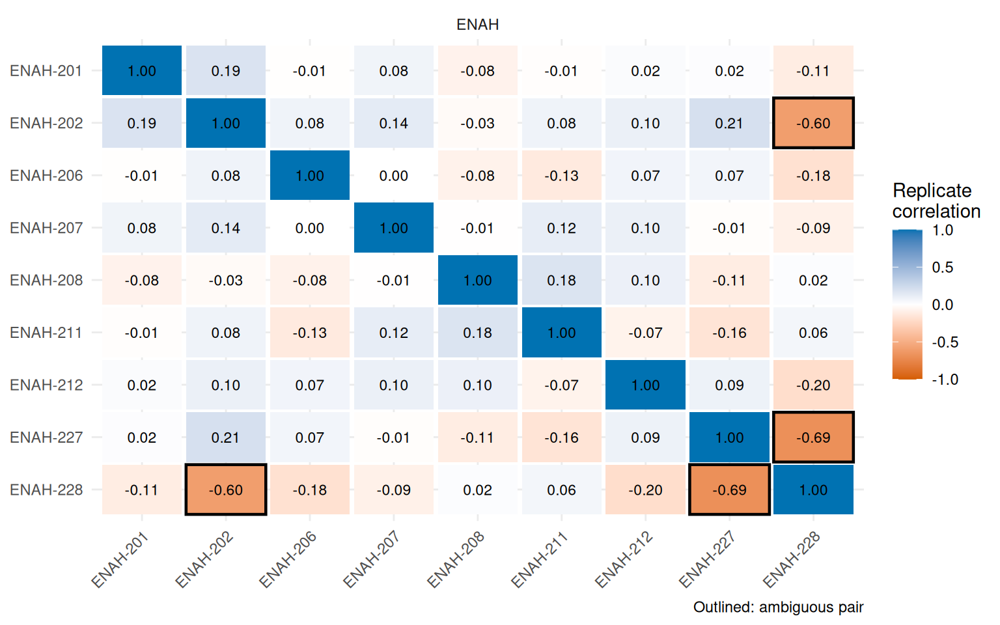
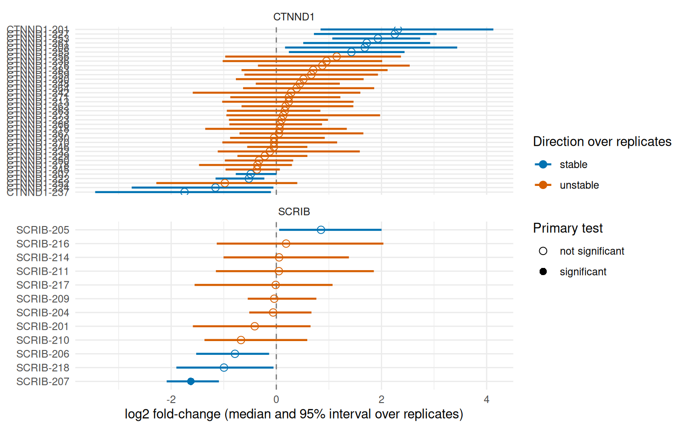
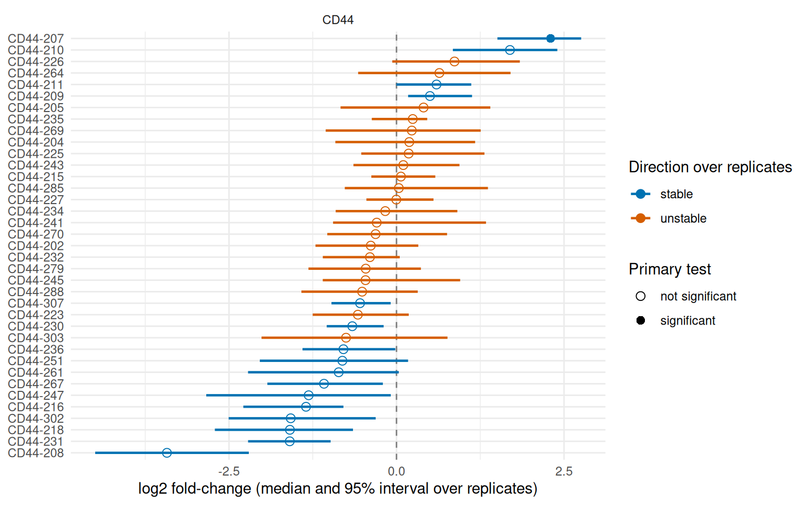

# How confident are we in an isoform-level result?

Reads that map to several isoforms of a gene can be shared out between
them in more than one way, so the abundance of an isoform is estimated
with an uncertainty that has nothing to do with biological variability.
A fold-change between two isoforms that share most of their reads can be
an artefact of how those reads were apportioned in each sample, however
clean the statistics look.

Salmon ([Patro et al. 2017](#ref-salmon)) measures this *inferential
uncertainty* by drawing replicates from the posterior of the abundances
(Gibbs sampling, `--numGibbsSamples`, 30 by default in
[`salmon_quant()`](https://luciorq.github.io/isoformic/reference/salmon_quant.md))
and by writing the equivalence classes (`--dumpEq`) and a run summary
(`meta_info.json`). Gibbs samples resolve low counts better than
bootstrap replicates, and the overdispersion used further down to scale
counts is precise once the study has at least 60 degrees of freedom,
counted as samples times replicates minus one (200 to 300 preferred)
([Baldoni, L. Chen, et al. 2024](#ref-baldoni2024gibbs)): 30 draws meet
that minimum from three samples up (87 degrees of freedom) and reach the
preferred range from seven (203), and
[`add_uncertainty()`](https://luciorq.github.io/isoformic/reference/uncertainty.md)
says so when a study falls short. `isoformic` turns them into four kinds
of evidence for every isoform and a check of the direction of every
differential expression call:

| Evidence | Question it answers | Columns |
|----|----|----|
| Quantification uncertainty | Is the abundance determined by the reads? | `mean_inf_rv`, `uncertain` |
| Ambiguity between isoforms | Can the isoform be told apart from its siblings? | `min_sibling_cor`, `ambiguity_group` |
| Read support | How many of its reads map to it alone? | `unique_fraction` |
| Fold-change stability | Does the contrast survive resampling the quantification? | `sign_agreement`, `unstable`, `lfc_lo`, `lfc_hi`, `frac_draws_sig` |

The first three are properties of the quantification; the last one is a
property of one contrast.

This article shows how to compute and read these columns on a small
panel of genes. Whether they matter in a genome-wide analysis of a real
cohort is the subject of the [evidence
article](https://luciorq.github.io/isoformic/articles/isoformic-uncertainty-evidence.md).
In short, in held-out halves of a placenta cohort the calls whose
direction fewer than 95% of the draws agreed on (`unstable`) replicated
less often than the other calls, and the other columns predicted
replication more weakly there (in technical read halves every flag
predicted non-replication), but the flag marked only about one in ten of
the calls that failed to replicate, so a stable direction does not make
a call right. `isoformic` therefore reports `unstable` as the flag of a
call and the other columns as descriptions of the isoform: a three-way
confidence class built from all of them, used by earlier development
versions, marked most of the calls (83%), separated replicating from
non-replicating calls only modestly, and as a filter would have
discarded 81% of the calls that replicated, so it was removed.

## Quantifying with replicates

Ask Salmon for the replicates and the equivalence classes.
[`salmon_quant()`](https://luciorq.github.io/isoformic/reference/salmon_quant.md)
does it by default; from a shell:

``` bash
salmon quant ... --numGibbsSamples 30 --dumpEq --dumpEqWeights
```

The [evidence
article](https://luciorq.github.io/isoformic/articles/isoformic-uncertainty-evidence.md)
used 30 replicates. Its InfRV thirds barely changed when computed from
15 of them (94% of transcripts stay in the same third), but it did not
test more draws for its calls. For isoforms near a cutoff (few unique
fragments or reads, retained introns, lncRNAs), more draws are expected
to make the flags more stable, since InfRV computed from more draws has
a smaller sampling error, but this was not tested, and they cost time
and disk space. Separately, about half of lncRNA isoforms sit in a
TreeTerminus tree that differs between two Salmon runs, one with 30 and
one with 100 draws; that comparison mixes the number of draws with the
randomness of an independent run (see the [quantification stability
article](https://luciorq.github.io/isoformic/articles/isoformic-quantification-stability.md)).
Then read everything in one call, from the same output directories used
for
[`read_salmon()`](https://luciorq.github.io/isoformic/reference/read_salmon.md):

``` r

iso <- read_salmon(quant_dirs, annot_path = annot_dir, col_data = col_data, inferential = TRUE)

# or, with a contrast and other cutoffs
iso <- read_salmon(quant_dirs, annot_path = annot_dir, col_data = col_data)
iso <- add_uncertainty(iso, paths = quant_dirs, group = "condition")
```

The replicates are read for the transcripts with an estimated mean count
of at least one, and the run metadata of every sample is added to
[`col_data()`](https://luciorq.github.io/isoformic/reference/IsoformicExperiment-accessors.md).
The replicates stay in memory (`iso@metadata$inf_reps`;
`keep_draws = FALSE` drops them); the tables derived from them, and the
draws that are kept, are stored in the object and written by
[`write_isoformic()`](https://luciorq.github.io/isoformic/reference/isoformic-io.md).

## The example

The package ships two small real datasets in which an isoform switch
defines the phenotype. ESRP1 and ESRP2 are epithelial splicing
regulators that keep cells in an epithelial isoform program; their loss
moves many genes (CD44, CTNND1, ENAH, SCRIB, …) to the isoforms of
mesenchymal cells. In prostate cancer the androgen receptor controls
`ESRP2`, which makes this switch part of the androgen response ([Munkley
et al. 2019](#ref-munkley2019)).

| Series | Cells | Knockdown | Reference |
|----|----|----|----|
| GSE129540 | prostate cancer | `ESRP2` siRNA, 3 vs 3 | Munkley et al. ([2019](#ref-munkley2019)) |
| GSE75489 | H358 lung epithelial | `ESRP1` and `ESRP2` shRNA, 3 vs 3 | Yang et al. ([2016](#ref-yang2016)) |

Both were re-quantified from the public reads (the first 12 million read
pairs of each sample) with Salmon 2.8.0 against GENCODE v50, with 30
Gibbs draws and equivalence classes.

The `swish` test ([Zhu et al. 2019](#ref-swish)) was run on the complete
quantification, so its q-values are those of the full analysis; only the
transcripts of 38 genes for the prostate series and 39 for H358 (known
ESRP targets and the genes with the most significant transcripts) are
bundled. These counts are gene names: HLA-B, HLA-C, IFI27, and SCRIB
also have copies on alternate haplotypes and patches, so the objects
below count 47 and 52 GENCODE gene IDs.
`data-raw/build_knockdown_example.R` rebuilds everything from the Salmon
output.

``` r

library(isoformic)
library(dplyr)

extdata <- fs::path_package("isoformic", "extdata")

read_knockdown <- function(series) {
  dir <- fs::path(extdata, "knockdown", series)
  iso <- IsoformicExperiment(
    experiment_name = series,
    annot_path = fs::path(extdata, "knockdown_annotation"),
    assays = list(
      abundance = read_parquet(fs::path(dir, "abundance.parquet")),
      counts = read_parquet(fs::path(dir, "counts.parquet"))
    ),
    col_data = read_parquet(fs::path(dir, "col_data.parquet"))
  )
  de_tx(iso) <- read_parquet(fs::path(dir, "det.parquet"))
  # The draws and the equivalence classes of the Salmon runs
  iso@metadata$inf_reps <- as_inferential_replicates(
    read_parquet(fs::path(dir, "draws.parquet"))
  )
  list(iso = iso, equivalence = read_parquet(fs::path(dir, "equivalence.parquet")))
}

prostate <- read_knockdown("GSE129540")
iso <- prostate$iso
iso
#> <IsoformicExperiment> GSE129540
#>   annotation : gencode_v50_knockdown_subset (52 genes, 2,001 transcripts, 21,575 exons)
#>   samples    : 6 [condition, library_size, run, salmon_version, library_type, detected_library_type, num_processed, num_mapped, percent_mapped, replicate_type, num_replicates, optimiser, em_converged, seq_bias_correct, gc_bias_correct, pos_bias_correct, frag_length_mean, frag_length_sd, qc_flag]
#>   transcripts: 581 assayed from 47 genes
#>   assays     : abundance, counts
#>   gene assays: derived from transcript assays on demand
#>   DE results : det (581 transcripts)
```

The small result tables of the checks further down (read-split
experiments, tool comparisons) are bundled; this helper reads them.

``` r

read_split <- function(name) {
  read_parquet(fs::path(extdata, "knockdown", "read_split", paste0(name, ".parquet")))
}
usage_rep <- read_split("usage_replication")
usage_pct <- function(method, scaled, column) {
  x <- usage_rep[[column]][usage_rep$method == method & usage_rep$scaled == scaled]
  paste0(round(100 * x), "%")
}
usage_null <- read_split("usage_null")
# a column of usage_null for one method and scaling, in both null contrasts
null_n <- function(method, scaled, column) {
  x <- usage_null[usage_null$method == method & usage_null$scaled == scaled, ]
  x <- x[order(x$contrast), ]
  paste(x[[column]], collapse = " and ")
}
```

Run-level checks come first: the mapping rate, the library type and
whether the optimiser converged are in the sample table, from
[`salmon_run_qc()`](https://luciorq.github.io/isoformic/reference/inferential-io.md).

``` r

col_data(iso) |>
  select(sample_id, condition, num_mapped, percent_mapped, num_replicates, qc_flag)
#> # A tibble: 6 × 6
#>   sample_id   condition num_mapped percent_mapped num_replicates qc_flag
#>   <chr>       <chr>          <dbl>          <dbl>          <dbl> <chr>  
#> 1 control_1   control     11202012           93.4             30 <NA>   
#> 2 control_2   control     11262504           93.9             30 <NA>   
#> 3 control_3   control     11261427           93.8             30 <NA>   
#> 4 knockdown_1 knockdown   11372738           94.8             30 <NA>   
#> 5 knockdown_2 knockdown   11325161           94.4             30 <NA>   
#> 6 knockdown_3 knockdown   11391711           94.9             30 <NA>
```

The `library_size` column holds the total estimated count of the
complete quantification. Because the object keeps only a subset of the
transcripts,
[`add_uncertainty()`](https://luciorq.github.io/isoformic/reference/uncertainty.md)
uses it to scale the counts before it computes the fold-changes.

The bundled `swish` result has these isoforms at a q-value below 0.05;
isoformic calls an isoform significant (`det_sig`, counted by
[`de_confidence()`](https://luciorq.github.io/isoformic/reference/uncertainty.md)
as `n_det_sig`) when it also changes by at least 1 log2 unit, the
default of
[`de_cutoffs()`](https://luciorq.github.io/isoformic/reference/dea.md):

``` r

det <- de_tx(iso)
c(q_below_0.05 = sum(det$qvalue < 0.05, na.rm = TRUE), significant = sum(det$det_sig %in% "yes"))
#> q_below_0.05  significant 
#>           57           46
```

## Computing the uncertainty

[`add_uncertainty()`](https://luciorq.github.io/isoformic/reference/uncertainty.md)
computes the tables and, given a `group`, repeats the contrast on every
draw. Without `paths` it uses the draws already in the object.

``` r

iso <- add_uncertainty(
  iso,
  group = "condition",
  levels = c("control", "knockdown"),
  equivalence = prostate$equivalence
)
iso
#> <IsoformicExperiment> GSE129540
#>   annotation : gencode_v50_knockdown_subset (52 genes, 2,001 transcripts, 21,575 exons)
#>   samples    : 6 [condition, library_size, run, salmon_version, library_type, detected_library_type, num_processed, num_mapped, percent_mapped, replicate_type, num_replicates, optimiser, em_converged, seq_bias_correct, gc_bias_correct, pos_bias_correct, frag_length_mean, frag_length_sd, qc_flag]
#>   transcripts: 581 assayed from 47 genes
#>   assays     : abundance, counts
#>   gene assays: derived from transcript assays on demand
#>   DE results : det (581 transcripts)
```

## Which isoforms are not determined by the reads?

[`tx_uncertainty()`](https://luciorq.github.io/isoformic/reference/uncertainty.md)
has one row per assessed transcript. `mean_inf_rv` is the inferential
relative variance ([Zhu et al. 2019](#ref-swish)): the variance of the
draws in excess of the counting noise (the mean), relative to the
expression, averaged over samples. The formula is the one of `fishpond`
and Terminus ([Sarkar et al. 2020](#ref-terminus)):
`max(variance - mean, 0) / (mean + 5) + 0.01`. A well-determined isoform
has a value near zero (0.01 at the least); the value of one that shares
its reads with others can be tens of units (up to 90 here).

``` r

unc <- tx_uncertainty(iso)
unc |>
  arrange(desc(mean_inf_rv)) |>
  select(any_of(c("gene_name", "transcript_name", "mean_count", "mean_inf_rv", "uncertain", "unique_fraction"))) |>
  head(8)
#> # A tibble: 8 × 6
#>   gene_name transcript_name mean_count mean_inf_rv uncertain unique_fraction
#>   <chr>     <chr>                <dbl>       <dbl> <lgl>               <dbl>
#> 1 FLNB      FLNB-201             567.         90.4 TRUE                    0
#> 2 ACSL3     ACSL3-202            520.         81.4 TRUE                    0
#> 3 CLSTN1    CLSTN1-201           161.         74.7 TRUE                    0
#> 4 ACSL3     ACSL3-201             85.7        72.2 TRUE                    0
#> 5 APLP2     APLP2-227            195.         66.2 TRUE                    0
#> 6 MPRIP     MPRIP-253            150.         65.4 TRUE                    0
#> 7 MPRIP     MPRIP-221            174.         61.6 TRUE                    0
#> 8 CLSTN1    CLSTN1-217           473.         58.4 TRUE                    0

table(unc$transcript_type, unc$uncertain)
#>                                 
#>                                  FALSE TRUE
#>   nonsense_mediated_decay            6   87
#>   protein_coding                    40  352
#>   protein_coding_CDS_not_defined     9   17
#>   retained_intron                   28   42
```

The distribution per transcript type, with the cutoff that marks
`uncertain` isoforms (`inf_rv_cutoff`, 0.5 by default). The cutoff marks
inferential variance above the sampling noise of 30 draws, which puts
well-determined, highly expressed transcripts near 0.1; it describes the
isoform and is not used to judge a call. In a full human annotation it
marks most expressed isoforms (87% in the placenta cohort of the
evidence article), so read `mean_inf_rv` itself rather than the flag:

``` r

plot_inf_rv(iso)
```



`unique_fraction` is the share of the fragments of an isoform that are
compatible with it alone, read from the equivalence classes of
`--dumpEq`. It is the most direct measure of read support. With `paths`,
[`add_uncertainty()`](https://luciorq.github.io/isoformic/reference/uncertainty.md)
reads the classes itself; here the table returned by
[`equivalence_support()`](https://luciorq.github.io/isoformic/reference/inferential-io.md)
is passed instead.

## Which isoforms cannot be told apart?

When two isoforms share their reads, every fragment given to one is
taken from the other, and their draws are negatively correlated.
[`isoform_ambiguity()`](https://luciorq.github.io/isoformic/reference/uncertainty.md)
reports the mean correlation of every pair of isoforms of the same gene;
pairs at or below `cor_cutoff` (-0.5) are ambiguous and connected into
`ambiguity_group`s. This is the idea of `mmcollapse` ([Turro et al.
2014](#ref-turro2014)), which merges the most anti-correlated
transcripts until a threshold taken from the data is passed; here the
cutoff is fixed by default, and
`add_uncertainty(cor_cutoff = "adaptive")` derives it from the data as
`mmcollapse` does.

``` r

isoform_ambiguity(iso, ambiguous_only = TRUE) |>
  select(gene_name, transcript_name_1, transcript_name_2, mean_cor, min_cor, n_samples)
#> # A tibble: 23 × 6
#>    gene_name transcript_name_1 transcript_name_2 mean_cor min_cor n_samples
#>    <chr>     <chr>             <chr>                <dbl>   <dbl>     <int>
#>  1 SLC45A3   SLC45A3-201       SLC45A3-214         -0.867  -0.955         6
#>  2 CTBP1     CTBP1-255         CTBP1-264           -0.826  -0.950         6
#>  3 ENAH      ENAH-227          ENAH-228            -0.687  -0.822         6
#>  4 RPS24     RPS24-214         RPS24-202           -0.666  -0.834         6
#>  5 RPL17     RPL17-265         RPL17-202           -0.651  -0.747         6
#>  6 KIF13A    KIF13A-203        KIF13A-206          -0.630  -0.744         6
#>  7 RPL17     RPL17-222         RPL17-220           -0.603  -0.798         6
#>  8 ENAH      ENAH-228          ENAH-202            -0.603  -0.851         6
#>  9 ZC3HAV1   ZC3HAV1-201       ZC3HAV1-205         -0.597  -0.904         6
#> 10 C1orf116  C1orf116-202      C1orf116-201        -0.596  -0.746         6
#> # ℹ 13 more rows
```

``` r

plot_isoform_correlation(iso, gene_name = "ENAH")
```



An ambiguous pair is a statement about this quantification: one isoform
of the pair may be up and the other down, or both unchanged, with the
same data. The sum of the pair is better determined than either part.

## How stable is each fold-change?

[`de_confidence()`](https://luciorq.github.io/isoformic/reference/uncertainty.md)
repeats the contrast on every draw and summarises the log2 fold-change:
its median and 95% interval, the share of draws that agree on its
direction (`sign_agreement`) and the share in which the isoform is
called differentially expressed (`frac_draws_sig`). The direction is
compared with the median of the per-draw fold-changes, not with the
fold-change of the primary test.

- `unstable` is `TRUE` when fewer than `min_agreement` (95%) of the
  draws agree on the direction. With 30 draws that allows one draw to
  disagree; with fewer than 20 draws, none.
- `unstable_de` is `TRUE` for a call of the primary test with an
  unstable direction. Read the flag on the significant isoforms only: an
  isoform that does not change has a median fold-change near zero, and
  its direction over the draws is close to a coin toss.
- `flags` lists the descriptions that apply to the isoform: unstable
  direction, uncertain quantification (`mean_inf_rv` at or above the
  cutoff), ambiguous with a sibling isoform and, when computed, not
  identifiable from the equivalence classes.

None of these is a verdict on a call. In the genome-wide evaluation
calls with an unstable direction replicated less often in held-out
halves of the cohort (odds ratio 0.36, see below), but the flag marked
only 10% of the calls that failed to replicate: most false calls have a
stable direction.

``` r

conf <- de_confidence(iso)
conf |>
  filter(n_det_sig > 0) |>
  select(gene_name, transcript_name, det_log2FC, lfc_lo, lfc_hi, sign_agreement, unstable, mean_inf_rv, flags) |>
  head(10)
#> # A tibble: 10 × 9
#>    gene_name transcript_name det_log2FC lfc_lo lfc_hi sign_agreement unstable
#>    <chr>     <chr>                <dbl>  <dbl>  <dbl>          <dbl> <lgl>   
#>  1 IFIT2     IFIT2-216             7.83   7.24   8.38              1 FALSE   
#>  2 IFIT2     IFIT2-201             7.46   7.12   8.15              1 FALSE   
#>  3 IFIT3     IFIT3-202             7.28   6.89   7.75              1 FALSE   
#>  4 OASL      OASL-211              7.19   6.87   7.69              1 FALSE   
#>  5 OASL      OASL-206              6.61   6.26   7.25              1 FALSE   
#>  6 IFIT1     IFIT1-203             6.50   6.01   7.18              1 FALSE   
#>  7 IFIT1     IFIT1-205             6.43   5.88   7.36              1 FALSE   
#>  8 ZC3HAV1   ZC3HAV1-204           5.48   4.98   6.48              1 FALSE   
#>  9 IFIT3     IFIT3-201             5.35   4.66   5.81              1 FALSE   
#> 10 OASL      OASL-201              5.36   4.56   5.82              1 FALSE   
#> # ℹ 2 more variables: mean_inf_rv <dbl>, flags <chr>

table(significant = conf$n_det_sig > 0, unstable = conf$unstable, useNA = "ifany")
#>            unstable
#> significant FALSE TRUE
#>       FALSE   109  426
#>       TRUE     46    0
```

In this panel none of the 46 significant isoforms has an unstable
direction. Most of the isoforms that are not significant do, as expected
for isoforms that do not change, whose direction over the draws is close
to a coin toss; that is why the flag is read on the calls only.

``` r

plot_de_confidence(iso, gene_name = c("SCRIB", "CTNND1"))
```



A significant isoform with an unstable direction is not wrong: the
quantification does not determine its sign, which is worth a second look
before the call is interpreted. A fold-change interval that crosses zero
is the visible form of the same thing. `flags` describes the isoform
behind a call; an uncertain or ambiguous isoform can still carry a real
change.

Two things stand out in these data. First, the isoforms with the largest
fold-changes are not the ESRP targets: `IFIT1`, `IFIT2`, `IFIT3`, `OASL`
and `ZC3HAV1` are interferon-stimulated genes, which is a common
response to transfected siRNA (an interpretation, not something these
data test). Their intervals are narrow (about 1.5 log2 units wide or
less for the ten largest changes) and every draw agrees on their
direction, but their inferential variance is 0.8 to 18, above the
cutoff, and the `IFIT1` and `IFIT2` isoforms and `OASL-201` also have an
ambiguous sibling: the gene changes, and which of its isoforms carries
the change is less certain. Second, the ESRP targets themselves are
mostly in genes with many annotated isoforms (91 for `CTNND1`, 30 for
`ENAH` and 15 for `SCRIB` on the primary assembly of GENCODE v50), where
the reads cannot decide between near-identical transcripts. Compare the
two genes of the plot above:

``` r

conf |>
  left_join(unc[, c("transcript_id", "unique_fraction")], by = c("feature_id" = "transcript_id")) |>
  filter(gene_name %in% c("SCRIB", "CTNND1"), abs(lfc_median) > 1.5) |>
  arrange(gene_name, desc(abs(lfc_median))) |>
  slice_head(n = 3, by = gene_name) |>
  select(gene_name, transcript_name, lfc_median, lfc_lo, lfc_hi, sign_agreement, unstable, mean_inf_rv, unique_fraction)
#> # A tibble: 4 × 9
#>   gene_name transcript_name lfc_median lfc_lo lfc_hi sign_agreement unstable
#>   <chr>     <chr>                <dbl>  <dbl>  <dbl>          <dbl> <lgl>   
#> 1 CTNND1    CTNND1-201            2.31  0.841   4.13              1 FALSE   
#> 2 CTNND1    CTNND1-227            2.25  0.715   3.05              1 FALSE   
#> 3 CTNND1    CTNND1-253            1.93  1.07    2.74              1 FALSE   
#> 4 SCRIB     SCRIB-207            -1.63 -2.09   -1.09              1 FALSE   
#> # ℹ 2 more variables: mean_inf_rv <dbl>, unique_fraction <dbl>
```

`SCRIB-207` is the clean case: a stable direction with an interval far
from zero, an inferential variance of 0.3 and no ambiguous partner, and
the primary test calls it; it is the only significant isoform of this
panel with no flag at all. The `CTNND1` isoforms change by about two
log2 units with every draw agreeing on the direction, but their
inferential variance is 9 to 27 against a cutoff of 0.5, no fragment is
unique to them (`unique_fraction` is zero) and `swish` calls none of
them: the data say that something in this gene changes, not which of the
transcripts it is. `ENAH` has no change that large, but it has two
ambiguous pairs (`ENAH-228` with `ENAH-227` and with `ENAH-202`, above),
which `collapse_groups` handles by testing their sum as one feature.

## A second dataset: the CD44 switch

The H358 series is the classical case. Without ESRP1 and ESRP2, `CD44`
skips its variable exons: the variant transcripts that include them (up
to 18 exons) give way to the standard form, which has none (`CD44-210`,
10 exons). The reads tell the same story, as far as the quantification
allows:

``` r

lung <- read_knockdown("GSE75489")
iso_lung <- add_uncertainty(
  lung$iso,
  group = "condition",
  levels = c("control", "knockdown"),
  equivalence = lung$equivalence
)
de_confidence(iso_lung, gene_name = "CD44") |>
  left_join(
    tx_uncertainty(iso_lung)[, c("transcript_id", "unique_fraction")],
    by = c("feature_id" = "transcript_id")
  ) |>
  filter(abs(lfc_median) > 1.5) |>
  arrange(desc(lfc_median)) |>
  select(transcript_name, lfc_median, lfc_lo, lfc_hi, sign_agreement, unstable, mean_inf_rv, unique_fraction, flags)
#> # A tibble: 6 × 9
#>   transcript_name lfc_median lfc_lo lfc_hi sign_agreement unstable mean_inf_rv
#>   <chr>                <dbl>  <dbl>  <dbl>          <dbl> <lgl>          <dbl>
#> 1 CD44-207              2.30  1.51   2.76               1 FALSE           2.34
#> 2 CD44-210              1.69  0.841  2.40               1 FALSE           3.26
#> 3 CD44-302             -1.58 -2.51  -0.311              1 FALSE           3.24
#> 4 CD44-218             -1.59 -2.71  -0.650              1 FALSE           3.18
#> 5 CD44-231             -1.59 -2.22  -0.983              1 FALSE           1.35
#> 6 CD44-208             -3.43 -4.50  -2.20               1 FALSE           9.43
#> # ℹ 2 more variables: unique_fraction <dbl>, flags <chr>
```

``` r

plot_de_confidence(iso_lung, gene_name = "CD44")
```



The direction of the switch is certain: the standard `CD44-210` goes up,
as does `CD44-207`, an 8-exon transcript without variable exons
annotated as nonsense-mediated decay; the 18-exon `CD44-208` (the MANE
Select transcript, with every variable exon) falls the most, and
`CD44-302` (9 exons, ending in the variable region) and two partial
transcripts, `CD44-231` and `CD44-218`, fall as well, with every draw
agreeing on every direction. Which transcript carries each change is
not, because the transcripts share most of their exons and almost none
of their reads are their own (`unique_fraction` below 0.002), so every
one of them is flagged as an uncertain quantification. `CD44-302` is
also ambiguous, because the reads cannot tell it from `CD44-303`, which
differs from it by three bases at the start of one exon and 14 at the 3’
end; of these six transcripts, `swish` calls only `CD44-207`. The
direction and the flags together give the summary: *CD44 switches
towards its short form (every draw agrees on the direction), but the
individual variant isoforms cannot be resolved with short reads*.

### Testing ambiguous isoforms as one feature

When a pair cannot be told apart, test the part that can be measured,
the sum. `collapse_groups = TRUE` sums the draws of each ambiguity group
before the contrast:

``` r

de_confidence(iso, group = "condition", levels = c("control", "knockdown"), collapse_groups = TRUE) |>
  filter(feature_type == "group") |>
  select(feature_id, transcript_ids, lfc_median, lfc_lo, lfc_hi, sign_agreement, unstable, mean_inf_rv)
#> # A tibble: 21 × 8
#>    feature_id    transcript_ids lfc_median lfc_lo lfc_hi sign_agreement unstable
#>    <chr>         <chr>               <dbl>  <dbl>  <dbl>          <dbl> <lgl>   
#>  1 ENSG00000119… ENST000003718…      8.15   7.77   8.61           1     FALSE   
#>  2 ENSG00000185… ENST000010939…      6.78   6.43   7.35           1     FALSE   
#>  3 ENSG00000135… ENST000002575…      5.55   5.13   5.75           1     FALSE   
#>  4 ENSG00000185… ENST000011367…      5.08   4.55   5.52           1     FALSE   
#>  5 ENSG00000158… ENST000003671…      1.12   1.07   1.17           1     FALSE   
#>  6 ENSG00000133… ENST000003958…      1.00   0.615  1.31           1     FALSE   
#>  7 ENSG00000182… ENST000004611…      0.941  0.862  1.00           1     FALSE   
#>  8 ENSG00000105… ENST000002423…      0.722  0.637  0.840          1     FALSE   
#>  9 ENSG00000159… ENST000009276…     -0.618 -0.849 -0.390          1     FALSE   
#> 10 ENSG00000152… ENST000009117…     -0.454 -1.04   0.704          0.767 TRUE    
#> # ℹ 11 more rows
#> # ℹ 1 more variable: mean_inf_rv <dbl>
```

### Groups from Terminus

Terminus ([Sarkar et al. 2020](#ref-terminus)) groups the transcripts
whose abundances the reads cannot estimate separately, from the
equivalence classes and the replicates of all samples, and gives one
consensus grouping.
[`run_terminus()`](https://luciorq.github.io/isoformic/reference/run_terminus.md)
runs it from R on the Salmon output directories, installing Terminus
with `condathis` the first time, and returns the consensus groups;
`add_uncertainty(groups = )` uses them in place of the groups built from
the correlation of the replicates, and `ambiguous` and `collapse_groups`
follow them. Terminus needs replicates and equivalence classes with
their weights (`--dumpEq --dumpEqWeights`), which
[`salmon_quant()`](https://luciorq.github.io/isoformic/reference/salmon_quant.md)
writes;
[`run_terminus()`](https://luciorq.github.io/isoformic/reference/run_terminus.md)
checks them before it starts.

``` r

groups <- run_terminus(quant_dirs, output_dir = "terminus", workers = 4)
iso <- add_uncertainty(iso, paths = quant_dirs, group = "condition", groups = groups)

# Groups from an earlier run, or from Terminus run outside R
groups <- read_terminus_groups("terminus/sample1")
```

On the six prostate samples (`data-raw/knockdown/compare_terminus.R`,
Terminus 0.1.0), the consensus holds 20,817 groups of 78,177
transcripts. The two groupings point at the same isoforms but differ in
reach:

``` r

read_split("terminus_comparison")
#> # A tibble: 13 × 2
#>    quantity                                                        value
#>    <chr>                                                           <dbl>
#>  1 assessed transcripts                                        139886   
#>  2 transcripts in a correlation group                            8326   
#>  3 transcripts in a Terminus group                              24755   
#>  4 correlation-grouped transcripts also grouped by Terminus      6342   
#>  5 Terminus-grouped transcripts also in a correlation group      6342   
#>  6 correlation pairs also in the same Terminus group             3257   
#>  7 median InfRV, correlation-grouped                               12.7 
#>  8 median InfRV, Terminus-grouped                                  16.0 
#>  9 median InfRV, in neither                                         1.64
#> 10 large changes (|log2FC| > 1)                                  5110   
#> 11 large changes with an unstable direction (either grouping)    1698   
#> 12 large changes with an ambiguous sibling, correlation groups   1003   
#> 13 large changes with an ambiguous sibling, Terminus groups      2867
```

About three quarters of the transcripts that the correlation rule groups
are also in a Terminus group (6,342 of 8,326), and the same share of its
pairs fall in the same group (3,257 of 4,356). Terminus groups three
times as many transcripts (24,755 against 8,326 of the assessed ones),
and the isoforms it groups are the most uncertain (median inferential
relative variance 16.0, against 12.7 for the correlation groups and 1.6
for the isoforms in neither). A Terminus group counts as an ambiguous
sibling, so `ambiguous` follows the grouping: of the 5,110 large changes
(\|log2FC\| \> 1), 2,867 have an ambiguous sibling with the Terminus
groups against 1,003 with the correlation rule. The direction does not
depend on the grouping: 1,698 of those changes have an unstable
direction either way. Both groupings are heuristics built from the same
replicates; neither is the truth, and the Terminus groups come from the
12 million read pairs of these samples.

### Trees from TreeTerminus

A flat group either collapses isoforms or does not. TreeTerminus ([Singh
et al. 2023](#ref-treeterminus)) builds trees instead: the leaves are
isoforms and every node is the sum of the isoforms below it, so the
resolution can change from one isoform to the next.
[`read_treeterminus()`](https://luciorq.github.io/isoformic/reference/treeterminus.md)
reads the trees and
[`cut_transcript_trees()`](https://luciorq.github.io/isoformic/reference/treeterminus.md)
cuts them with the replicates in the object: an isoform the reads
determine stays itself, one they do not is replaced by its lowest
ancestor whose inferential relative variance is below the cutoff, and
nested choices are merged so that no isoform is in two groups.

``` r

# treeterminus group -d <folder with the Salmon runs> -o tt --mean_inf true
trees <- read_treeterminus("tt", salmon_dir = quant_dirs[[1]])
groups <- cut_transcript_trees(trees, iso, cutoff = 0.5)
iso <- add_uncertainty(iso, group = "condition", groups = groups)
```

On the six prostate samples
(`data-raw/knockdown/compare_treeterminus.R`; TreeTerminus Mean trees of
the six samples), the three groupings compare as follows:

``` r

grouping_comparison <- read_split("grouping_comparison")
grouping_comparison
#> # A tibble: 3 × 11
#>   grouping   assessed grouped groups uncertain_left_alone features_after_colla…¹
#>   <chr>         <int>   <int>  <int>                <int>                  <int>
#> 1 correlati…   139886    8326   4100                99513                 135885
#> 2 Terminus     139886   24755  10883                84469                 126229
#> 3 TreeTermi…   139886   25247   3988                85245                 118850
#> # ℹ abbreviated name: ¹​features_after_collapse
#> # ℹ 5 more variables: median_group_inf_rv <dbl>, groups_below_cutoff <dbl>,
#> #   large_changes <int>, large_unstable <int>, large_ambiguous <int>
```

The trees reach about as many of the uncertain isoforms as Terminus
(85,245 are left alone, against 84,469 with Terminus and 99,513 with the
correlation rule), but the features they produce are the ones the reads
determine: the median inferential relative variance of a group is 0.24
and every group is below the cutoff, against 3.67 for the Terminus
groups, 88% of which stay uncertain after summing. The trees also group
the most isoforms (25,247), but they leave about as many large changes
with an ambiguous sibling as the correlation rule (1,061 against 1,003,
and 2,867 with Terminus). The isoforms still left alone are those whose
whole tree stays above the cutoff; `unresolved = "root"` merges such
trees into one group each. TreeTerminus needed 43 minutes for the six
samples; reading and cutting the trees took about six minutes.

## Does the uncertainty predict what does not reproduce?

A flag is only useful if it separates the calls that hold up from those
that do not. The prostate dataset allows a direct check, because a
library can be quantified twice. Each of the six libraries was split
into its first and second 6 million read pairs and quantified separately
(`data-raw/knockdown/split_halves.sh`,
`data-raw/knockdown/validate_uncertainty.R`), which gives technical
replicates and two kinds of contrast:

- **null contrasts**, half 1 against half 2 of the same libraries, for
  the controls and for the knockdowns, where every difference is noise;
- **the real contrast** (control against knockdown), called in half 1
  and checked in half 2.

**A stable direction is not enough.** The null contrasts contain
hundreds of transcripts whose fold-change exceeds two-fold and is stable
over the draws (at least 95% of them agree on the direction), because
the draws describe the quantification and the two halves differ in the
reads that were sampled. Nearly all of them (1,189 of 1,192) are on
isoforms with an uncertain quantification, and about a quarter have an
ambiguous sibling:

``` r

null_stable
#> # A tibble: 2 × 6
#>   contrast       stable_large_changes uncertain ambiguous uncertain_or_ambiguous
#>   <chr>                         <int>     <int>     <int>                  <int>
#> 1 null_control                    612       611       169                    611
#> 2 null_knockdown                  580       578       159                    578
#> # ℹ 1 more variable: neither <int>
```

**In technical halves, every flag points the same way.** Among the 110
isoforms called by `edgeR` in half 1, the 15 with an unstable direction
kept it in half 2 in 80% of cases and none were called again, against
96% and 58% for the others. The uncertain and the ambiguous isoforms
also replicate less, and the calls are few:

``` r

replication_flag
#> # A tibble: 6 × 5
#>   flag                     flagged calls same_direction significant_again
#>   <chr>                    <lgl>   <int>          <dbl>             <dbl>
#> 1 unstable direction       FALSE      95          0.958             0.576
#> 2 unstable direction       TRUE       15          0.8               0    
#> 3 uncertain quantification FALSE      15          1                 1    
#> 4 uncertain quantification TRUE       95          0.926             0.437
#> 5 ambiguous with a sibling FALSE      81          0.951             0.539
#> 6 ambiguous with a sibling TRUE       29          0.897             0.462
```

The inferential relative variance shows the same gradient on every
large, stable change, and puts a scale on the cutoff of `uncertain`: the
direction agrees in all 72 isoforms below 0.5 and in 78% of those above
10.

``` r

read_split("replication_rv")
#> # A tibble: 4 × 3
#>   inferential_rv transcripts same_direction
#>   <chr>                <int>          <dbl>
#> 1 below 0.5               72          1    
#> 2 0.5 to 2               151          0.914
#> 3 2 to 10                612          0.874
#> 4 above 10               801          0.783
```

These checks compare technical halves of the same libraries, the most
favourable case for the draws, and the panel is small. In a biological
cohort the picture is different (see the [evidence
article](https://luciorq.github.io/isoformic/articles/isoformic-uncertainty-evidence.md),
placenta, held-out half-splits):

- **An unstable direction predicts non-replication, but catches few
  failures.** Calls with `sign_agreement` below 0.95 were 5.7% of the
  calls of the discovery halves (2.1% of the calls of the full cohort)
  and replicated in 34.7% of cases, against 64.3% (odds ratio 0.36, 95%
  CI 0.31 to 0.41 with genes as clusters), and their raw replication
  rate was lower in all 60 directed comparisons (30 half-splits, each
  used in both directions; against flags of the same size made of the
  lowest-count or lowest-\|z\| calls, the gap was larger in 60 and 60 of
  them). But the flag marked only 10% of the calls that failed to
  replicate, it was a secondary flag of that evaluation made the
  headline after the results, and in the technical halves above every
  flag predicted non-replication, not this one in particular.
- **The confidence class was a weak filter, and was removed.** Earlier
  development versions combined the direction, `uncertain` and
  `ambiguous` into a class (`high`, `moderate`, `low`). A class other
  than `high` marked 83% of the calls, which replicated somewhat less
  (odds ratio 0.68; a gap of 0.099 in replication rate within cells of
  equal count and test statistic), and a filter on it would have removed
  81% of the calls that replicated. It beat a flag of the same size made
  of the lowest-count calls by only 0.018 in replication rate, a margin
  whose interval includes 0 once genes are resampled as clusters (-0.018
  to 0.053). In the null, keeping only class `high` removed no more
  false calls than dropping as many of the least expressed transcripts
  (difference in the share of false calls removed -0.10, 95% CI -0.24 to
  0.05).
- **The cutoff of 0.5 is not a practical guide genome-wide.** 87.1% of
  the 57,294 expressed placenta transcripts are above it, so the bin
  below 0.5 that reproduces so well here holds few isoforms in a full
  human annotation; `uncertain` therefore describes the isoform and does
  not judge a call. An ambiguous partner (`cor_cutoff = -0.5`) predicted
  little (odds ratio 0.87).
- **No excess of false calls was detected with 7 samples per group.**
  The pre-registered rule that false positives concentrate in uncertain
  isoforms failed there (rate ratio 1.00), but the conservative raw
  jackknife interval, 0.56 to 1.76, does not rule out an excess close to
  the one at 5 v 5 (1.81; the narrower Monte Carlo corrected interval,
  0.92 to 1.08, removes about 98% of the jackknife variance and is not
  reliable); the excess seen with 3 or 5 per group was at nominal p \<
  0.01 only, not at FDR level (see below).

## Dividing out the uncertainty

The flags describe a call after the test. The same replicates can also
go into the test:
[`inferential_overdispersion()`](https://luciorq.github.io/isoformic/reference/inferential-overdispersion.md)
estimates how much more variable than Poisson the count of each isoform
is because of the read ambiguity, as
[`edgeR::catchSalmon()`](https://rdrr.io/pkg/edgeR/man/catchSalmon.html)
does ([Baldoni, Y. Chen, et al. 2024](#ref-baldoni2024)), and
[`scale_counts()`](https://luciorq.github.io/isoformic/reference/inferential-overdispersion.md)
divides the counts by it. The scaled counts can then be given to any
count-based test. On a full quantification the prior of the estimates
comes from every transcript of the index, as in `catchSalmon()`, also
when
[`add_uncertainty()`](https://luciorq.github.io/isoformic/reference/uncertainty.md)
keeps the replicates of the expressed transcripts only; the draws
bundled here are those of the expressed transcripts of 38 genes (47 gene
IDs), so here it comes from those transcripts. That makes the prior of
these panels 2.9 and 2.4 times the genome-wide one, but in the [evidence
article](https://luciorq.github.io/isoformic/articles/isoformic-uncertainty-evidence.md)
using the genome-wide prior instead changed none of the calls in the two
series on the transcripts both runs tested. In the null contrasts above,
`edgeR` on the raw counts calls about three times as many transcripts at
a p-value below 0.001 as chance allows (95 and 85 against 33 and 32),
and on the scaled counts about as many as chance allows (10 and 14
against 12):

``` r

read_split("null_calls")
#> # A tibble: 6 × 6
#>   contrast       method tested q_below_0.05 p_below_0.001 expected_p_below_0.001
#>   <chr>          <chr>   <int>        <int>         <int>                  <dbl>
#> 1 null_control   swish   32763            0            NA                   32.8
#> 2 null_control   edgeR   32734            0            95                   32.7
#> 3 null_control   edgeR…  12490            0            10                   12.5
#> 4 null_knockdown swish   32100            2            NA                   32.1
#> 5 null_knockdown edgeR   32087            0            85                   32.1
#> 6 null_knockdown edgeR…  12297            0            14                   12.3
```

Fewer transcripts pass the expression filter of the scaled test (about
12,400 against 32,400), and these null contrasts compare technical
replicates of the same libraries, a favourable case; no biological
variability is involved. The flags and the scaling answer different
questions and can be used together.

The excess of raw-count calls in these null contrasts is a property of
technical halves, where the draws describe all of the noise there is. In
a biological null of control placentas (evidence article), `edgeR` on
raw counts was not detectably inflated: the observed share at p \< 0.01
was 0.83 times the expected one with 7 samples per group (95% CI 0.30 to
2.35) and 1.13 with 3 (0.79 to 1.61). With 3 or 5 samples per group, its
nominal false calls (p \< 0.01) fell more often on uncertain isoforms,
and scaling removed that concentration (the ratio of the rate ratios,
scaled over raw, was 0.28 at 3 v 3), but it did not lower the number of
false discoveries: at q \< 0.05, raw counts made 0.20 false calls per 3
v 3 split and scaled counts 1.21 (0.39 without their worst split). It
also cost power: with known changes added to 7 v 7 splits, scaled counts
found 21,349 true changes against 31,886 for raw counts. On the whole
placenta comparison, by contrast, scaled counts made more calls than raw
counts on the transcripts both tested (7,887 against 6,235), and about
as many when each kept its own expression filter; a real comparison
cannot say whether the extra calls are true.

``` r

overdispersion <- inferential_overdispersion(iso)
summary(overdispersion$overdispersion)
#>    Min. 1st Qu.  Median    Mean 3rd Qu.    Max. 
#>   1.000   3.011   6.823  11.906  15.866  92.992

iso <- scale_counts(iso)
scaled <- edgeR::DGEList(tx_assay(iso, "counts_scaled"), group = col_data(iso)$condition)
design <- stats::model.matrix(~group, scaled$samples)
scaled <- edgeR::estimateDisp(scaled, design)
fit <- edgeR::glmQLFit(scaled, design)
scaled_test <- edgeR::topTags(edgeR::glmQLFTest(fit, coef = 2), n = 5)$table
scaled_test |>
  tibble::rownames_to_column("transcript_id") |>
  left_join(unc[, c("transcript_id", "gene_name", "transcript_name", "mean_inf_rv")], by = "transcript_id") |>
  select(gene_name, transcript_name, logFC, FDR, mean_inf_rv)
#>   gene_name transcript_name    logFC          FDR mean_inf_rv
#> 1     IFIT2       IFIT2-201 6.749908 1.291531e-10   6.0175059
#> 2     IFIT2       IFIT2-216 6.939322 1.833901e-10   3.7364143
#> 3      OASL        OASL-211 7.923885 2.009526e-10   0.7549282
#> 4      OASL        OASL-206 7.210848 6.651530e-10   3.6807166
#> 5     IFIT3       IFIT3-202 7.120601 1.574309e-08   9.2968987
```

## Testing transcript usage

The tests above ask whether an isoform changes. Switches are also tested
as a change in the *share* of a gene that an isoform carries.
[`test_usage()`](https://luciorq.github.io/isoformic/reference/test_usage.md)
runs `edgeR` `diffSplice`, `satuRn` or `DEXSeq` on the counts, divided
by the overdispersion of the replicates when the object has them, and
returns the same table for the three backends. With more than two groups
it tests every level against the first, or every pair with
`contrasts = "pairwise"`, and the `contrast` column says which
comparison each row belongs to; `contrasts = "omnibus"` gives one
p-value per isoform for a difference among any of the groups:

``` r

usage <- test_usage(iso, group = "condition", levels = c("control", "knockdown"), method = "diffsplice")
usage |>
  filter(gene_qvalue < 0.05) |>
  select(gene_name, transcript_name, usage_log2FC, qvalue, gene_qvalue, scaled) |>
  head(8)
#> # A tibble: 8 × 6
#>   gene_name transcript_name usage_log2FC        qvalue   gene_qvalue scaled
#>   <chr>     <chr>                  <dbl>         <dbl>         <dbl> <lgl> 
#> 1 ZC3HAV1   ZC3HAV1-204            5.72  0.00000000498 0.00000000593 TRUE  
#> 2 FLNB      FLNB-202               5.69  0.000000924   0.00000147    TRUE  
#> 3 APLP2     APLP2-210              2.73  0.00000317    0.00000377    TRUE  
#> 4 QSOX1     QSOX1-202             -1.02  0.000111      0.000133      TRUE  
#> 5 CTBP1     CTBP1-209              0.897 0.000248      0.000295      TRUE  
#> 6 ARHGEF11  ARHGEF11-202           4.10  0.00137       0.00109       TRUE  
#> 7 RPS24     RPS24-202              0.458 0.00961       0.00763       TRUE  
#> 8 CTBP1     CTBP1-203             -0.715 0.0171        0.000295      TRUE
```

The division matters. In the null contrasts of the read-split
experiment, where every call is a false positive, the unscaled
`diffSplice` and `DEXSeq` call dozens to hundreds of transcripts. The
calls of the real contrast made in one half of the reads go the same way
in the other half in 64% of the cases for unscaled `diffSplice` and for
`DEXSeq`, not far above the 50% of chance. With the scaling the false
positives of `diffSplice` and `DEXSeq` nearly vanish (6 to 17
transcripts at a q-value below 0.05), and the calls that could be
checked in the other half keep their direction (100% of 9 for
`diffSplice` and 98% of 54 for `DEXSeq`, against 64% unscaled); 44% and
35% are called again, against 8% and 11% unscaled:

``` r

read_split("usage_null") |>
  select(contrast, method, scaled, transcripts, q_below_0.05, p_below_0.001, expected_p_below_0.001)
#> # A tibble: 12 × 7
#>    contrast       method     scaled transcripts q_below_0.05 p_below_0.001
#>    <chr>          <chr>      <lgl>        <int>        <int>         <int>
#>  1 null_control   diffsplice FALSE        15890           87           112
#>  2 null_control   diffsplice TRUE          4709            6            12
#>  3 null_control   satuRn     FALSE        15890            0             4
#>  4 null_control   satuRn     TRUE          4709            6             9
#>  5 null_control   DEXSeq     FALSE        15890          234           238
#>  6 null_control   DEXSeq     TRUE          4709           17            20
#>  7 null_knockdown diffsplice FALSE        15677           94           108
#>  8 null_knockdown diffsplice TRUE          4666            6             9
#>  9 null_knockdown satuRn     FALSE        15677            0             2
#> 10 null_knockdown satuRn     TRUE          4666            2             4
#> 11 null_knockdown DEXSeq     FALSE        15677          220           226
#> 12 null_knockdown DEXSeq     TRUE          4666            7            15
#> # ℹ 1 more variable: expected_p_below_0.001 <dbl>
read_split("usage_replication")
#> # A tibble: 6 × 6
#>   method     scaled calls_half1 tested_in_half2 same_direction significant_again
#>   <chr>      <lgl>        <int>           <int>          <dbl>             <dbl>
#> 1 diffsplice FALSE          117              47          0.638             0.085
#> 2 diffsplice TRUE            17               9          1                 0.444
#> 3 satuRn     FALSE            0               0        NaN               NaN    
#> 4 satuRn     TRUE            11               5          1                 0.4  
#> 5 DEXSeq     FALSE          312             170          0.635             0.106
#> 6 DEXSeq     TRUE            80              54          0.981             0.352
```

`satuRn` behaves the other way. Without the scaling it is the most
conservative of the three: it makes 0 and 0 calls at a q-value below
0.05 in the two null contrasts (control and knockdown), and 4 and 2 at p
\< 0.001, fewer than the 15.9 and 15.7 that chance predicts. With the
scaling it makes 6 and 2 false calls at a q-value below 0.05, and 9 and
4 at p \< 0.001 against 4.7 and 4.7 expected, so its p-values move
closer to chance but it also makes false calls. Those are about as many
as the 11 calls it gains in the real contrast (of which 100% of the 5
tested in the other half keep their direction and 40% are called again),
so the extra `satuRn` calls cannot be read as extra true calls: the
scaling makes `satuRn` less conservative, not more accurate. The scaled
runs test fewer transcripts, because fewer pass the expression filter
once the counts are divided; for `diffSplice` and `DEXSeq` the false
positives are fewer partly for that reason. These are technical
replicates of the same libraries, which is the most favourable
comparison for a usage test: biological variability is absent, so they
say how well a method resists read ambiguity and nothing else. In a
biological null of control placentas (evidence article) the gain was
smaller and depended on the method: `diffSplice` gained at 5 samples per
group (3.49 false genes per split on raw counts against 0.17 scaled),
for `satuRn` the observed over expected share at p \< 0.01 went from
0.71 (95% CI 0.15 to 3.48) to 1.25 (0.13 to 11.68) with the scaling, the
same direction as in the read halves, with intervals too wide to tell
the two apart, and `DEXSeq` made many false calls either way.

### Against IsoformSwitchAnalyzeR

IsoformSwitchAnalyzeR (version 2.10.0) tests isoform usage with `DEXSeq`
too, adds its own expression and effect-size filters, and calls an
isoform a switch when its adjusted p-value is below 0.05 and its usage
changes by at least 0.1. Run on the same six prostate samples
(`data-raw/knockdown/compare_isar.R`), with the same two thresholds
applied to
[`test_usage()`](https://luciorq.github.io/isoformic/reference/test_usage.md),
it gives:

``` r

isar <- read_split("isar_comparison")
isar |>
  select(tool, tested, calls, shared_with_isar, uncertain, ambiguous, unstable_expression = unstable)
#> # A tibble: 3 × 7
#>   tool     tested calls shared_with_isar uncertain ambiguous unstable_expression
#>   <chr>     <int> <int>            <int>     <int>     <int>               <int>
#> 1 Isoform…  85213   325              325       298        37                 220
#> 2 isoform…  19276   374              154       369        89                 201
#> 3 isoform…   8133   118               23       111        38                  25
```

There is no ground truth for this contrast, so the table says how the
tools differ and not which is right. The call sets overlap only in part:
154 of the 374 calls on raw counts are also among the 325
IsoformSwitchAnalyzeR switches, and 23 of the 118 calls on scaled
counts. The tools tested different isoforms (85,213 for
IsoformSwitchAnalyzeR against 19,276 and 8,133 here, which apply their
expression filters at different points), so part of the disagreement is
the filters.

What the uncertainty tables add is a way to read each call. Most calls
of every tool (92% to 99%) are on isoforms with an inferential relative
variance of at least 0.5, as usage switches mostly occur in genes with
many near-identical isoforms. The last column is not a stability of the
switch calls. It counts the calls whose isoform has an expression
fold-change
([`de_confidence()`](https://luciorq.github.io/isoformic/reference/uncertainty.md))
that fewer than 95% of the replicates agree on in direction: 220 of the
325 switches of IsoformSwitchAnalyzeR, 201 of the 374 calls on raw
counts and 25 of the 118 calls on scaled counts. That is the direction
of the isoform’s expression change, not of its usage change, and the
usage of an isoform can change while its expression barely does; such an
isoform has a fold-change near zero, whose direction over the draws is
close to a coin toss (in the panel above 426 of the 535 non-significant
isoforms have an unstable direction, against 0 of the 46 significant
ones). For usage calls the column therefore mostly marks isoforms whose
expression does not change, and the smaller count for the scaled calls
also follows from their stricter expression filter (8,133 isoforms
tested against 19,276 on raw counts and 85,213 by
IsoformSwitchAnalyzeR). How stable the direction of the usage change is
over the replicates was not computed here, so the table does not say
which tool’s switches are more reliable.

## Using the stability downstream

Isoform switches count significant isoforms, which is where ambiguous
quantification does most damage. With the fold-change table stored,
[`isoform_switches()`](https://luciorq.github.io/isoformic/reference/diversity.md)
reports how many significant isoforms of each gene have an unstable
direction (`n_det_unstable`), and `drop_unstable = TRUE` leaves them out
(calls whose direction was not assessed stay). Treat the second table as
a sensitivity analysis next to the first, not as the set of switches to
report: in the placenta cohort leaving out the unstable calls would have
removed 3% of the calls that replicated and only 10% of those that did
not, and it does not remove false calls caused by biological
variability.

In this panel no significant isoform has an unstable direction (see
above), so the two tables below are the same:

``` r

isoform_switches(iso) |>
  select(gene_name, n_det_sig, n_det_unstable, switch_type) |>
  head(8)
#> # A tibble: 8 × 4
#>   gene_name n_det_sig n_det_unstable switch_type       
#>   <chr>         <int>          <int> <chr>             
#> 1 ZC3HAV1           5              0 opposite_direction
#> 2 RPL17             2              0 opposite_direction
#> 3 OASL              6              0 det_not_deg       
#> 4 IFIT3             4              0 det_not_deg       
#> 5 IFIT1             4              0 det_not_deg       
#> 6 ACSL3             4              0 det_not_deg       
#> 7 IFIT2             3              0 det_not_deg       
#> 8 ESRP1             3              0 det_not_deg
isoform_switches(iso, drop_unstable = TRUE) |>
  select(gene_name, n_det_sig, n_det_unstable, switch_type) |>
  head(8)
#> # A tibble: 8 × 4
#>   gene_name n_det_sig n_det_unstable switch_type       
#>   <chr>         <int>          <int> <chr>             
#> 1 ZC3HAV1           5              0 opposite_direction
#> 2 RPL17             2              0 opposite_direction
#> 3 OASL              6              0 det_not_deg       
#> 4 IFIT3             4              0 det_not_deg       
#> 5 IFIT1             4              0 det_not_deg       
#> 6 ACSL3             4              0 det_not_deg       
#> 7 IFIT2             3              0 det_not_deg       
#> 8 ESRP1             3              0 det_not_deg
```

[`dominant_isoform()`](https://luciorq.github.io/isoformic/reference/diversity.md)
adds the uncertainty of the dominant isoform (`dominant_inf_rv`,
`dominant_ambiguous`), and
[`productive_fraction()`](https://luciorq.github.io/isoformic/reference/productivity.md)
uses the same draws to put an uncertainty on the share of expression
carried by productive isoforms (see the [productivity
article](https://luciorq.github.io/isoformic/articles/isoformic-productivity.md)).

``` r

dominant_isoform(iso, group = "condition") |>
  filter(dominant_switch) |>
  select(gene_name, condition, dominant_transcript_name, dominant_fraction, dominant_inf_rv, dominant_ambiguous) |>
  head(6)
#> # A tibble: 6 × 6
#>   gene_name condition dominant_transcript_name dominant_fraction dominant_inf_rv
#>   <chr>     <chr>     <chr>                                <dbl>           <dbl>
#> 1 SLK       control   SLK-202                              0.631          37.9  
#> 2 SLK       knockdown SLK-215                              0.413           3.82 
#> 3 FGFR2     control   FGFR2-215                            0.274           0.169
#> 4 FGFR2     knockdown FGFR2-222                            0.365           0.169
#> 5 ITGA6     control   ITGA6-212                            0.502          40.3  
#> 6 ITGA6     knockdown ITGA6-222                            0.349          27.3  
#> # ℹ 1 more variable: dominant_ambiguous <lgl>
```

## Reporting the uncertainty

Report the numbers next to the calls, and the settings that produced
them.
[`uncertainty_report()`](https://luciorq.github.io/isoformic/reference/uncertainty.md)
collects the tables a methods or results section needs:

``` r

report <- uncertainty_report(iso)
names(report)
#> [1] "settings"    "replicates"  "run"         "transcripts" "genes"      
#> [6] "de"          "switches"
report$replicates
#> # A tibble: 1 × 4
#>   replicate_type n_draws resampling_df median_overdispersion
#>   <chr>            <int>         <int>                 <dbl>
#> 1 gibbs               30           174                  6.82
report$transcripts
#> # A tibble: 4 × 9
#>   transcript_type  n_assessed n_uncertain pct_uncertain median_inf_rv q25_inf_rv
#>   <chr>                 <int>       <int>         <dbl>         <dbl>      <dbl>
#> 1 protein_coding          392         352          89.8         6.32       1.60 
#> 2 nonsense_mediat…         93          87          93.5         5.55       1.82 
#> 3 retained_intron          70          42          60           0.755      0.309
#> 4 protein_coding_…         26          17          65.4         0.783      0.400
#> # ℹ 3 more variables: q75_inf_rv <dbl>, n_ambiguous <int>,
#> #   median_unique_fraction <dbl>
report$de
#> # A tibble: 3 × 6
#>   flag      rule                  n_significant n_assessed n_flagged pct_flagged
#>   <chr>     <chr>                         <int>      <int>     <int>       <dbl>
#> 1 unstable  sign_agreement < 0.95            46         46         0         0  
#> 2 uncertain mean_inf_rv >= 0.5               46         46        45        97.8
#> 3 ambiguous correlation with a s…            46         46        13        28.3
report$switches
#> # A tibble: 2 × 4
#>   set                         n_genes n_opposite_direction n_det_not_deg
#>   <chr>                         <int>                <int>         <int>
#> 1 all significant isoforms         19                    2            NA
#> 2 without unstable directions      19                    2            NA
```

`report$switches` counts genes with significant isoforms, all and
without the calls of unstable direction; `n_det_not_deg` needs a
gene-level table
([`de_gene()`](https://luciorq.github.io/isoformic/reference/dea.md))
and is `NA` without one, as here. The two rows are the same here because
no significant isoform of this panel has an unstable direction.

- **Results.** State how many of the significant isoforms have an
  unstable direction (`report$de`, first row): in the placenta
  half-splits of the genome-wide evaluation those calls replicated less
  often than the other calls, and they deserve a second look rather than
  silent removal. A stable direction is not a clean bill: the flag
  marked only 10% of the calls that failed to replicate. The other rows
  of `report$de` (uncertain quantification, ambiguous sibling, and not
  identifiable when computed) describe the isoforms behind the calls; do
  not filter the results on them, and if you report switches without the
  unstable calls (`report$switches`), give them as a sensitivity
  analysis next to the unfiltered ones.
- **Tables.** For every isoform you discuss, give the fold-change with
  its interval (`lfc_median`, `lfc_lo`, `lfc_hi`), `sign_agreement`,
  `mean_inf_rv`, `unique_fraction` and the ambiguous partner, if any,
  next to the p-value of the primary test. For low-count isoforms, do
  not quote the fold-change of the primary test alone: in the
  genome-wide evaluation the point estimate of 23.0% of the calls lay
  outside the range of the same model refitted on each draw, mostly
  further from zero, and neither is the true value. `lfc_median` is a
  simpler statistic (the difference between the groups of the mean of
  log2 counts, pseudocount 5: a log ratio of geometric means) that pulls
  low-count fold-changes towards zero, so a gap between it and the
  primary test is expected for low counts; it was not itself compared
  with the point estimate in that evaluation.
- **Figures.**
  [`plot_de_confidence()`](https://luciorq.github.io/isoformic/reference/uncertainty-plots.md)
  for the isoforms of a gene,
  [`plot_isoform_correlation()`](https://luciorq.github.io/isoformic/reference/uncertainty-plots.md)
  for the ambiguous ones.
- **Methods.**
  [`uncertainty_methods()`](https://luciorq.github.io/isoformic/reference/uncertainty.md)
  writes a paragraph with the Salmon version, the number of draws and
  the cutoffs; edit it to fit.

``` r

uncertainty_methods(iso)
#> [1] "Transcript abundances were quantified with Salmon 2.8.0 and 30 Gibbs samples per sample were used to measure the inferential uncertainty of each isoform (174 degrees of freedom over the study). For every transcript, the inferential relative variance (InfRV; Zhu et al. 2019) was averaged over samples, and transcripts with an InfRV of at least 0.5 were called uncertain. The correlation between the replicates of isoforms of the same gene was averaged over samples, and isoform pairs with a correlation of -0.5 or lower were called ambiguous and grouped (as in mmcollapse, Turro et al. 2014, with a fixed cutoff). The log2 fold-change of each isoform was recomputed on every replicate (counts scaled to a common library size, pseudocount 5) and the share of replicates that agreed on its direction was recorded (sign agreement); a fold-change that fewer than 95% of the replicates agreed on was flagged as having an unstable direction. Only transcripts with a mean estimated count of at least 1 were assessed. The contrast was knockdown versus control in the condition variable."
```

Some cautions belong in the text as well. The draws describe the
uncertainty of the quantification only; they do not replace biological
replicates, and an isoform with a stable fold-change can still be a
false positive of the primary test. The cutoffs (`inf_rv_cutoff`,
`cor_cutoff`, `min_agreement`) are heuristics: rerun
[`add_uncertainty()`](https://luciorq.github.io/isoformic/reference/uncertainty.md)
with other values and report how the numbers change. Of the three
defaults, only `min_agreement = 0.95` was tested as a flag of its own
and supported in the biological (placenta) half-splits of the [evidence
article](https://luciorq.github.io/isoformic/articles/isoformic-uncertainty-evidence.md);
it was fixed before that evaluation and no other value was tried.
`inf_rv_cutoff = 0.5` was not tested as a flag there: it marked 87% of
the expressed isoforms of that cohort, although a stricter split, the
top third of InfRV, did predict less replication (odds ratio 0.63). An
ambiguous partner (`cor_cutoff = -0.5`) predicted little in the placenta
(odds ratio 0.87). In the technical read halves, both flags, like every
other, predicted non-replication. The defaults now follow that
evaluation: the confidence class of earlier development versions is
gone, `unstable` is reported as the flag of a call, and the two other
cutoffs keep their values as descriptions of the isoform, not as
judgements of a call. This change was made after the results were known,
on one cohort with one primary test (`edgeR`) and short-read Gibbs
draws, so how well the flag carries over to other data is still an open
question. Two kinds of error are outside what the draws can show. An
abundance can be non-identifiable, with several solutions that explain
the reads equally well: only about half of the transcripts flagged by
the variance of the draws were also non-identifiable in that sense in
one comparison ([Zheng et al. 2022](#ref-zheng2022)), so an ambiguous
pair is a statement about the draws, not a proof.
[`equivalence_identifiability()`](https://luciorq.github.io/isoformic/reference/equivalence_identifiability.md)
checks the first kind from the equivalence classes of each sample: a
transcript is identifiable when its abundance is fixed once the total of
every class is fixed. `add_uncertainty(identifiability = TRUE)` computes
it from the Salmon directories (minutes per human sample) and adds
`identifiable` to
[`tx_uncertainty()`](https://luciorq.github.io/isoformic/reference/uncertainty.md),
and
[`de_confidence()`](https://luciorq.github.io/isoformic/reference/uncertainty.md)
then reports `identifiable` next to each call (and “not identifiable” in
`flags`), without combining it with the direction. It uses class
membership only, not the range of optimal estimates of Zheng et al.
([2022](#ref-zheng2022)).

``` r

identifiability <- equivalence_identifiability(quant_dirs)
iso <- add_uncertainty(iso, paths = quant_dirs, group = "condition", identifiability = identifiability)
```

The second kind: an estimate can be wrong because the transcript the
reads came from is missing from the annotation, which shows as read
coverage that contradicts the model and not as variance ([Ma and
Kingsford 2019](#ref-ma2019)). With long reads the overdispersion is
expected close to 1 ([Baldoni, Y. Chen, et al. 2024](#ref-baldoni2024));
`uncertainty_report()$replicates` gives its median. Finally, the
contrast repeated on each draw is a screening statistic (a Welch test on
the log scale, with a pseudocount of 5) and does not replace `swish` or
`DESeq2`.

## Saving

[`write_isoformic()`](https://luciorq.github.io/isoformic/reference/isoformic-io.md)
saves the tables, the settings, the run metadata and the draws
(`inf_reps/`, one Parquet file per draw), and
[`read_isoformic()`](https://luciorq.github.io/isoformic/reference/isoformic-io.md)
restores them all. To save only the tables, build them with
`add_uncertainty(keep_draws = FALSE)` or set
`iso@metadata$inf_reps <- NULL` before writing; the draws are then
re-read from the Salmon directories with
`add_uncertainty(iso, paths = )` when the tables need to be recomputed.

``` r

out_dir <- fs::path(tempdir(), "knockdown_uncertainty")
invisible(write_isoformic(iso, out_dir, overwrite = TRUE))
fs::dir_ls(fs::path(out_dir, "dea"))
#> /tmp/Rtmp3BRuWT/knockdown_uncertainty/dea/ambiguity.parquet
#> /tmp/Rtmp3BRuWT/knockdown_uncertainty/dea/confidence.parquet
#> /tmp/Rtmp3BRuWT/knockdown_uncertainty/dea/det.parquet
#> /tmp/Rtmp3BRuWT/knockdown_uncertainty/dea/uncertainty.parquet
fs::dir_ls(fs::path(out_dir, "inf_reps")) |> head(3)
#> /tmp/Rtmp3BRuWT/knockdown_uncertainty/inf_reps/draw_0001.parquet
#> /tmp/Rtmp3BRuWT/knockdown_uncertainty/inf_reps/draw_0002.parquet
#> /tmp/Rtmp3BRuWT/knockdown_uncertainty/inf_reps/draw_0003.parquet
tx_uncertainty(read_isoformic(out_dir)) |> head(3)
#> # A tibble: 3 × 19
#>   transcript_id     gene_id gene_name transcript_name transcript_type mean_count
#>   <chr>             <chr>   <chr>     <chr>           <chr>                <dbl>
#> 1 ENST00000424832.6 ENSG00… HLA-C     HLA-C-280       protein_coding      729.  
#> 2 ENST00000494158.5 ENSG00… HLA-C     HLA-C-287       retained_intron       3.84
#> 3 ENST00000496419.5 ENSG00… HLA-C     HLA-C-288       retained_intron      22.4 
#> # ℹ 13 more variables: assessed <lgl>, mean_inf_rv <dbl>, max_inf_rv <dbl>,
#> #   mean_inf_cv <dbl>, uncertain <lgl>, min_sibling_cor <dbl>,
#> #   n_ambiguous_partners <int>, ambiguity_group <chr>, n_classes <dbl>,
#> #   n_fragments <dbl>, n_unique_fragments <dbl>, unique_fraction <dbl>,
#> #   low_information <lgl>
```

## Session information

``` r

sessionInfo()
#> R version 4.6.2 (2026-10-29)
#> Platform: x86_64-pc-linux-gnu
#> Running under: Ubuntu 26.04.1 LTS
#> 
#> Matrix products: default
#> BLAS:   /usr/lib/x86_64-linux-gnu/openblas-pthread/libblas.so.3 
#> LAPACK: /usr/lib/x86_64-linux-gnu/openblas-pthread/libopenblasp-r0.3.32.so;  LAPACK version 3.12.0
#> 
#> locale:
#>  [1] LC_CTYPE=C.UTF-8       LC_NUMERIC=C           LC_TIME=C.UTF-8       
#>  [4] LC_COLLATE=C.UTF-8     LC_MONETARY=C.UTF-8    LC_MESSAGES=C.UTF-8   
#>  [7] LC_PAPER=C.UTF-8       LC_NAME=C              LC_ADDRESS=C          
#> [10] LC_TELEPHONE=C         LC_MEASUREMENT=C.UTF-8 LC_IDENTIFICATION=C   
#> 
#> time zone: UTC
#> tzcode source: system (glibc)
#> 
#> attached base packages:
#> [1] stats     graphics  grDevices utils     datasets  methods   base     
#> 
#> other attached packages:
#> [1] dplyr_1.2.1     isoformic_0.1.3
#> 
#> loaded via a namespace (and not attached):
#>  [1] limma_3.68.5       gtable_0.3.6       jsonlite_2.0.0     crayon_1.5.3      
#>  [5] compiler_4.6.2     tidyselect_1.2.1   parallel_4.6.2     scales_1.4.0      
#>  [9] statmod_1.5.2      yaml_2.3.12        fastmap_1.2.0      lattice_0.23-1    
#> [13] ggplot2_4.0.4      R6_2.6.1           labeling_0.4.3     generics_0.1.4    
#> [17] knitr_1.52         tibble_3.3.1       DBI_1.3.0          pillar_1.11.1     
#> [21] RColorBrewer_1.1-3 rlang_1.3.0        utf8_1.2.6         xfun_0.62         
#> [25] fs_2.1.0           S7_1.0.0           otel_0.3.0         cli_3.6.6         
#> [29] withr_3.0.3        magrittr_2.0.5     locfit_1.5-9.12    digest_0.6.39     
#> [33] grid_4.6.2         edgeR_4.10.7       lifecycle_1.0.5    vctrs_0.7.3       
#> [37] evaluate_1.0.5     glue_1.8.1         farver_2.1.2       duckdb_2.0.0      
#> [41] rmarkdown_2.32     tools_4.6.2        pkgconfig_2.0.3    htmltools_0.5.9
```

## References

Baldoni, Pedro L, Lizhong Chen, and Gordon K Smyth. 2024. “Faster and
More Accurate Assessment of Differential Transcript Expression with
Gibbs Sampling and edgeR V4.” *NAR Genomics and Bioinformatics* 6 (4):
lqae151. <https://doi.org/10.1093/nargab/lqae151>.

Baldoni, Pedro L, Yunshun Chen, Soroor Hediyeh-Zadeh, et al. 2024.
“Dividing Out Quantification Uncertainty Allows Efficient Assessment of
Differential Transcript Expression with edgeR.” *Nucleic Acids Research*
52 (3): e13. <https://doi.org/10.1093/nar/gkad1167>.

Ma, Cong, and Carl Kingsford. 2019. “Detecting, Categorizing, and
Correcting Coverage Anomalies of RNA-seq Quantification.” *Cell Systems*
9 (6): 589–599.e7. <https://doi.org/10.1016/j.cels.2019.10.005>.

Munkley, Jennifer, Li Ling, S R Gokul Krishnan, et al. 2019.
“Androgen-Regulated Transcription of ESRP2 Drives Alternative Splicing
Patterns in Prostate Cancer.” *eLife* 8: e47678.
<https://doi.org/10.7554/eLife.47678>.

Patro, R, G Duggal, MI Love, RA Irizarry, and C Kingsford. 2017. “Salmon
Provides Fast and Bias-Aware Quantification of Transcript Expression.”
*Nature Methods* 14: 417–19. <https://doi.org/10.1038/nmeth.4197>.

Sarkar, Hirak, Avi Srivastava, Héctor Corrada Bravo, Michael I Love, and
Rob Patro. 2020. “Terminus Enables the Discovery of Data-Driven, Robust
Transcript Groups from RNA-seq Data.” *Bioinformatics* 36
(Supplement_1): i102–10.
<https://doi.org/10.1093/bioinformatics/btaa448>.

Singh, Noor Pratap, Michael I Love, and Rob Patro. 2023. “TreeTerminus –
Creating Transcript Trees Using Inferential Replicate Counts.”
*iScience* 26 (6): 106961. <https://doi.org/10.1016/j.isci.2023.106961>.

Turro, Ernest, William J Astle, and Simon Tavaré. 2014. “Flexible
Analysis of RNA-seq Data Using Mixed Effects Models.” *Bioinformatics*
30 (2): 180–88. <https://doi.org/10.1093/bioinformatics/btt624>.

Yang, Yueqin, Juw Won Park, Thomas W Bebee, et al. 2016. “Determination
of a Comprehensive Alternative Splicing Regulatory Network and
Combinatorial Regulation by Key Factors During the
Epithelial-to-Mesenchymal Transition.” *Molecular and Cellular Biology*
36 (11): 1704–19. <https://doi.org/10.1128/MCB.00019-16>.

Zheng, Hongyu, Cong Ma, and Carl Kingsford. 2022. “Deriving Ranges of
Optimal Estimated Transcript Expression Due to Nonidentifiability.”
*Journal of Computational Biology* 29 (2): 121–39.
<https://doi.org/10.1089/cmb.2021.0444>.

Zhu, A, A Srivastava, JG Ibrahim, R Patro, and MI Love. 2019.
“Nonparametric expression analysis using inferential replicate counts.”
*Nucleic Acids Research* 47: e105. <https://doi.org/10.1093/nar/gkz622>.
